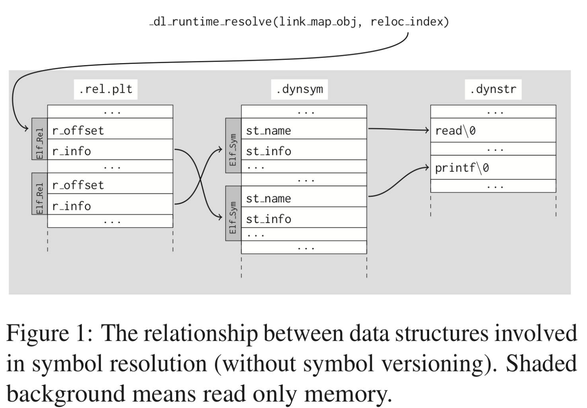

# Symbol Resolution

## 基本原理

リンカはオブジェクトファイルを処理するとき、オブジェクトファイル内のいくつかの位置をリロケーションする必要があります。つまり、シンボルを適切な位置に向けて、プログラムが正常に実行されるようにします。たとえば、プログラムが関数を呼び出すとき、関連する呼び出し命令は、制御フローを適切な実行先アドレスに渡さなければなりません。

ELF ファイルでは、リロケーションが必要な ELF セクションごとに、対応するリロケーションテーブルがあります。たとえば `.text` セクションにリロケーションが必要なら、対応するリロケーションテーブルは通常 `.rel.text` です。

例を挙げると、プログラムがある関数をインポートするとき、.dynstr には対応する関数名の文字列が入り、.dynsym にはその名前を持つシンボル(Elf_Sym)が入り、.rel.plt にはこのシンボルを指すリロケーションテーブルエントリが入ります。つまり、これらの間の参照関係は次のとおりです。



全体として、plt のエントリは主に次の関数呼び出しを行って、対象の関数を解決します。

```c
_dl_runtime_resolve(link_map_obj, reloc_index)
```

## 具体的な動作

### _dl_runtime_resolve

32 ビット版と 64 ビット版では _dl_runtime_resolve 関数が異なります。32 ビット版は次のとおりです。

```assembly
        .text
        .globl _dl_runtime_resolve
        .type _dl_runtime_resolve, @function
        cfi_startproc
        .align 16
_dl_runtime_resolve:
        cfi_adjust_cfa_offset (8)
        _CET_ENDBR
        pushl %eax                # Preserve registers otherwise clobbered.
        cfi_adjust_cfa_offset (4)
        pushl %ecx
        cfi_adjust_cfa_offset (4)
        pushl %edx
        cfi_adjust_cfa_offset (4)
        movl 16(%esp), %edx        # Copy args pushed by PLT in register.  Note
        movl 12(%esp), %eax        # that `fixup' takes its parameters in regs.
        call _dl_fixup                # Call resolver.
        popl %edx                # Get register content back.
        cfi_adjust_cfa_offset (-4)
        movl (%esp), %ecx
        movl %eax, (%esp)        # Store the function address.
        movl 4(%esp), %eax
        ret $12                        # Jump to function address.
        cfi_endproc
        .size _dl_runtime_resolve, .-_dl_runtime_resolve
```

このうち、

- cfi で始まるものはどれもヒント的な情報で、気にしなくてかまいません。次を参照してください。
    - https://stackoverflow.com/questions/51962243/what-is-cfi-adjust-cfa-offset-and-cfi-rel-offset
    - https://sourceware.org/binutils/docs/as/CFI-directives.html
- _CET_ENDBR  は Intel の CET に関係します。`ENDBR32`/`ENDBR64` は、Intel CET-IBT における正当な間接分岐先のマーカーです。間接 `CALL` や `JMP` を実行したあと、プロセッサは、分岐先が対応する ENDBR で始まっていることを期待します。この命令は、CET をサポートしない古いプロセッサでは、互換の NOP として扱われます。

したがって、この部分のコードは次のように簡略化できます。

```assembly
        .text
        .globl _dl_runtime_resolve
        .type _dl_runtime_resolve, @function
        .align 16
_dl_runtime_resolve:
        pushl %eax                # Preserve registers otherwise clobbered.
        pushl %ecx
        pushl %edx
        movl 16(%esp), %edx        # Copy args pushed by PLT in register.  Note
        movl 12(%esp), %eax        # that `fixup' takes its parameters in regs.
        call _dl_fixup                # Call resolver.
        popl %edx                # Get register content back.
        movl (%esp), %ecx
        movl %eax, (%esp)        # Store the function address.
        movl 4(%esp), %eax
        ret $12                        # Jump to function address.
        .size _dl_runtime_resolve, .-_dl_runtime_resolve
```

つまり、`_dl_runtime_resolve` は eax、ecx、edx の 3 つのレジスタを保存したあと、link_map のアドレスを eax に、解決待ちのシンボルのオフセットを edx に入れます。そのあと `_dl_fixup` 関数を実行します。関数の実行が戻ってきたあと、次の順序で実行されます。

- まず edx レジスタの値を復元する
- 次に ecx の値を復元する
- 次に `_dl_fixup` 関数の戻り値を現在のスタックに置く
- 次に eax の値を復元する
- ret $12 を実行する。このときスタックは次のようになっている
    - 解決された関数のアドレス
    - original eax
    - `link_map` 的地址
    - reloc_offset

64 ビット版の _dl_runtime_resolve は 32 ビット版に似ていますが、主な違いがいくつかあります。

- 関数に入った直後に、より多くの情報を保存する
- _dl_fixup は rdi と rsi で引数を渡す
- 最後に対象の関数を実行するときには jmp 命令を使う

```assembly
        .globl _dl_runtime_resolve
        .hidden _dl_runtime_resolve
        .type _dl_runtime_resolve, @function
        .align 16
        cfi_startproc
_dl_runtime_resolve:
        cfi_adjust_cfa_offset(16) # Incorporate PLT
        _CET_ENDBR
# if DL_RUNTIME_RESOLVE_REALIGN_STACK
#  if LOCAL_STORAGE_AREA != 8
#   error LOCAL_STORAGE_AREA must be 8
#  endif
        pushq %rbx                        # push subtracts stack by 8.
        cfi_adjust_cfa_offset(8)
        cfi_rel_offset(%rbx, 0)
        mov %RSP_LP, %RBX_LP
        cfi_def_cfa_register(%rbx)
        and $-STATE_SAVE_ALIGNMENT, %RSP_LP
# endif
# ifdef REGISTER_SAVE_AREA
        sub $REGISTER_SAVE_AREA, %RSP_LP
#  if !DL_RUNTIME_RESOLVE_REALIGN_STACK
        cfi_adjust_cfa_offset(REGISTER_SAVE_AREA)
#  endif
# else
        # Allocate stack space of the required size to save the state.
#  if IS_IN (rtld)
        sub _rtld_local_ro+RTLD_GLOBAL_RO_DL_X86_CPU_FEATURES_OFFSET+XSAVE_STATE_SIZE_OFFSET(%rip), %RSP_LP
#  else
        sub _dl_x86_cpu_features+XSAVE_STATE_SIZE_OFFSET(%rip), %RSP_LP
#  endif
# endif
        # Preserve registers otherwise clobbered.
        movq %rax, REGISTER_SAVE_RAX(%rsp)
        movq %rcx, REGISTER_SAVE_RCX(%rsp)
        movq %rdx, REGISTER_SAVE_RDX(%rsp)
        movq %rsi, REGISTER_SAVE_RSI(%rsp)
        movq %rdi, REGISTER_SAVE_RDI(%rsp)
        movq %r8, REGISTER_SAVE_R8(%rsp)
        movq %r9, REGISTER_SAVE_R9(%rsp)
# ifdef USE_FXSAVE
        fxsave STATE_SAVE_OFFSET(%rsp)
# else
        movl $STATE_SAVE_MASK, %eax
        xorl %edx, %edx
        # Clear the XSAVE Header.
#  ifdef USE_XSAVE
        movq %rdx, (STATE_SAVE_OFFSET + 512)(%rsp)
        movq %rdx, (STATE_SAVE_OFFSET + 512 + 8)(%rsp)
#  endif
        movq %rdx, (STATE_SAVE_OFFSET + 512 + 8 * 2)(%rsp)
        movq %rdx, (STATE_SAVE_OFFSET + 512 + 8 * 3)(%rsp)
        movq %rdx, (STATE_SAVE_OFFSET + 512 + 8 * 4)(%rsp)
        movq %rdx, (STATE_SAVE_OFFSET + 512 + 8 * 5)(%rsp)
        movq %rdx, (STATE_SAVE_OFFSET + 512 + 8 * 6)(%rsp)
        movq %rdx, (STATE_SAVE_OFFSET + 512 + 8 * 7)(%rsp)
#  ifdef USE_XSAVE
        xsave STATE_SAVE_OFFSET(%rsp)
#  else
        xsavec STATE_SAVE_OFFSET(%rsp)
#  endif
# endif
        # Copy args pushed by PLT in register.
        # %rdi: link_map, %rsi: reloc_index
        mov (LOCAL_STORAGE_AREA + 8)(%BASE), %RSI_LP
        mov LOCAL_STORAGE_AREA(%BASE), %RDI_LP
        call _dl_fixup                # Call resolver.
        mov %RAX_LP, %R11_LP        # Save return value
        # Get register content back.
# ifdef USE_FXSAVE
        fxrstor STATE_SAVE_OFFSET(%rsp)
# else
        movl $STATE_SAVE_MASK, %eax
        xorl %edx, %edx
        xrstor STATE_SAVE_OFFSET(%rsp)
# endif
        movq REGISTER_SAVE_R9(%rsp), %r9
        movq REGISTER_SAVE_R8(%rsp), %r8
        movq REGISTER_SAVE_RDI(%rsp), %rdi
        movq REGISTER_SAVE_RSI(%rsp), %rsi
        movq REGISTER_SAVE_RDX(%rsp), %rdx
        movq REGISTER_SAVE_RCX(%rsp), %rcx
        movq REGISTER_SAVE_RAX(%rsp), %rax
# if DL_RUNTIME_RESOLVE_REALIGN_STACK
        mov %RBX_LP, %RSP_LP
        cfi_def_cfa_register(%rsp)
        movq (%rsp), %rbx
        cfi_restore(%rbx)
# endif
        # Adjust stack(PLT did 2 pushes)
        add $(LOCAL_STORAGE_AREA + 16), %RSP_LP
        cfi_adjust_cfa_offset(-(LOCAL_STORAGE_AREA + 16))
        # Preserve bound registers.
        PRESERVE_BND_REGS_PREFIX
        jmp *%r11                # Jump to function address.
        cfi_endproc
        .size _dl_runtime_resolve, .-_dl_runtime_resolve
#endif
```

### _dl_fixup

_dl_runtime_resolve で実行される最も中心的な関数が _dl_fixup で、次のとおりです(関連するマクロもいくつか示します)。なお、64 ビットでは reloc_arg がそのまま reloc_index です。

```c
/* We use this macro to refer to ELF types independent of the native wordsize.
   `ElfW(TYPE)' is used in place of `Elf32_TYPE' or `Elf64_TYPE'.  */
#define ElfW(type) _ElfW(Elf, __ELF_NATIVE_CLASS, type)
#define _ElfW(e, w, t) _ElfW_1(e, w, _##t)
#define _ElfW_1(e, w, t) e##w##t

/* All references to the value of l_info[DT_PLTGOT],
  l_info[DT_STRTAB], l_info[DT_SYMTAB], l_info[DT_RELA],
  l_info[DT_REL], l_info[DT_JMPREL], and l_info[VERSYMIDX (DT_VERSYM)]
  have to be accessed via the D_PTR macro.  The macro is needed since for
  most architectures the entry is already relocated - but for some not
  and we need to relocate at access time.  */
#ifdef DL_RO_DYN_SECTION
#define D_PTR(map, i) ((map)->i->d_un.d_ptr + (map)->l_addr)
#else
#define D_PTR(map, i) (map)->i->d_un.d_ptr
#endif

#if (!ELF_MACHINE_NO_RELA && !defined ELF_MACHINE_PLT_REL) || ELF_MACHINE_NO_REL
#define PLTREL ElfW(Rela)
#else
#define PLTREL ElfW(Rel)
#endif

/* The type of the return value of fixup/profile_fixup.  */
#define DL_FIXUP_VALUE_TYPE ElfW(Addr)
/* Construct a value of type DL_FIXUP_VALUE_TYPE from a code address
   and a link map.  */
#define DL_FIXUP_MAKE_VALUE(map, addr) (addr)
/* Extract the code address from a value of type DL_FIXUP_MAKE_VALUE.
 */
#define DL_FIXUP_VALUE_CODE_ADDR(value) (value)
#define DL_FIXUP_VALUE_ADDR(value) (value)
#define DL_FIXUP_ADDR_VALUE(addr) (addr)

/* Result of the lookup functions and how to retrieve the base address.  */
typedef struct link_map *lookup_t;
#define LOOKUP_VALUE(map) map
#define LOOKUP_VALUE_ADDRESS(map, set) ((set) || (map) ? (map)->l_addr : 0)
/* Calculate the address of symbol REF using the base address from map MAP,
   if non-NULL.  Don't check for NULL map if MAP_SET is TRUE.  */
#define SYMBOL_ADDRESS(map, ref, map_set)                                                                  \
    ((ref) == NULL ? 0                                                                                     \
                   : (__glibc_unlikely((ref)->st_shndx == SHN_ABS) ? 0                                     \
                                                                   : LOOKUP_VALUE_ADDRESS(map, map_set)) + \
                         (ref)->st_value)

#ifndef reloc_offset
#define reloc_offset reloc_arg
#define reloc_index reloc_arg / sizeof(PLTREL)
#endif
/* This function is called through a special trampoline from the PLT the
   first time each PLT entry is called.  We must perform the relocation
   specified in the PLT of the given shared object, and return the resolved
   function address to the trampoline, which will restart the original call
   to that address.  Future calls will bounce directly from the PLT to the
   function.  */
DL_FIXUP_VALUE_TYPE
attribute_hidden __attribute((noinline)) ARCH_FIXUP_ATTRIBUTE
_dl_fixup(
#ifdef ELF_MACHINE_RUNTIME_FIXUP_ARGS
    ELF_MACHINE_RUNTIME_FIXUP_ARGS,
#endif
    struct link_map *l, ElfW(Word) reloc_arg)
{
    // 対象ファイルの動的シンボルテーブルを取得する
    const ElfW(Sym) *const symtab = (const void *)D_PTR(l, l_info[DT_SYMTAB]);
    // 対象ファイルの動的文字列テーブルを取得する
    const char *strtab = (const void *)D_PTR(l, l_info[DT_STRTAB]);
    // 指定されたオフセットから、リロケーション対象のエントリを取得する
    const PLTREL *const reloc = (const void *)(D_PTR(l, l_info[DT_JMPREL]) + reloc_offset);
    // 得られたリロケーションエントリから、解決対象シンボルのシンボル情報を取得する
    const ElfW(Sym) *sym = &symtab[ELFW(R_SYM)(reloc->r_info)];
    const ElfW(Sym) *refsym = sym;
    // rel_addr には最終的に、解決するシンボルのアドレスが格納される
    // つまり *rel_addr = addr_of_symbol_to_be_resolved
    void *const rel_addr = (void *)(l->l_addr + reloc->r_offset);
    lookup_t result;
    DL_FIXUP_VALUE_TYPE value;
    /* Sanity check that we're really looking at a PLT relocation.  */
    // リロケーション対象エントリの型が ELF_MACHINE_JMP_SLOT であることを確認する
    assert(ELFW(R_TYPE)(reloc->r_info) == ELF_MACHINE_JMP_SLOT);
    /* Look up the target symbol.  If the normal lookup rules are not
      used don't look in the global scope.  */
    // シンボルの可視性を判定する
    if (__builtin_expect(ELFW(ST_VISIBILITY)(sym->st_other), 0) == 0)
    {
        // シンボルのバージョン情報を取得する
        const struct r_found_version *version = NULL;
        if (l->l_info[VERSYMIDX(DT_VERSYM)] != NULL)
        {
            const ElfW(Half) *vernum = (const void *)D_PTR(l, l_info[VERSYMIDX(DT_VERSYM)]);
            ElfW(Half) ndx = vernum[ELFW(R_SYM)(reloc->r_info)] & 0x7fff;
            version = &l->l_versions[ndx];
            if (version->hash == 0)
                version = NULL;
        }
        /* We need to keep the scope around so do some locking.  This is
         not necessary for objects which cannot be unloaded or when
         we are not using any threads (yet).  */
        int flags = DL_LOOKUP_ADD_DEPENDENCY;
        if (!RTLD_SINGLE_THREAD_P)
        {
            THREAD_GSCOPE_SET_FLAG();
            flags |= DL_LOOKUP_GSCOPE_LOCK;
        }
#ifdef RTLD_ENABLE_FOREIGN_CALL
        RTLD_ENABLE_FOREIGN_CALL;
#endif
        // 解決対象シンボルがあるオブジェクトファイルの link_map を検索する
        result = _dl_lookup_symbol_x(strtab + sym->st_name, l, &sym, l->l_scope,
                                     version, ELF_RTYPE_CLASS_PLT, flags, NULL);
        /* We are done with the global scope.  */
        if (!RTLD_SINGLE_THREAD_P)
            THREAD_GSCOPE_RESET_FLAG();
#ifdef RTLD_FINALIZE_FOREIGN_CALL
        RTLD_FINALIZE_FOREIGN_CALL;
#endif
        /* Currently result contains the base load address (or link map)
         of the object that defines sym.  Now add in the symbol
         offset.  */
        // 検索で得た link_map から、シンボルの絶対アドレスを計算する: result->l_addr + sym->st_value
        // l_addr は、解決対象の関数があるファイルのベースアドレス
        value = DL_FIXUP_MAKE_VALUE(result,
                                    SYMBOL_ADDRESS(result, sym, false));
    }
    else
    {
        /* We already found the symbol.  The module (and therefore its load
         address) is also known.  */
        value = DL_FIXUP_MAKE_VALUE(l, SYMBOL_ADDRESS(l, sym, true));
        result = l;
    }
    /* And now perhaps the relocation addend.  */
    value = elf_machine_plt_value(l, reloc, value);
    if (sym != NULL && __builtin_expect(ELFW(ST_TYPE)(sym->st_info) == STT_GNU_IFUNC, 0))
        value = elf_ifunc_invoke(DL_FIXUP_VALUE_ADDR(value));
    /* Finally, fix up the plt itself.  */
    // plt テーブルを修正する
    if (__glibc_unlikely(GLRO(dl_bind_not)))
        return value;
    return elf_machine_fixup_plt(l, result, refsym, sym, reloc, rel_addr, value);
}

static inline ElfW(Addr)
elf_machine_fixup_plt (struct link_map *map, lookup_t t,
                       const ElfW(Sym) *refsym, const ElfW(Sym) *sym,
                       const ElfW(Rela) *reloc,
                       ElfW(Addr) *reloc_addr, ElfW(Addr) value)
{
  return *reloc_addr = value;
}
/* Return the final value of a PLT relocation.  On x86-64 the
   JUMP_SLOT relocation ignores the addend.  */
static inline ElfW(Addr)
elf_machine_plt_value (struct link_map *map, const ElfW(Rela) *reloc,
                       ElfW(Addr) value)
{
  return value;
}
```

## 参考資料

- https://code.woboq.org/userspace/glibc/sysdeps/x86_64/dl-trampoline.h.html#60
- https://stackoverflow.com/questions/46374907/what-does-the-f-prefix-of-some-gcc-command-line-options-mean
- https://gcc.gnu.org/onlinedocs/gcc/Invoking-GCC.html