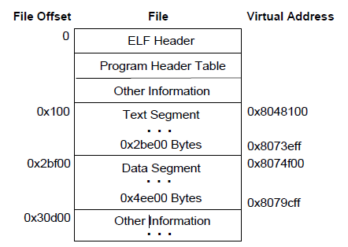
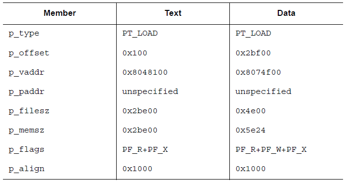
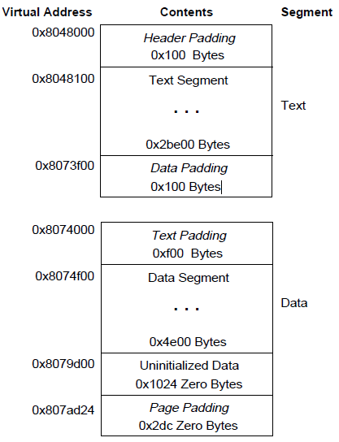
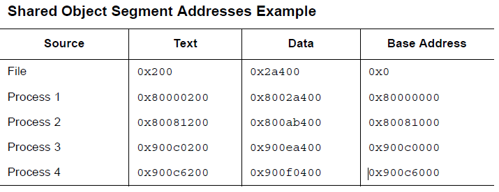

# プログラムのロード

プログラムのロード(program loading)とは、実はシステムがプロセスイメージを作る、または拡張する過程のことです。一定の規則に従って、ファイルのセグメントを仮想メモリのセグメントにコピーするだけです。プロセスは、実行中に対応する論理ページを使ったときにはじめて、対応する物理ページを要求します。一般に、プロセスの中には参照されないページがたくさんあります。そのため、物理的な読み書きを遅らせるとシステムの性能が上がります。この効率を達成するには、実行ファイルと共有オブジェクトファイルが持つセグメントのファイルオフセットと仮想アドレスが適切でなければなりません。つまり、ページサイズの整数倍でなければなりません。

Intel アーキテクチャでは、仮想アドレスとファイルオフセットは 4KB(またはそれより大きい 2 の整数べきの数)の整数倍でなければなりません。

次は、実行ファイルがメモリにロードされたときのレイアウトの例です。

対応するコードセグメントとデータセグメントの説明は次のとおりです。

この例では、コードセグメントとデータセグメントは 4KB を法として等しいものの、不純なコードやデータを含むページが最大で 4 つあります。もちろん、実際にはページサイズやファイルシステムのブロックサイズによって決まります。

- コードセグメントの最初のページには、ELF ヘッダ、プログラムヘッダテーブル、そのほかの情報が入っています。
- コードセグメントの最後のページには、データセグメントの先頭部分のコピーが入っています。
- データセグメントの最後のページには、コードセグメントの最後の部分のコピーが入っています。どれだけ入るかは、まだ説明されていません。
- データセグメントの最後の部分には、プログラムの実行と無関係な情報が入っていることがあります。

論理的には、システムはメモリの権限を強制的に制御します。まるで各セグメントの権限がまったく独立しているかのようにです。セグメントのアドレスは、メモリ内の各論理ページが 1 組の種類の権限だけを持つように調整されます。上に挙げた例では、ファイルのコードセグメントの最後の部分とデータセグメントの先頭部分は、どちらも 2 回マップされます。データセグメントの仮想アドレスとコードセグメントの仮想アドレスにです。

データセグメントの末尾では、初期化されていないデータをきちんと処理する必要があります。一般に、システムはそれらが 0 から始まることを要求します。したがって、ファイルの最後のページに、論理ページに含まれない情報が入っている場合、残りのデータは 0 に初期化されなければなりません。残りの 3 つのページにある不純なデータは、論理的にはプロセスイメージの一部ではなく、システムはそれらを削除してもかまいません。このファイルに対応する仮想メモリイメージは次のとおりです(各ページのサイズが 4KB であると仮定します)。

セグメントをロードするとき、実行ファイルと共有オブジェクトファイルには違いがあります。実行ファイルは通常、絶対コードを含んでいます。プログラムが正しく実行できるように、各セグメントは、実行ファイルの構築に使われた仮想アドレスになければなりません。そのため、システムは p_vaddr をそのまま仮想アドレスとして使います。

一方、共有オブジェクトファイルは通常、位置独立コードを含んでいます。これにより、異なるプロセスで同じセグメントの仮想アドレスが異なることがありますが、プログラムの実行時の挙動には影響しません。システムは、プロセスごとに異なる仮想アドレスを選ぶことがありますが、それでもセグメントの相対アドレスは維持します。位置独立コードは異なるセグメント間で相対アドレスを使うので、仮想メモリ内の仮想アドレスの差は、ファイル内の対応する仮想アドレスの差と必ず同じになります。次の表は、同じ共有オブジェクトファイルに対する異なるプロセスでのありうる状況を示し、相対アドレス指定を説明しています。さらにこの表には、ベースアドレスの計算方法も示されています。

