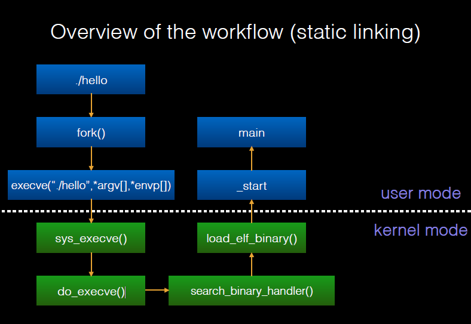
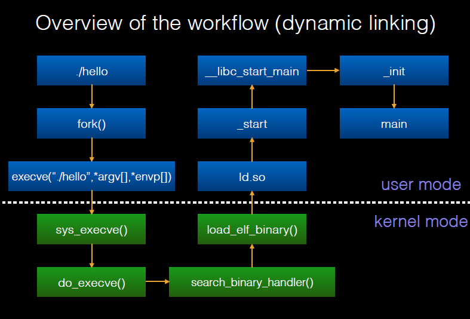
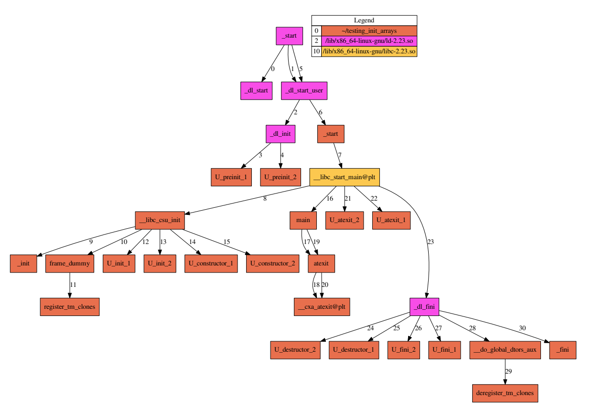
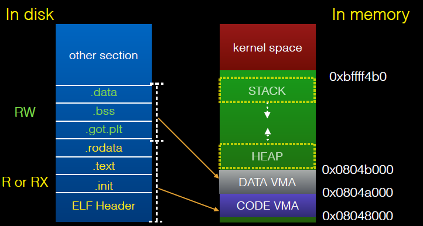

# プログラムの実行の流れ

**参考: Execution Angleboye@Bamboofox。**

## 静的実行

ここでは、プログラムが静的に実行される基本的な流れを示します。

## 動的実行

ここでは、より詳しいもう 1 枚の図を示します。

## 基本的な操作の説明

### sys_execve

この関数は主に新しいプログラムを実行するためのものです。つまり、実行したいプログラムを実行し、対応する argv や envp などの引数を検査します。

### do_execve

この関数は対象のイメージファイルを開き、対象ファイルの先頭から指定された長さ(現在は 128)のバイト列を読み込んで、対象ファイルの基本的な情報を得ます。

### search_binary_handler

この関数は、現在の型を処理できるバイナリファイルの型のキューを検索し、各種の実行ファイルのハンドラに対応する処理をさせます。

### load_elf_binary

この関数の主な処理の流れは次のとおりです。

- elf ファイルのヘッダ情報を検査して取得する。

- 対象ファイルが動的リンクを使っていれば、.interp セクションを使って loader のパスを決める。

- program header に記録された対応するセグメントをメモリにマップする。program header には次の重要な情報があります。

  - 各セグメントのマップ先アドレス
  - 各セグメントの権限
  - どのセクションがどのセグメントに属するかの記録

  具体的なマッピングは次のとおりです。

  

  場合分けして処理する。

  - 動的リンクの場合、sys_execve の戻りアドレスを loader(ld.so)の entry point に変更する。
  - 静的リンクの場合、sys_execve の戻りアドレスをプログラムのエントリポイントに変更する。

### ld.so

このファイルには次の機能があります。

- 主に、ELF ファイルの DT_NEED に記録された共有ライブラリをロードする。
- 初期化処理
  - GOT テーブルを初期化する。
  - symbol table を global symbol table にマージする。

### _start

_start 関数は、次の項目を libc_start_main に渡します。

- 環境変数の先頭アドレス
- .init
  - main 関数を起動する前の初期化処理
- fini
  - プログラム終了前の後始末処理
