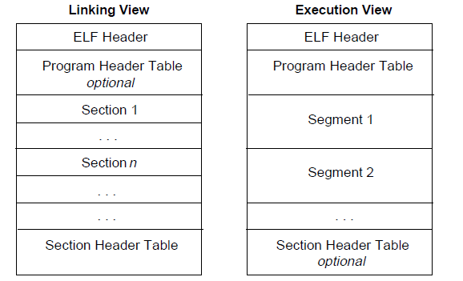
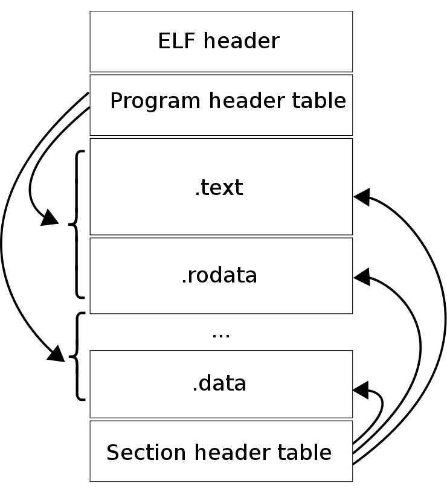
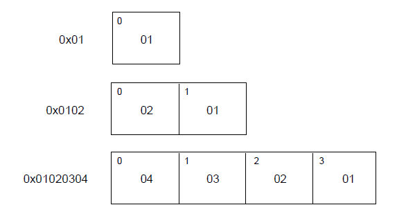
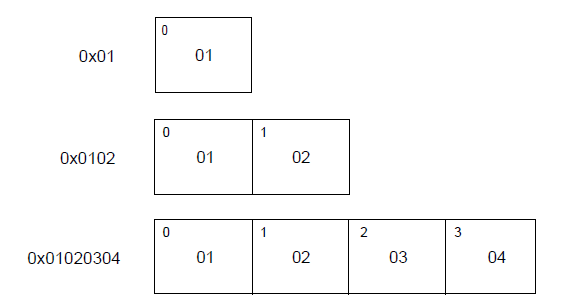
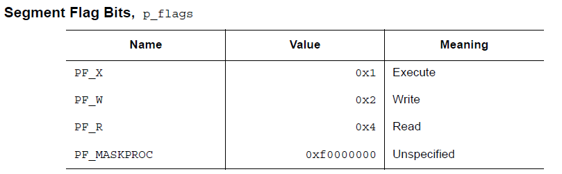
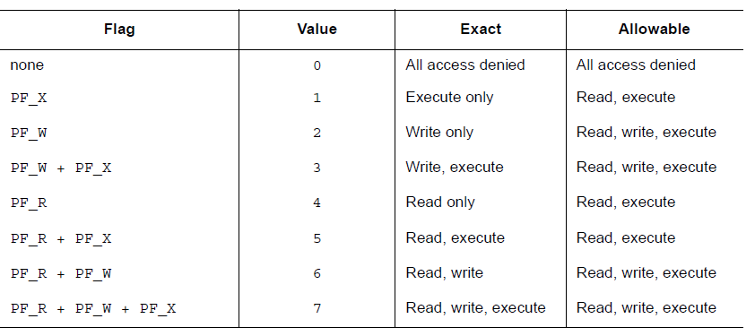
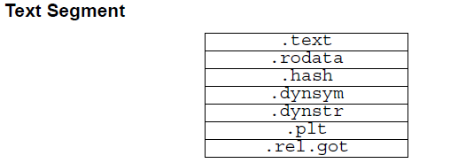
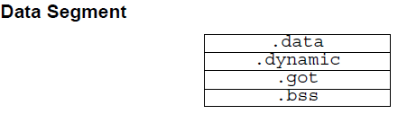
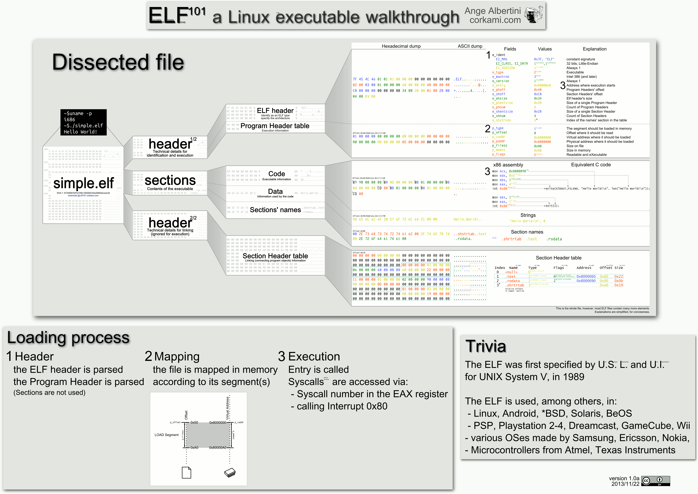

# ELF ファイル

> この部分の内容は ELF 1.2 標準に由来し、一部修正と整理を加えています。主な参考文献は次のとおりです。
>
> 1. ELF 文件格式分析(ELF ファイル形式の分析)、北京大学、滕启明
> 2. ELF-摧毁圣诞(ELF - クリスマスを破壊せよ)

## はじめに

ELF(Executable and Linkable Format)ファイルは、Linux におけるオブジェクトファイルのことで、主に次の 3 種類があります。

- リロケータブルファイル(Relocatable File)。コンパイラが生成したコードとデータを含みます。リンカはこれをほかのオブジェクトファイルとリンクして、実行ファイルや共有オブジェクトファイルを作ります。Linux システムでは、このファイルの拡張子は通常 `.o` です。
- 実行ファイル(Executable File)。Linux で普段実行するプログラムです。


- 共有オブジェクトファイル(Shared Object File)。コードとデータを含みます。このファイルがいわゆるライブラリファイルで、通常は `.so` で終わります。一般に、次の 2 つの使われ方があります。
	- リンカ(Link eDitor、ld)が、これをほかのリロケータブルファイルや共有オブジェクトファイルと一緒に処理して、別のオブジェクトファイルを生成することがあります。
	- 動的リンカ(Dynamic Linker)が、これを実行ファイルやほかの共有オブジェクトと組み合わせて、プロセスイメージを生成します。

> Link eDitor という名前については、https://en.wikipedia.org/wiki/GNU_linker を参照してください。

オブジェクトファイルはアセンブラとリンカによって作られ、テキストのプログラムのバイナリ形式で、プロセッサ上で直接実行できます。仮想マシンがないと実行できないプログラム(Java)は、この範囲に含まれません。

ここでは主に ELF のファイル形式に注目します。

### ファイル形式

オブジェクトファイルは、プログラムのリンクにも実行にも関わります。便宜と効率を考えて、過程の違いに応じて、オブジェクトファイル形式はその内容の 2 つの並行したビューを提供します。次のとおりです。



まず、**リンクビューに注目しましょう**。

ファイルの先頭には ELF ヘッダ(**ELF  Header**)があり、ファイル全体の構成を与えます。

プログラムヘッダテーブル(Program Header Table)がある場合、それはシステムにプロセスの作り方を伝えます。プロセスを生成するためのオブジェクトファイルにはプログラムヘッダテーブルが必要ですが、リロケータブルファイルにはこのテーブルは不要です。

セクション部分には、リンクビューで使う情報の大部分が含まれます。命令、データ、シンボルテーブル、リロケーション情報などです。

セクションヘッダテーブル(Section Header Table)には、ファイルのセクションを記述する情報が含まれます。各セクションにはテーブル内にエントリが 1 つあり、セクション名やセクションの大きさなどの情報を与えます。リンクに使うオブジェクトファイルにはセクションヘッダテーブルが必要ですが、そのほかのオブジェクトファイルでは、あってもなくてもかまいません。

リンクビューをより具体的に示すと次のようになります。



**実行ビュー**での主な違いは、section がなくなり、複数の segment があることです。実は、ここでの segment の多くは、リンクビューの section に由来しています。

注意:

> 図では ELF ヘッダ、プログラムヘッダテーブル、セクション、セクションヘッダテーブルの順に並んでいますが、実際には ELF  ヘッダ以外には、厳密な順序はありません。

### データの形式

ELF ファイル形式は 8 ビット/32 ビットのアーキテクチャをサポートします。もちろん、この形式は拡張可能で、より小さい、またはより大きいビット数のプロセッサアーキテクチャもサポートできます。そのため、オブジェクトファイルにはいくつかの制御データが含まれ、これはオブジェクトファイルが使うアーキテクチャを示します。これにより、汎用的な方法でオブジェクトファイルを識別し、解釈できます。オブジェクトファイル内のそのほかのデータは、対象プロセッサの形式でエンコードされ、どのマシンで作られたかとは関係ありません。ここで言いたいのは、オブジェクトファイルはクロスコンパイルできるということでしょう。x86 プラットフォームで、arm プラットフォームの実行コードを生成できます。

オブジェクトファイル内のすべてのデータ構造は、「自然な」サイズとアライメントの規則に従います。次のとおりです。

| 名前            |  長さ  | アライメント |   用途    |
| :------------ | :--: | :--: | :-----: |
| Elf32_Addr    |  4   |  4   | 符号なしプログラムアドレス |
| Elf32_Half    |  2   |  2   | 符号なし半整数  |
| Elf32_Off     |  4   |  4   | 符号なしファイルオフセット |
| Elf32_Sword   |  4   |  4   | 符号付き大整数  |
| Elf32_Word    |  4   |  4   | 符号なし大整数  |
| unsigned char |  1   |  1   | 符号なし小整数  |

必要であれば、データ構造は明示的なパディングを含めて、4 バイトのオブジェクトが 4 バイト境界にそろうようにしたり、データ構造のサイズを 4 の整数倍に強制したりできます。データもアライメントされています。したがって、Elf32_Addr 型のメンバを含む構造体は、ファイル内で 4 バイト境界にそろいます。

移植性のため、ELF ファイルはビットフィールドを使いません。

### 文字の表現

未記入です。

**注: 以下の説明では、主に 32 ビットを例にします。**

## ELF Header

ELF Header は ELF ファイルの概要情報を記述します。このデータ構造を使えば、ELF ファイルのすべての情報を引くことができます。データ構造は次のとおりです。

```c
#define EI_NIDENT	16

typedef struct {
	unsigned char	e_ident[EI_NIDENT];
	ELF32_Half		e_type;
	ELF32_Half		e_machine;
	ELF32_Word		e_version;
	ELF32_Addr		e_entry;
	ELF32_Off		e_phoff;
	ELF32_Off		e_shoff;
	ELF32_Word		e_flags;
	ELF32_Half		e_ehsize;
	ELF32_Half		e_phentsize;
	ELF32_Half		e_phnum;
	ELF32_Half		e_shentsize;
	ELF32_Half		e_shnum;
	ELF32_Half		e_shstrndx;
} Elf32_Ehdr;
```

どのメンバも e で始まっていますが、これはおそらく ELF の略でしょう。各メンバの具体的な説明は次のとおりです。

### e_ident

先に述べたとおり、ELF はオブジェクトファイルのフレームワークを提供し、複数のプロセッサ、複数のエンコード形式のマシンをサポートできるようにしています。この変数は、ファイル内のマシンに依存しないデータをデコードし解釈する方法を与えます。この配列の添字ごとの意味は次のとおりです。

| マクロ名   | 添字 | 目的           |
| ---------- | ---- | -------------- |
| EI_MAG0    | 0    | ファイル識別   |
| EI_MAG1    | 1    | ファイル識別   |
| EI_MAG2    | 2    | ファイル識別   |
| EI_MAG3    | 3    | ファイル識別   |
| EI_CLASS   | 4    | ファイルクラス |
| EI_DATA    | 5    | データエンコーディング |
| EI_VERSION | 6    | ファイルバージョン |
| EI_PAD     | 7    | パディングバイトの開始位置 |

このうち、

`e_ident[EI_MAG0]` から `e_ident[EI_MAG3]`、つまりファイルの先頭 4 バイトは「マジックナンバー」と呼ばれ、このファイルが ELF オブジェクトファイルであることを示します。**先頭がなぜ 0x7f なのかは、詳しく調べていません**。

| 名前    | 値   | 位置             |
| ------- | ---- | ---------------- |
| ELFMAG0 | 0x7f | e_ident[EI_MAG0] |
| ELFMAG1 | ‘E’  | e_ident[EI_MAG1] |
| ELFMAG2 | ‘L’  | e_ident[EI_MAG2] |
| ELFMAG3 | ‘F’  | e_ident[EI_MAG3] |

`e_ident[EI_CLASS]` は `e_ident[EI_MAG3]` の次のバイトで、ファイルの種類または容量を示します。

| 名前         | 値   | 意味         |
| ------------ | ---- | ------------ |
| ELFCLASSNONE | 0    | 無効なクラス |
| ELFCLASS32   | 1    | 32 ビットファイル |
| ELFCLASS64   | 2    | 64 ビットファイル |

ELF ファイルは、マシンの最長バイト長と最短バイト長を強制的に決めなくても、さまざまなバイト長のマシンの間で移植できるように設計されています。`ELFCLASS32` クラスは、ファイルの大きさと仮想アドレス空間の上限が 4GB のマシンをサポートします。これは上で定義した基本型を使います。

`ELFCLASS64` クラスは 64 ビットアーキテクチャ用です。

`e_ident[EI_DATA]` バイトは、オブジェクトファイル内のプロセッサ固有のデータのエンコード方式を与えます。現在定義されているエンコードは次のとおりです。

| 名前        | 値   | 意味               |
| ----------- | ---- | ------------------ |
| ELFDATANONE | 0    | 無効なデータエンコーディング |
| ELFDATA2LSB | 1    | リトルエンディアン |
| ELFDATA2MSB | 2    | ビッグエンディアン |

そのほかの値は予約されており、将来必要になったときに新しいエンコーディングが割り当てられます。

ファイルのデータエンコーディングは、ファイルの内容の解釈方法を示します。先に述べたとおり、`ELFCLASS32` クラスのファイルは、1、2、4 バイトの変数型を使います。定義されている各エンコーディングでの表現は次のとおりです。バイト番号は左上に書かれています。

`ELFDATA2LSB` エンコーディングは 2 の補数を使い、最下位バイト(Least Significant Byte)が最も低いアドレスを占めます。



`ELFDATA2MSB` エンコーディングは 2 の補数を使い、最上位バイト(Most Significant Byte)が最も低いアドレスを占めます。



`e_ident[EI_DATA]` は ELF ヘッダのバージョン番号を与えます(原文のまま)。現在この値は `EV_CURRENT` でなければなりません。これは先に示した `e_version` と同じです。

`e_ident[EI_PAD]` は、`e_ident` の未使用バイトの開始アドレスを与えます。これらのバイトは予約されていて 0 に設定されます。オブジェクトファイルを処理するプログラムは、これらを無視するべきです。のちにこれらのバイトが使われるようになれば、EI_PAD の値が変わります。

### e_type

`e_type` はオブジェクトファイルの種類を示します。

| 名前      | 値     | 意味                         |
| --------- | ------ | ---------------------------- |
| ET_NONE   | 0      | ファイル種別なし             |
| ET_REL    | 1      | リロケータブルファイル       |
| ET_EXEC   | 2      | 実行ファイル                 |
| ET_DYN    | 3      | 共有オブジェクトファイル     |
| ET_CORE   | 4      | コアダンプファイル           |
| ET_LOPROC | 0xff00 | プロセッサ固有の下限         |
| ET_HIPROC | 0xffff | プロセッサ固有の上限         |

コアダンプファイルの内容は詳しく規定されていませんが、`ET_CORE` はこの種のファイルを示すために予約されています。`ET_LOPROC` から `ET_HIPROC`(境界を含む)は、プロセッサ固有の用途のために予約されています。そのほかの値は、将来必要になったときに新しいオブジェクトファイルの種類に割り当てられることがあります。

### e_machine

この項目は、このファイルが動作できるマシンアーキテクチャを指定します。

| 名前     | 値   | 意味           |
| -------- | ---- | -------------- |
| EM_NONE  | 0    | マシン種別なし |
| EM_M32   | 1    | AT&T WE 32100  |
| EM_SPARC | 2    | SPARC          |
| EM_386   | 3    | Intel 80386    |
| EM_68K   | 4    | Motorola 68000 |
| EM_88K   | 5    | Motorola 88000 |
| EM_860   | 7    | Intel 80860    |
| EM_MIPS  | 8    | MIPS RS3000    |

ここで EM は `ELF Machine` の略でしょう。

そのほかの値は、将来必要になったときに新しいマシンに使われます。また、プロセッサ固有の ELF の名前は、マシン名で区別されます。一般にフラグには `EF_`(ELF Flag)という接頭辞が付きます。たとえば、`EM_XYZ` マシン上の `WIDGET` という名前のフラグは `EF_XYZ_WIDGET` と呼ばれます。

### e_version

オブジェクトファイルのバージョンを示します。

| 名前       | 値   | 意味         |
| ---------- | ---- | ------------ |
| EV_NONE    | 0    | 無効なバージョン |
| EV_CURRENT | 1    | 現在のバージョン |

1 は最初のファイル形式を表します。将来、新しいバージョン(extensions)を拡張するときには、より大きな数が使われます。上の値では `EV_CURRENT` は 1 ですが、現在のバージョン番号を反映するために変わることがあります。**たとえば ELF は現在 1.2 版です。**

### e_entry

この項目は、システムが ELF 内の対応するコードに制御を渡す仮想アドレスです。関連するエントリがなければ、この項目は 0 です。

### e_phoff

この項目は、**プログラムヘッダテーブル**のファイル内でのバイトオフセット(**Program Header table OFFset**)を与えます。ファイルにプログラムヘッダテーブルがなければ、0 です。

### e_shoff

この項目は、**セクションヘッダテーブル**のファイル内でのバイトオフセット(**Section Header table OFFset**)を与えます。ファイルにセクションヘッダテーブルがなければ、0 です。

### e_flags

この項目は、ファイル内のプロセッサ固有のフラグを与えます。これらのフラグの名前の形式は `EF_machine_flag` です。

### e_ehsize

この項目は、ELF ファイルのヘッダのバイト長(ELF Header Size)を与えます。

### e_phentsize

この項目は、プログラムヘッダテーブルの各エントリのバイト長(**Program Header ENTry SIZE**)を与えます。各エントリの大きさは同じです。

### e_phnum

この項目は、プログラムヘッダテーブルのエントリ数(**Program Header entry NUMber**)を与えます。したがって、`e_phnum` と `e_phentsize` の積がプログラムヘッダテーブルのバイト長になります。ファイルにプログラムヘッダテーブルがなければ、この項目の値は 0 です。

### e_shentsize

この項目は、セクションヘッダのバイト長(**Section Header ENTry SIZE**)を与えます。セクションヘッダはセクションヘッダテーブルの 1 つのエントリです。セクションヘッダテーブルのすべてのエントリが占める大きさは同じです。

### e_shnum

この項目は、セクションヘッダテーブルのエントリ数(**Section Header NUMber**)を与えます。したがって、 `e_shnum` と `e_shentsize` の積がセクションヘッダテーブルのバイト長になります。ファイルにセクションヘッダテーブルがなければ、この項目の値は 0 です。

### e_shstrndx

この項目は、セクションヘッダテーブルのうち、セクション名の文字列テーブルに関係するエントリのインデックス値(**Section Header table InDeX related with section  name STRing table**)を与えます。ファイルにセクション名の文字列テーブルがなければ、この項目の値は `SHN_UNDEF` です。詳細は、後の「セクション」と「文字列テーブル」の部分を参照してください。

## Program Header Table

### 概要

Program Header Table は構造体の配列で、各要素の型は `Elf32_Phdr` です。これは、セグメント、またはプログラムの実行を準備するときにシステムが必要とするそのほかの情報を記述します。このうち、ELF ヘッダの `e_phentsize` と `e_phnum` が、この配列の各要素の大きさと要素数を指定します。オブジェクトファイルのセグメントは 1 つ以上のセクションを含みます。**プログラムヘッダは、実行ファイルと共有オブジェクトファイルでのみ意味を持ちます。**

Program Header Table は、ELF ファイルの実行時のセグメントのために用意されたものだと言えます。

`Elf32_Phdr` のデータ構造は次のとおりです。

```c++
typedef struct {
	ELF32_Word	p_type;
	ELF32_Off	p_offset;
	ELF32_Addr	p_vaddr;
	ELF32_Addr	p_paddr;
	ELF32_Word	p_filesz;
	ELF32_Word	p_memsz;
	ELF32_Word	p_flags;
	ELF32_Word	p_align;
} Elf32_Phdr;
```

各フィールドの説明は次のとおりです。

| フィールド | 説明                                                         |
| -------- | ------------------------------------------------------------ |
| p_type   | このフィールドはセグメントの種類、またはこの構造に関する情報を示します。 |
| p_offset | このフィールドは、ファイルの先頭からこのセグメントの最初のバイトまでのオフセットを与えます。 |
| p_vaddr  | このフィールドは、このセグメントの最初のバイトのメモリ上の仮想アドレスを与えます。 |
| p_paddr  | このフィールドは物理アドレスによるアドレス指定に関係するシステムでのみ使われます。「System V」はアプリケーションの物理アドレス指定を無視するため、実行ファイルと共有オブジェクトファイルでのこの項目の内容は限定されていません。 |
| p_filesz | このフィールドは、ファイルイメージ内でのこのセグメントの大きさを与えます。0 のこともあります。 |
| p_memsz  | このフィールドは、メモリイメージ内でのこのセグメントの大きさを与えます。0 のこともあります。 |
| p_flags  | このフィールドは、セグメントに関連するフラグを与えます。   |
| p_align  | ロード可能なプログラムのセグメントの p_vaddr と p_offset の大きさは、page の整数倍でなければなりません。このメンバは、セグメントのファイルとメモリでのアライメント方法を与えます。この値が 0 または 1 なら、アライメントは不要です。それ以外の場合、p_align は 2 の整数べきであるべきで、p_vaddr と p_offset は p_align を法として等しくあるべきです。 |

### セグメントの種類

実行ファイルのセグメントの種類は次のとおりです。

| 名前                | 値                      | 説明                                                         |
| ------------------- | ----------------------- | ------------------------------------------------------------ |
| PT_NULL             | 0                       | セグメントが未使用であることを示します。その構造のほかのメンバはすべて未定義です。 |
| PT_LOAD             | 1                       | この型のセグメントはロード可能なセグメントで、大きさは p_filesz と p_memsz  で記述されます。ファイル内のバイトは、対応するメモリセグメントの先頭にマップされます。p_memsz  が  p_filesz より大きい場合、「余った」バイトはすべて 0 に設定されます。p_filesz は p_memsz より大きくてはいけません。ロード可能なセグメントは、プログラムヘッダ内で p_vaddr の昇順に並びます。 |
| PT_DYNAMIC          | 2                       | この型のセグメントは動的リンクの情報を与えます。             |
| PT_INTERP           | 3                       | この型のセグメントは、NULL  終端の文字列の位置と長さを与えます。この文字列はインタプリタとして呼び出されます。このセグメント型は実行ファイルでのみ意味を持ちます(共有オブジェクトファイルに現れることもあります)。また、このセグメントは 1 つのファイルに多くても 1 回しか現れません。さらに、この型のセグメントがある場合、それはすべてのロード可能なセグメントのエントリより前になければなりません。 |
| PT_NOTE             | 4                       | この型のセグメントは、補助的な情報の位置と大きさを与えます。 |
| PT_SHLIB            | 5                       | このセグメント型は予約されていますが、意味は指定されていません。また、この型のセグメントを含むプログラムは ABI 標準に適合しません。 |
| PT_PHDR             | 6                       | この型の配列要素が存在する場合、プログラムヘッダテーブル自身の大きさと位置を与えます。ファイル内とメモリ内の両方の情報を含みます。この型のセグメントはファイルに多くても 1 回しか現れません。**また、プログラムヘッダテーブルがプログラムのメモリイメージの一部であるときにだけ現れます**。この型のセグメントがある場合、すべてのロード可能なセグメントのエントリより前になければなりません。 |
| PT_LOPROC~PT_HIPROC | 0x70000000  ~0x7fffffff | この範囲の型は、プロセッサ固有の意味のために予約されています。 |

### ベースアドレス - Base Address

プログラムヘッダの仮想アドレスは、プログラムのメモリイメージ内の実際の仮想アドレスとは限りません。一般に、実行プログラムには絶対アドレスのコードが含まれます。プログラムが正常に実行できるように、セグメントは対応する仮想アドレスになければなりません。一方、共有オブジェクトファイルは通常、アドレスに依存しないコードを含みます。これにより、共有オブジェクトファイルを複数のプロセスにロードしつつ、プログラムの実行の正しさを保てます。システムはプロセスごとに異なる仮想アドレスを選ぶことがありますが、それでもセグメントの相対アドレスは保たれます。**アドレス非依存のコードはセグメント間の相対アドレスでアドレス指定を行うので、メモリ内の仮想アドレス間の差は、ファイル内の仮想アドレス間の差と一致しなければならないからです**。メモリ内の任意のセグメントの仮想アドレスと、ファイル内の対応する仮想アドレスとの差は、1 つの実行ファイルまたは共有オブジェクトについて、単一の定数になります。この差がベースアドレスで、ベースアドレスの用途の 1 つは、動的リンクの間にプログラムをリロケーションすることです。

実行ファイルまたは共有オブジェクトファイルのベースアドレスは、実行中に次の 3 つの数値から計算されます。

- 仮想メモリのロードアドレス
- 最大ページサイズ
- プログラムのロード可能なセグメントの最も低い仮想アドレス

ベースアドレスを計算するには、まずロード可能なセグメントのうち p_vaddr が最小のメモリ仮想アドレスを求め、そのメモリ仮想アドレスを、それに最も近い、最大ページの整数倍に切り下げたものがベースアドレスです。メモリにロードするファイルの種類によって、メモリアドレスは p_vaddr と同じこともあれば、異なることもあります。

### セグメントの権限 - p_flags

システムによってメモリにロードされるプログラムには、少なくとも 1 つのロード可能なセグメントがあります。システムがロード可能なセグメントのメモリイメージを作るとき、p_flags に従ってセグメントに対応する権限を設定します。セグメントの権限ビットには次のものがあります。



このうち、PF_MASKPROC に含まれるビットはすべて、プロセッサに関係する意味情報のために予約されています。

権限ビットが 0 に設定されている場合、その種類のセグメントにはアクセスできません。実際のメモリ権限は対応するメモリ管理ユニットによって決まり、システムによって動作が異なることがあります。権限の組み合わせはどれも可能ですが、システムは一般に、要求されたより多くの権限を与えます。いかなる場合も、明示されていない限り、セグメントに書き込み権限はありません。可能な組み合わせをすべて次に示します。



たとえば、一般に .text セグメントは読み取りと実行の権限を持ちますが、書き込み権限は持ちません。データセグメントは一般に書き込み、読み取り、実行の権限を持ちます。

### セグメントの内容

セグメントには 1 つ以上のセクションが含まれることがありますが、これはプログラムのロードには影響しません。とはいえ、プログラムが実行でき、動的リンクなどができるように、さまざまなデータが必要です。以下に、一般的なセグメントの内容を示します。セグメントによって、セクションの順序や含まれるセクションの数は異なります。また、プロセッサに関係する制約によって、対応するセグメントの構造が変わることもあります。

次に示すとおり、コードセグメントには読み取り専用の命令とデータだけが含まれます。もちろん、この例ですべての可能なセグメントを示しているわけではありません。



データセグメントは書き込み可能なデータと命令を含み、通常は次の内容を含みます。



プログラムヘッダの PT_DYNAMIC 型の要素は .dynamic セクションを指します。このうち、got テーブルと plt テーブルには、アドレスに依存しないコードに関する情報が含まれます。ここで示した例では plt セクションがコードセグメントに現れますが、プロセッサによっては変わることがあります。

.bss セクションの型は SHT_NOBITS で、これは ELF ファイル内では領域を占めないものの、実行ファイルのメモリイメージの領域は占めることを示します。通常、初期化されていないデータはセグメントの末尾にあります。そのため、`p_memsz` が `p_filesz` より大きくなります。

注意:

-   異なるセグメントが重なることがあります。つまり、異なるセグメントが同じセクションを含むことがあります。

## Section Header Table

実は、このデータ構造は ELF ファイルの末尾にあります(**なぜファイルの末尾に置くのでしょうか。**)。ただし説明の便宜上、ここでこのテーブルを説明します。

この構造は、ELF ファイル内の各セクションの具体的な位置を特定するために使われます。

まず、ELF ヘッダの `e_shoff` 項目が、ファイルの先頭からセクションヘッダテーブルの位置までのバイトオフセットを与えます。`e_shnum` は、セクションヘッダテーブルに含まれるエントリ数を示し、`e_shentsize` は各エントリのバイトサイズを与えます。

次に、セクションヘッダテーブルは配列で、各要素の型は `ELF32_Shdr` です。各要素が、1 つのセクションの概要を記述します。

### ELF32_Shdr

各セクションヘッダは、次のデータ構造で記述できます。

```c
typedef struct {
	ELF32_Word		sh_name;
	ELF32_Word		sh_type;
	ELF32_Word		sh_flags;
	ELF32_Addr		sh_addr;
	ELF32_Off		sh_offset;
	ELF32_Word		sh_size;
	ELF32_Word		sh_link;
	ELF32_Word		sh_info;
	ELF32_Word		sh_addralign;
	ELF32_Word		sh_entsize;
} Elf32_Shdr;
```

各フィールドの意味は次のとおりです。

| メンバ       | 説明                                                         |
| :----------- | ------------------------------------------------------------ |
| sh_name      | セクション名。セクションヘッダ文字列テーブルセクション(Section Header String Table Section)内のインデックスなので、このフィールドは実際には数値です。文字列テーブル内の具体的な内容は、NULL 終端の文字列です。 |
| sh_type      | セクションの内容と意味に基づく分類です。具体的な型は後で説明します。 |
| sh_flags     | 各ビットが異なるフラグを表し、セクションが書き込み可能か、実行可能か、メモリの割り当てが必要かなどの属性を記述します。 |
| sh_addr      | セクションがプロセスのメモリイメージに現れる場合、このメンバは、セクションの最初のバイトがプロセスイメージ内にあるべき位置を与えます。そうでなければ、このフィールドは 0 です。 |
| sh_offset    | セクションの最初のバイトとファイルの先頭との間のオフセットを与えます。SHT_NOBITS 型のセクションはファイル内の領域を占めないため、その sh_offset メンバが与えるのは概念上のオフセットです。 |
| sh_size      | このメンバはセクションのバイトサイズを与えます。セクションの型が SHT_NOBITS でない限り、このセクションはファイル内の sh_size  バイトを占めます。型が SHT_NOBITS のセクションの長さは 0 でないことがありますが、ファイル内の領域は占めません。 |
| sh_link      | このメンバは、セクションヘッダテーブルのインデックスのリンクを与えます。具体的な解釈はセクションの型によります。 |
| sh_info      | このメンバは追加情報を与えます。その解釈はセクションの型によります。 |
| sh_addralign | 一部のセクションは、アドレスのアライメントが必要です。たとえば、セクションに doubleword 型の変数があるなら、システムはセクション全体がダブルワード境界にそろうことを保証しなければなりません。つまり、$sh\_addr \% sh\_addralign$=0 です。現在は 0 と 2 の正の整数べきだけが許されます。 0 と 1 は、アライメント制約がないことを表します。 |
| sh_entsize   | 一部のセクションには、シンボルテーブルのように、固定サイズのエントリを持つテーブルがあります。この種のセクションでは、このメンバが各エントリのバイトサイズを与えます。そうでなければ、このメンバの値は 0 です。 |

 先に述べたとおり、インデックスが 0(SHN_UNDEF)のセクションヘッダも存在します。このインデックスは、未定義のセクション参照を示します。この項目の情報は次のとおりです。

| フィールド名     | 値        | 説明     |
| ------------ | --------- | ----- |
| sh_name      | 0         | 名前なし   |
| sh_type      | SHT_NULL  | 制限    |
| sh_flags     | 0         | フラグなし   |
| sh_addr      | 0         | アドレスなし   |
| sh_offset    | 0         | ファイルオフセットなし |
| sh_size      | 0         | 大きさなし   |
| sh_link      | SHN_UNDEF | リンク情報なし |
| sh_info      | 0         | 補助情報なし |
| sh_addralign | 0         | アライメント要件なし |
| sh_entsize   | 0         | エントリなし   |

### 特別な添字

セクションヘッダテーブルで特殊な添字は次のとおりです。

| 名前          | 値     | 意味                                     |
| ------------- | ------ | ---------------------------------------- |
| SHN_UNDEF     | 0      | 未定義の、失われた、無関係な、またはそのほか意味のないセクション参照を示します。たとえば、セクション番号 SHN_UNDEF に関係する「定義された」シンボルは、未定義シンボルです。**注: 0 番のインデックスは未定義値のために予約されていますが、セクションヘッダテーブルにはインデックス 0 のエントリが含まれます。つまり、ELF ヘッダの e_shnum が 6 なら、インデックスは 0~5 になるはずです。より詳しい内容は後で説明します。** |
| SHN_LORESERVE | 0xff00 | 予約されたインデックス値の範囲の下限。                   |
| SHN_LOPROC    | 0xff00 | プロセッサ固有の下限                                     |
| SHN_HIPROC    | 0xff1f | プロセッサ固有の上限                                     |
| SHN_ABS       | 0xfff1 | 関連する参照の絶対値。たとえば、セクション番号 SHN_ABS に関係するシンボルは絶対値を持ち、リロケーションの影響を受けません |
| SHN_COMMON    | 0xfff2 | このセクションに関して定義されたシンボルは共通シンボルです。たとえば FORTRAN の COMMON や、C 言語の未割り当ての外部変数です。 |
| SHN_HIRESERVE | 0xffff | 予約されたインデックス値の範囲の上限。                   |

**システムは、`SHN_LORESERVE` から `SHN_HIRESERVE` の間(境界を含む)のインデックス値を予約しており、これらの値はセクションヘッダテーブルでは参照されません。つまり、セクションヘッダテーブルには予約されたインデックスのエントリは含まれません。あまり理解できていません。**

### セクションヘッダの一部のフィールド

#### sh_type

セクションの型には、現在次の選択肢があります。SHT は **Section Header Table** の略です。

| 名前         | 値         | 説明                                     |
| ------------ | ---------- | ---------------------------------------- |
| SHT_NULL     | 0          | この型のセクションは非アクティブで、この型のセクションヘッダのほかのメンバの値には意味がありません。 |
| SHT_PROGBITS | 1          | この型のセクションはプログラムが定義する情報を含み、その形式と意味はプログラムが決めます。 |
| SHT_SYMTAB   | 2          | この型のセクションはシンボルテーブル(**SYMbol TABle**)を含みます。現在、オブジェクトファイルは各種類のセクションを 1 つしか含められませんが、この制限は将来変わるかもしれません。  一般に、SHT_SYMTAB セクションは、(ld  を指して)リンク編集のためのシンボルを提供しますが、動的リンクの実現にも使えます。 |
| SHT_STRTAB   | 3          | この型のセクションは文字列テーブル( **STRing TABle** )を含みます。 |
| SHT_RELA     | 4          | この型のセクションは、加数(addend)を明示するリロケーションエントリ( **RELocation entry with Addends** )を含みます。たとえば 32 ビットオブジェクトファイルの Elf32_Rela 型です。また、オブジェクトファイルは複数のリロケーションセクションを持てます。 |
| SHT_HASH     | 5          | この型のセクションはシンボルのハッシュテーブル( **HASH table** )を含みます。 |
| SHT_DYNAMIC  | 6          | この型のセクションは動的リンクの情報( **DYNAMIC linking** )を含みます。 |
| SHT_NOTE     | 7          | この型のセクションは、何らかの方法でファイルに印を付ける情報(**NOTE**)を含みます。 |
| SHT_NOBITS   | 8          | この型のセクションはファイル内の領域を占めず、ほかの点では SHT_PROGBITS に似ています。この型のセクションはバイトを含みませんが、対応するセクションヘッダのメンバ sh_offset には、概念上のファイルオフセットが入っています。 |
| SHT_REL      | 9          | この型のセクションは、加数を持たないリロケーションエントリ(**RELocation entry without Addends**)を含みますが、ビット数は指定されていません。たとえば 32 ビットオブジェクトファイルの Elf32_rel 型です。オブジェクトファイルは複数のリロケーションセクションを持てます。 |
| SHT_SHLIB    | 10         | この型のセクションは予約されていますが、その意味はまだ定義されていません。 |
| SHT_DYNSYM   | 11         | 完全なシンボルテーブルとして、動的リンクには不要なシンボルが多く含まれることがあります。そのため、オブジェクトファイルは SHT_DYNSYM  セクションを含むこともでき、そこには領域を節約するために動的リンクのシンボルの最小限の集合が保存されます。 |
| SHT_LOPROC   | 0X70000000 | この値は、プロセッサ固有の意味のために予約された範囲の下限( **LOw PROCessor-specific semantics** )を指定します。 |
| SHT_HIPROC   | OX7FFFFFFF | この値は、プロセッサ固有の意味のために予約された範囲の上限( **HIgh PROCessor-specific semantics** )を指定します。 |
| SHT_LOUSER   | 0X80000000 | この値は、アプリケーションのために予約されたインデックスの下限を指定します。 |
| SHT_HIUSER   | 0X8FFFFFFF | この値は、アプリケーションのために予約されたインデックスの上限を指定します。 |

#### sh_flags

セクションヘッダの `sh_flags`  フィールドの各ビットは、対応するフラグ情報を与え、対応するセクションの内容が変更できるか、実行できるかなどの情報を定義します。フラグが設定されていれば、そのビットの値は 1 で、未定義のビットはすべて 0 です。現在定義されている値は次のとおりで、そのほかの値は予約されています。

| 名前          | 値         | 説明                                     |
| ------------- | ---------- | ---------------------------------------- |
| SHF_WRITE     | 0x1        | このセクションは、プロセスの実行中に書き込める可能性のあるデータを含みます。 |
| SHF_ALLOC     | 0x2        | このセクションは、プロセスの実行時にメモリを占めます。オブジェクトファイルのメモリイメージの領域を占めない一部の制御用セクションでは、この属性はオフ(off)です。 |
| SHF_EXECINSTR | 0x4        | このセクションは実行可能な機械語命令(**EXECutable INSTRuction**)を含みます。 |
| SHF_MASKPROC  | 0xf0000000 | このマスクに含まれるビットはすべて、特定のプロセッサの意味のために使われます。 |

#### sh_link & sh_info

セクションの型が異なると、sh_link と sh_info の意味も異なります。

| sh_type               | sh_link                                                      | sh_info                    |
| --------------------- | ------------------------------------------------------------ | -------------------------- |
| SHT_DYNAMIC           | セクション内で使う文字列テーブルのセクションヘッダインデックス | 0                          |
| SHT_HASH              | このハッシュテーブルが使うシンボルテーブルのセクションヘッダインデックス | 0                          |
| SHT_REL/SHT_RELA      | シンボルテーブルに関係するセクションヘッダインデックス       | リロケーションが適用されるセクションのセクションヘッダインデックス |
| SHT_SYMTAB/SHT_DYNSYM | OS 固有の情報。Linux の ELF ファイルでは、この項目は、シンボルテーブル内のシンボルに対応する文字列セクションの Section Header Table 内でのオフセットを指します。 | OS 固有の情報              |
| other                 | `SHN_UNDEF`                                                  | 0                          |

## 例

ここでは、elf ファイルのかなり典型的な例を示します。



**時間があるときに、具体的なプログラムと組み合わせて、よりよい例を示します。**

## 参考文献

-   https://blogs.oracle.com/ali/gnu-hash-elf-sections
-   https://bbs.pediy.com/thread-204642.htm
