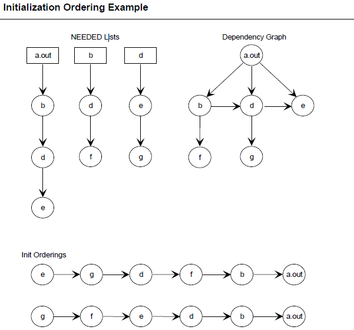

# Code Section

## 概要

動的リンカがプロセスイメージを作り、リロケーションを実行したあと、各共有オブジェクトファイルには、初期化用のコードを実行する機会があります。すべての共有オブジェクトファイルは、実行ファイルが実行権限を得る前に初期化されます。

オブジェクトファイル A の初期化コードを呼び出す前に、まず A が依存するすべての共有オブジェクトファイルの初期化コードが呼び出されます。たとえば、オブジェクトファイル A が別のオブジェクトファイル B に依存する場合、B は A の依存リストに入ります。これは動的構造体の DT_NEEDED に記録されます。循環依存の初期化は未定義です。

オブジェクトファイルの初期化は、依存している各エントリを再帰的にたどることで行われます。あるオブジェクトファイルが依存するすべてのオブジェクトファイルが、自分の依存の処理を終えてはじめて、そのオブジェクトファイルは初期化コードを実行します。

次の例は、与えられた例を生成するのに使える、正しい順序を 2 つ説明しています。この例では、a.out は b、d、e に依存しています。b は d と f に依存し、d は e と g に依存しています。この情報から、次のような依存グラフを描けます。そして、上に述べたアルゴリズムでは、次の順序で初期化できます。

同様に、共有オブジェクトファイルには終了用の関数もあります。これらの関数は、プロセスが自分の終了シーケンスを完了するときに、atexit の仕組みで実行されます。動的リンカが終了用の関数を呼び出す順序は、上の初期化の順序とちょうど逆です。動的リンカは、初期化用の関数や終了用の関数を多くても 1 回しか実行しないことを保証します。

共有オブジェクトファイルは、動的構造体の DT_INIT と DT_FINI で、自分の初期化用の関数と終了用の関数を指定します。一般に、これらの関数は .init セクションと .fini セクションにあります。

注意:

>   atexit による終了処理関数は通常は実行されますが、プログラムが終了するときに必ず実行されることは保証されません。より具体的には、プログラムが _exit 関数を呼び出した場合や、プロセスがシグナルを受け取って終了した場合には、対応する関数は実行されません。

動的リンカは、実行ファイルの .init セクションの呼び出しや、atexit を使った実行ファイルの .fini セクションの登録を担当しません。ユーザーが atexit の仕組みで指定した終了用の関数は、すべての共有オブジェクトファイルの終了用の関数より前に実行されなければなりません。

## .init & .init_array

このセクションは実行可能な命令を含み、プロセスの初期化コードの一部です。プログラムの実行が始まると、システムはメインプログラムのエントリ(通常は C 言語の main 関数)を呼び出す前に、これらのコードを実行します。

## .text

このセクションはプログラムの実行可能な命令を含みます。

## .fini & .fini_array

このセクションは実行可能な命令を含み、プロセスの終了コードの一部です。プログラムが正常に終了するとき、システムはここのコードを実行します。
