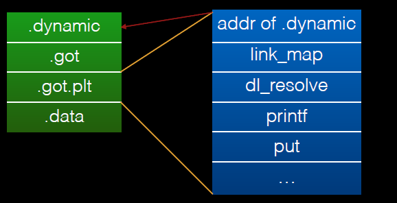
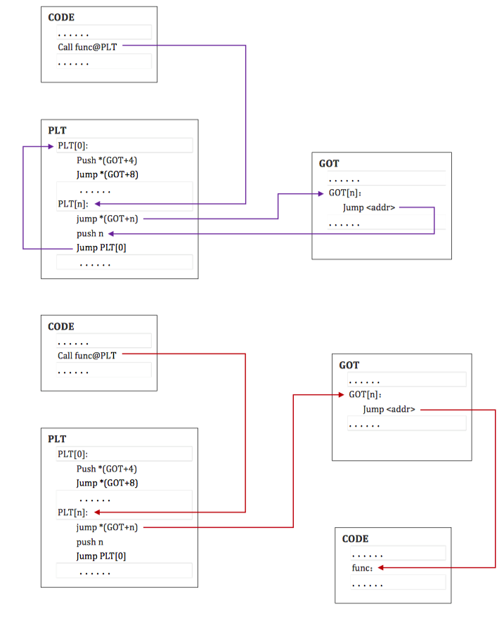

# Dynamic Sections

## .interp

このセクションには、プログラムに対応するインタプリタ(interpreter)が入っています。

動的リンクに関わる実行ファイルには、PT_INTERP 型のプログラムヘッダ要素があり、プログラム内のセグメントをロードするために使われます。exec (BA_OS) の過程で、システムはこのセクションからインタプリタのパスを取り出し、インタプリタファイルのセグメントに基づいて、初期のプログラムイメージを作ります。つまり、システムは与えられた実行ファイルのイメージを使わず、まずインタプリタのための独立したメモリイメージを構築します。したがって、インタプリタはシステムから制御権を受け取り、そのうえでアプリケーションに実行環境を提供する必要があります。

インタプリタが制御権を得る方法は 2 通りあります。

1. ファイルヘッダを指すファイルディスクリプタを受け取り、実行ファイルを読み取れるようにする方法。このファイルディスクリプタを使って、実行ファイルのセグメントを読み取り、メモリにマップできます。

2. 実行ファイルの形式によっては、システムがファイルディスクリプタをインタプリタに渡さず、実行ファイルを直接メモリにロードすることもあります。

インタプリタ自身が、さらにインタプリタを必要とすることはありません。インタプリタ自身は、共有オブジェクトファイルであることも、実行ファイルであることもあります。

- 共有オブジェクトファイルは、(通常は)アドレス非依存としてロードされます。つまり、プロセスごとにそのアドレスは異なります。システムは mmap (KE_OS) といくつかの関連する操作で、動的セグメントの内容を作ります。したがって、共有オブジェクトファイルのアドレスは通常、元の実行ファイルのもともとのアドレスと衝突しません。
- 実行ファイルは一般に、固定のアドレスにロードされます。システムは、プログラムヘッダテーブルの仮想アドレスを使って、対応するセグメントを作ります。したがって、ある実行ファイルのインタプリタの仮想アドレスは、最初の実行ファイルと衝突する可能性があります。対応する衝突を解決する責任はインタプリタにあります。

## .dynamic

オブジェクトファイルが動的リンクの過程に関わる場合、そのプログラムヘッダテーブルには、型が PT_DYNAMIC の要素が含まれます。このセグメントには .dynamic セクションが含まれます。ELF は _DYNAMIC シンボルでこのセクションを示します。その構造は次のとおりです。

```c
/* Dynamic section entry.  */
typedef struct
{
    Elf32_Sword d_tag; /* Dynamic entry type */
    union
    {
        Elf32_Word d_val; /* Integer value */
        Elf32_Addr d_ptr; /* Address value */
    } d_un;
} Elf32_Dyn;
extern Elf32_Dyn_DYNAMIC[];
```

このうち、d_tag の値が、d_un をどう解釈するかを決めます。

-   d_val
    -   このフィールドは整数値を表し、さまざまな意味を持てます。
-   d_ptr
    -   このフィールドはプログラムの仮想アドレスを表します。先に述べたとおり、ファイルの仮想アドレスは、実行中のメモリの仮想アドレスと一致しないことがあります。動的セクション内のアドレスを解決するとき、動的リンカは元のファイルの値とメモリのベースアドレスから、本当のアドレスを計算します。一貫性を保つため、ファイルには、動的構造体内のアドレスを「修正」するためのリロケーションエントリは含まれません。

このセクションは、実は複数のキーと値のペアで構成されていることが分かります。

**次の表は、実行ファイルと共有オブジェクトファイルでの d_tag の要件をまとめたものです**。tag が "mandatory" とされている場合、TIS ELF conforming なファイルでは、その動的リンク配列に対応するエントリの型が含まれていなければなりません。同様に、「optional」は、あってもなくてもよいことを意味します。

| 名前                  | 値                     | d_un   | 実行ファイル | 共有オブジェクト | 説明                                                         |
| --------------------- | ---------------------- | ------ | ------ | --------- | ------------------------------------------------------------ |
| DT_NULL               | 0                      | 無視   | 必須   | 必須      | _DYNAMIC 配列の末尾を示します。                              |
| DT_NEEDED             | 1                      | d_val  | 任意   | 任意      | NULL 終端の文字列の、文字列テーブル内のオフセットを含みます。その文字列は、必要なライブラリの名前を与えます。使われるインデックスは DT_STRTAB の添字です。動的配列には、この種のタグを多数含められます。この種のタグ内でのこれらの項目の相対的な順序は重要ですが、ほかのタグとの順序は問題ではありません。対応するセクションは .gnu.version_r です。 |
| DT_PLTRELSZ           | 2                      | d_val  | 任意   | 任意      | プロシージャリンケージテーブルに関係するリロケーションエントリの合計サイズを与えます。DT_JMPREL 型のエントリがあるなら、DT_PLTRELSZ も存在しなければなりません。 |
| DT_PLTGOT             | 3                      | d_ptr  | 任意   | 任意      | プロシージャリンケージテーブルまたはグローバルオフセットテーブルに関連付けられたアドレスを与えます。対応するセクションは .got.plt です |
| DT_HASH               | 4                      | d_ptr  | 必須   | 必須      | この型のエントリはシンボルのハッシュテーブルのアドレスを含みます。このハッシュテーブルは、DT_SYMTAB が参照するシンボルテーブルのものです。 |
| DT_STRTAB             | 5                      | d_ptr  | 必須   | 必須      | この型のエントリは動的文字列テーブルのアドレスを含みます。シンボル名、ライブラリ名、そのほかの文字列はこのテーブルに含まれます。対応するセクションの名前は .dynstr であるはずです。 |
| DT_SYMTAB             | 6                      | d_ptr  | 必須   | 必須      | この型のエントリは動的シンボルテーブルのアドレスを含みます。32 ビットのファイルでは、このシンボルテーブルのエントリの型は Elf32_Sym です。 |
| DT_RELA               | 7                      | d_ptr  | 必須   | 任意      | この型のエントリはリロケーションテーブルのアドレスを含みます。このテーブルの要素は、32 ビットファイルの Elf32_Rela のように、明示的な加数を含みます。オブジェクトファイルには複数のリロケーションセクションがあることがあります。実行ファイルまたは共有オブジェクトファイルのリロケーションテーブルを作るとき、リンクエディタはこれらのセクションを連結して 1 つのテーブルにします。これらのセクションはオブジェクトファイルでは互いに独立していますが、動的リンカはそれらを 1 つのテーブルとして扱います。動的リンカが実行ファイルのプロセスイメージを作るとき、またはあるプロセスイメージに共有オブジェクトを追加するとき、リロケーションテーブルを読み取り、関連する動作を行います。この要素がある場合、動的構造体には DT_RELASZ と DT_RELAENT の要素も含まれていなければなりません。あるファイルでリロケーションが必須であれば、DT_RELA か DT_REL のどちらかが存在することがあります。 |
| DT_RELASZ             | 8                      | d_val  | 必須   | 任意      | この型のエントリは DT_RELA リロケーションテーブルの合計バイトサイズを含みます。 |
| DT_RELAENT            | 9                      | d_val  | 必須   | 任意      | この型のエントリは DT_RELA リロケーションエントリのバイトサイズを含みます。 |
| DT_STRSZ              | 10                     | d_val  | 必須   | 必須      | この型のエントリは文字列テーブルのバイトサイズを、バイト数で与えます。 |
| DT_SYMENT             | 11                     | d_val  | 必須   | 必須      | この型のエントリはシンボルテーブルエントリのバイトサイズを与えます。 |
| DT_INIT               | 12                     | d_ptr  | 任意   | 任意      | この型のエントリは初期化関数のアドレスを与えます。           |
| DT_FINI               | 13                     | d_ptr  | 任意   | 任意      | この型のエントリは終了関数(Termination Function)のアドレスを与えます。 |
| DT_SONAME             | 14                     | d_val  | 無視   | 任意      | この型のエントリは、NULL 終端の文字列の文字列テーブル内のオフセットを与えます。対応する文字列は、ある共有オブジェクトの名前です。このオフセットは実際には DT_STRTAB 内のインデックスです。 |
| DT_RPATH              | 15                     | d_val  | 任意   | 無視      | この型のエントリは、NULL 終端の文字列の文字列テーブル内のオフセットを含みます。対応する文字列は、ライブラリを検索するときに使う検索パスです。このオフセットは実際には DT_STRTAB 内のインデックスです。 |
| DT_SYMBOLIC           | 16                     | 無視   | 無視   | 任意      | この型のエントリが共有オブジェクトライブラリに現れると、動的リンカのシンボル解決アルゴリズムが変わります。動的リンカはまず、共有オブジェクトファイル自身からシンボルを検索することを選び、検索に失敗したときにだけ、実行ファイルから対応するシンボルを検索します。 |
| DT_REL                | 17                     | d_ptr  | 必須   | 任意      | この型のエントリは DT_RELA 型のエントリに似ていますが、そのテーブルが暗黙の加数を含む点が異なります。32 ビットファイルでは Elf32_Rel です。ELF ファイルにこの要素が含まれる場合、動的構造体には DT_RELSZ と DT_RELENT 型の要素も含まれていなければなりません。 |
| DT_RELSZ              | 18                     | d_val  | 必須   | 任意      | この型のエントリは DT_REL リロケーションテーブルの合計バイトサイズを含みます。 |
| DT_RELENT             | 19                     | d_val  | 必須   | 任意      | この型のエントリは DT_REL リロケーションエントリのバイトサイズを含みます。 |
| DT_PLTREL             | 20                     | d_val  | 任意   | 任意      | この型のエントリは、プロシージャリンケージテーブルが参照するリロケーションエントリのアドレスを与えます。具体的な状況に応じて、d_val に対応するアドレスは DT_REL または  DT_RELA を含むことがあります。プロシージャリンケージテーブル内のすべてのリロケーションは、同じリロケーション方式を使わなければなりません。 |
| DT_DEBUG              | 21                     | d_ptr  | 任意   | 無視      | この型のエントリはデバッグに使われます。ABI はその内容を規定しておらず、これらのエントリにアクセスするプログラムは ABI と互換性がない可能性があります。 |
| DT_TEXTREL            | 22                     | 無視   | 任意   | 任意      | ファイルにこの型のエントリが含まれない場合、書き込み不可のセグメントを変更しうるリロケーションエントリがないことを表します。存在する場合、書き込み不可のセグメントの変更を要求するリロケーションエントリがいくつか存在しうるので、動的リンカは対応する準備ができます。 |
| DT_JMPREL             | 23                     | d_ptr  | 任意   | 任意      | この型のエントリの d_ptr メンバはプロシージャリンケージテーブルのアドレスを含み、引くときにはそのアドレスを、対応するリロケーションエントリ型へのポインタに強制的にキャストするはずです。リロケーションエントリを分けておくと、動的リンカがプロセスの初期化時にそれらを無視できて(遅延バインディングが有効な場合)好都合です。このメンバがある場合、関連する DT_PLTRELSZ と  DT_PLTREL も存在しなければなりません。 |
| DT_BIND_NOW           | 24                     | 無視   | 任意   | 任意      | 実行ファイルまたは共有オブジェクトファイルにこの型のエントリがある場合、動的リンカは、制御権をプログラムに渡す前に、そのファイルのリロケーションが必要なすべてのアドレスをリロケーションしなければなりません。このエントリの優先度は遅延バインディングより高く、環境変数や dlopen(BA_LIB) で設定できます。 |
| DT_LOPROC  ~DT_HIPROC | 0x70000000 ~0x7fffffff | 未指定 | 未指定 | 未指定    | この範囲のエントリは、プロセッサ固有の意味のために予約されています。 |

この表にないタグ値は予約されています。また、配列末尾の DT_NULL 要素と DT_NEEDED 要素の相対順序の制約を除けば、ほかのエントリは任意の順序で現れてかまいません。

## Global Offset Table

GOT テーブルは、ELF ファイルでは 2 つの部分に分かれます。

-   .got。インポートした変数のアドレスを格納します。
-   .got.plt。インポートした関数のアドレスを格納します。

通常、アドレス非依存のコードは絶対仮想アドレスを含められません。GOT テーブルには隠れた絶対アドレスが入っており、位置独立性とプログラムコードセグメントの共有に反することなく、関連するシンボルの絶対アドレスを得られます。プログラムは、位置独立コードで自分の GOT テーブルを参照し、そこから絶対的な値を取り出して、位置独立の参照を絶対アドレスにリダイレクトできます。 

最初、got テーブルにはリダイレクトに必要な情報が入っています。システムがロード可能なオブジェクトファイルのメモリセグメントを作るとき、動的リンカはリロケーションエントリを処理します。その中には型が R_386_GLOB_DAT のものがあり、これは got テーブルを指します。動的リンカは関連するシンボルの値を決め、それらの絶対アドレスを計算して、適切なメモリエントリを対応する値に設定します。リンカがオブジェクトファイルを作るときには絶対アドレスはまだ分かっていませんが、動的リンカはすべてのメモリセグメントのアドレスを知っているので、含まれるシンボルの絶対アドレスを計算できます。

プログラムがあるシンボルの絶対アドレスに直接アクセスする必要がある場合、そのシンボルには got テーブルのエントリがあります。実行ファイルと共有オブジェクトファイルにはそれぞれ独立したエントリがあるので、1 つのシンボルのアドレスが複数のテーブルに現れることがあります。動的リンカは、プロセスイメージ内のコードセグメントに権限を渡す前に、すべての got テーブルのリロケーションエントリを処理して、すべての絶対アドレスが実行中にアクセスできることを保証します。

GOT テーブルの第 0 エントリには、動的構造体(_DYNAMIC)のアドレスが入っています。これにより、動的リンカのようなプログラムは、自分のリダイレクトを実行する前に、対応する動的セクションを見つけられます。動的リンカは、ほかのプログラムに依存せずに自分のメモリイメージをリロケーションできなければならないので、これは動的リンカにとって非常に重要です。

プログラムが異なれば、システムは同じ共有オブジェクトファイルに異なるメモリセグメントのアドレスを選ぶことがあります。同じプログラムでも、実行のたびにライブラリのアドレスが異なることがあります。ただし、いったんプロセスイメージが作られると、メモリセグメントのアドレスはもう変わらず、プロセスが存在する限り、そのメモリセグメントのアドレスは固定された位置にあります。

GOT テーブルの形式と解釈はプロセッサに依存します。Intel アーキテクチャでは、`_GLOBAL_OFFSET_TABLE_` シンボルでこのテーブルにアクセスできます。

```
extern Elf32_Addr _GLOBAL_OFFSET_TABLE[];
```

`_GLOBAL_OFFSET_TABLE_` は .got セクションの途中にあることがあり、そうすれば正負のインデックスでこのテーブルにアクセスできます。

Linux の実装では、.got.plt の最初の 3 エントリの具体的な意味は次のとおりです。

-   GOT[0]。.dynamic のアドレス。
-   GOT[1]。link_map へのポインタ。動的ローダでのみ使われ、シンボル解決に必要な、現在の ELF オブジェクトの情報を含みます。各 link_map は双方向リストの 1 つのノードで、このリストはロードされたすべての ELF オブジェクトの情報を保持しています。
-   GOT[2]。動的ローダ内の _dl_runtime_resolve 関数へのポインタ。

.got.plt の後ろのエントリは、プログラム内のさまざまな .so にある関数の参照アドレスです。対応関係を次に示します。



## Procedure Linkage Table

PLT テーブルは、インポートした関数を絶対アドレスにリダイレクトします。主に 2 つの部分からなります。

-   **.plt**。read などの、一般的なインポート関数に関係します。
-   **.plt.got**。動的リンクに関係します。

正確に言えば、plt テーブルは参照用のテーブルではなく、コードの塊です。この部分はコードに関係しています。

動的リンクでは、プログラムのモジュール間に大量の関数参照があります。プログラムの実行を始める前にすべての関数のアドレスを解決してしまうと、動的リンクは、モジュール間の関数参照のシンボル検索とリロケーションにかなりの時間を費やします。しかし、プログラムの実行中には、プログラムが終わるまで使われない関数がたくさんあるかもしれないので、最初からすべての関数をリンクしてしまうと、大量のリソースを無駄にするかもしれません。そこで ELF は遅延バインディング(lazy binding)という方法を採っています。基本的な考え方は、関数が初めて使われるときにバインド(シンボル検索、リロケーションなど)を行い、使われなければバインドしないというものです。したがって、プログラムの実行開始前には、モジュール間の関数呼び出しはバインドされておらず、必要になったときに、動的リンカがバインドを担当します。

遅延(lazy)バインディングの場合、全体の流れは次の図のとおりです。青い線は初回の実行の流れ、赤い線は 2 回目以降の呼び出しの流れを表します。



LD_BIND_NOW 環境変数は、動的リンカの挙動を変えられます。その値が空でなければ、動的リンカは、プログラムに制御権を渡す前に PLT エントリを実行します。つまり、動的リンカはプロセスの初期化中に、型が R\_3862\_JMP_SLOT のリロケーションエントリを実行します。そうでなければ、動的リンクテーブルはプロシージャリンケージテーブルのエントリを遅延バインディングし、対応するエントリが初めて実行されるときまで、シンボル解決とリロケーションを行いません(原文のまま)。

注意

>   遅延バインディングは通常、アプリケーションの性能を高めます。使われていないシンボルは動的リンクの負荷を増やさないからです。しかし、次の 2 つの場合には、遅延バインディングが予期しない状況を引き起こすことがあります。1 つ目は、共有オブジェクトファイルの関数への最初の参照は、一般に後続の呼び出しより時間がかかることです。動的リンカが呼び出しを横取りしてシンボルを解決する必要があるからです。アプリケーションによっては、この予測不能性に耐えられません。2 つ目は、エラーが発生し、動的リンカがシンボルを解決できない場合、動的リンカはプログラムを終了させることです。遅延バインディングの場合、これはいつでも起こりえます。遅延バインディングを無効にすると、動的リンカは、プロセスの初期化中にこのようなエラーを出すことはありません。これらはアプリケーションが制御権を得る前に実行されるからです。

リンクエディタは、実行フローの転送(関数呼び出しなど)、つまりある実行ファイルまたは共有オブジェクトファイルから別のファイルへの転送を解決できません。リンカは、プログラムが制御権をプロシージャリンケージテーブルのエントリに渡すように手配します。Intel アーキテクチャでは、プロシージャリンケージテーブルは共有コードセグメントにありますが、GOT テーブルのデータを使います。動的リンカは対象の絶対アドレスを決め、対応する GOT テーブルのメモリイメージを変更します。したがって、動的リンカは、位置独立性とプログラムコードセグメントの互換性に反することなく、PLT エントリをリダイレクトできます。実行ファイルと共有オブジェクトファイルには、それぞれ独立した PLT テーブルがあります。

絶対アドレスのプロシージャリンケージテーブルは次のとおりです。

```assembly
.PLT0:  pushl	got_plus_4
        jmp	*got_plus_8
	      nop; nop
	      nop; nop
.PLT1:  jmp	*name1_in_GOT
        pushl	$offset@PC
	      jmp	.PLT0@PC
.PLT2:  jmp	*name2_in_GOT
        push	$offset
	     jmp	.PLT0@PC
	     ...
```

位置独立のプロシージャリンケージテーブルのアドレスは次のとおりです(原文のまま)。

```assembly
.PLT0:  pushl	4(%ebx)
        jmp	*8(%ebx)
	      nop; nop
	      nop; nop
.PLT1:  jmp	*name1_in_GOT(%ebx)
        pushl	$offset
	      jmp	.PLT0@PC
.PLT2:  jmp	*name2_in_GOT(%ebx)
        push	$offset
	      jmp	.PLT0@PC
	      ...
```

プロシージャリンケージテーブルでは、絶対アドレスのコードと位置独立のコードとで処理が異なることが分かります。しかし、動的リンカがそれらを処理するときに使うインタフェースは同じです。


動的リンカとプログラムは、次の方法でプロシージャリンケージテーブルとグローバルオフセットテーブルのシンボル参照を解決します。

1.  プログラムのメモリイメージが最初に作られるとき、動的リンカは GOT テーブルの 2 番目と 3 番目のエントリを特別な値に設定します。以下の手順でこれらの値を詳しく説明します。
2.  プロシージャリンケージテーブルが位置独立なら、GOT テーブルのアドレスは ebx レジスタに入っていなければなりません。プロセスイメージ内の各共有オブジェクトファイルには独立した PLT テーブルがあり、プログラムは同じオブジェクトファイルからしか PLT エントリに制御フローを渡しません。したがって、呼び出し側の関数は、PLT エントリを呼び出す前に、グローバルオフセットテーブルのベースアドレスをレジスタに設定する責任があります。
3.  ここで例を挙げます。プログラムが name1 を呼び出すと仮定します。制御権は lable .PLT1 に渡されます。
4.  すると、最初の命令は、グローバルオフセットテーブル内の name1 のアドレスにジャンプします。最初、グローバルオフセットテーブルには、PLT の次の pushl 命令のアドレスが入っており、name1 の実際のアドレスではありません。
5.  そこでプログラムは、対応する関数の `rel.plt` 内でのオフセット(リロケーションオフセット、reloc_index)をスタックにプッシュします。リロケーションオフセットは 32 ビットで、非負の数値です。また、リロケーションエントリの型は R\_386\_JMP_SLOT で、先ほどの jmp 命令で使ったグローバルオフセットテーブルのエントリが GOT テーブル内のどこにあるかというオフセットを示します。リロケーションエントリにはシンボルテーブルのインデックスも含まれており、どのシンボルが現在参照されているかを動的リンカに伝えます。この例では name1 です。
6.  リロケーションオフセットをプッシュしたあと、プログラムは .PLT0、つまりプロシージャリンケージテーブルの最初のエントリにジャンプします。pushl 命令は、GOT テーブルの 2 番目のエントリ(got_plus_4 または 4(%ebx)、**現在の ELF オブジェクトの情報**)をスタックにプッシュし、動的リンカに識別情報を与えます。その後、プログラムは 3 番目のグローバルオフセットテーブルのエントリ(got_plus\_8 または 8(%ebx)、**動的ローダ内の `_dl_runtime_resolve` 関数へのポインタ**)にジャンプし、プログラムの流れを動的リンカに渡します。
7.  動的リンカが制御権を受け取ると、ポップ操作を行い、リロケーションエントリを調べ、対応するシンボルの値を解決し、name1 のアドレスをグローバルオフセットテーブルのエントリに書き込み、最後に制御権を目的のアドレスに渡します。
8.  プロシージャリンケージテーブルが実行されたあと、プログラムの制御権は name1 関数に直接渡され、それ以降、この関数を解決するために動的リンカが呼ばれることは二度とありません。つまり、.PLT1 の jmp 命令は name1 に直接ジャンプし、pushl 命令を再び実行することはありません。

## .rel(a).dyn & .rel(a).plt

.rel.dyn には、動的リンクされたバイナリファイルでリロケーションが必要な変数の情報が入っており、.rel.plt には、リロケーションが必要な関数の情報が入っています。この 2 種類のリロケーションセクションは、次の構造を使います(32 ビットの場合)。

```
typedef struct {
    Elf32_Addr        r_offset;
    Elf32_Word       r_info;
} Elf32_Rel;

typedef struct {
    Elf32_Addr     r_offset;
    Elf32_Word    r_info;
    Elf32_Sword    r_addend;
} Elf32_Rela;
```

Elf32_Rela 型のエントリは、明示的な加数の情報を含みます。Elf32_Rel 型のエントリは、変更される位置に暗黙の加数の情報を保持します。プロセッサアーキテクチャの事情により、この 2 つの形式は両方とも存在し、必要でさえあります。したがって、特定のマシン向けの実装では、一方の形式だけを使っても、文脈に応じて両方の形式を使ってもかまいません。

各フィールドの説明は次のとおりです。

| メンバ   | 説明                                                         |
| -------- | ------------------------------------------------------------ |
| r_offset | **このメンバは、リロケーションが必要な位置を与えます。**リロケータブルファイルでは、この値は、リロケーションが必要なシンボルがあるセクションのヘッダの先頭から、リロケーションされる位置までのバイトオフセットです。実行ファイルまたは共有オブジェクトファイルでは、その値はリロケーションが必要な**仮想アドレス**で、一般に、これは GOT テーブルのアドレスのことです。 |
| r_info   | **このメンバは、リロケーションが必要なシンボルのシンボルテーブルインデックスと、対応するリロケーション型を与えます。**  たとえば、呼び出し命令のリロケーションエントリには、呼び出される関数のシンボルテーブルインデックスが含まれます。インデックスが STN_UNDEF なら、リロケーションは「シンボル値」として 0 を使います。また、リロケーション型はプロセッサに依存します。 |
| r_addend | このメンバは、リロケータブルフィールドに書き込む値を計算するための定数の加数を与えます。 |

r_info のより具体的なフィールド情報は、次のコードのとおりです。

- r_info の上位 3 バイトの値は、この動的シンボルが `.dynsym` シンボルテーブル内のどの位置にあるかを表す
- r_info の最下位バイトはリロケーション型を表す

```c
#define ELF32_R_SYM(i)    ((i)>>8)
#define ELF32_R_TYPE(i)   ((unsigned char)(i))
// r_info を構築するために使う
#define ELF32_R_INFO(s,t) (((s)<<8)+(unsigned char)(t))
```

リロケーションセクションは 2 つのほかのセクションを参照します。**シンボルテーブルと、変更対象のセクション**です。セクションヘッダの sh_info と sh_link メンバが、対応する関係を与えます。

ここでは、考えられるリロケーション型を具体的に論じます。以下の計算では、リロケータブルファイルを実行ファイルまたは共有オブジェクトファイルに変換することを想定します。概念上、リンカは 1 つ以上のリロケータブルファイルを結合して出力ファイルを得ます。まず、これらの入力ファイルをどのように結合して配置するかを決め、次にシンボルテーブルの値を更新し、最後にリロケーションを行います。実行ファイルまたは共有オブジェクトファイルのリロケーション方法は似ており、結果もほぼ同じです。以降の記述では、次の記法を使います。

-   A(addend) リロケータブルフィールドの値を計算するための加数。
-   B(base)  共有オブジェクトファイルが実行中にメモリにロードされるベースアドレス。一般に、共有オブジェクトファイルの仮想ベースアドレスは 0 ですが、実行時にはそのアドレスが変わります。
-   G(Global) 実行時に、リロケーションエントリのシンボルがグローバルオフセットテーブル内でどのオフセットにあるか。
-   GOT (global offset table) グローバルオフセットテーブル(GOT)のアドレス。
-   L (linkage) プロシージャリンケージテーブルのエントリ内のシンボルの、セクションオフセットまたはアドレス。プロシージャリンケージテーブルのエントリは、関数呼び出しを正しい目的の位置にリロケーションします。リンクエディタが初期のプロシージャリンケージテーブルを構築し、その後、動的リンカが実行中にこれらの項目を変更します。
-   P (place) リロケーションされる(r_offset で計算される)記憶単位の位置(セクションオフセットまたはアドレス)。
-   S  (symbol) インデックスがリロケーションエントリ内にあるシンボルの値。

リロケーションエントリの r_offset の値は、影響を受ける記憶単位の最初のバイトのオフセットまたは仮想アドレスです。リロケーション型は、変更が必要なビットと、その値の計算方法を与えます。このうち Intel アーキテクチャは ELF32_REL リロケーションエントリだけを使い、リロケーションされるメンバに対応する加数の値を保持します。すべての場合で、加数の値と計算結果は同じバイトオーダーを使います。

リロケーション型とその意味の一部は次のとおりです。

| 名前           | 値   | フィールド | 計算        | 意味                                                         |
| -------------- | ---- | ------ | ----------- | ------------------------------------------------------------ |
| R_386_NONE     | 0    | なし   | なし        |                                                              |
| R_386_32       | 1    | word32 | S + A       |                                                              |
| R_386_PC32     | 1    | word32 | S + A - P   |                                                              |
| R_386_GOT32    | 1    | word32 | G + A - P   | このリロケーション型は、グローバルオフセットテーブルのベースから、シンボルのグローバルオフセットテーブルエントリまでの距離を計算します。さらに、リンカにグローバルオフセットテーブルを作るよう命じます。 |
| R_386_PLT32    | 1    | word32 | L + A - P   | このリロケーション型は、シンボルのプロシージャリンケージテーブルエントリのアドレスを計算します。さらに、リンカにプロシージャリンケージテーブルを作るよう命じます。 |
| R_386_COPY     | 5    | なし   | なし        | このリロケーション型は、動的リンクの過程のためにリンカが作ります。そのオフセット項目は、書き込み可能なセグメント内の位置を指します。シンボルテーブルは、この種のシンボルが現在のオブジェクトファイルにも共有オブジェクトファイルにも存在するべきだと規定します。実行中、動的リンカは、その共有オブジェクトのシンボルに関連するデータを、上のオフセットが指定する位置にコピーします。 |
| R_386_GLOB_DAT | 6    | word32 | S           | このリロケーション型は、グローバルオフセットテーブル内のシンボルを、指定されたシンボルのアドレスに設定するために使われます。この特別なリロケーション型により、シンボルとグローバルオフセットテーブルのエントリとの関係を決められます。 |
| R_386_JMP_SLOT | 7    | word32 | S           | このリロケーション型は、動的リンクの過程のためにリンカが作ります。そのオフセット項目は、対応するプロシージャリンケージテーブルエントリの位置を与えます。動的リンカはプロシージャリンケージテーブルを変更して、プログラムの制御権を、上で指されたシンボルのアドレスに移します。 |
| R_386_RELATIVE | 8    | word32 | B + A       | このリロケーション型は、動的リンクの過程のためにリンカが作ります。そのオフセット項目は、共有オブジェクト内の、相対アドレスを表す値を含む位置を与えます。動的リンカは、共有オブジェクトファイルがロードされた仮想アドレスを上の相対アドレスに加えて、対応する仮想アドレスを計算します。この型のリロケーションエントリは、シンボルテーブルインデックスを 0 に設定します。 |
| R_386_GOTOFF   | 9    | word32 | S + A - GOT | このリロケーション型は、シンボルの値とグローバルオフセットテーブルのアドレスとの差を計算します。さらに、リンカにグローバルオフセットテーブルを作るよう通知します。 |
| R_386_GOTPC    | 10   | word32 | S + A - P   | このリロケーション型は `R_386_PC32` に似ていますが、計算にグローバルオフセットテーブルのアドレスを使う点が違います。通常、このリロケーションエントリで参照されるシンボルは `_GLOBAL_OFFSET_TABLE_` で、リンカにグローバルオフセットテーブルを作るよう命じます。 |

## .dynsym

動的リンクされた ELF ファイルには専用の動的シンボルテーブルがあり、使われる構造も Elf32_Sym ですが、格納されるセクションは .dynsym です。ここで Elf32_Sym の構造をもう一度示します。

```c
typedef struct
{
  Elf32_Word    st_name;   /* Symbol name (string tbl index) */
  Elf32_Addr    st_value;  /* Symbol value */
  Elf32_Word    st_size;   /* Symbol size */
  unsigned char st_info;   /* Symbol type and binding */
  unsigned char st_other;  /* Symbol visibility under glibc>=2.2 */
  Elf32_Section st_shndx;  /* Section index */
} Elf32_Sym;
```

`.dynsym` は実行時に必要で、ELF ファイルの export/import のシンボル情報はすべてここにあることに注意してください。一方、`.symtab` セクションに格納されている情報はコンパイル時のシンボル情報で、`strip` のあとに削除されます。

動的シンボルの 2 つのメンバに注目します。

-   st_name。このメンバは、動的シンボルの .dynstr テーブル(動的文字列テーブル)内でのオフセットを保持します。
-   st_value。このシンボルがエクスポートされる場合、このシンボルは対応する仮想アドレスを保持します。

動的シンボルと、それを指す Elf_Verdef との対応関係は、`.gnu.version` セクションに保存されています。このセクションは Elf_Verneed 構造体で構成される配列です。各エントリは、動的シンボルテーブルの 1 つの項目に対応します。実は、この構造体にはフィールドが 1 つしかありません。`.gnu.verion_r` セグメント内の添字を表す 16 ビットの整数です。

そのほか、動的リンカは、Elf_Rel 構造体のメンバ r_info 内の添字を、.dynsym セグメントと .gnu.version セグメントの両方の添字として使います。こうして、各シンボルがどのバージョンのものかを 1 対 1 に対応付けられます。

## .dynstr

このセクションは、動的リンクに必要な文字列を含みます。

## Misc 

### version releated sections

ELF ファイルは外部のシンボルをインポートできるだけでなく、特定のバージョンのシンボルもインポートできます。たとえば、GLIBC_2.2.5 から printf などの標準ライブラリ関数をインポートできます。このうち、.gnu.version_r はバージョンの定義を保持し、対応する構造体は Elf_Verdef です(原文のまま)。

#### .gnu.version

このセクションは .dynsym 内のシンボル情報と 1 対 1 に対応しており、つまり両者の要素数は同じです。.gnu.version の各要素の型は `Elfxx_Half` で、対応するシンボルのバージョン情報を指定します。`Elfxx_Half` では 2 つの値が予約されています。

- 0。このシンボルがローカルで、外部に公開されないことを表します。次の `__gmon_start__` はローカルシンボルです。
- 1。このシンボルが現在のオブジェクトファイルで定義されており、グローバルにアクセスできることを表します。次の `_IO_stdin_used` はグローバルシンボルです。

```assembly
LOAD:080482D8 ; ELF GNU Symbol Version Table
LOAD:080482D8                 dw 0
LOAD:080482DA                 dw 2                    ; setbuf@@GLIBC_2.0
LOAD:080482DC                 dw 2                    ; read@@GLIBC_2.0
LOAD:080482DE                 dw 0                    ; local  symbol: __gmon_start__
LOAD:080482E0                 dw 2                    ; strlen@@GLIBC_2.0
LOAD:080482E2                 dw 2                    ; __libc_start_main@@GLIBC_2.0
LOAD:080482E4                 dw 2                    ; write@@GLIBC_2.0
LOAD:080482E6                 dw 2                    ; stdin@@GLIBC_2.0
LOAD:080482E8                 dw 2                    ; stdout@@GLIBC_2.0
LOAD:080482EA                 dw 1                    ; global symbol: _IO_stdin_used
...
.rodata:0804866C                 public _IO_stdin_used
.rodata:0804866C _IO_stdin_used  db    1                 ; DATA XREF: LOAD:0804825C↑o
.rodata:0804866D                 db    0
.rodata:0804866E                 db    2
.rodata:0804866F                 db    0
.rodata:0804866F _rodata         ends
```

#### .gnu.version_d

Version definitions of symbols.

#### .gnu.version_r

Version references (version needs) of symbols.

## 参考資料

- https://refspecs.linuxfoundation.org/LSB_3.0.0/LSB-PDA/LSB-PDA.junk/symversion.html
