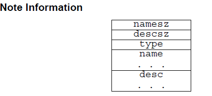
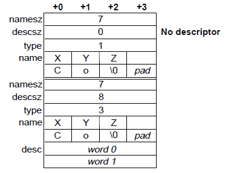
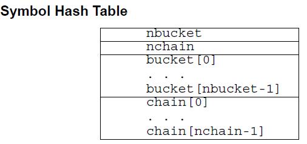
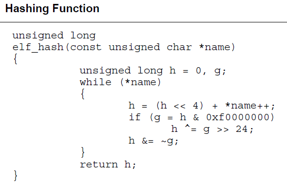

# Misc Sections

## Note related sections

メーカーやシステムの構築者が、ELF ファイルに特別な情報で印を付けたいことがあります。そうすると、ほかのプログラムがその ELF ファイルの一貫性や互換性を検査できます。この目的には、セクション型が SHT_NOTE のセクション、またはプログラムヘッダ型が PT_NOTE の要素を使います。それらの中のオブジェクトのエントリは 1 つ以上あることがあり、それぞれのエントリは、対象プロセッサの形式の 4 バイトの配列です。次に、考えられる注釈情報をいくつか挙げます。ただし、これは ELF ファイルの仕様には含まれません。

-   namesz と name
    -   name の先頭 namesz バイトは NULL 終端の文字列を含み、これはそのエントリの所有者または発行者を表します。ただし現在のところ、衝突を避けるための書式化された命名の仕組みはありません。一般に、メーカーは自社の名前、たとえば「XYZ Computer Company」を識別子として使います。名前がまったくない場合、namesz は 0 になるはずです。その場合、name の位置は 4 バイト境界にそろうようにパディングされるはずです。
-   descsz と desc
    -   desc の先頭 descsz バイトは注釈の記述を含みます。ELF ファイルは、記述の内容に何の制約も課しません。記述がまったくない場合、descsz は 0 になるはずです。もちろん、desc の位置は 4 バイト境界にそろうようにパディングされるはずです。
-   type
    -   このフィールドは記述の解釈を与えます。発行者ごとに、それぞれが自分の型を管理しなければなりません。同じ型に対して、複数の記述が対応することもあります。したがって、発行者は、対応する記述を理解するために、名前と型を識別できなければなりません。現在のところ、型は非負の値であってはなりません(原文のまま)。ELF ファイルの仕様は、記述子の意味を定義しません。これが type が前にある理由です。

簡単な例で説明します。

ここには 2 つのエントリが含まれています。

Linux では、Note に関係するセクションに ELF ファイルの注釈情報が入っています。主に次の 2 つのセクションがあります。

-   .note.ABI-tag
-   .note.gnu.build-id

## .gnu.hash

注: この部分は主に https://blogs.oracle.com/ali/gnu-hash-elf-sections を参考にしています。

ELF の優れた拡張性のおかげで、GNU は ELF オブジェクトに新しいハッシュセクションを追加しました。このセクションの性能は、従来の `SYSV hash` よりずっとよくなっています。このセクションは、シンボル名から、対応するシンボルテーブル内のインデックスを素早く得るために使われます。

詳しくは https://blogs.oracle.com/ali/entry/gnu_hash_elf_sections を参照してください。 **さらなる学習が必要です。**

### ELF 標準

ELF ファイルのハッシュテーブルは Elf32_Word オブジェクトで構成され、シンボルテーブルへのアクセスをサポートします。次のシンボルはシンボルテーブルの構成を説明するのに役立ちますが、ELF ファイルの仕様の一部ではありません。

bucket 配列は nbucket 個の要素を含み、chain 配列は nchain 個の要素を含みます。すべての配列の添字は 0 から始まります。bucket と chain はどちらもシンボルテーブルのインデックスを含みます。chain 配列の要素はシンボルテーブルの要素と 1 対 1 に対応しているため、シンボルテーブルの要素数は nchain の大きさと同じでなければならず、したがってシンボルテーブルのインデックスは chain テーブルのインデックスとしても使えます。次に示すハッシュ関数は、シンボル名を入力として受け取り、値を返します。この値は bucket のインデックスの計算に使われることがあります。したがって、ハッシュ関数があるシンボル名に対して値 x を返すなら、`bucket[x%nbucket] ` はインデックス y を与え、これでシンボルテーブルを引くことも chain テーブルを引くこともできます。シンボルテーブルの対応するインデックスが目的のものでなければ、chain[y] が、同じハッシュ値を持つ次のシンボルテーブルエントリの位置を与えます。つまり、ハッシュ値が同じになる場合を防ぐのに使えます。したがって、目的のシンボルに出会うか、値が `STN_UNDEF` の chain のエントリに出会うまで、chain をたどって検索できます。

## .eh_frame related

.eh_frame_hdr

.eh_frame
