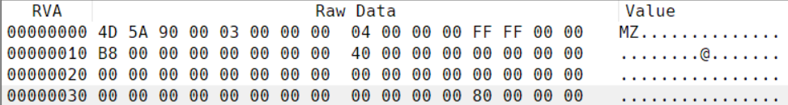
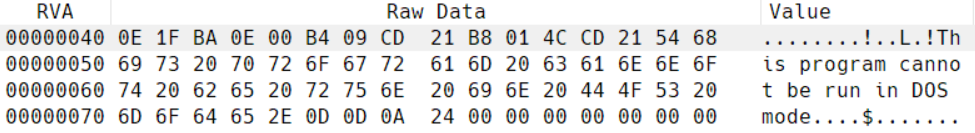
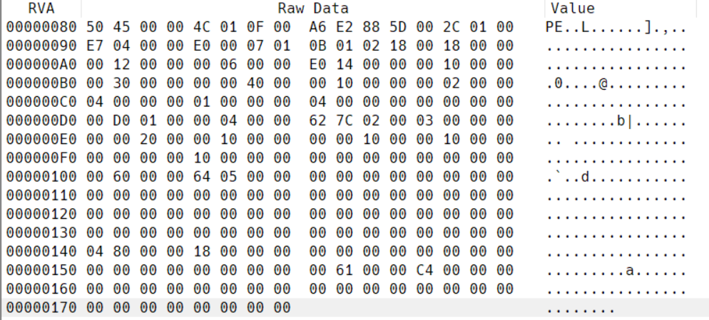
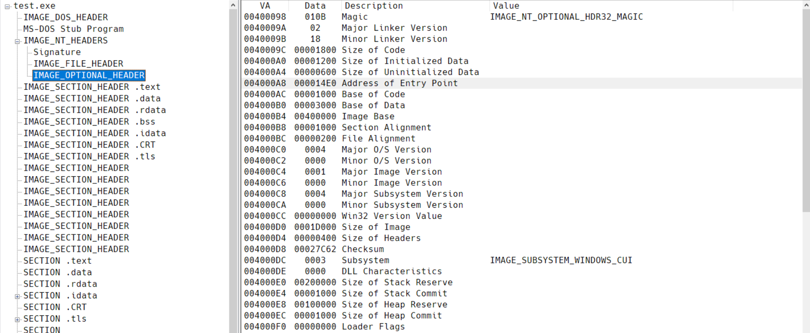
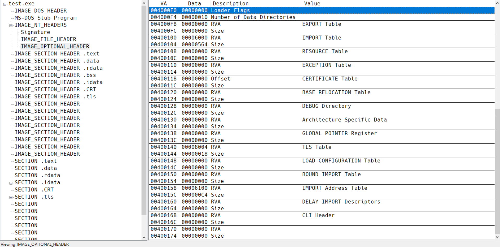

# PE ファイル形式

## PE の紹介

PE ファイルの正式名称は Portable Executable で、移植可能な実行ファイルを意味します。よく見る EXE、DLL、OCX、SYS、COM はどれも PE ファイルです。PE ファイルは Microsoft Windows オペレーティングシステム上のプログラムファイルで、DLL のように間接的に実行されるものもあります。
32 ビットの PE ファイルのレイアウトは次の図のとおりです。

```text
+-------------------------------+ \
|     MS-DOS MZ header          |  |
+-------------------------------+  |
| MS-DOS Real-Mode Stub program |  |
+-------------------------------+  |
|     PE Signature              |  | -> PE file header
+-------------------------------+  |
|     IMAGE_FILE_HEADER         |  |
+-------------------------------+  |
|     IMAGE_OPTIONAL_HEADER     |  |
+-------------------------------+ /
|     section header #1         | 
+-------------------------------+ 
|     section header #2 
+------------------------- 
: 
: 
 
+------------------------------+ 
|        section #1            | 
+------------------------------+ 
|        section #2 
+-------------------- 
: 
: 
```

以降では、32 ビットの PE ファイルを見本にして PE ファイルを紹介します。

```c
// サンプルコード test.c
#include <stdio.h>

int main(){
  printf("Hello, PE!\n");

  return 0;
}
```

**`Devcpp` ソフトウェアの `TDM-GCC 4.9.2 32-bit Release` 方式でコンパイルして `test.exe` を生成し、サンプルファイルとして使います。**

### よく使う用語とその意味

- **`イメージファイル(映像文件)` PE ファイルは通常、メモリにロードしてはじめて実行できます。メモリ内のイメージに相当するので、PE ファイルはイメージファイルとも呼ばれます。**
- **`RVA` 相対仮想アドレス(Relative Virtual Address)。イメージファイルの、仮想メモリ内でのロードベースアドレスからのオフセット。**
- **`VA` 仮想アドレス(Virtual Address)。イメージファイルの、仮想メモリ内でのアドレス。**
- **`FOA` ファイルオフセットアドレス(File Offset Address)。イメージファイルの、ディスク上のファイルの先頭からのオフセット。**

ディスク上のファイルでも仮想メモリ内でも、データが属するセクションに対するデータの相対オフセットは固定されています。これにより、RVA と FOA の相互変換ができます。つまり `RVA - セクションRVA = FOA - セクションFOA` です。

たとえば、.data セクションに属するあるデータの RVA が 0x3100 で、.data セクションのセクション RVA が 0x3000 なら、このデータの .data セクションに対する相対オフセットは 0x100 です。そして .data セクションのセクション FOA が 0x1C00 なら、このデータのディスク上のファイルでの FOA は 0x1D00 です。完全な計算式は `FOA = セクションFOA + (RVA - セクションRVA)` です。このイメージファイルのロードベースアドレスが 0x40000000 なら、このデータの VA は 0x40003100 になります。

## PE ファイルヘッダ

PE ファイルの一番最初が PE ファイルヘッダで、`MS-DOS ファイルヘッダ` と `IMAGE_NT_HEADERS` 構造体からなります。

### MS-DOS ファイルヘッダ

`MS-DOS ファイルヘッダ` は、`IMAGE_DOS_HEADER` と `DOS Stub` の 2 つの部分を含みます。

`IMAGE_DOS_HEADER` 構造体の定義は次のとおりです。

```c
typedef struct _IMAGE_DOS_HEADER
{
     WORD e_magic;              // "MZ"
     WORD e_cblp;
     WORD e_cp;
     WORD e_crlc;
     WORD e_cparhdr;
     WORD e_minalloc;
     WORD e_maxalloc;
     WORD e_ss;
     WORD e_sp;
     WORD e_csum;
     WORD e_ip;
     WORD e_cs;
     WORD e_lfarlc;
     WORD e_ovno;
     WORD e_res[4];
     WORD e_oemid;
     WORD e_oeminfo;
     WORD e_res2[10];
     LONG e_lfanew;             // NT ヘッダの、ファイルの先頭からのオフセット
} IMAGE_DOS_HEADER, *PIMAGE_DOS_HEADER;
```

`IMAGE_DOS_HEADER` 構造体には重要なメンバが 2 つあります。
- **`e_magic` ワード(単字)。DOS シグネチャ "4D5A"、つまり ASCII 値の "MZ"。すべての PE ファイルの先頭には DOS シグネチャがあります。**
- **`e_lfanew` ワード(単字)。`IMAGE_NT_HEADER` の、ファイルの先頭からのオフセット。**

サンプルプログラムの `IMAGE_DOS_HEADER` は図 2 のとおりです。



`IMAGE_DOS_HEADER` 構造体のすぐ後ろに `DOS Stub` があります。その役割は単純で、システムが MS-DOS 環境のとき、`This program cannot be run in DOS mode.` と出力してプログラムを終了し、このプログラムが MS-DOS 環境では実行できないことを示します。これにより、すべての PE ファイルが MS-DOS 環境と互換になります。この特性を利用すると、MS-DOS と Windows の両方の環境で実行できるプログラムを作れます。MS-DOS では 16 ビットの MS-DOS コードを実行し、Windows では 32 ビットの Windows コードを実行します。

サンプルプログラムの `DOS Stub` は図 3 のとおりです。



### IMAGE_NT_HEADERS

`IMAGE_NT_HEADERS` 構造体は、俗に NT ヘッダと呼ばれます。`DOS Stub` のすぐ後ろにあり、定義は次のとおりです。

```c
typedef struct _IMAGE_NT_HEADERS {
  DWORD                   Signature;         /* +0000h PE シグネチャ */
  IMAGE_FILE_HEADER       FileHeader;        /* +0004h PE 標準ヘッダ */
  IMAGE_OPTIONAL_HEADER32 OptionalHeader;    /* +0018h PE オプショナルヘッダ  */
} IMAGE_NT_HEADERS32, *PIMAGE_NT_HEADERS32;
```

サンプルプログラムの `IMAGE_NT_HEADERS` は図 4 のとおりです。



次に、NT ヘッダを詳しく説明します。

#### PE Signature

NT ヘッダの最初のメンバは `PE Signature` で、4 バイトの ASCII 文字列 `PE\0\0` です。現在のファイルが PE 形式のイメージファイルであることを示すために使われます。その位置は、`IMAGE_DOS_HEADER` の `e_lfanew` メンバの値で決まります。

#### IMAGE_FILE_HEADER

`PE Signature` の後ろには `IMAGE_FILE_HEADER` 構造体が続きます。`COFF ヘッダ(標準共通ファイル形式ヘッダ)` とも呼ばれます。その定義は次のとおりです。

```c
typedef struct _IMAGE_FILE_HEADER {
  WORD  Machine;                    /* +0004h ターゲットマシンの種類 */
  WORD  NumberOfSections;           /* +0006h PE 内のセクションの数 */
  DWORD TimeDateStamp;              /* +0008h タイムスタンプ */
  DWORD PointerToSymbolTable;       /* +000ch シンボルテーブルへのポインタ */
  DWORD NumberOfSymbols;            /* +0010h シンボルテーブル内のシンボルの数 */
  WORD  SizeOfOptionalHeader;       /* +0012h オプショナルヘッダの大きさ */
  WORD  Characteristics;            /* +0014h ファイル属性フラグ */
} IMAGE_FILE_HEADER, *PIMAGE_FILE_HEADER;
```

次に、各フィールドを順に説明します。

- **`Machine`  ワード(単字)。CPU の種類を示します。サポートされる CPU の種類の詳細は、[Microsoft の PE 形式 COFF ファイルヘッダの Machine 型](https://docs.microsoft.com/zh-cn/windows/win32/debug/pe-format?redirectedfrom=MSDN#machine-types)を参照してください。**
- **`NumberOfSections` ワード(単字)。ファイルに存在するセクションの数。PE ファイルは、コード、データ、リソースを属性ごとに分けて、異なるセクションに格納します。**
- `TimeDateStamp` ダブルワード(双字)。下位 32 ビットは、1970 年 1 月 1 日 00:00 からファイルが作られるまでの経過秒数を表します。
- `PointerToSymbolTable` ダブルワード(双字)。シンボルテーブルのファイルオフセット。シンボルテーブルが存在しなければ、その値は 0 です。
- `NumberOfSymbols` ダブルワード(双字)。このフィールドは、シンボルテーブル内のシンボルの数を表します。文字列テーブルはシンボルテーブルの直後にあるため、この値から文字列テーブルを特定できます。
- **`SizeOfOptionalHeader` ワード(単字)。オプショナルヘッダの大きさを表します。32 ビットのマシンでは既定で 0x00E0、64 ビットのマシンでは既定で 0x00F0 です。**
- **`Characteristics` ワード(単字)。ファイルの属性を示し、ビット OR で組み合わせます。**定義済みのファイル属性フラグの一部を次に示します。

```c
// ファイル属性フラグ
#define IMAGE_FILE_RELOCS_STRIPPED          0x0001    // ファイルにリロケーション情報がなく、もとのベースアドレスにしかロードできないことを示す。もとのベースアドレスが使えない場合、ローダはエラーを出す
#define IMAGE_FILE_EXECUTABLE_IMAGE         0x0002    // ファイルが実行可能であることを示す。このビットが設定されていなければ、リンカのエラーがあることを意味する
#define IMAGE_FILE_LINE_NUMS_STRIPPED       0x0004    // 行情報がない
#define IMAGE_FILE_LOCAL_SYMS_STRIPPED      0x0008    // シンボル情報がない
#define IMAGE_FILE_AGGRESSIVE_WS_TRIM       0x0010    // 廃止済み
#define IMAGE_FILE_LARGE_ADDRESS_AWARE      0x0020    // アプリケーションが 2GB を超えるアドレスを扱える
#define IMAGE_FILE_BYTES_REVERSED_LO        0x0080    // リトルエンディアンでの格納。廃止済み
#define IMAGE_FILE_32BIT_MACHINE            0x0100    // 32 ビットアーキテクチャ向け
#define IMAGE_FILE_DEBUG_STRIPPED           0x0200    // デバッグ情報がない
#define IMAGE_FILE_REMOVABLE_RUN_FROM_SWAP  0x0400    // イメージファイルがリムーバブルメディア上にある場合、完全にロードしてメモリのスワップファイルにコピーする
#define IMAGE_FILE_NET_RUN_FROM_SWAP        0x0800    // イメージファイルがネットワークメディア上にある場合、完全にロードしてメモリのスワップファイルにコピーする
#define IMAGE_FILE_SYSTEM                   0x1000    // イメージファイルはシステムファイルである
#define IMAGE_FILE_DLL                      0x2000    // イメージファイルは動的リンクライブラリファイルである
#define IMAGE_FILE_UP_SYSTEM_ONLY           0x4000    // ファイルはシングルプロセッサのマシンでしか実行できない
#define IMAGE_FILE_BYTES_REVERSED_HI        0x8000    // ビッグエンディアンでの格納(廃止済み)
```

サンプルプログラムの `IMAGE_FILE_HEADER` は次のとおりです。

```text
// サンプルプログラムの IMAGE_FILE_HEADER
RVA       Value      Description
----------------------------------------------------
00000084  014C       机器类型
00000086  000F       节区数量
00000088  5D88E2A6   时间戳
0000008c  00012C00   符号表偏移
00000090  000004E4   符号数量
00000094  00E0       可选头大小
00000096  0107       文件属性
                     0001  IMAGE_FILE_RELOCS_STRIPPED
                     0002  IMAGE_FILE_EXECUTABLE_IMAGE
                     0004  IMAGE_FILE_LINE_NUMS_STRIPPED
                     0100  IMAGE_FILE_32BIT_MACHINE
```

#### IMAGE_OPTIONAL_HEADER

`IMAGE_OPTIONAL_HEADER` がオプショナルヘッダ(可選頭)と呼ばれるのは、オブジェクトファイルにとっては何の役割もなく、オブジェクトファイルの大きさをただ増やすだけだからです。しかしイメージファイルにとっては、ロード時に必要な情報を提供します。定義は次のとおりです。

```c
typedef struct _IMAGE_OPTIONAL_HEADER {
  WORD                 Magic;                            /* +0018h マジックナンバー */
  BYTE                 MajorLinkerVersion;               /* +001ah リンカのメジャーバージョン番号 */
  BYTE                 MinorLinkerVersion;               /* +001bh リンカのマイナーバージョン番号 */
  DWORD                SizeOfCode;                       /* +001ch コードを含むすべてのセクションの合計サイズ */
  DWORD                SizeOfInitializedData;            /* +0020h 初期化済みデータを含むすべてのセクションの合計サイズ */
  DWORD                SizeOfUninitializedData;          /* +0024h 未初期化データを含むすべてのセクションの合計サイズ */
  DWORD                AddressOfEntryPoint;              /* +0028h プログラムのエントリポイントの RVA */
  DWORD                BaseOfCode;                       /* +002ch コードセクションの開始 RVA */
  DWORD                BaseOfData;                       /* +0030h データセクションの開始 RVA */
  DWORD                ImageBase;                        /* +0034h イメージファイルのロード時の優先アドレス */
  DWORD                SectionAlignment;                 /* +0038h メモリ内でのセクションのアライメント単位*/
  DWORD                FileAlignment;                    /* +003ch ファイル内でのセクションのアライメント単位 */
  WORD                 MajorOperatingSystemVersion;      /* +0040h オペレーティングシステムのメジャーバージョン番号 */
  WORD                 MinorOperatingSystemVersion;      /* +0042h オペレーティングシステムのマイナーバージョン番号 */
  WORD                 MajorImageVersion;                /* +0044h イメージファイルのメジャーバージョン番号 */
  WORD                 MinorImageVersion;                /* +0046h イメージファイルのマイナーバージョン番号 */
  WORD                 MajorSubsystemVersion;            /* +0048h サブシステムのメジャーバージョン番号 */
  WORD                 MinorSubsystemVersion;            /* +004ah サブシステムのマイナーバージョン番号 */
  DWORD                Win32VersionValue;                /* +004ch 予約。0 にする */
  DWORD                SizeOfImage;                      /* +0050h メモリ内でのイメージファイルの大きさ */
  DWORD                SizeOfHeaders;                    /* +0054h すべてのヘッダ + セクションテーブルの大きさ */
  DWORD                CheckSum;                         /* +0058h イメージファイルのチェックサム */
  WORD                 Subsystem;                        /* +005ch イメージの実行に必要なサブシステム */
  WORD                 DllCharacteristics;               /* +005eh イメージファイルの DLL 属性 */
  DWORD                SizeOfStackReserve;               /* +0060h 初期化時に予約するスタックの大きさ */
  DWORD                SizeOfStackCommit;                /* +0064h 初期化時に実際にコミットするスタックの大きさ */
  DWORD                SizeOfHeapReserve;                /* +0068h 初期化時に予約するヒープの大きさ */
  DWORD                SizeOfHeapCommit;                 /* +006ch 初期化時に実際にコミットするヒープの大きさ */
  DWORD                LoaderFlags;                      /* +0070h 廃止済み */
  DWORD                NumberOfRvaAndSizes;              /* +0074h データディレクトリ構造の数 */
  IMAGE_DATA_DIRECTORY DataDirectory[IMAGE_NUMBEROF_DIRECTORY_ENTRIES];     /* +0078h データディレクトリ内の最初の IMAGE_DATA_DIRECTORY 構造体へのポインタ */
} IMAGE_OPTIONAL_HEADER32, *PIMAGE_OPTIONAL_HEADER32;
```

- **`Magic` ワード(単字)。イメージファイルの種類を示します。`0x0107h` は ROM イメージ、`0x010B` は PE32、`0x020B` は PE32+、つまり 64 ビットの PE ファイルを表します。**
- `MajorLinkerVersion` バイト。リンカのメジャーバージョン番号を指定します。
- `MinorLinkerVersion` バイト。リンカのマイナーバージョン番号を指定します。
- `SizeOfCode` ダブルワード(双字)。コードを含むすべてのセクションの合計サイズ。**ここでのサイズは、ファイルアライメント後のサイズを指します。あるセクションがコードを含むかどうかは、セクションの属性が `IMAGE_SCN_CNT_CODE` フラグを含むかどうかで判断します。**
- `SizeOfInitializedData` ダブルワード(双字)。初期化済みデータを含むすべてのセクションの合計サイズ。
- `SizeOfUninitializedData` ダブルワード(双字)。未初期化データを含むすべてのセクションの合計サイズ。
- **`AddressOfEntryPoint` ダブルワード(双字)。エントリポイント関数へのポインタの、イメージファイルのロードベースアドレスからのオフセット。実行ファイルでは開始アドレス、デバイスドライバでは初期化関数のアドレスです。エントリポイント関数は DLL ファイルでは省略可能で、エントリポイントがなければ、このメンバは 0 にしなければなりません。**
- `BaseOfCode` ダブルワード(双字)。コードセクションの RVA。コードセクションの先頭の、イメージファイルのロードベースアドレスからのオフセット。通常、コードセクションは PE ヘッダのすぐ後ろにあり、セクション名は ".text" です。
- `BaseOfData` ダブルワード(双字)。データセクションの RVA。データセクションの先頭の、イメージファイルのロードベースアドレスからのオフセット。通常、データセクションはファイルの末尾にあり、セクション名は ".data" です。
- **`ImageBase` ダブルワード(双字)。イメージファイルがロードされるときの優先ロードアドレス。値は 64KB の整数倍でなければなりません。**アプリケーションの既定値は 0x00400000、DLL の既定値は 0x10000000 です。**プログラムが複数の DLL ファイルを使うとき、PE ローダは、すべての DLL ファイルが正しくロードされるように、DLL のロードアドレスを調整します。**
- **`SectionAlignment` ダブルワード(双字)。メモリ内でのセクションのアライメント単位。このメンバの値は `FileAlignment` メンバの値以上でなければなりません。既定の値はシステムのページサイズと同じです。**
- **`FileAlignment` ダブルワード(双字)。イメージファイル内の生データのアライメント単位。値は 512-64K の範囲の 2 のべきでなければなりません。既定値は 512 ですが、`SectionAlignment` メンバの値がシステムのページサイズより小さい場合は、`FileAlignment` と `SectionAlignment` の 2 つのメンバの値は同じでなければなりません。**
- `MajorOperatingSystemVersion` ワード(単字)。オペレーティングシステムのメジャーバージョン番号。
- `MinorOperatingSystemVersion` ワード(単字)。オペレーティングシステムのマイナーバージョン番号。
- `MajorImageVersion` ワード(単字)。イメージファイルのメジャーバージョン番号。
- `MinorImageVersion` ワード(単字)。イメージファイルのマイナーバージョン番号。
- `MajorSubsystemVersion` ワード(単字)。サブシステムのメジャーバージョン番号。
- `MinorSubsystemVersion` ワード(単字)。サブシステムのマイナーバージョン番号。
- `Win32VersionValue` ダブルワード(双字)。予約。0 にします。
- **`SizeOfImage` ダブルワード(双字)。イメージファイルが仮想メモリ内で占める大きさ。値は `SectionAlignment` の整数倍でなければなりません。**
- **`SizeOfHeaders` ダブルワード(双字)。PE ファイルヘッダとすべてのセクションテーブルの大きさの合計を、`FileAlignment` に従ってアライメントしたあとの大きさ。最初のセクションは、ファイルの先頭からのオフセットが `SizeOfHeaders` の位置にあります。**
- `CheckSum` ダブルワード(双字)。イメージファイルのチェックサム値。ロード時に検証が必要なファイルは、すべてのドライバ、起動時にロードされるすべての DLL、重要なシステムプロセスにロードされるすべての DLL です。
- **`Subsystem` ワード(単字)。イメージファイルの実行に必要なサブシステム。定義済みのサブシステムフラグは次のとおりです。**

```c
// Subsystem フラグ
#define IMAGE_SUBSYSTEM_UNKNOWN                      0  // 不明なサブシステム
#define IMAGE_SUBSYSTEM_NATIVE                       1  // サブシステム不要。デバイスドライバとネイティブのシステムプロセス
#define IMAGE_SUBSYSTEM_WINDOWS_GUI                  2  // Windows グラフィカルユーザーインタフェース(GUI)サブシステム
#define IMAGE_SUBSYSTEM_WINDOWS_CUI                  3  // Windows 文字モードユーザーインタフェース(CUI)サブシステム
#define IMAGE_SUBSYSTEM_OS2_CUI                      5  //  OS/2 CUI サブシステム
#define IMAGE_SUBSYSTEM_POSIX_CUI                    7  // POSIX CUI サブシステム
#define IMAGE_SUBSYSTEM_WINDOWS_CE_GUI               9  // Windows CE システム
#define IMAGE_SUBSYSTEM_EFI_APPLICATION             10  // Extensible Firmware Interface(EFI)アプリケーション
#define IMAGE_SUBSYSTEM_EFI_BOOT_SERVEICE_DRIVER    11  // ブートサービス付きの EFI ドライバ
#define IMAGE_SUBSYSTEM_EFI_RUNTIME_DRIVER          12  // ランタイムサービス付きの EFI ドライバ
#define IMAGE_SUBSYSTEM_EFI_ROM                     13  // EFI ROM イメージ
#define IMAGE_SUBSYSTEM_XBOX                        14  // XBOX システム
#define IMAGE_SUBSYSTEM_WINDOWS_BOOT_APPLICATION    16  // ブートアプリケーション
```

- **`DllCharacteristics` ワード(単字)。イメージファイルの DLL 属性で、ビット OR で組み合わせます。各フラグビットの意味は次のとおりです。**

```c
// DLL 属性フラグ
// 0x0001 0x0002 0x0004 0x0008 予約。値は 0 でなければならない。
#define IMAGE_DLLCHARACTERISTICS_DYNAMIC_BASE             0x0040  // DLL はロード時にリロケーションできる
#define IMAGE_DLLCHARACTERISTICS_FORCE_INTEGRITY          0x0080  // コードの完全性検査を強制する
#define IMAGE_DLLCHARACTERISTICS_NX_COMPAT                0x0100  // イメージはデータ実行防止(DEP)と互換
#define IMAGE_DLLCHARACTERISTICS_NO_ISOLATION             0x0200  // イメージは分離できるが、分離されるべきではない
#define IMAGE_DLLCHARACTERISTICS_NO_SEH                   0x0400  // イメージは構造化例外処理(SEH)を使わない
#define IMAGE_DLLCHARACTERISTICS_NO_BIND                  0x0800  // イメージをバインドしない
//#define IMAGE_DLLCHARACTERISTICS_APPCONTAINER           0x1000  // 32 ビットでは予約。64 ビットでは、イメージが AppContainer 内で実行されなければならないことを表す
#define IMAGE_DLLCHARACTERISTICS_WDM_DRIVER               0x2000  // WDM ドライバ
//#define IMAGE_DLLCHARACTERISTICS_GUARD_CF               0x4000  // 32 ビットでは予約。64 ビットでは、イメージがコントロールフローガードをサポートすることを表す
#define IMAGE_DLLCHARACTERISTICS_TERMINAL_SERVER_AWARE    0x8000  // イメージはターミナルサーバーで使える
```

- `SizeOfStackReserve` ダブルワード(双字)。初期化時に予約されるスタックメモリの大きさで、既定値は 1MB です。正確には、初期化時にスタック用に予約される仮想メモリの大きさですが、予約された仮想メモリのすべてがそのままスタックとして使えるわけではありません。初期化時に実際にコミットされるスタックの大きさは、`SizeOfStackCommit` メンバで指定されます。
- `SizeOfStackCommit` ダブルワード(双字)。初期化時に実際にコミットされるスタックメモリの大きさ。
- `SizeOfHeapReserve` ダブルワード(双字)。初期化時に予約されるヒープメモリの大きさで、既定値は 1MB です。どのプロセスにも、少なくとも 1 つの既定のプロセスヒープがあり、プロセスの起動時に作られ、プロセスのライフサイクルの間は削除されません。
- `SizeOfHeapCommit` ダブルワード(双字)。初期化時に実際にコミットされるヒープメモリの大きさで、既定の大きさは 1 ページです。リンカの "-heap" パラメータで、最初に予約するヒープメモリの大きさと、実際にコミットするヒープメモリの大きさを指定できます。
- `LoaderFlags` メンバは非推奨です。
- **`NumberOfRvaAndSizes` ダブルワード(双字)。データディレクトリ構造の数。通常は 0x00000010、つまり 16 個です。**
- **`DataDirectory` 構造体。`IMAGE_DATA_DIRECTORY` 構造体からなる配列で、配列の各項目には定義された値があります。構造体の定義は次のとおりです。**

```c
typedef struct _IMAGE_DATA_DIRECTORY {
  DWORD VirtualAddress;      /* データディレクトリの RVA */
  DWORD Size;                /* データディレクトリの大きさ */
} IMAGE_DATA_DIRECTORY, *PIMAGE_DATA_DIRECTORY;
```

配列の各項目は次のとおりです。

```c
// データディレクトリ
DataDirectory[0] =   EXPORT Directory           // インポートテーブルの RVA と大きさ
DataDirectory[1] =   IMPORT Directory           // インポートテーブルの RVA と大きさ
DataDirectory[2] =   RESOURCE Directory         // リソーステーブルの RVA と大きさ
DataDirectory[3] =   EXCEPTION Directory        // 例外テーブルの RVA と大きさ
DataDirectory[4] =   CERTIFICATE Directory      // 証明書テーブルの FOA と大きさ
DataDirectory[5] =   BASE RELOCATION Directory  // ベースリロケーションテーブルの RVA と大きさ
DataDirectory[6] =   DEBUG Directory            // デバッグ情報の RVA と大きさ
DataDirectory[7] =   ARCH DATA Directory        // アーキテクチャ固有情報の RVA と大きさ
DataDirectory[8] =   GLOBALPTR Directory        // グローバルポインタレジスタの RVA
DataDirectory[9] =   TLS Directory              // スレッドプライベートストレージテーブルの RVA と大きさ
DataDirectory[10] =  LOAD CONFIG Directory      // ロード構成テーブルの RVA と大きさ
DataDirectory[11] =  BOUND IMPORT Directory     // バウンドインポートテーブルの RVA と大きさ
DataDirectory[12] =  `IAT` Directory              // インポートアドレステーブルの RVA と大きさ
DataDirectory[13] =  DELAY IMPORT Directory     // 遅延インポートディスクリプタの RVA と大きさ
DataDirectory[14] =  CLR Directory              // CLR データの RVA と大きさ
DataDirectory[15] =  Reserverd                  // 予約
```

サンプルプログラムの `IMAGE_OPTIONAL_HEADER` は次の図のとおりです。



## PE のデータ本体

PE のデータ本体は、`Section Header` とすべてのセクションを含みます。

### Section Header

オプショナルヘッダのすぐ後ろにあるのが `Section Header` で、セクションテーブルとも呼ばれます。PE ファイル内のすべてのセクションの属性は、セクションテーブルに定義されています。セクションテーブルは一連の `IMAGE_SECTION_HEADER` 構造体からなり、構造体の大きさはどれも 40 バイトです。それぞれの構造体が 1 つのセクションの情報を記述します。定義は次のとおりです。

```c
typedef struct _IMAGE_SECTION_HEADER {
  BYTE  Name[IMAGE_SIZEOF_SHORT_NAME];    /* セクション名 */
  union {
    DWORD PhysicalAddress;                /* 物理アドレス */
    DWORD VirtualSize;                    /* 仮想メモリ内でのセクションの大きさ  */
  } Misc;
  DWORD VirtualAddress;                   /* 仮想メモリ内でのセクションの RVA */
  DWORD SizeOfRawData;                    /* ディスク上のファイルでのセクションの大きさ */
  DWORD PointerToRawData;                 /* ディスク上のファイルでのセクションの FOA */
  DWORD PointerToRelocations;             /* リロケーションテーブルへのポインタ */
  DWORD PointerToLinenumbers;             /* 行番号テーブルへのポインタ */
  WORD  NumberOfRelocations;              /* リロケーションエントリの数 */
  WORD  NumberOfLinenumbers;              /* 行番号の数 */
  DWORD Characteristics;                  /* セクションの属性 */
} IMAGE_SECTION_HEADER, *PIMAGE_SECTION_HEADER;
```

- `Name` セクション名の文字列。長さは最大 8 バイト。
- `Misc`
  - `PhysicalAddress` ダブルワード(双字)。ファイルアドレス。
  - `VirtualSize` ダブルワード(双字)。仮想メモリ内でセクションが占めるメモリの大きさ。 
- `VirtualAddress` ダブルワード(双字)。仮想メモリ内でのセクションの RVA。
- `SizeOfRawData` ダブルワード(双字)。イメージファイルでは、ディスク上の初期化済みデータの大きさを表し、値は `FileAlignment` の整数倍でなければなりません。オブジェクトファイルでは、セクションの大きさを表します。
- `PointerToRawData` ダブルワード(双字)。ディスク上のファイルでのセクションの先頭の FOA。値は `FileAlignment` の整数倍でなければなりません。
- `PointerToRelocations` ダブルワード(双字)。オブジェクトファイルで使われ、リロケーションテーブルへのポインタです。
- `PointerToLinenumbers` ダブルワード(双字)。行番号情報の位置(デバッグ用)。行番号情報がなければ 0 にします。また、COFF のデバッグ情報は非推奨なので、イメージファイルでは 0 にします。
- `NumberOfRelocations` ワード(単字)。リロケーションエントリの数で、イメージファイルでは 0 にします。
- `NumberOfLinenumbers` ワード(単字)。行番号の数(デバッグ用)。COFF のデバッグ情報は非推奨なので、イメージファイルでは 0 にします。
- **`Characteristics` ダブルワード(双字)。セクションの属性で、ビット OR で組み合わせます。各フラグビットの意味は次のとおりです。**

```c
// セクションの属性
#define IMAGE_SCN_CNT_CODE                0x00000020  // セクションはコードを含む
#define IMAGE_SCN_CNT_INITIALIZED_DATA    0x00000040  // セクションは初期化済みデータを含む
#define IMAGE_SCN_CNT_UNINITIALIZED_DATA  0x00000080  // セクションは未初期化データを含む
#define IMAGE_SCN_ALIGN_1BYTES            0x00100000  // 1-byte アライメント。オブジェクトファイル専用
#define IMAGE_SCN_ALIGN_2BYTES            0x00200000  // 2-byte アライメント。オブジェクトファイル専用
#define IMAGE_SCN_ALIGN_4BYTES            0x00300000  // 4-byte アライメント。オブジェクトファイル専用
#define IMAGE_SCN_ALIGN_8BYTES            0x00400000  // 8-byte アライメント。オブジェクトファイル専用
#define IMAGE_SCN_ALIGN_16BYTES           0x00500000  // 16-byte アライメント。オブジェクトファイル専用
#define IMAGE_SCN_ALIGN_32BYTES           0x00600000  // 32-byte アライメント。オブジェクトファイル専用
#define IMAGE_SCN_ALIGN_64BYTES           0x00700000  // 64-byte アライメント。オブジェクトファイル専用
#define IMAGE_SCN_ALIGN_128BYTES          0x00800000  // 128-byte アライメント。オブジェクトファイル専用
#define IMAGE_SCN_ALIGN_256BYTES          0x00900000  // 256-byte アライメント。オブジェクトファイル専用
#define IMAGE_SCN_ALIGN_512BYTES          0x00A00000  // 512-byte アライメント。オブジェクトファイル専用
#define IMAGE_SCN_ALIGN_1024BYTES         0x00B00000  // 1024-byte アライメント。オブジェクトファイル専用
#define IMAGE_SCN_ALIGN_2048BYTES         0x00C00000  // 2048-byte アライメント。オブジェクトファイル専用
#define IMAGE_SCN_ALIGN_4096BYTES         0x00D00000  // 4096-byte アライメント。オブジェクトファイル専用
#define IMAGE_SCN_ALIGN_8192BYTES         0x00E00000  // 8192-byte アライメント。オブジェクトファイル専用
#define IMAGE_SCN_LNK_NRELOC_OVFL         0x01000000  // セクションは拡張されたリロケーション項目を含む
#define IMAGE_SCN_MEM_DISCARDABLE         0x02000000  // セクションは必要に応じて破棄できる。たとえば .reloc はプロセスの開始後に破棄される
#define IMAGE_SCN_MEM_NOT_CACHED          0x04000000  // セクションはキャッシュされない
#define IMAGE_SCN_MEM_NOT_PAGED           0x08000000  // セクションはページングできない
#define IMAGE_SCN_MEM_SHARED              0x10000000  // セクションは異なるプロセス間で共有できる
#define IMAGE_SCN_MEM_EXECUTE             0x20000000  // セクションはコードとして実行できる
#define IMAGE_SCN_MEM_READ                0x40000000  // セクションは読み取り可能
#define IMAGE_SCN_MEM_WRITE               0x80000000  // セクションは書き込み可能
```

サンプルファイルのセクションヘッダは次のとおりです。

```text
No.  Name    VirtualSize  VirtualOffset  RawSize   RawOffset  Characteristics
--------------------------------------------------------------------------
01   .text   00001670     00001000       00001800  00000400   60500020  R-X  包含可执行代码
02   .data   0000002C     00003000       00000200  00001C00   C0300040  RW-  包含已初始化数据
03   .rdata  00000168     00004000       00000600  00001E00   40300040  R--  包含已初始化数据
04   .bss    00000450     00005000       00000000  00000000   C0700080  RW-  包含未初始化数据
05   .idata  00000564     00006000       00000600  00002400   C0300040  RW-  包含已初始化数据
06   .CRT    00000034     00007000       00000200  00002A00   C0300040  RW-  包含已初始化数据
07   .tls    00000020     00008000       00000200  00002C00   C0300040  RW-  包含已初始化数据
08   /4      000002D8     00009000       00000400  00002E00   42400040  R--  包含已初始化数据
09   /19     0000A6D5     0000A000       0000A800  00003200   42100040  R--  包含已初始化数据
0A   /31     0000199E     00015000       00001A00  0000DA00   42100040  R--  包含已初始化数据
0B   /45     000018F3     00017000       00001A00  0000F400   42100040  R--  包含已初始化数据
0C   /57     00000780     00019000       00000800  00010E00   42300040  R--  包含已初始化数据
0D   /70     000002F2     0001A000       00000400  00011600   42100040  R--  包含已初始化数据
0E   /81     00000D1E     0001B000       00000E00  00012800   42100040  R--  包含已初始化数据
0F   /92     00000230     0001C000       00000400  00012C00   42100040  R--  包含已初始化数据
```

### Sections

`Section Header` の後ろに続くのが各 section、つまりセクションです。PE ファイルは一般に、少なくとも 2 つのセクションを必要とします。実行可能なデータを格納するコードセクション .text と、データを格納するデータセクション .data です。セクション名からそのセクションの用途を推測できますが、セクション名はセクションの用途を決める要因ではなく、参考にすぎません。たとえば、コードセクションのセクション名を .data に変更しても、プログラムの実行に影響はありません。ここで、よく見るセクションの用途を説明します。

```text
 .text  默认的代码节区。用于保存可执行代码。
 .data  默认的读/写数据节区。用于保存已初始化的全局变量，静态变量。
.rdata  默认的只读数据节区。
.idata  用于保存导入表信息。包含IAT, INT, 导入函数名称以及导入 DLL 名称等。
.edata  用于保存导出表信息。
 .rsrc  用于保存资源表信息。
  .bss  用于保存未初始化数据。
  .tls  用于保存 TLS（线程局部存储）信息。
.reloc  用于保存重定位表信息。
```

このうち、特に注目すべき Section がいくつかあります。たとえば、ライブラリファイルのインポートに関係するデータを保持する .idata セクションや、スレッドプライベートストレージに関係する .tls セクションなどです。これらの重要なセクションを分析することが、このあとの学習の主な内容です。
