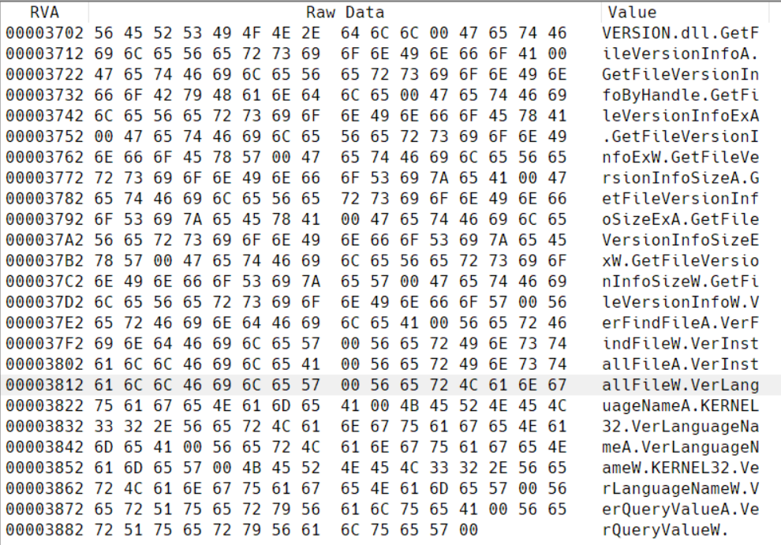

# エクスポートテーブル

DLL はエクスポートテーブルを通じて、エクスポート関数の名前、序数(ordinal)、エントリアドレスなどの情報を外部に提供します。インポートの側から見ると、Windows ローダが IAT を完成させるときに、DLL のエクスポートテーブルから、インポートした関数のアドレスを読み取っています。エクスポートテーブルは通常ほとんどの DLL に存在しますが、ごく一部の EXE ファイルにも存在します。

DLL のエクスポート関数の呼び出しは、関数名でも、エクスポートテーブル内の関数のインデックスでも行えます。Windows ローダがプロセスに関連する DLL を仮想アドレス空間にロードした後、インポートテーブルに登録されたその DLL に関連する名前または番号をもとに、DLL の仮想アドレス空間を走査してエクスポートテーブルの構造体を探し、そのエクスポート関数の仮想アドレス空間内での開始アドレス VA を確定します。そして、その VA を IAT の対応する項目に上書きします。

## EAT

`DataDirectory[0]` には EXPORT TABLE(すなわちエクスポートテーブル)の RVA が格納されています。この RVA は `IMAGE_EXPORT_DIRECTORY` 構造体を指します。PE ファイルには `IMAGE_EXPORT_DIRECTORY` 構造体は最大で 1 つしか存在しません。**ただし、PE ファイルは一度に複数のライブラリをインポートできるため、`IMAGE_IMPORT_DESCRIPTOR` 構造体は複数持てます。**

`IMAGE_EXPORT_DIRECTORY` 構造体を見てみましょう。

```c
typedef struct _IMAGE_EXPORT_DIRECTORY{
  DWORD    Characteristics;
  DWORD    TimeDateStamp;
  WORD     MajorVersion;
  WORD     MinorVersion;
  DWORD    Name;                     // ライブラリファイル名のアドレス
  DWORD    Base;                     // エクスポート関数の開始序数
  DWORD    NumberOfFunctions;        // エクスポート関数の個数
  DWORD    NumberOfNames;            // エクスポート関数の名前の個数
  DWORD    AddressOfFunctions;       // エクスポート関数アドレスの配列(要素数=NumberOfFunctions)
  DWORD    AddressOfNames;           // エクスポート関数名アドレスの配列(要素数=NumberOfNames)
  DWORD    AddressOfNameOrdinals;    // エクスポート関数序数の配列(要素数=NumberOfNames)
} IMAGE_EXPORT_DIRECTORY, *PIMAGE_EXPORT_DIRECTORY;
```

構造体の各メンバについて詳しく説明します。

- **`Name` ダブルワード。このメンバが保持するアドレスは "\0" で終わる文字列を指し、その文字列には、エクスポートテーブルが存在するファイルの元のファイル名が記録されています。**
- **`Base` ダブルワード。エクスポート関数の開始序数です。エクスポート関数の番号 = Base + Ordinals です。**
- **`NumberOfFunctions` ダブルワード。エクスポート関数の総数です。**
- **`NumberOfNames0` ダブルワード。エクスポートテーブルでは、名前が定義されている関数と、されていない関数があります。このメンバは、名前が定義されているエクスポート関数の個数を記録します。この値が 0 の場合は、すべての関数に名前が定義されていないことを表します。`NumberOfNames**` は常に `NumberOfFunctions` 以下です。**
- **`AddressOfFunctions` ダブルワード。エクスポート関数アドレス配列の先頭を指します。エクスポート関数アドレス配列には、`NumberOfFunctions` 個のエクスポート関数のアドレスが保存されています。**
- **`AddressOfNames` ダブルワード。エクスポート関数名アドレス配列の先頭を指します。エクスポート関数名配列の各要素は、エクスポート関数に対応する名前文字列のアドレスを指しています。**
- **`AddressOfNameOrdinals` ダブルワード。エクスポート関数序数アドレス配列の先頭を指します。`AddressOfNames` と一対一に対応します。エクスポート関数序数配列の各要素は、エクスポート関数に対応する序数の値を指しています。**

簡単な例で学んでみましょう。例として Windows システムの version.dll を選びます。このファイルは `C:\Windows\SysWOW64\` ディレクトリにあります。
まず、例のファイルの `IMAGE_EXPORT_DIRECTORY` 構造体を見てみます。

```text
// サンプルプログラムの IMAGE_EXPORT_DIRECTORY
RVA       Value      Description
----------------------------------------------------
00003630  00000000   Characteristicss
00003634  FDB2B236   Time Data Stamp
00003638  0000       Major Version
0000363A  0000       Minor Version
0000363C  00003702   Name RVA
00003640  00000001   Base
00003644  00000011   Number of Functions
00003648  00000011   Number of Names
0000364C  00003658   Address Table RVA
00003650  0000369C   Name Pointer Table RVA
00003654  000036E0   Ordinal Table RVA
----------------------------------------------------
```

続いて、エクスポートテーブル内の配列を整理します。

```text
RVA       Address   Name      Ordinal  Description
---------------------------------------------------------------------
00003658  000014F0  0000370E        0  GetFileVersionInfoA
0000365C  000022E0  00003722        1  GetFileVersionInfoByHandle
00003660  00001F40  0000373D        2  GetFileVersionInfoExA
00003664  00001570  00003753        3  GetFileVersionInfoExW
00003668  00001510  00003769        4  GetFileVersionInfoSizeA
0000366C  00001F60  00003781        5  GetFileVersionInfoSizeExA
00003670  00001590  0000379B        6  GetFileVersionInfoSizeExW
00003674  000015B0  000037B5        7  GetFileVersionInfoSizeW 
00003678  000015D0  000037CD        8  GetFileVersionInfoW
0000357C  00001F80  000037E1        9  VerFindFileA
00003680  00002470  000037EE       10  VerFindFileW
00003684  00001FA0  000037FB       11  VerInstallFileA
00003688  00002F40  0000380B       12  VerInstallFileW
0000368C  0000382C  0000381B       13  VerLanguageNameA
00003690  00003857  00003846       14  VerLanguageNameW
00003694  00001530  00003871       15  VerQueryValueA
00003698  00001550  00003880       16  VerQueryValueW
------------------------------------------------------------------------
```

Address 列はエクスポート関数がメモリにロードされたときの実際のアドレスに、Name 列はエクスポート関数名の RVA に対応し、Ordinal はエクスポート関数の序数です。
ここで、エクスポートテーブルの文字列部分、つまりライブラリファイル名とエクスポート関数名が保存されている部分の内容も加えておきます。PEview を使うと簡単に確認できます。



エクスポート関数のアドレスを取得する流れは、おおよそ次のとおりです。

1. まず `AddressOfNames` メンバを使って、エクスポート関数名の配列を特定します。
2. 次に、文字列比較(strcmp)で指定された関数名を探し、見つかったらそのインデックスを `name_index` とします。
3. 次に、`AddressOfOrdinals` メンバを使って、エクスポート関数序数の配列を特定します。
4. 次に、`name_index` を使って、エクスポート関数序数配列内の対応する `ordinal` の値を特定します。
5. 次に、`AddressOfFunctions` メンバを使って、エクスポート関数アドレス配列、すなわち `Export Address Table(EAT)` を特定します。
6. 最後に、`ordinal` をインデックスとして、エクスポート関数アドレス配列内の対応する項目を特定し、指定された関数の開始アドレスを取得します。

まれに存在する名前を持たないエクスポート関数については、Ordinal メンバから Base を引いた値をインデックスとして、エクスポート関数アドレス配列内の対応する関数アドレスを特定します。