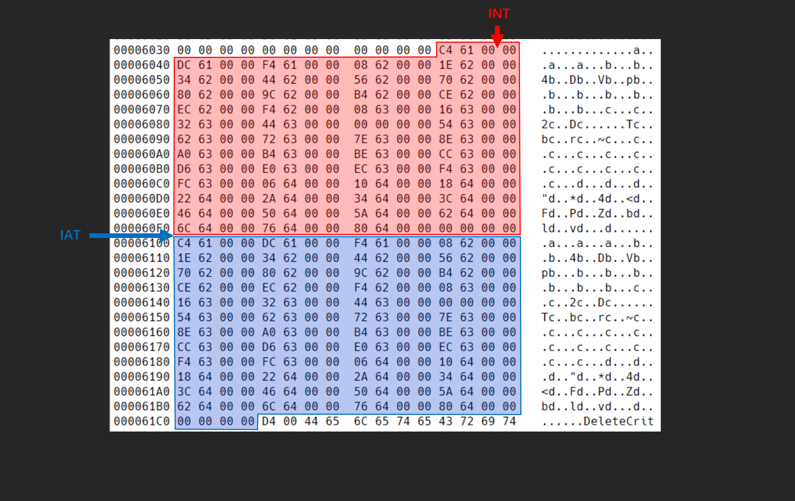
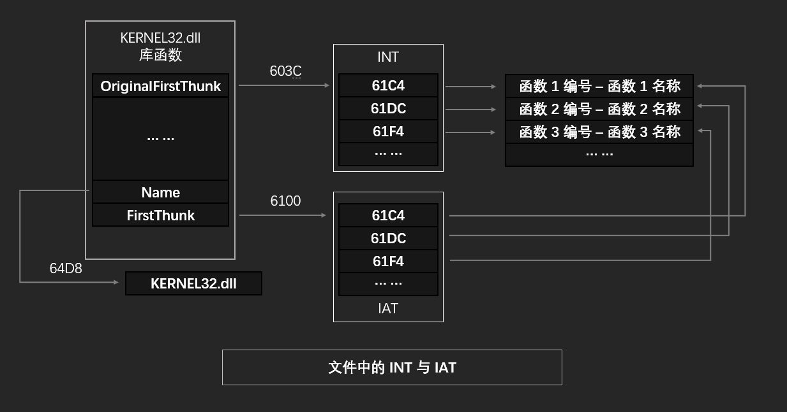
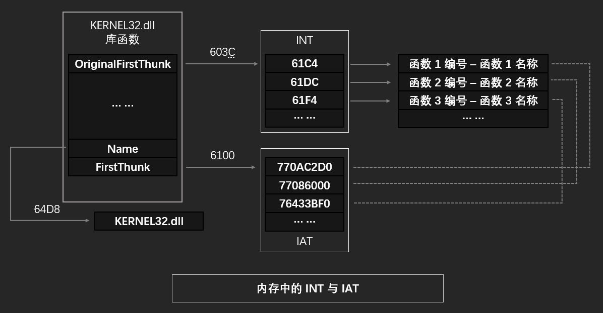
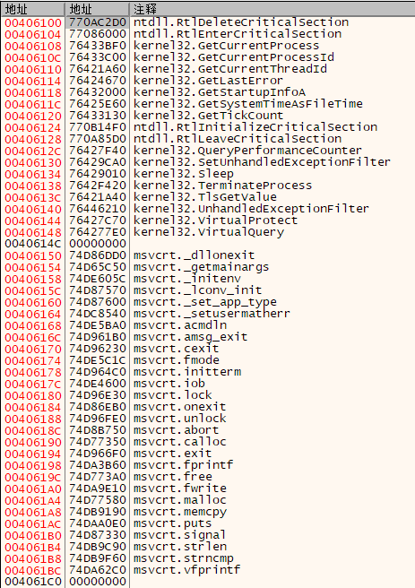

# インポートテーブル

実行ファイルが外部の DLL のコードやデータを使うとき、Windows ローダは、インポートする関数とデータをすべて記録し、DLL を実行ファイルの仮想アドレス空間にロードする必要があります。ローダは、実行ファイルの実行に必要なすべての DLL がロードされることを保証します。

しかし、実行ファイルはインポート関数がメモリ上のどこにあるかを確定できません。そこで、Windows ローダは DLL のロード時に、インポート関数を特定するのに必要な情報を IAT(Import Address Table、インポートアドレステーブル)に書き込みます。実行中にインポート関数の呼び出しに遭遇すると、IAT を通じてインポート関数のメモリ上の位置を確定します。

インポートテーブルに関連するデータには、`IMAGE_IMPORT_DESCRIPTOR` と `IMAGE_IMPORT_BY_NAME`、およびそれらに対応する文字列データがあります。インポートテーブルは、DLL がメモリにロードされた後の、対応する関数の実際のアドレスを修正して保存するためのデータセクションです。

## INT と IAT

`DataDirectory[1]` には IMPORT TABLE(すなわちインポートテーブル)の RVA が格納されています。この RVA は `IMAGE_IMPORT_DESCRIPTOR` 構造体の配列を指し、`IMAGE_IMPORT_DESCRIPTOR` 構造体には、PE ファイルがライブラリファイルをインポートするのに必要な情報が記録されています。

```c
typedef struct _IMAGE_IMPORT_DESCRIPTOR {
  union {
    DWORD Characteristics;
    DWORD OriginalFirstThunk;       // インポート名前テーブル `INT` の RVA
  };
  DWORD TimeDateStamp;
  DWORD ForwarderChain;
  DWORD Name;                       // ライブラリ名の文字列の RVA
  DWORD FirstThunk;                 // インポートアドレステーブル `IAT` の RVA
} IMAGE_IMPORT_DESCRIPTOR;
```

構造体の重要なメンバについて説明します。

- **`OriginalFirstThunk` は INT(Import Name Table)を指します。**
- **`Name` は、インポート関数が属するライブラリファイルの名前を指します。**
- **`FirstThunk` は IAT(Import Address Table)を指します。**

`INT` と `IAT` は、まとめて「二重の橋」構造とも呼ばれます。`INT` 配列の各ポインタは、それぞれ `IMAGE_IMPORT_BY_NAME` 構造体を指し、ファイル中の `IAT` も同様です。`IMAGE_IMPORT_BY_NAME` 構造体には、インポート関数に必要な情報が記録されています。

```c
typedef struct _IMAGE_IMPORT_BY_NAME {
  WORD Hint;                        // 
  BYTE Name[1];                     // 関数名の文字列
} IMAGE_IMPORT_BY_NAME, *PIMAGE_IMPORT_BY_NAME;
```

- **`Hint` メンバは関数の番号を表します。通常、DLL では各関数に番号が付けられており、関数を特定するときには、名前でも番号でも特定できます。**
- **`Name[1]` メンバは "\0" で終わる ANSI 文字列で、関数名を表します。**

続いて、例のファイルの `IMAGE_IMPORT_DESCRIPTOR` 構造体の配列を見てみます。

```text
RVA       Data      Description               Value
----------------------------------------------------------
00006000  0000603C  Import Name Table RVA
00006004  00000000  Time Data Stamp
00006008  00000000  Forward Chain
0000600C  000064D8  Name RVA                  KERNEL32.dll
00006010  00006100  Import Address Table RVA  
----------------------------------------------------------
00006014  0000608C  Import Name Table RVA
00006018  00000000  Time Data Stamp
0000601C  00000000  Forward Chain
00006020  00006558  Name RVA                  msvcrt.dll
00006024  00006150  Import Address Table RVA
----------------------------------------------------------
00006028  00000000
0000602C  00000000
00006030  00000000
00006034  00000000
00006038  00000000
----------------------------------------------------------
```

続いて、例のファイルの `INT` と `IAT` を見てみます。



両者は異なる場所を指していますが、保存されているデータはまったく同じであることが分かります。なぜまったく同じ構造体を 2 つ保存するのでしょうか。これを理解するには、まず `INT` と `IAT` の役割と、両者の関係を知る必要があります。まず、ファイル中の `INT` と `IAT` の関係を見てみます。



両者は異なるポインタですが、ポインタの内容はまったく同じで、最終的にはどちらも同じ構造体の配列を指します。つまり、あるライブラリファイル内の関数を特定したいとき、`INT` からでも `IAT` からでも特定できます。
プログラムがメモリにロードされると、参照しやすいように、インポート関数のアドレスが `IAT` に書き込まれます。IAT のアドレス値が更新される流れは次のとおりです。

1. `IMAGE_IMPORT_DESCRIPTOR` の `Name` メンバを読み取り、ライブラリ名の文字列 "KERNEL32.dll" を取得する
2. 対応するライブラリをロードする -> `LoadLibrary["KERNEL32.dll"]`
3. `IMAGE_IMPORT_DESCRIPTOR` の `OriginalFirstThunk` メンバを読み取り、`INT` のアドレスを取得する
4. `INT` 配列の値を読み取り、対応する `IMAGE_IMPORT_BY_NAME` 構造体のアドレスを取得する
5. `IMAGE_IMPORT_BY_NAME` の `Hint` または `Name` メンバを読み取り、対応する関数の開始アドレスを取得する -> `GetProcAddress('DeleteCriticalSection')`
6. `IMAGE_IMPORT_DESCRIPTOR` の `FirstThunk` メンバを読み取り、`IAT` のアドレスを取得する
7. 手順 5 で得た関数アドレスを、`IAT` 配列の対応する項目に書き込む
8. `INT` が終わる(NULL に遭遇する)まで、手順 4 から 7 を繰り返す

続いて、メモリ上の `INT` と `IAT` の関係を見てみます。



**メモリ上では、`INT` から関数の名前または関数の番号が分かり、`IAT` から関数の命令コードのメモリ空間上での実際のアドレスが分かります。**
x32dbg でプログラムの IAT を見てみます。



このとき、`IAT` 内のポインタはすべて、関数のメモリ上の実際のアドレスに置き換わっています。

## バインドインポート

バインドインポートは、PE のロード速度を高める技術です。影響するのはロードの過程だけで、PE の最終的なロード結果や実行結果には影響しません。PE ファイルがインポートする関数が多いと、ロード時に関数のインポートを完了するのに一定の時間がかかり、PE のロード時間が長くなります。**バインドインポートでは、IAT アドレスの修正作業をロードの前に行います。ユーザーが手作業で行うか、専用のバインドツールが行い、そのうえで PE ファイル内にバインドインポートデータを宣言して、ローダに再度の処理が不要であることを伝えます。**

ただし、Windows のバージョンによって動的リンクライブラリのベースアドレスは異なるため、バインドされたアドレスが誤り、プログラムが実行できなくなることがあります。この点も簡単に解決できます。**PE のロード前の IAT の修正がすべて正しいと仮定すれば、実行時には修正の手順を省けます。また、PE のロードにはエラー検出の仕組みがあり、エラーが検出された場合は、PE ローダがロード時に IAT を再度修正します。**

**まとめると、Windows は、対象の PE ファイルに関連する動的リンクライブラリをロードするとき、まずこれらのアドレスが正しく有効かどうかを確認します。これには、現在のシステムの DLL のバージョンが、バインドインポート構造に記述されたバージョン番号と合っているかの確認も含まれます。合っていない場合や、DLL の再配置が必要な場合、ローダは OriginalFirstThunk が指す配列を走査して新しいアドレスを計算し、その新しいアドレスを IAT に書き込みます。**

