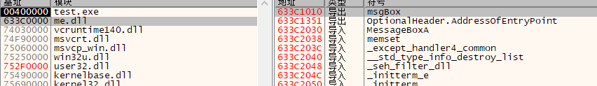
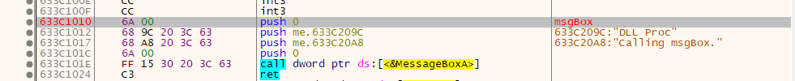

# ベースリロケーションテーブル

リンカは PE ファイルを生成するとき、実行時に PE ファイルがデフォルトのベースアドレスにロードされると仮定して、コードとデータの絶対アドレスを PE ファイルに書き込みます。ロード時に PE ファイルが実際にデフォルトのベースアドレスにロードされれば、リロケーションは不要です。しかし、ロード時に PE ファイルが別の場所にロードされると、ロードのベースアドレスが変わり、コードとデータの実際のアドレスもそれに応じて変わるため、ファイル中の絶対アドレスはすべて無効になります。このときは、リロケーションによって絶対アドレスを修正し、すべて正しい位置を指すようにする必要があります。

EXE ファイルは、実行時にそれぞれ独立した仮想アドレス空間を使うため、常にデフォルトのベースアドレスにロードでき、リロケーション情報は不要です。しかし、同じ仮想アドレス空間に複数の DLL が存在することがあり、DLL によってはデフォルトのベースアドレスがすでに使われている状況に直面します。そのため、DLL にはリロケーション情報が必要です。

## リロケーション構造体

PE ファイルでは、リロケーションが必要になりうるアドレスはすべて 1 つの配列、すなわちベースリロケーションテーブルに置かれます。ロードアドレスが変わった場合は、配列内のすべてのアドレスが修正されます。ベースリロケーションテーブルはセクション .reloc 内にありますが、これを見つける正しい方法は、`DataDirectory[5]`、すなわち BASE RELOCATION TABLE の項目を使うことです。

ベースリロケーションデータはページ単位で分割する方式で構成されます。つまり、異なるページのリロケーションデータを分けて格納し、各ページのリロケーションデータが 1 つのリロケーションデータブロックを成し、すべてのリロケーションブロックがリロケーションテーブルを構成します。各リロケーションブロックは 4KB 分のリロケーション情報を格納し、各リロケーションデータブロックのサイズは DWORD アラインされている必要があります。リロケーションブロックは `IMAGE_BASE_RELOCATION` 構造体で始まり、その構造体は次のとおりです。

```c
typedef struct _IMAGE_BASE_RELOCATION {
    DWORD    VirtualAddress;  // リロケーション対象ページの RVA
    DWORD    SizeOfBlock;     // リロケーションブロックのサイズ
     WORD    TypeOffset;      // リロケーションエントリの種類とオフセット

} _IMAGE_BASE_RELOCATION;
typedef IMAGE_BASE_RELOCATION UNALIGNED * PIMAGE_BASE_RELOCATION;
```

構造体の各メンバについて詳しく説明します。

- **VirtualAddress リロケーション対象ページの RVA。イメージのロードベースアドレスにページの RVA を加えた和を被加数とし、さらにリロケーション項目に対応する offset を加えると、メモリ上の実際の VA が得られます。最後のリロケーションブロックの末尾にも、終了の目印として virtualaddress フィールドが追加されます。**
- **SizeOfBlock ベースリロケーションブロックのサイズ。VirtualAddress、SizeOfBlock、およびそれに続く TypeOffset のサイズを含みます。**
- **TypeOffset** 配列です。配列の各要素のサイズは 2 バイト、すなわち 16 ビットです。 
  - **type の上位 4 ビットは、リロケーションの種類を表します。**
  - **offset の下位 12 ビットは、リロケーションデータの位置の、ページ RVA に対するオフセットを表します。VirtualAddress に加えると、修正すべきリロケーションデータへのポインタになり、さらにイメージのロードベースアドレスを加えると、修正後のポインタになります。**

## リロケーションの過程

**リロケーションテーブルを使って、修正が必要なアドレスを特定します。**たとえば me.dll では、リロケーションテーブルの先頭部分は次のとおりです。

```text
RVA       Data      Description
00005000  00001000  页 RVA        // page RVA = 0x1000
00005004  00000118  重定位块大小 size   
00005008      3013  Type|Offset   //   offset = 0x013
...
```

0x1000+0x013 から、リロケーション対象のデータがファイルオフセット 0x1013 にあることが分かります。これにデフォルトの imagebase を加えると 0x10001013 になります。次のとおりです。

```x86asm
.text:10001012 68 9C 20 00 10        push 1000209C
```

つまり、ファイルオフセット 0x1013 にある 1000209C は、リロケーションが必要な可能性があります。

**リロケーション対象データの修正**:プログラムの実行後、me.dll は 0x633C0000 にロードされました。



リロケーション対象の修正後の値を計算し、その修正後の値をリロケーション対象のアドレスに書き込みます。

```
计算待重定位数据地址：
(0x10001013 - DefaultImageBase) + ImageBase 
即 (0x10001013 - 0x10000000) + 0x633C0000 => 0x633C1013

计算待重定位数据修正后的值：
(0x1000209C - DefaultImageBase) + ImageBase 
即 (0x1000209C - 0x10000000) + 0x633C0000 => 0x633C209C

最后： *0x633C1013 = 0x633C209C
```

メモリ上の実際の値を確認します。



> 問題を一つ残しておきます。EXE がリロケーションを必要とするのはどんなときでしょうか。