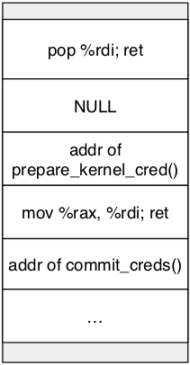

# Change Self

カーネルは、プロセスの `task_struct` 構造体の cred ポインタから cred 構造体を参照し、cred の内容に基づいてプロセスの持つ権限を判断します。cred 構造体のメンバのうち uid から fsgid までがすべて 0 であれば、一般にそのプロセスは root 権限を持つとみなされます。

```c
struct cred {
	atomic_t	usage;
#ifdef CONFIG_DEBUG_CREDENTIALS
	atomic_t	subscribers;	/* number of processes subscribed */
	void		*put_addr;
	unsigned	magic;
#define CRED_MAGIC	0x43736564
#define CRED_MAGIC_DEAD	0x44656144
#endif
	kuid_t		uid;		/* real UID of the task */
	kgid_t		gid;		/* real GID of the task */
	kuid_t		suid;		/* saved UID of the task */
	kgid_t		sgid;		/* saved GID of the task */
	kuid_t		euid;		/* effective UID of the task */
	kgid_t		egid;		/* effective GID of the task */
	kuid_t		fsuid;		/* UID for VFS ops */
	kgid_t		fsgid;		/* GID for VFS ops */
  ...
}
```

したがって、考え方は比較的直感的で、次の方法で権限昇格できます。

- cred 構造体の内容を直接書き換える
- task_struct 構造体中の cred ポインタを、条件を満たす別の cred に向けるよう書き換える

どちらの方法でも、一般に「特定」と「書き換え」の 2 段階に分かれます。これは、象を冷蔵庫に入れる話のようなものです。

## cred を直接書き換える

### 具体的な位置を特定する

まず cred の具体的なアドレスを取得し、そのうえで cred を書き換えます。

#### 特定

cred の具体的なアドレスを特定する方法は多数ありますが、ここでは直接特定するかどうかで次の 2 つに分けます。

##### 直接特定する

cred 構造体の先頭には各種の ID 情報が記録されており、通常のプロセスでは、uid から fsgid までがすべてそのプロセスを実行したユーザーの ID になっています。したがって、メモリをスキャンして cred を特定できます。

```c
struct cred {
	atomic_t	usage;
#ifdef CONFIG_DEBUG_CREDENTIALS
	atomic_t	subscribers;	/* number of processes subscribed */
	void		*put_addr;
	unsigned	magic;
#define CRED_MAGIC	0x43736564
#define CRED_MAGIC_DEAD	0x44656144
#endif
	kuid_t		uid;		/* real UID of the task */
	kgid_t		gid;		/* real GID of the task */
	kuid_t		suid;		/* saved UID of the task */
	kgid_t		sgid;		/* saved GID of the task */
	kuid_t		euid;		/* effective UID of the task */
	kgid_t		egid;		/* effective GID of the task */
	kuid_t		fsuid;		/* UID for VFS ops */
	kgid_t		fsgid;		/* GID for VFS ops */
  ...
}
```

**実際に特定していると、条件を満たす cred が多数見つかることがあります。これは主に、cred 構造体がコピーされたり解放されたりするためです。**特定の際に usage が 0 でないことを利用して一部の cred を除外するのは直感的な方法ですが、それでも usage が 0 の cred が見つかります。cred は usage が 0 になってから解放されるまでに一定の時間があるためです。また、cred は rcu を使って遅延解放されます。

##### 間接的に特定する

###### task_struct

プロセスの `task_struct` 構造体には cred へのポインタが格納されています。そこで、次のようにします。

1. 現在のプロセスの `task_struct` 構造体のアドレスを特定する

2. task_struct 構造体に対する cred ポインタのオフセットから、`cred` ポインタが格納されているアドレスを計算する

3. `cred` の具体的なアドレスを取得する

###### comm

comm は実行ファイルの名前を示すもので、プロセスの `task_struct` 構造体の中にあります。comm は実は cred の直後(原文では「真下」)に位置しているため、先に comm を特定し、それから cred のアドレスを特定することもできます。

```c
	/* Process credentials: */

	/* Tracer's credentials at attach: */
	const struct cred __rcu		*ptracer_cred;

	/* Objective and real subjective task credentials (COW): */
	const struct cred __rcu		*real_cred;

	/* Effective (overridable) subjective task credentials (COW): */
	const struct cred __rcu		*cred;

#ifdef CONFIG_KEYS
	/* Cached requested key. */
	struct key			*cached_requested_key;
#endif

	/*
	 * executable name, excluding path.
	 *
	 * - normally initialized setup_new_exec()
	 * - access it with [gs]et_task_comm()
	 * - lock it with task_lock()
	 */
	char				comm[TASK_COMM_LEN];
```

ただし、プロセス名が特殊でない場合、カーネル内に同じ文字列が複数存在することがあり、検索の正確さと効率に影響します。そこで、prctl でプロセスの comm を特殊な文字列に設定してから、comm の特定を始めるとよいでしょう。

#### 書き換え

この方法では、cred 中の uid から fsgid までをすべて 0 に書き換えるだけです。書き換え方はもちろん多数あり、たとえば次のようなものがあります。

- 任意アドレスの読み書きができるなら、cred を直接書き換えられる。
- ROP でコードを実行できるなら、ROP gadget を使って cred を書き換えられる。

### 間接的に特定する

cred の内容を書き換えたいのは確かですが、cred の具体的な位置を必ずしも知る必要はなく、cred を書き換えられさえすればかまいません。

#### (すでに古い)UAF で同じヒープチャンクを使う

プロセスの初期化時に cred 構造体の位置を制御でき、かつ初期化後にその部分の内容を書き換えられるなら、権限昇格の目的は容易に達成できます。典型的な例を示します。

1. cred 構造体と同じサイズのヒープチャンクを確保する
2. そのチャンクを解放する
3. 新しいプロセスを fork する。ちょうど先ほど解放したチャンクが使われる
4. このとき、cred 構造体の特定のメモリを書き換えて権限昇格する

ただし、**この方法は新しいバージョンのカーネルではすでに成立せず、cred\_jar 内のオブジェクトを直接確保することはできません**。cred\_jar は作成時に `SLAB_ACCOUNT` フラグが設定されており、`CONFIG_MEMCG_KMEM=y`(デフォルトで有効)のとき、**cred\_jar は同じサイズの kmalloc-192 と統合されなくなる**ためです。

```c
void __init cred_init(void)
{
	/* allocate a slab in which we can store credentials */
	cred_jar = kmem_cache_create("cred_jar", sizeof(struct cred), 0,
			SLAB_HWCACHE_ALIGN|SLAB_PANIC|SLAB_ACCOUNT, NULL);
}
``` 

## cred ポインタを書き換える

### 具体的な位置を特定する

この方法では、cred ポインタの具体的なアドレスを知る必要があります。

#### 特定

##### 直接特定する

当然ながら、cred ポインタには特に変わった点がないため、直接特定する方法で cred ポインタを見つけるのは困難です。

##### 間接的に特定する

###### task_struct

プロセスの `task_struct` 構造体には cred へのポインタが格納されています。そこで、次のようにします。

1. 現在のプロセスの `task_struct` 構造体のアドレスを特定する

2. task_struct 構造体に対する cred ポインタのオフセットから、`cred` ポインタが格納されているアドレスを計算する

###### common

comm は実行ファイルの名前を示すもので、プロセスの `task_struct` 構造体の中にあります。comm は実は cred ポインタの直後(原文では「真下」)に位置しているため、先に comm を特定し、それから cred ポインタのアドレスを特定することもできます。

```c
	/* Process credentials: */

	/* Tracer's credentials at attach: */
	const struct cred __rcu		*ptracer_cred;

	/* Objective and real subjective task credentials (COW): */
	const struct cred __rcu		*real_cred;

	/* Effective (overridable) subjective task credentials (COW): */
	const struct cred __rcu		*cred;

#ifdef CONFIG_KEYS
	/* Cached requested key. */
	struct key			*cached_requested_key;
#endif

	/*
	 * executable name, excluding path.
	 *
	 * - normally initialized setup_new_exec()
	 * - access it with [gs]et_task_comm()
	 * - lock it with task_lock()
	 */
	char				comm[TASK_COMM_LEN];
```

ただし、プロセス名が特殊でない場合、カーネル内に同じ文字列が複数存在することがあり、検索の正確さと効率に影響します。そこで、prctl でプロセスの comm を特殊な文字列に設定してから、comm の特定を始めるとよいでしょう。

#### 書き換え

具体的に書き換える際には、次の 2 つの方法が使えます。

- cred ポインタを、カーネルイメージ中にすでに存在する init_cred のアドレスに書き換える。この方法は、cred ポインタを直接書き換えられ、かつ init_cred のアドレスが分かっている場合に向いています。
- cred を偽造し、cred ポインタをそのアドレスに向けるよう書き換える。この方法は手間がかかるため、一般にはあまり使われません。

### 間接的に特定する

#### commit_creds(&init_cred)

`commit_creds()` 関数は、新しい cred を現在のプロセスの task_struct の real_cred フィールドと cred フィールドに設定するために使われます。したがって、カーネルの実行フローを奪ってこの関数を呼び出し、root 権限を持つ cred を渡せれば、現在のプロセスの権限昇格をそのまま完了できます。

```c
int commit_creds(struct cred *new)
{
	struct task_struct *task = current;//カーネルのマクロ。percpu セグメントから現在のプロセスの PCB を取得する
	const struct cred *old = task->real_cred;

	//...
	rcu_assign_pointer(task->real_cred, new);
	rcu_assign_pointer(task->cred, new);
```

カーネルの初期化の過程では `init` プロセスが root 権限で起動され、その cred 構造体は**静的に定義された** `init_cred` です。このことから、`commit_creds(&init_cred)` で権限昇格できると容易に思いつきます。

```c
/*
 * The initial credentials for the initial task
 */
struct cred init_cred = {
	.usage			= ATOMIC_INIT(4),
#ifdef CONFIG_DEBUG_CREDENTIALS
	.subscribers		= ATOMIC_INIT(2),
	.magic			= CRED_MAGIC,
#endif
	.uid			= GLOBAL_ROOT_UID,
	.gid			= GLOBAL_ROOT_GID,
	.suid			= GLOBAL_ROOT_UID,
	.sgid			= GLOBAL_ROOT_GID,
	.euid			= GLOBAL_ROOT_UID,
	.egid			= GLOBAL_ROOT_GID,
	.fsuid			= GLOBAL_ROOT_UID,
	.fsgid			= GLOBAL_ROOT_GID,
	.securebits		= SECUREBITS_DEFAULT,
	.cap_inheritable	= CAP_EMPTY_SET,
	.cap_permitted		= CAP_FULL_SET,
	.cap_effective		= CAP_FULL_SET,
	.cap_bset		= CAP_FULL_SET,
	.user			= INIT_USER,
	.user_ns		= &init_user_ns,
	.group_info		= &init_groups,
	.ucounts		= &init_ucounts,
};
```

#### (すでに古い) commit_creds(prepare_kernel_cred(0))

カーネルには、指定したプロセスの cred 構造体をコピーする `prepare_kernel_cred()` 関数があります。引数に NULL を渡すと、この関数は `init_cred` をコピーして、root 権限を持つ cred を返します。

```c
struct cred *prepare_kernel_cred(struct task_struct *daemon)
{
	const struct cred *old;
	struct cred *new;

	new = kmem_cache_alloc(cred_jar, GFP_KERNEL);
	if (!new)
		return NULL;

	kdebug("prepare_kernel_cred() alloc %p", new);

	if (daemon)
		old = get_task_cred(daemon);
	else
		old = get_cred(&init_cred);
```

カーネル空間で `commit_creds(prepare_kernel_cred(NULL))` を呼び出せれば、やはりそのまま権限昇格を完了できます。



ただし、カーネルバージョン 6.2 以降、`prepare_kernel_cred(NULL)` は **init\_cred をコピーせず、実行時エラーとして扱って NULL を返す**ようになりました。このため、この権限昇格方法は 6.2 以降のカーネルでは使えません。

```c
struct cred *prepare_kernel_cred(struct task_struct *daemon)
{
	const struct cred *old;
	struct cred *new;

	if (WARN_ON_ONCE(!daemon))
		return NULL;

	new = kmem_cache_alloc(cred_jar, GFP_KERNEL);
	if (!new)
		return NULL;
```
