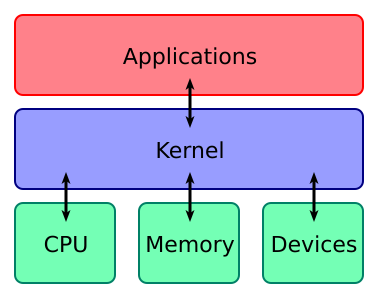
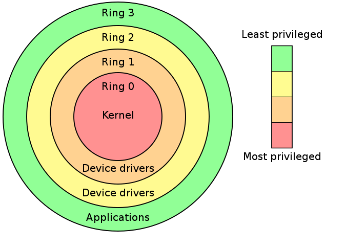
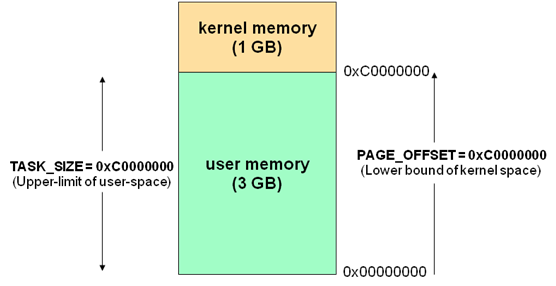
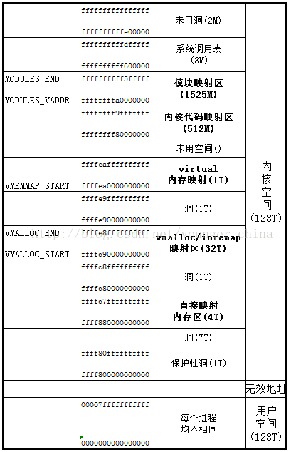
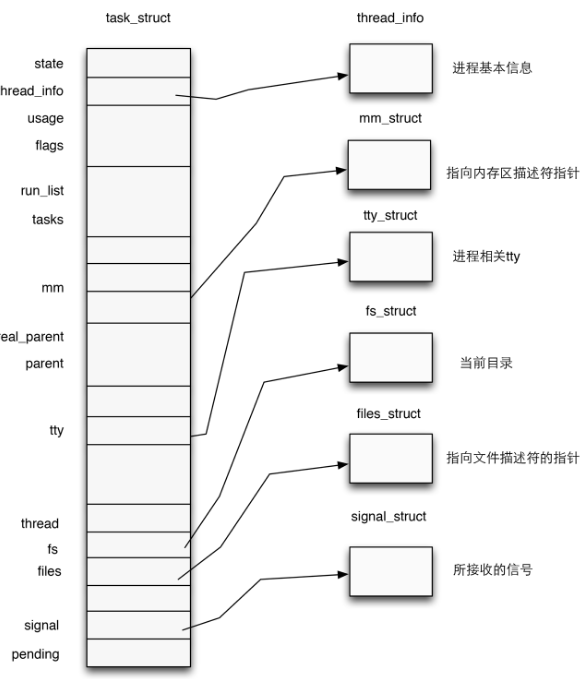
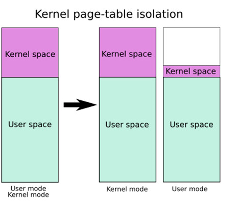
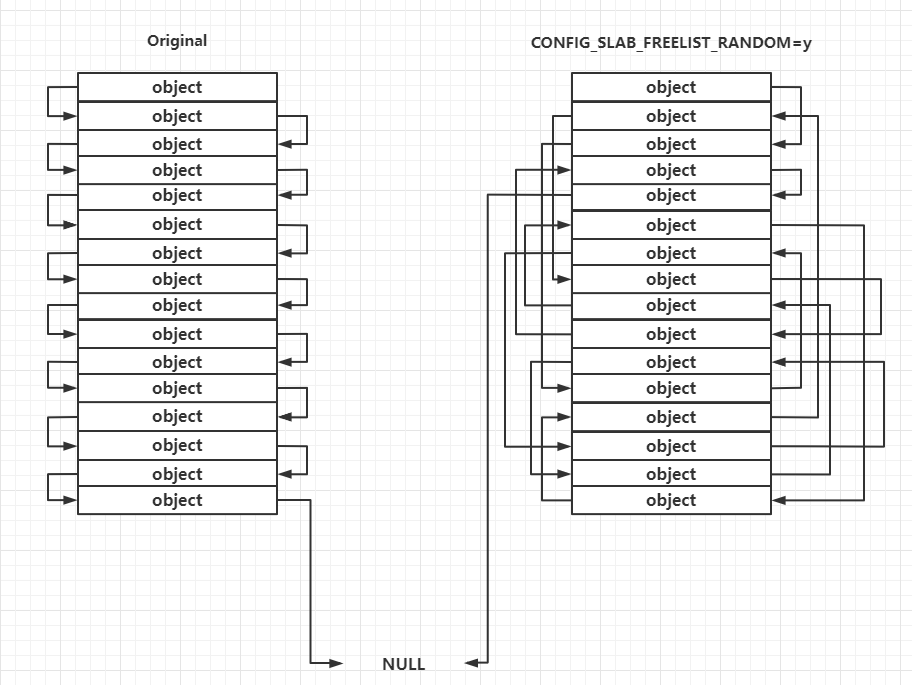

# 基礎知識

この節では、Linux カーネルの pwn に必要な基礎知識を紹介します。簡易版の「オペレーティングシステム入門」の講義のようなものと考えてください。

## Operating System Kernel

オペレーティングシステムのカーネル(Operation System Kernel)も本質的にはソフトウェアの一種で、一般のアプリケーションとハードウェアの間に位置する中間層と見なせます。主な役割は、システムリソースのスケジューリング、IO デバイスの制御、ネットワークやファイルシステムの操作などで、上位のアプリケーションに便利で抽象化されたインターフェースを提供します。



オペレーティングシステムのカーネルは、実際には私たちが抽象化して作り出した概念で、本質的にはユーザープロセスと変わらず、どちらも物理メモリ上のコードとデータです。違いは、CPU がカーネルのコードを実行するときは通常高い権限で動作し、ハードウェアへの完全なアクセス能力を持つのに対し、ユーザーモードのコードを実行するときは通常低い権限の環境で動作し、ハードウェアへのアクセス能力が一部しかない、または欠けている点です。

この 2 つの異なる権限での実行状態は、実際にはハードウェアによって実現されています。そこで、ここで新しい概念として**保護リング**を導入します。

## hierarchical protection domains

**階層的保護ドメイン**(hierarchical protection domains)は保護リングとも呼ばれ、略して Rings といいます。コンピュータのさまざまなリソースを、異なる権限に分けるモデルです。

ハードウェアやマイクロコードのレベルで異なる特権モードを提供する CPU アーキテクチャでは、保護リングは通常ハードウェアによって強制されます。Rings は、最高の特権レベル(通常はレベル 0 と呼ばれます)から最低の特権レベル(通常は最大の数字に対応します)の順に並びます。

Intel の CPU は権限を Ring0、Ring1、Ring2、Ring3 の 4 段階に分け、権限は順に低くなります。現代のオペレーティングシステムのモデルでは、通常 ring0 と ring3 だけを使い、それぞれオペレーティングシステムのカーネルとユーザープロセスに対応します。つまり、CPU はユーザープロセスのコードを実行しているとき ring3 にいます。



ここで、【ユーザーモード】と【カーネルモード】という 2 つの概念を定義します。

- ユーザーモード:CPU が ring3 で動作している + ユーザープロセスの実行環境コンテキスト。
- カーネルモード:CPU が ring0 で動作している + カーネルコードの実行環境コンテキスト。

## モードの切り替え

CPU が異なる特権レベルの間で切り替わる経路は、主に 2 つあります。

- 割り込みと例外(interrupt & exception):CPU が割り込みや例外を受け取ると ring0 に切り替わり、割り込み記述子テーブルを引いて対応する割り込み処理コードを実行します。
- 特権レベル関連の命令:CPU がこれらの命令を実行すると実行状態が変化します。たとえば iret 命令(ring0->ring3)や sysenter 命令(ring3->ring0)です。

こうした特権レベルの切り替え方法に基づいて、現代のオペレーティングシステムの開発者は、「ユーザーモード」から「カーネルモード」に切り替えるための入口としてシステムコール(syscall)を用意しました。これにより、ユーザープロセスに必要な機能を実現するカーネルコードが実行されます。ユーザープロセスがより高い権限のサービスを要求したいときは、システムが提供するアプリケーションインターフェースを通じて、システムコールでカーネルモードに入り、オペレーティングシステムに要求を処理させる必要があります。

### user space to kernel space(システムコール)

`システムコール`、`例外の発生`、`周辺機器による割り込み` などのイベントが起きると、ユーザーモードからカーネルモードへの切り替えが発生し、カーネル内の対応するハンドラに入って処理されます。

システムコールはカーネルとユーザーが通信するための直接のインターフェースなので、ここでは主に、ユーザー空間でよく使われるシステムコールという動作に注目します。具体的な流れは次のとおりです。

> 注意:システムコール命令が実行されると、CPU はカーネルモードに入ります。以下の操作はカーネルモードで行われます。

1. `swapgs` で GS セグメントレジスタを切り替えます。GS レジスタの値と特定の位置の値を交換することで、GS の値を保存すると同時に、その位置の値をカーネル実行時の GS 値として使います。
2. 現在のスタックトップ(ユーザー空間のスタックトップ)を CPU 専用の変数領域に記録し、CPU 専用領域に記録されているカーネルスタックトップを rsp/esp に入れます。
3. push で各レジスタの値を保存します。具体的な[コード](http://elixir.free-electrons.com/linux/v4.12/source/arch/x86/entry/entry_64.S)は次のとおりです。

	```asm
	 ENTRY(entry_SYSCALL_64)
	 /* SWAPGS_UNSAFE_STACK はマクロで、x86 では直接 swapgs 命令として定義されています */
	 SWAPGS_UNSAFE_STACK
	
	 /* スタックの値を保存し、カーネルスタックを設定する */
	 movq %rsp, PER_CPU_VAR(rsp_scratch)
	 movq PER_CPU_VAR(cpu_current_top_of_stack), %rsp
	
	
	/* push でレジスタの値を保存し、pt_regs 構造体を形成する */
	/* Construct struct pt_regs on stack */
	pushq  $__USER_DS      /* pt_regs->ss */
	pushq  PER_CPU_VAR(rsp_scratch)  /* pt_regs->sp */
	pushq  %r11             /* pt_regs->flags */
	pushq  $__USER_CS      /* pt_regs->cs */
	pushq  %rcx             /* pt_regs->ip */
	pushq  %rax             /* pt_regs->orig_ax */
	pushq  %rdi             /* pt_regs->di */
	pushq  %rsi             /* pt_regs->si */
	pushq  %rdx             /* pt_regs->dx */
	pushq  %rcx tuichu    /* pt_regs->cx */
	pushq  $-ENOSYS        /* pt_regs->ax */
	pushq  %r8              /* pt_regs->r8 */
	pushq  %r9              /* pt_regs->r9 */
	pushq  %r10             /* pt_regs->r10 */
	pushq  %r11             /* pt_regs->r11 */
	sub $(6*8), %rsp      /* pt_regs->bp, bx, r12-15 not saved */
	```

4. アセンブリ命令で `x32_abi` かどうかを判定します。
5. システムコール番号をもとに、グローバル変数 `sys_call_table` の対応する位置にジャンプして、システムコールの実行を続けます。

### kernel space to user space

終了時の流れは次のとおりです。

1. `swapgs` で GS の値を復元します。
2. `sysretq` または `iretq` でユーザー空間に戻り、実行を続けます。`iretq` を使う場合は、ユーザー空間の情報(CS、eflags/rflags、esp/rsp など)も与える必要があります。

## 仮想メモリ空間

現代のオペレーティングシステムでは、コンピュータの仮想メモリのアドレス空間は通常 2 つに分けられます。ユーザープロセスが使うユーザー空間(user space)と、オペレーティングシステムのカーネルが使うカーネル空間(kernel space)です。Linux では通常、仮想アドレスの高い側の仮想メモリ空間がカーネルに割り当てられ、仮想アドレスの低い側の仮想メモリ空間がユーザープロセスに割り当てられます。

32 ビット環境の仮想メモリ空間のレイアウトは次のとおりです。



64 ビット環境の仮想メモリ空間のレイアウトは次のとおりです。



## プロセスの権限管理

カーネル(kernel)はあらゆるシステムリソースをスケジューリングし、ユーザーのアプリケーションに実行環境を提供します。同様に、アプリケーションの権限もすべて kernel が管理しています。

### プロセス記述子(process descriptor)

カーネル内では、構造体 `task_struct` でプロセスを表します。この構造体はカーネルソースの `include/linux/sched.h` で定義されていますが、コードが長いのでここには載せません。

プロセス記述子の構造は、次の図のようになっているはずです。



### プロセスの権限資格情報(credential)

`task_struct` のソースに、次のコードがあることに注目してください。

```c
/* Process credentials: */

/* Tracer's credentials at attach: */
const struct cred __rcu        *ptracer_cred;

/* Objective and real subjective task credentials (COW): */
const struct cred __rcu        *real_cred;

/* Effective (overridable) subjective task credentials (COW): */
const struct cred __rcu        *cred;
```

構造体 `cred` はプロセスの権限を管理するためのもので、カーネルソースの `include/linux/cred.h` で次のように定義されています。

```c
/*
 * The security context of a task
 *
 * The parts of the context break down into two categories:
 *
 *  (1) The objective context of a task.  These parts are used when some other
 *	task is attempting to affect this one.
 *
 *  (2) The subjective context.  These details are used when the task is acting
 *	upon another object, be that a file, a task, a key or whatever.
 *
 * Note that some members of this structure belong to both categories - the
 * LSM security pointer for instance.
 *
 * A task has two security pointers.  task->real_cred points to the objective
 * context that defines that task's actual details.  The objective part of this
 * context is used whenever that task is acted upon.
 *
 * task->cred points to the subjective context that defines the details of how
 * that task is going to act upon another object.  This may be overridden
 * temporarily to point to another security context, but normally points to the
 * same context as task->real_cred.
 */
struct cred {
	atomic_long_t	usage;
	kuid_t		uid;		/* real UID of the task */
	kgid_t		gid;		/* real GID of the task */
	kuid_t		suid;		/* saved UID of the task */
	kgid_t		sgid;		/* saved GID of the task */
	kuid_t		euid;		/* effective UID of the task */
	kgid_t		egid;		/* effective GID of the task */
	kuid_t		fsuid;		/* UID for VFS ops */
	kgid_t		fsgid;		/* GID for VFS ops */
	unsigned	securebits;	/* SUID-less security management */
	kernel_cap_t	cap_inheritable; /* caps our children can inherit */
	kernel_cap_t	cap_permitted;	/* caps we're permitted */
	kernel_cap_t	cap_effective;	/* caps we can actually use */
	kernel_cap_t	cap_bset;	/* capability bounding set */
	kernel_cap_t	cap_ambient;	/* Ambient capability set */
#ifdef CONFIG_KEYS
	unsigned char	jit_keyring;	/* default keyring to attach requested
					 * keys to */
	struct key	*session_keyring; /* keyring inherited over fork */
	struct key	*process_keyring; /* keyring private to this process */
	struct key	*thread_keyring; /* keyring private to this thread */
	struct key	*request_key_auth; /* assumed request_key authority */
#endif
#ifdef CONFIG_SECURITY
	void		*security;	/* LSM security */
#endif
	struct user_struct *user;	/* real user ID subscription */
	struct user_namespace *user_ns; /* user_ns the caps and keyrings are relative to. */
	struct ucounts *ucounts;
	struct group_info *group_info;	/* supplementary groups for euid/fsgid */
	/* RCU deletion */
	union {
		int non_rcu;			/* Can we skip RCU deletion? */
		struct rcu_head	rcu;		/* RCU deletion hook */
	};
} __randomize_layout;
```

cred 構造体には、プロセスの 4 種類の異なるユーザー ID が記録されています。通常、これらの ID はすべて同じ値のはずです。

- 実ユーザー ID(real UID):プロセスの起動時のユーザー ID を示します
- 保存ユーザー ID(saved UID):プロセスの最初の実効ユーザー ID を示します
- 実効ユーザー ID(effective UID):プロセスの実行中に属しているユーザー ID を示します。プロセスは実行の途中で自分の属するユーザーを変更できるため、権限の仕組みも実効ユーザー ID で認証を行い、カーネルは euid で特権の判断をします。ユーザーが常に高い権限を使い続けるのを防ぐため、タスクが完了すると euid と suid が交換され、プロセスの有効な権限が元に戻ります
- ファイルシステムユーザー ID(UID for VFS ops):プロセスがファイルを作成するときの識別に使うユーザー ID を示します

グループ ID も同様に、実グループ ID、保存グループ ID、実効グループ ID、ファイルシステムグループ ID の 4 つに分かれ、ユーザー ID と似ているため、ここでは繰り返しません。

### プロセスの権限の変更

前述のとおり、プロセスの権限はカーネル空間にある `cred` 構造体で管理されています。したがって、プロセスの `cred` 構造体を変更すれば、その実行権限を変更できると容易に考えられます。

カーネル空間には、次の 2 つの関数があり、どちらも `kernel/cred.c` にあります。

- `struct cred* prepare_kernel_cred(struct task_struct* daemon)`:この関数はプロセスの cred 構造体をコピーし、新しい cred 構造体を返します。daemon 引数は、有効なプロセス記述子のアドレスでなければならない点に注意してください。
- `int commit_creds(struct cred *new)`:この関数は、新しい cred 構造体をプロセスに適用します。

## Loadable Kernel Modules(LKMs)

Linux Kernel はモノリシックカーネルのアーキテクチャを採用しており、あらゆるシステムサービスをカーネルが提供する必要があります。効率は高いものの、拡張性と保守性に欠け、また、使う可能性のある多くのサービスをカーネルにロードする必要がありますが、それらのサービスが結局使われないこともあり、大量のメモリ空間を占有します。さらに、新しいサービスを提供するには、カーネル全体を再コンパイルしなければならないことも少なくありません。

以上を総合的に考えて、**ロード可能カーネルモジュール**(Loadable Kernel Modules、略して LKMs)が登場しました。カーネル空間にある LKMs は、新しいシステムコールやその他のサービスを提供できます。また、LKMs は積み木のようにカーネルへロードしたり、カーネルからアンロードしたりできるため、kernel の拡張性と保守性が大幅に向上しました。

よくある LKMs には次のようなものがあります。

- ドライバ(Device drivers)
	- デバイスドライバ
	- ファイルシステムドライバ
	- ...
- カーネル拡張モジュール (modules)

LKMs のファイル形式はユーザーモードの実行可能プログラムと同じで、Linux では ELF、Windows では exe/dll、mac では MACH-O です。そのため、IDA などのツールでカーネルモジュールを解析できます。

モジュールは単独でコンパイルできますが、単独では実行できません。実行時にカーネルにリンクされ、カーネルの一部としてカーネル空間で動作します。この点がユーザー空間で動作するプロセスとは異なります。

モジュールは通常、ファイルシステム、ドライバ、あるいはカーネルの上位層のその他の機能を実装するのに使われます。

> Linux カーネルがモジュールの仕組みを提供しているのは、カーネル自体がモノリシックカーネル(monolithic kernel)だからです。モノリシックカーネルの利点はすべてが一体になっているため効率が高いことですが、欠点は拡張性と保守性が比較的劣ることで、モジュールの仕組みはこの欠点を補うためのものです。

### 関連コマンド
- **insmod**: 指定したモジュールをカーネルにロードする
- **rmmod**: 指定したモジュールをカーネルからアンロードする
- **lsmod**: ロード済みのモジュールを一覧表示する
- **modprobe**: モジュールを追加または削除する。modprobe はモジュールのロード時に依存関係を調べる

> 多くの CTF における kernel の脆弱性も LKM に存在します。

## カーネルとのやり取り

### システムコールの概要

システムコールとは、ユーザー空間のプログラムが、IO 操作やプロセス間通信など、より高い権限を必要とするサービスをオペレーティングシステムのカーネルに要求することを指します。システムコールは、ユーザープログラムとオペレーティングシステムの間のインターフェースです。一部のライブラリ関数(scanf、puts などの IO 関連の関数)は、実際にはシステムコール(read と write)のラッパーです。

> */usr/include/x86_64-linux-gnu/asm/unistd_64.h* と */usr/include/x86_64-linux-gnu/asm/unistd_32.h* で、それぞれ 64 ビットと 32 ビットのシステムコール番号を確認できます。

> あわせて、とても便利なサイト [Linux Syscall Reference](https://syscalls.kernelgrok.com) も紹介します。32 ビットのシステムコールに対応するレジスタの意味やソースを調べられます。64 ビットのシステムコールは [Linux Syscall64 Reference](https://syscalls64.paolostivanin.com/) で確認できます。

### システムコール:ioctl

`*NIX` ではすべてがファイルと見なせるため、すべてをファイルへのアクセスと同じ方法で操作できます。便宜上、Linux はプロセスとデバイスの間で通信するためのシステムコール `ioctl` を定義しています。

`ioctl` はデバイスの入出力操作専用のシステムコールで、呼び出し方は次のとおりです。

```c
int ioctl(int fd, unsigned long request, ...)
```

第 1 引数はデバイスを開いたとき(open)に返される[ファイルディスクリプタ](http://m4x.fun/post/play-with-file-descriptor-1/)、第 2 引数はユーザープログラムからデバイスへの制御コマンドで、その後ろの引数は補足的なもので、デバイスに依存します。

ioctl による通信方法を提供しているデバイスに対しては、そのファイルディスクリプタを使い、異なるリクエストコードやその他のリクエスト引数を指定して ioctl システムコールを呼び出すことで、デバイスに対するさまざまな I/O 操作を行えます。

> ioctl で通信する理由:
>
> オペレーティングシステムは、カーネルが標準的な外部デバイスにアクセスするためのシステムコールを提供しています。ほとんどのハードウェアデバイスはカーネル空間内でしか直接アドレス指定できないためです。しかし、標準でないハードウェアデバイスにアクセスする場合、こうしたシステムコールは適切でなく、ユーザーモードからデバイスに直接アクセスする必要が生じることがあります。
>
> たとえば、システム管理者がネットワークカードの設定を変更したい場合があります。現代のオペレーティングシステムはさまざまなデバイスをサポートしていますが、カーネルの設計者が想定していなかったデバイスもあり、そうなると、デバイスを使うためのシステムコールをこのように用意することは不可能になります。
>
> この問題を解決するため、カーネルは拡張可能に設計されており、デバイスドライバと呼ばれるモジュールを追加できます。ドライバのコードはカーネル空間で動作でき、デバイスに直接アドレス指定できます。Ioctl インターフェースは独立したシステムコールで、これを通じてユーザー空間はデバイスドライバと通信できます。デバイスドライバへのリクエストは、デバイスとリクエスト番号を引数とする Ioctl の呼び出しです。これにより、カーネルはユーザー空間にデバイスドライバへのアクセス、ひいてはデバイスへのアクセスを許可しつつ、デバイスの具体的な詳細を知る必要がなく、デバイスごとの大量のシステムコールも必要としません。

## カーネルモードでよく使う関数

カーネル内ではユーザーモードの C ライブラリの関数は使えず、カーネル自身が対応するさまざまな関数を持っています。よく使う機能の関数は次のとおりです。

- printf()		->		**printk()**。ただし、printk() は必ずしも内容を端末に表示するとは限りませんが、必ずカーネルバッファには入るので、`dmesg` で結果を確認できます
- memcpy()		->		**copy\_from\_user()/copy\_to\_user()**
	- copy\_from\_user() は、ユーザー空間のデータをカーネル空間に転送します
	- copy\_to\_user() は、カーネル空間のデータをユーザー空間に転送します
- malloc()		->		**kmalloc()**。カーネルモードのメモリ確保関数で、malloc() に似ていますが、`slab/slub アロケータ` を使います
- free()		->		**kfree()**。kmalloc() と同様です

また、`kernel はプロセスを管理するため、kernel はプロセスの権限も記録しています`。kernel には、権限を簡単に変更できる関数が 2 つあります。

- **int commit_creds(struct cred \*new)**
- **struct cred\* prepare_kernel_cred(struct task_struct\* daemon)**

関数名からも分かるように、`commit_creds(prepare_kernel_cred(&init_task))` を実行すれば root 権限を取得できます。つまり、init プロセスの cred をコピーして、現在のプロセスの新しい credentials にします。

> `prepare_kernel_cred` の詳細は、[ソース](https://elixir.bootlin.com/linux/v4.6/source/kernel/cred.c#L594)を参照してください。

`commit_creds(prepare_kernel_cred(&init_task))` の実行は最もよく使われる権限昇格の手段でもあります。これらの関数や変数のアドレスは `/proc/kallsyms` で確認できます(古いカーネルバージョンでは `/proc/ksyms`)。このファイルの内容は、通常 root 権限がないと正しく閲覧できません。

```shell
$ sudo cat /proc/kallsyms | grep "T commit_creds"
ffffffffbb11ab20 T commit_creds
$ sudo cat /proc/kallsyms | grep "T prepare_kernel_cred"
ffffffffbb11b080 T prepare_kernel_cred
$ sudo cat /proc/kallsyms | grep "D init_cred"
ffffffffbce58840 D init_cred
```

## Mitigation

一般のプログラムと同様に、Linux Kernel にもさまざまな保護機構があります。

> canary、dep、PIE、RELRO などの保護は、ユーザーモードと原理も役割も同じです。

### 汎用的な保護機構

#### KASLR

KASLR は```内核空間地址随机化```(kernel address space layout randomize)であり、ユーザーモードのプログラムの ASLR に似ています。カーネルイメージを実際のアドレス空間にマップするときにオフセット値(粒度は 256MB)を加えますが、カーネル内部の相対オフセットは変わりません。

KASLR 保護が有効でないとき、カーネルのコードセグメントのベースアドレスは ```0xffffffff81000000``` で、direct mapping area のベースアドレスは `0xffff888000000000` です。

カーネルのメモリレイアウトは[こちら](https://elixir.bootlin.com/linux/v6.3/source/Documentation/x86/x86_64/mm.rst)を参照してください。

#### _*FGKASLR_

KASLR はある程度攻撃を緩和できますが、攻撃者が情報漏えいの脆弱性でカーネル内の何らかのアドレスを入手すると、カーネルのロードアドレスのオフセットが直接分かり、カーネル全体のアドレスレイアウトが分かってしまいます。そのため、KASLR をもとに FGKASLR を実装した研究者がいます。これは**関数単位でカーネルコードを並べ替える**ものです。

#### STACK PROTECTOR

ユーザーモードのプログラムの canary に似たもので、stack cookie とも呼ばれ、**カーネルスタックのオーバーフローが発生したか**を検出するために使います。カーネルスタックのオーバーフローが発生すると、kernel panic が起きます。

カーネル内の canary の値は、通常 gs セグメントレジスタの固定オフセットにある値から取られます。

#### SMAP/SMEP

SMAP は```管理模式访问保护```(Supervisor Mode Access Prevention)、SMEP は```管理模式执行保护```(Supervisor Mode Execution Prevention)のことで、この 2 つの保護は通常同時に有効になります。**カーネル空間からユーザー空間のデータへの直接のアクセスや実行**を阻止し、カーネル空間とユーザー空間を完全に分離することで、ret2usr(return-to-user。カーネル空間の命令ポインタを、ユーザー空間に用意した権限昇格コードへ向ける)攻撃を防ぎます。

SMEP 保護を回避する方法は、次の 2 つがあります。

- カーネルのリニアマッピング領域が物理アドレス空間を完全にマップしていることを利用し、ユーザー空間の対応するページフレームのカーネル空間アドレスを見つけて、そのカーネルアドレスでユーザー空間にアクセスします(つまり、カーネル空間のアドレスとユーザー空間のアドレスが同じページフレームにマップされている状態です)。この攻撃手法は ret2dir と呼ばれます。
- Intel ではシステムは CR4 制御レジスタの第 20 ビットで SMEP 保護が有効かどうかを示します(1 で有効、0 で無効)。kernel ROP で CR4 レジスタの値を変更できれば SMEP 保護を無効にでき、SMEP-bypass が完了します。その後は再び ret2usr を行えます。**ただし、KPTI が有効なカーネルでは、カーネルページテーブル上のユーザーアドレス空間に実行権限がないため、ret2usr は完全に過去のものになりました**。

>  ARM には `PXN` という似た保護があります。

#### [KPTI](https://www.kernel.org/doc/html/latest/x86/pti.html)

KPTI は `カーネルページテーブル分離`(Kernel page-table isolation)のことで、カーネル空間とユーザー空間でそれぞれ別のページテーブルのセットを使います。これはカーネルのメモリ管理に根本的な変化をもたらしました。

補足しておくと、**この 2 つのページテーブルにはどちらもユーザーメモリ空間の完全なマッピングがありますが、ユーザー側のページテーブルにはごく一部のカーネルコード(システムコールのエントリポイントや割り込み処理など)しかマップされておらず、カーネルメモリ空間の完全なマッピングがあるのはカーネル側のページテーブルだけです。ただし、どちらのページテーブルにもユーザーメモリ空間の完全なマッピングがあります**。次の図のとおり、左側は KPTI が有効でない場合のページテーブルのレイアウト、右側は KPTI が有効な場合のページテーブルのレイアウトです。



KPTI は、史上最大級の CPU ハードウェアの脆弱性である Meltdown を修正するために考案されました。簡単に言うと、CPU のパイプライン設計(アウトオブオーダー実行と投機実行)の欠陥を突いて、ユーザーモードからはアクセスできないカーネル空間のデータを取得するもので、サイドチャネル攻撃の一種です。

**KPTI はさらに、カーネルページテーブルのうちユーザーアドレス空間に属する部分から実行権限も取り除きます。これにより、ret2usr は完全に過去のものになりました**。

### カーネルの「ヒープ」上の保護機構

#### Hardened Usercopy

hardened usercopy は、ユーザー空間とカーネル空間の間でデータをコピーするときに範囲外アクセスをチェックする保護機構で、**主にコピーの過程でカーネル空間内のデータの読み書きが範囲外にならないかをチェックします**。

- 読み取るデータの長さが、コピー元の object の範囲を超えていないか。
- 書き込むデータの長さが、コピー先の object の範囲を超えていないか。

この保護は `copy_to_user()` や `copy_from_user()` などのデータ交換 API で使われます。ただし、この保護は _カーネル空間内でのデータコピーには適用されません_。これが現在の主流の回避手段です。

#### Hardened freelist

glibc 2.32 で導入された保護に似ています。この保護が有効になる前は、slub 内の free object の next ポインタには、次の free object のアドレスが直接格納されていたため、攻撃者は freelist を読み取ってカーネルのリニアマッピング領域のアドレスをリークできました。この保護が有効になった後は、free object の next ポインタには、次の 3 つの値を XOR した値が格納されます。

- 現在の free object のアドレス。
- 次の free object のアドレス。
- kmem\_cache が指定する random 値。

攻撃者は、少なくとも 1 つ目と 3 つ目の値を入手しないと freelist を改ざんできません。これにより、freelist を直接悪用する難易度が確実に大きく上がります。

> 新しいバージョンの Linux kernel では、さらにオフセット値が導入されているようですが、筆者は未確認です。

#### Random freelist

この保護は主に、slub allocator が buddy system からページフレームを確保した後の処理の過程で働きます。この保護が有効でない完全な slub では、その上の object の連結順序は線形に連続していますが、保護が有効になるとその上の object 同士の連結順序はランダムになり、攻撃者は次に確保される object のアドレスを直接予測できなくなります。

注意すべきは、この保護が働くのは **slub allocator が buddy system から新しい slub を取得した直後だけで、実行時の freelist の構成は引き続き LIFO に従う**ということです。



#### CONFIG\_INIT\_ON\_ALLOC\_DEFAULT\_ON

カーネルのコンパイル時にこのオプションを有効にすると、カーネルが「ヒープメモリ」を確保する際(buddy system と slab allocator の両方を含む)、**確保されたメモリの内容をゼロクリアします**。これにより、未初期化メモリを利用したデータのリークを防ぎます。

> 性能の低下は `1%~7%` の間とされています。

## CTF の kernel pwn 関連

従来の kernel pwn の問題では、通常次の 3 つのファイルが与えられます。

1. boot.sh: kernel を起動する shell のスクリプトで、多くは qemu を使います。保護機構は qemu の起動パラメータによって異なります
2. bzImage: compressed kernel binary
3. rootfs.cpio: ファイルシステムイメージ

ここでは CISCN2017 - babydriver を例にします。
	
	```bash
	CISCN2017_babydriver [master●] ls
	babydriver.tar
	CISCN2017_babydriver [master●] x babydriver.tar
	boot.sh
	bzImage
	rootfs.cpio
	CISCN2017_babydriver [master●] ls
	babydriver.tar  boot.sh  bzImage  rootfs.cpio
	CISCN2017_babydriver [master●] file bzImage
	bzImage: Linux kernel x86 boot executable bzImage, version 4.4.72 (atum@ubuntu) #1 SMP Thu Jun 15 19:52:50 PDT 2017, RO-rootFS, swap_dev 0x6, Normal VGA
	CISCN2017_babydriver [master●] file rootfs.cpio
	rootfs.cpio: gzip compressed data, last modified: Tue Jul  4 08:39:15 2017, max compression, from Unix, original size 2844672
	CISCN2017_babydriver [master●] file boot.sh
	boot.sh: Bourne-Again shell script, ASCII text executable
	CISCN2017_babydriver [master●] bat boot.sh 
	───────┬─────────────────────────────────────────────────────────────────────────────────
	       │ File: boot.sh
	───────┼─────────────────────────────────────────────────────────────────────────────────
	   1   │ #!/bin/bash
	   2   │ 
	   3   │ qemu-system-x86_64 -initrd rootfs.cpio -kernel bzImage -append 'console=ttyS0 ro
	       │ ot=/dev/ram oops=panic panic=1' -enable-kvm -monitor /dev/null -m 64M --nographi
	       │ c  -smp cores=1,threads=1 -cpu kvm64,+smep
	───────┴─────────────────────────────────────────────────────────────────────────────────
	```

主な qemu パラメータの意味は次のとおりです。
	
- -initrd rootfs.cpio、rootfs.cpio をカーネル起動時のファイルシステムとして使う
- -kernel bzImage、bzImage を kernel イメージとして使う
- -cpu kvm64,+smep、CPU のセキュリティオプションを設定する。ここでは smep を有効にしている
- -m 64M、仮想 RAM を 64M に設定する(デフォルトは 128M)

そのほかの qemu パラメータは --help で確認できます。

### リモートの問題環境での攻略

通常、ローカルで書いた exploit プログラムを静的コンパイルしてリモートに転送する必要があります。比較的汎用的な方法は、exploit を base64 エンコードして転送することで、次のスクリプトが参考になります。

```python
from pwn import *
import base64
#context.log_level = "debug"

with open("./exp", "rb") as f:
    exp = base64.b64encode(f.read())

p = remote("127.0.0.1", 11451)
#p = process('./run.sh')
p.sendline()
p.recvuntil("/ $")

count = 0
for i in range(0, len(exp), 0x200):
    p.sendline("echo -n \"" + exp[i:i + 0x200].decode() + "\" >> /tmp/b64_exp")
    count += 1
    log.info("count: " + str(count))

for i in range(count):
    p.recvuntil("/ $")
    
p.sendline("cat /tmp/b64_exp | base64 -d > /tmp/exploit")
p.sendline("chmod +x /tmp/exploit")
p.sendline("/tmp/exploit ")

p.interactive()
```
通常の pwn の問題と比べると、kernel pwn でリモートを攻めるのは比較的長い作業になります。時間の大半がこのファイル転送に費やされるためです。musl-C や uclibc などのライブラリを使うと実行ファイルのサイズを大幅に減らせます。時間に余裕のある問題では、純粋なアセンブリで exp を書くこともできます。

## Reference

[【OS.0x00】Linux Kernel I：Basic Knowledge](https://arttnba3.cn/2021/02/21/OS-0X00-LINUX-KERNEL-PART-I/)

[【PWN.0x00】Linux Kernel Pwn I：Basic Exploit to Kernel Pwn in CTF](https://arttnba3.cn/2021/03/03/PWN-0X00-LINUX-KERNEL-PWN-PART-I/)

[Linux kernel heap feng shui in 2022](https://duasynt.com/blog/linux-kernel-heap-feng-shui-2022)

https://zh.wikipedia.org/wiki/内核

https://zh.wikipedia.org/wiki/分级保护域

https://zh.wikipedia.org/wiki/Ioctl

http://www.freebuf.com/articles/system/54263.html

https://blog.csdn.net/zqixiao_09/article/details/50839042

https://yq.aliyun.com/articles/53679

