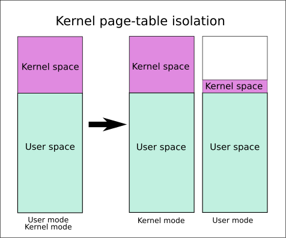

# KPTI - Kernel Page Table Isolation

## 概要

KPTI 機構の当初の主な目的は、KASLR の回避や CPU のサイドチャネル攻撃を緩和することでした。

KPTI 機構では、カーネル空間のメモリとユーザー空間のメモリの隔離がさらに強化されます。

- カーネルモードのページテーブルには、ユーザー空間メモリのページテーブルとカーネル空間メモリのページテーブルの両方が含まれます。
- ユーザーモードのページテーブルには、ユーザー空間メモリのページテーブルと、必要なカーネル空間メモリのページテーブル(システムコールや割り込みなどの処理に使うメモリなど)だけが含まれます。



x86_64 の PTI 機構では、カーネルモードにおけるユーザー空間メモリのマッピング部分がすべて実行不可としてマークされます。つまり、SMEP 機能を持たなかったハードウェアでも、KPTI 保護を有効にすれば SMEP に似た機能を持つことになります。また、SMAP のエミュレーションも同様の方法で導入できますが、現時点では導入されていません。したがって、現在 KPTI 保護が有効なカーネルでは、SMAP 保護が有効でなければ、カーネルは依然としてユーザー空間のメモリにアクセスできます。ただし、ユーザー空間にジャンプして Shellcode を実行することはできません。

KPTI 機構は Linux 4.15 で導入され、Linux 4.14.11、4.9.75、4.4.110 にバックポートされました。

## 発展の歴史

TODO。

## 実装

TODO。

## 有効化と無効化

qemu で起動したカーネルの場合は、`-append` オプションに `kpti=1` を追加すると KPTI を有効にできます。

qemu で起動したカーネルの場合は、`-append` オプションに `nopti` を追加すると KPTI を無効にできます。

## 状態の確認

次の 2 つの方法で、KPTI 機構が有効かどうかを確認できます。

```shell
/home/pwn # dmesg | grep 'page table'
[    0.000000] Kernel/User page tables isolation: enabled
/home/pwn # cat /proc/cpuinfo | grep pti
fpu_exception   : yes
flags           : ... pti smep smap
```

## Attack KPTI

KPTI 機構は SMAP や SMEP とは異なり、ソースコードと密接に結びついているため、実行時に無効にする方法はなさそうです。

### ページテーブルの書き換え

KPTI を有効にすると、ユーザー空間のすべてのデータに NX 権限が設定されます。しかし、対応するページテーブルの権限を書き換えて、実行可能にすることを考えられます。カーネルで smep が有効でない場合、ページテーブルの権限を書き換えた後でユーザーモードに戻り、ユーザーモードのコードを実行できます。

### SWITCH_TO_USER_CR3_STACK

KPTI 機構を有効にすると、ユーザーモードからカーネルモードに入るときにページテーブルが切り替わり、カーネルモードからユーザーモードに復帰するときにも切り替わります。したがって、カーネルがユーザーモードに戻る際に実行するページテーブル切り替えのコード断片を制御できれば、正常にユーザーモードへ戻ることもできます。

カーネルモードからユーザーモードへの切り替えのコードを解析すると、ページテーブルの切り替えは主に `SWITCH_TO_USER_CR3_STACK` というアセンブラマクロで行われていることが分かります。そのため、この部分のコードを呼び出せればよいのです。

```assembly
.macro SWITCH_TO_USER_CR3_STACK	scratch_reg:req
	pushq	%rax
	SWITCH_TO_USER_CR3_NOSTACK scratch_reg=\scratch_reg scratch_reg2=%rax
	popq	%rax
.endm
.macro SWITCH_TO_USER_CR3_NOSTACK scratch_reg:req scratch_reg2:req
	ALTERNATIVE "jmp .Lend_\@", "", X86_FEATURE_PTI
	mov	%cr3, \scratch_reg

	ALTERNATIVE "jmp .Lwrcr3_\@", "", X86_FEATURE_PCID

	/*
	 * Test if the ASID needs a flush.
	 */
	movq	\scratch_reg, \scratch_reg2
	andq	$(0x7FF), \scratch_reg		/* mask ASID */
	bt	\scratch_reg, THIS_CPU_user_pcid_flush_mask
	jnc	.Lnoflush_\@

	/* Flush needed, clear the bit */
	btr	\scratch_reg, THIS_CPU_user_pcid_flush_mask
	movq	\scratch_reg2, \scratch_reg
	jmp	.Lwrcr3_pcid_\@

.Lnoflush_\@:
	movq	\scratch_reg2, \scratch_reg
	SET_NOFLUSH_BIT \scratch_reg

.Lwrcr3_pcid_\@:
	/* Flip the ASID to the user version */
	orq	$(PTI_USER_PCID_MASK), \scratch_reg

.Lwrcr3_\@:
	/* Flip the PGD to the user version */
	orq     $(PTI_USER_PGTABLE_MASK), \scratch_reg
	mov	\scratch_reg, %cr3
.Lend_\@:
.endm
```

実際には、ページテーブルを切り替えるだけでなく、ユーザーモードにも戻りたいので、カーネル内のユーザーモードへ戻るコードも再利用する必要があります。カーネルがユーザーモードに戻る方法は主に 2 つ、iret と sysret です。以下で詳しく紹介します。

#### iret

```assembly
SYM_INNER_LABEL(swapgs_restore_regs_and_return_to_usermode, SYM_L_GLOBAL)
#ifdef CONFIG_DEBUG_ENTRY
	/* Assert that pt_regs indicates user mode. */
	testb	$3, CS(%rsp)
	jnz	1f
	ud2
1:
#endif
	POP_REGS pop_rdi=0

	/*
	 * The stack is now user RDI, orig_ax, RIP, CS, EFLAGS, RSP, SS.
	 * Save old stack pointer and switch to trampoline stack.
	 */
	movq	%rsp, %rdi
	movq	PER_CPU_VAR(cpu_tss_rw + TSS_sp0), %rsp
	UNWIND_HINT_EMPTY

	/* Copy the IRET frame to the trampoline stack. */
	pushq	6*8(%rdi)	/* SS */
	pushq	5*8(%rdi)	/* RSP */
	pushq	4*8(%rdi)	/* EFLAGS */
	pushq	3*8(%rdi)	/* CS */
	pushq	2*8(%rdi)	/* RIP */

	/* Push user RDI on the trampoline stack. */
	pushq	(%rdi)

	/*
	 * We are on the trampoline stack.  All regs except RDI are live.
	 * We can do future final exit work right here.
	 */
	STACKLEAK_ERASE_NOCLOBBER

	SWITCH_TO_USER_CR3_STACK scratch_reg=%rdi

	/* Restore RDI. */
	popq	%rdi
	SWAPGS
	INTERRUPT_RETURN

```

次のようなスタックを偽造し、`movq	%rsp, %rdi` にジャンプすれば、ページテーブルの切り替えとユーザーモードへの復帰を同時に行えます。

```
fake rax
fake rdi
RIP
CS
EFLAGS
RSP
SS
```

#### sysret

sysret を使う場合は、まず rcx と r11 が次の値になっていることを確認する必要があります。

```
rcx, save the rip of the code to be executed when returning to userspace
r11, save eflags
```

次に、次のようなスタックを構築します。

```
fake rdi
rsp, the stack of the userspace
```

最後に entry_SYSCALL_64 の次のコードへジャンプすれば、ユーザーモードに戻れます。

```assembly
	SWITCH_TO_USER_CR3_STACK scratch_reg=%rdi

	popq	%rdi
	popq	%rsp
	swapgs
	sysretq
```

### signal handler

ユーザーモードに signal handler を登録して、ユーザーモードにあるコードを実行させることも考えられます。この方法では、ページテーブルを切り替える必要がありません。

## 参考文献

- https://github.com/pr0cf5/kernel-exploit-practice/tree/master/bypass-smep#bypassing-smepkpti-via-rop
- https://outflux.net/blog/archives/2018/02/05/security-things-in-linux-v4-15/