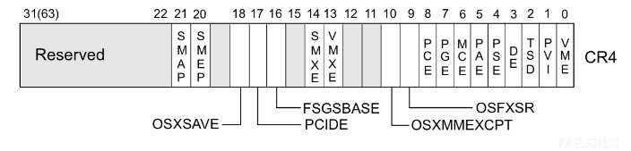

# ユーザーコードの実行禁止

当初、カーネルモードでコードを実行するとき、ユーザーモードのコードをそのまま実行できました。そのため、攻撃者がカーネル内の実行フローを制御できれば、ユーザーモードにあるコードを実行できました。ユーザーモードのコードは攻撃者が制御できるので、攻撃がより容易になります。この攻撃を防ぐため、研究者はカーネルモードにいる間はユーザーモードのコードを実行できないようにすることを提案しました。Linux カーネルでは、この防御策の実装は命令セットアーキテクチャに依存します。

## x86 - SMEP - Supervisor Mode Execution Protection

x86 での対応する保護機構の名前は SMEP です。CR4 レジスタの第 20 ビットが、SMEP 保護が有効かどうかを示します。



### 発展の歴史

TODO。

### 実装

TODO。

### 有効化と無効化

#### 有効化

デフォルトでは、SMEP 保護は有効です。

qemu で起動したカーネルの場合は、`-append` オプションに `+smep` を追加すると SMEP を有効にできます。

#### 無効化

`/etc/default/grub` の次の 2 行に nosmep を追加します。

```
GRUB_CMDLINE_LINUX_DEFAULT="quiet"  
GRUB_CMDLINE_LINUX="initrd=/install/initrd.gz"
```

そのうえで `update-grub` を実行して再起動すれば、smep を無効にできます。

qemu で起動したカーネルの場合は、`-append` オプションに `nosmep` を追加すると SMEP を無効にできます。

### 状態の確認

次のコマンドで SMEP が有効かどうかを確認できます。smep という文字列が見つかれば smep 保護が有効、見つからなければ無効です。

```bash
grep smep /proc/cpuinfo
```

### Attack SMEP

CR4 レジスタの第 20 ビットを 0 にすれば、ユーザーモードのコードを実行できます。一般には 0x6f0 を CR4 に設定し、SMAP と SMEP の両方を無効にします。

カーネル内で cr4 を書き換えるコードは最終的に `native_write_cr4` に行き着きます。制御フローを奪えれば、カーネル内の gadget を実行して CR4 を書き換えられます。別の見方をすると、カーネル内には cr4 を書き換える固定のコードが存在し、たとえば `refresh_pce` 関数や ` set_tsc_mode` などの関数にあります。

## ARM - PXN

TODO。

## 参考文献

- https://duasynt.com/slides/smep_bypass.pdf
- https://github.com/torvalds/linux/commit/15385dfe7e0fa6866b204dd0d14aec2cc48fc0a7