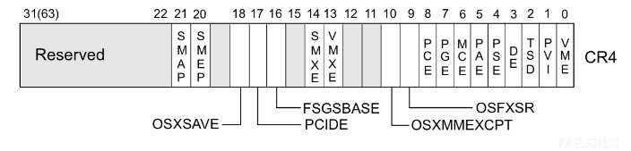

# ユーザーデータへのアクセス禁止

カーネルモードからユーザーモードのデータにアクセスできると、やはり問題が生じます。たとえば、制御フローを奪った後、攻撃者はスタックピボットでスタックをユーザーモードに移し、そこで ROP を行って、権限昇格という目的をさらに達成できます。Linux カーネルでは、この防御策の実装は命令セットアーキテクチャに依存します。

## x86 - SMAP - Supervisor Mode Access Protection

### 概要

x86 での対応する保護機構の名前は SMAP です。CR4 レジスタの第 21 ビットが、SMEP 保護が有効かどうかを示します。



### 発展の歴史

TODO。

### 実装

TODO。

### 有効化と無効化

#### 有効化

デフォルトでは、SMAP 保護は有効です。

qemu で起動したカーネルの場合は、`-append` オプションに `+smap` を追加すると SMAP を有効にできます。

#### 無効化

`/etc/default/grub` の次の 2 行に nosmap を追加します。

```
GRUB_CMDLINE_LINUX_DEFAULT="quiet"  
GRUB_CMDLINE_LINUX="initrd=/install/initrd.gz"
```

そのうえで `update-grub` を実行して再起動すれば、smap を無効にできます。

qemu で起動したカーネルの場合は、`-append` オプションに `nosmap` を追加すると SMAP を無効にできます。

### 状態の確認

次のコマンドで SMAP が有効かどうかを確認できます。smap という文字列が見つかれば smap 保護が有効、見つからなければ無効です。

```bash
grep smap /proc/cpuinfo
```

### Attack SMEP

ここでは、いくつかの方法を紹介します。

#### CR4 レジスタの設定

CR4 レジスタの第 21 ビットを 0 にすれば、ユーザーモードのデータにアクセスできます。一般には 0x6f0 を CR4 に設定し、SMAP と SMEP の両方を無効にします。

カーネル内で cr4 を書き換えるコードは最終的に `native_write_cr4` に行き着きます。制御フローを奪えれば、カーネル内の対応する gadget を実行して CR4 を書き換えられます。別の見方をすると、カーネル内には cr4 を書き換える固定のコードが存在し、たとえば `refresh_pce` 関数や ` set_tsc_mode` などの関数にあります。

#### copy_from/to_user

制御フローを奪った後、攻撃者は `copy_from_user` や `copy_to_user` を呼び出して、ユーザーモードのメモリにアクセスできます。この 2 つの関数は、ユーザーモードのメモリへのアクセスを禁止するフラグを一時的にクリアします。

## ARM - PAN

TODO。
