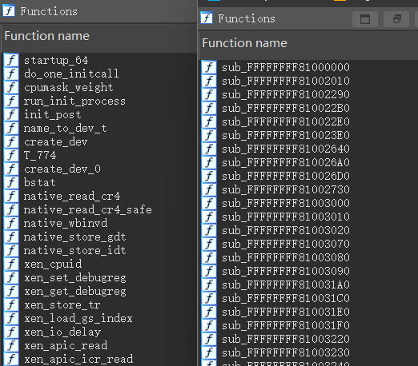

# System.map

`System.map` ファイルは、Linux カーネルのコンパイル過程で生成される重要なファイルです。カーネルシンボルと、それに対応するメモリアドレスが含まれています。これらのシンボルには、カーネル関数、変数、そのほかカーネル内で定義された重要なシンボルが含まれます。入手した vmlinux が stripped の場合、デバッグの助けとして System.map が必要になります。
`System.map` ファイルはプレーンテキストファイルで、各行に 3 つのフィールドがあります。

シンボルのアドレス(メモリアドレス)
シンボルの種類(例:関数、変数)。小文字ならローカルシンボル、大文字ならグローバル(外部)シンボルです。
シンボル名(識別子)
```
└─$ head System.map                 
0000000000000000 A VDSO32_PRELINK
0000000000000000 D __per_cpu_start
0000000000000000 D per_cpu__irq_stack_union
0000000000000000 A xen_irq_disable_direct_reloc
0000000000000000 A xen_save_fl_direct_reloc
0000000000000040 A VDSO32_vsyscall_eh_frame_size
00000000000001e7 A kexec_control_code_size
00000000000001f0 A VDSO32_NOTE_MASK
0000000000000400 A VDSO32_sigreturn
0000000000000410 A VDSO32_rt_sigreturn
```

## IDA で stripped の vmlinux に System.map を追加する

次のスクリプトをロードし、対応する System.map ファイルを選択します。
```python
import idaapi

def load_system_map(file_path):
    with open(file_path, "r") as f:
        for line in f:
            parts = line.split()
            if len(parts) < 3:
                continue
            
            addr = int(parts[0], 16)
            symbol_type = parts[1]
            symbol_name = parts[2]
            
            # if symbol_type in ['T', 't', 'D', 'd', 'B', 'b']:     #シンボルテーブルが大きすぎる場合は、必要に応じて絞り込めます
            if not idaapi.add_entry(addr, addr, symbol_name, 0):
                print(f"Failed to add symbol: {symbol_name} at {hex(addr)}")
            else:
                print(f"Added symbol: {symbol_name} at {hex(addr)}")

system_map_path = idaapi.ask_file(0, "*.map", "Select System.map file")
if system_map_path:
    load_system_map(system_map_path)
else:
    print("No file selected")

```

ロード前後の比較



## vmlinux を直接修復する

vmlinux を直接修復したい場合は、https://github.com/marin-m/vmlinux-to-elf を参照してください。

## 参考文献
https://linux.die.net/man/1/nm
