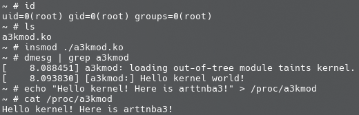

# Loadable Kernel Module を書く

この節では、ユーザーモードとやり取りする方法を含め、簡単なロード可能カーネルモジュール(Loadable Kernel Module)の開発方法を説明します。

## 基本的なカーネルモジュール

まず基本的なカーネルモジュールを書きます。ソースファイルの構成は次のとおりです。

```shell
$ tree .
.
├── Makefile
└── src
    ├── Kbuild
    └── main.c

2 directories, 3 files
```

main.c の内容は次のとおりです。モジュールのロード時に呼び出される初期化関数 `a3kmod_init()` と、モジュールのアンロード時に呼び出される終了関数 `a3kmod_exit()` を定義しています。

```c
/**
 * Copyright (c) 2025 arttnba3 <arttnba@gmail.com>
 * 
 * This work is licensed under the terms of the GNU GPL, version 2 or later.
**/

#include <linux/kernel.h>
#include <linux/module.h>
#include <linux/init.h>

static __init int a3kmod_init(void)
{
    printk(KERN_INFO "[a3kmod:] Hello kernel world!\n");
    return 0;
}

static __exit void a3kmod_exit(void)
{
    printk(KERN_INFO "[a3kmod:] Goodbye kernel world!\n");
}

module_init(a3kmod_init);
module_exit(a3kmod_exit);
MODULE_AUTHOR("arttnba3");
MODULE_LICENSE("GPL v2");
```

### Kbuild ビルドシステム

[Kbuild](https://docs.kernel.org/kbuild/kbuild.html) は Linux カーネルのビルドシステムの一部です。簡単に言うと、ソースディレクトリに `Kbuild` ファイルを書いておけば、コンパイル時に Linux カーネルのビルド基盤が `Kbuild` に従ってカーネルモジュールを自動的にビルドします。`Kbuild` がなければ `Makefile` を探します。

次は最も基本的な Kbuild ファイルの例です。構文は Makefile に少し似ています。

```makefile
# module name
MODULE_NAME ?= a3kmod
obj-m += $(MODULE_NAME).o

# compiler flags
ccflags-y += -I$(src)/include

# entry point
$(MODULE_NAME)-y += main.o
```

各シンボルの説明は次のとおりです。

- `MODULE_NAME`:単純な自前の変数で、モジュール名を定義するのに使います。

- `obj-m`:ビルド対象のカーネルモジュールの一覧を指定するシンボルです。`+=` はカーネルモジュールを追加することを意味し、`$(MODULE_NAME).o` はカーネルモジュールのビルドの後期の生成物です。通常は 1 つまたは複数のオブジェクトファイルが結合されたもので、最終的に `$(MODULE_NAME).ko` ファイル、つまりおなじみの LKM の ELF にリンクされます。モジュールをカーネルの ELF ファイル(vmlinux)に組み込んでビルドする場合は、`obj-y` を使います。

- `ccflags-y`:`ccflags` はコンパイルオプションを意味し、`-y` は有効にするコンパイルオプションを意味します。ここでは `-I` オプションを追加して、自前のヘッダディレクトリを取り込んでいます(あくまで例示で、この節では実際には複雑なコード構造は扱いません)。そのほかのコンパイルオプションは [GCC のドキュメント](https://gcc.gnu.org/onlinedocs/gcc/Invoking-GCC.html)を参照してください。

- `$(MODULE_NAME)-y`:`$(MODULE_NAME).o` に必要なオブジェクトファイルです。`-y` は、ビルドの過程でそのファイルが必要であることを意味します。ここでは `main.o` を加えているので、ソースディレクトリに `main.c` があるはずです。

これに応じて、モジュールのビルド動作はすでに Kbuild で指示してあるため、ソースのルートディレクトリの Makefile には汎用的な内容を書くだけで済みます。ここでの Makefile の内容は次のとおりです。

```makefile
# SPDX-License-Identifier: GPL-2.0
# Copyright (c) 2025 arttnba3 <arttnba@gmail.com>

A3KMOD_ROOT_DIR=$(shell pwd)
A3KMOD_SRC_DIR=$(A3KMOD_ROOT_DIR)/src
LINUX_KERNEL_SRC=/lib/modules/$(shell uname -r)/build

all:
	@$(MAKE) -C $(LINUX_KERNEL_SRC) M=$(A3KMOD_SRC_DIR) modules

clean:
	@$(MAKE) -C $(LINUX_KERNEL_SRC) M=$(A3KMOD_SRC_DIR) clean

.PHONY: clean

```

簡単に説明します(より詳しく知りたい場合は、Makefile の構文を各自で学んでください)。

- `A3KMOD_ROOT_DIR`、`A3KMOD_SRC_DIR`:これらの変数は、ソースディレクトリを現在のディレクトリ下の `src` フォルダに指定しています。`$(shell pwd)` は、その値が `pwd` コマンドの結果であることを意味します。
- `LINUX_KERNEL_SRC`:この変数は Linux カーネルのソースディレクトリを指定します。ほとんどの Linux ディストリビューションでは、対応するパッケージ(たとえば `linux-headers`)をインストールすると、`/lib/modules/$(shell uname -r)/build` ディレクトリに、現在使っているカーネルのソースとビルドシステムのファイルが置かれます。`$(shell uname -r)` は、その値が `uname -r` の結果であることを意味します。
- `all:`:`all` という名前のラベルで、`make all` を実行するとこのラベルの下のコマンドが実行されます。これは Makefile の最初のコマンドなので、`make` を直接実行するとデフォルトでこのコマンドが実行されます。
    - `@$(MAKE)`:`@$(MAKE)` は、現在の環境の `MAKE` コマンドを使うことを指定します(つまり、`make` コマンドの実行時に `MAKE=` を指定してパスを変更できます。デフォルト値は `make` です)。
    - ` -C $(LINUX_KERNEL_SRC)`:make コマンドがカーネルのソースディレクトリに移動して実行されます。
    - `modules`:カーネルソースの Makefile の `modules` ターゲットを実行します。つまり、カーネルモジュールのビルドを行います。
    - `M=$(A3KMOD_SRC_DIR)`:パラメータ `M` の値を指定します。`modules` ターゲットにとっては、ビルドするカーネルモジュールのソースパスを表します。
- `clean:`:`all` ラベルとほぼ同じですが、最後に実行される動作が `clean` である点が異なります。これはビルド生成物を片付けることを意味します。
- `.PHONY`:「疑似ターゲット」です。同名のファイルよりも、Makefile のラベル定義を優先して探します。ここでは `clean` ラベルを疑似ターゲットとして宣言しています。

### カーネルモジュールのビルド

ここまで済めば、カーネルモジュールのビルドを始められます。次のコマンドを実行するだけです。

```shell
$ make -j$(nproc) all
```

自分でダウンロードしてコンパイルしたカーネルソースを使っている場合は、カーネルモジュールをビルドする前に、カーネルソースのディレクトリで次のコマンドを先に実行する必要があります。

```shell
$ make -j$(nproc) modules
```

### カーネルモジュールのロードとアンロード

`insmod` コマンドで、カーネルモジュールを直接ロードできます。

```shell
$ sudo insmod a3kmod.ko
```

同様に、`rmmod` コマンドでカーネルモジュールをアンロードできます。

```shell
$ sudo rmmod a3kmod
```

## ユーザーモード向けインターフェースの提供

次に、カーネルモジュールに、ユーザーモードのアプリケーションとやり取りするための手段を追加します。よくある方法は、ロード後にカーネルモジュールが仮想ファイルノードを作成し、ユーザーモードのアプリケーションがそのノードを開いて、`read()`、`write()`、`ioctl()` などのシステムコールでやり取りするというものです。

この節では、ユーザーモードとやり取りできる procfs(Process file system)のファイルノードを作成する方法を簡単に紹介します。

### ファイルノードとのやり取り

ファイルノードは `read()`、`write()`、`ioctl()` などのシステムコールによるやり取りをサポートしますが、これには実際にはカーネル空間で対応する操作関数を定義する必要があります。procfs の場合、サポートする操作は `struct proc_ops` という関数テーブルで定義します。

```c
struct proc_ops {
	unsigned int proc_flags;
	int	(*proc_open)(struct inode *, struct file *);
	ssize_t	(*proc_read)(struct file *, char __user *, size_t, loff_t *);
	ssize_t (*proc_read_iter)(struct kiocb *, struct iov_iter *);
	ssize_t	(*proc_write)(struct file *, const char __user *, size_t, loff_t *);
	/* mandatory unless nonseekable_open() or equivalent is used */
	loff_t	(*proc_lseek)(struct file *, loff_t, int);
	int	(*proc_release)(struct inode *, struct file *);
	__poll_t (*proc_poll)(struct file *, struct poll_table_struct *);
	long	(*proc_ioctl)(struct file *, unsigned int, unsigned long);
#ifdef CONFIG_COMPAT
	long	(*proc_compat_ioctl)(struct file *, unsigned int, unsigned long);
#endif
	int	(*proc_mmap)(struct file *, struct vm_area_struct *);
	unsigned long (*proc_get_unmapped_area)(struct file *, unsigned long, unsigned long, unsigned long, unsigned long);
} __randomize_layout;
```

ここでは、`proc_read()` と `proc_write()` に対応する関数の原型を簡単に実装します。これらはユーザープロセスへのデータのコピーと、ユーザープロセスからのデータの読み取りを行います。そして、その関数ポインタを `proc_ops` に入れます。

```c
#include <linux/proc_fs.h>

#define A3KMOD_BUF_SZ 0x1000
static char a3kmod_buf[A3KMOD_BUF_SZ] = { 0 };

static ssize_t a3kmod_proc_read
(struct file *file, char __user *ubuf, size_t size, loff_t *ppos)
{
    ssize_t err;
    size_t end_loc, copied;

    end_loc = size + (*ppos);
    if (end_loc < size || (*ppos) > A3KMOD_BUF_SZ) {
        return -EINVAL;
    }

    if (end_loc > A3KMOD_BUF_SZ) {
        end_loc = A3KMOD_BUF_SZ;
    }

    copied = end_loc - (*ppos);
    if (copied == 0) {
        return 0;   // EOF
    }

    err = copy_to_user(ubuf, &a3kmod_buf[*ppos], copied);
    if (err != 0) {
        return err;
    }

    *ppos = end_loc;

    return copied;
}

static ssize_t a3kmod_proc_write
(struct file *file, const char __user *ubuf, size_t size, loff_t *ppos)
{
    ssize_t err;
    size_t end_loc, copied;

    end_loc = size + (*ppos);
    if (end_loc < size || (*ppos) > A3KMOD_BUF_SZ) {
        return -EINVAL;
    }

    if (end_loc > A3KMOD_BUF_SZ) {
        end_loc = A3KMOD_BUF_SZ;
    }

    copied = end_loc - (*ppos);
    if (copied == 0) {
        return 0;   // EOF
    }

    err = copy_from_user(&a3kmod_buf[*ppos], ubuf, copied);
    if (err != 0) {
        return err;
    }

    *ppos = end_loc;

    return copied;
}

static struct proc_ops a3kmod_proc_ops = {
    .proc_read = a3kmod_proc_read,
    .proc_write = a3kmod_proc_write,
};
```

### ファイルノードの作成

モジュールの初期化関数で `proc_create()` を呼び出して procfs のファイルノードを作成します。各引数は、ノード名、権限、親ノード(NULL の場合は procfs のルートノードにぶら下がります)、関数テーブルを指定します。そして、モジュールのアンロード時にそのノードを破棄します。

```c
static struct proc_dir_entry *a3kmod_proc_dir_entry;

static __init int a3kmod_init(void)
{
    printk(KERN_INFO "[a3kmod:] Hello kernel world!\n");
    a3kmod_proc_dir_entry = proc_create("a3kmod", 0666, NULL, &a3kmod_proc_ops);
    if (IS_ERR(a3kmod_proc_dir_entry)) {
        return PTR_ERR(a3kmod_proc_dir_entry);
    }

    return 0;
}

static __exit void a3kmod_exit(void)
{
    printk(KERN_INFO "[a3kmod:] Goodbye kernel world!\n");
    proc_remove(a3kmod_proc_dir_entry);
}
```

あとは通常どおりビルドしてロードするだけです。QEMU 環境で実行した結果は次の図のとおりです。



## Reference

- https://arttnba3.cn/2021/02/21/OS-0X01-LINUX-KERNEL-PART-II/
- https://arttnba3.cn/2025/01/12/DEV-0X01-LKM_WITH_KBUILD_DKMS/
