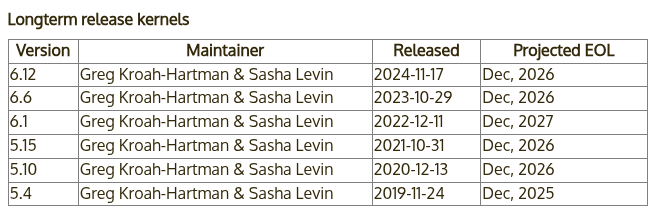

# カーネルソースのダウンロードとビルド

Linux カーネルに対するエクスプロイトやデバッグなどを行うには、まず利用可能な Linux の実行環境を用意する必要があります。この節では、カーネルソースの入手方法と、カーネルイメージ(bzImage)のビルド方法を説明します。bzImage と BusyBox を使って簡易的な実行環境を構築する方法は、次の節で説明します。

## カーネルソースのダウンロード

[The Linux Kernel Archives](https://www.kernel.org) では、オリジナルのメインラインカーネルの各バージョンのソースコードが提供されています。必要なバージョンのカーネルソースはこのサイトからダウンロードできるほか、各種ミラーサイトからも入手できます。たとえば[清華大学オープンソースソフトウェアミラー](https://mirrors.tuna.tsinghua.edu.cn/kernel/)でも各バージョンのカーネルソースが提供されています。

[Archive kernel releases](https://www.kernel.org/category/releases.html) によると、カーネルには主に次の種類があります。

- Prepatch (RC):メインラインカーネルのプレリリース版です。テスト待ちの最新のカーネル機能が含まれており、Linus Torvalds がメンテナンスしています。
- Mainline:メインラインのカーネルバージョンです。RC 版の新機能はテストを経てメインラインにマージされます。9〜10 週間ごとに 1 バージョンがリリースされ、Linus Torvalds がメンテナンスしています。
- Stable:メインラインカーネルがリリースされると Stable 状態になります。次のカーネルバージョンがリリースされるまで、stable kernel のメンテナによって、メインラインツリーからの脆弱性修正のバックポート(後方移植)のみが行われます。Stable kernel は必要に応じて更新され、通常は週に 1 回です。
- Longterm:一部のカーネルバージョンは長期サポート版(LTS)に選ばれます。Stable カーネルよりもサポート期間が長く、通常は重要な脆弱性修正のみがバックポートされ、更新の間隔も長くなります(特に古いバージョンほどそうです)。

ここでは、最近の Longterm バージョンのカーネル `6.12` を選びます。これは `Greg Kroah-Hartman & Sasha Levin` がメンテナンスしており、リリース日は `2024-11-17`、サポート終了は `Dec, 2026` の予定です。

> カーネルチームは、複数の LTS バージョンのカーネルのサポートを同じ時期にまとめて終了することがわかります。すべての LTS バージョンが同じ長さのライフサイクルを持つわけではありません。



最新の LTS バージョンである `6.12.16`(`2025-02-21` リリース)をダウンロードしてビルドします。ダウンロードを速くするため、清華大学のミラーサイトからダウンロードし、展開します。

```shell
$ wget https://mirrors.tuna.tsinghua.edu.cn/kernel/v6.x/linux-6.12.16.tar.xz
--2025-02-27 12:39:53--  https://mirrors.tuna.tsinghua.edu.cn/kernel/v6.x/linux-6.12.16.tar.xz
Resolving mirrors.tuna.tsinghua.edu.cn... 2402:f000:1:400::2, 101.6.15.130
Connecting to mirrors.tuna.tsinghua.edu.cn|2402:f000:1:400::2|:443... connected.
HTTP request sent, awaiting response... 200 OK
Length: 147993844 (141M) [application/octet-stream]
Saving to: ‘linux-6.12.16.tar.xz’

linux-6.12.16.tar.xz        100%[=========================================>] 141.14M  3.86MB/s    in 42s     

2025-02-27 12:40:37 (3.33 MB/s) - ‘linux-6.12.16.tar.xz’ saved [147993844/147993844]

$ unxz ./linux-6.12.16.tar.xz
```

## カーネル署名の検証

カーネルが悪意を持って改ざんされるのを防ぐため、カーネルチームは署名による検証を提供しています。カーネルのリリース時に、リリース担当者がカーネルに署名します。そのため検証には、まずカーネルメンテナの公開鍵をインポートする必要があります。ここでは Linus Torvalds と Greg Kroah-Hartman の公開鍵をインポートします。

```shell
$ gpg2 --locate-keys torvalds@kernel.org gregkh@kernel.org
pub   rsa4096 2011-09-23 [SC]
      647F28654894E3BD457199BE38DBBDC86092693E
uid           [ unknown] Greg Kroah-Hartman <gregkh@kernel.org>
sub   rsa4096 2011-09-23 [E]

pub   rsa2048 2011-09-20 [SC]
      ABAF11C65A2970B130ABE3C479BE3E4300411886
uid           [ unknown] Linus Torvalds <torvalds@kernel.org>
sub   rsa2048 2011-09-20 [E]

```

次に、清華大学のミラーサイトからカーネルの署名をダウンロードして検証します。

```shell
$ wget https://mirrors.tuna.tsinghua.edu.cn/kernel/v6.x/linux-6.12.16.tar.sign
--2025-02-27 12:44:33--  https://mirrors.tuna.tsinghua.edu.cn/kernel/v6.x/linux-6.12.16.tar.sign
Resolving mirrors.tuna.tsinghua.edu.cn... 2402:f000:1:400::2, 101.6.15.130
Connecting to mirrors.tuna.tsinghua.edu.cn|2402:f000:1:400::2|:443... connected.
HTTP request sent, awaiting response... 200 OK
Length: 991 [application/octet-stream]
Saving to: ‘linux-6.12.16.tar.sign’

linux-6.12.16.tar.sign      100%[=========================================>]     991  --.-KB/s    in 0s      

2025-02-27 12:44:35 (2.36 GB/s) - ‘linux-6.12.16.tar.sign’ saved [991/991]

$ gpg2 --verify linux-6.12.16.tar.sign
gpg: assuming signed data in 'linux-6.12.16.tar'
gpg: Signature made Sat Feb 22 00:02:55 2025 AEDT
gpg:                using RSA key 647F28654894E3BD457199BE38DBBDC86092693E
gpg: Good signature from "Greg Kroah-Hartman <gregkh@kernel.org>" [unknown]
gpg: WARNING: This key is not certified with a trusted signature!
gpg:          There is no indication that the signature belongs to the owner.
Primary key fingerprint: 647F 2865 4894 E3BD 4571  99BE 38DB BDC8 6092 693E
```

ここで WARNING が出ていることに注意してください。インポートした公開鍵には信頼できる署名がなく、確かに Linus Torvalds と Greg Kroah-Hartman のものであると証明できないためです。この問題を解消するには、TOFU を使って該当の鍵を信頼することができます。

```shell
$ gpg2 --tofu-policy good 38DBBDC86092693E
gpg: Setting TOFU trust policy for new binding <key: 647F28654894E3BD457199BE38DBBDC86092693E, user id: Greg Kroah-Hartman <gregkh@kernel.org>> to good.
```

あらためてカーネルの署名を検証します。今度はエラーが出ていないので、このカーネルソースが信頼できるものだとわかります。

```shell
$ gpg2 --trust-model tofu --verify ./linux-6.12.16.tar.sign 
gpg: assuming signed data in './linux-6.12.16.tar'
gpg: Signature made Sat Feb 22 00:02:55 2025 AEDT
gpg:                using RSA key 647F28654894E3BD457199BE38DBBDC86092693E
gpg: Good signature from "Greg Kroah-Hartman <gregkh@kernel.org>" [full]
gpg: gregkh@kernel.org: Verified 1 signatures in the past 0 seconds.  Encrypted
     0 messages.
```

検証に成功したら、アーカイブを展開してカーネルソースを得ます。

```shell
$ tar -xf linux-6.12.16.tar
```

## ビルドオプションの設定

カーネルソースを実際にビルドする前に、ビルドオプションを用意する必要があります。これはカーネルのビルドに関する設定を含み、通常はソースディレクトリ直下の `.config` ファイルに置かれます。ただし、ゼロから手で書く必要はなく、カーネルのビルド設定システムで動的に生成できます。

通常は、カーネルソースディレクトリで次のコマンドを使い、GUI のカーネル設定パネルを開きます。 **これが最もよく使われるカーネル設定の方法です** 。`.config` ファイルの設定を読み込み、GUI 上で変更できます。このファイルが存在しない場合は、まず `make defconfig` を呼び出してデフォルト設定を生成します。

> GUI の設定画面は ncurses ライブラリに依存します。これは通常、お使いのディストリビューションのリポジトリからインストールできます。

```shell
$ make menuconfig
```

このことから、次のコマンドが上記コマンドのデフォルトの出力結果を直接生成することがわかります。`make defconfig` はデフォルトのカーネル設定を生成します。`arch/アーキテクチャ/configs` ディレクトリの設定ファイルをベース設定として読み込み、デフォルトで有効なカーネル機能やドライバのビルド設定などを含みます。通常は一般的なドライバのほとんどがビルド対象となり、現在のシステム環境(たとえばハードウェアプラットフォームに関する設定)に応じて微調整されます。

```shell
$ make defconfig
```

これに対し、各カーネルビルドオプションを手動で設定することもできます。次のコマンドはデフォルト設定を読み込まず、各カーネル設定を有効にするかどうかを 1 つずつ尋ねます。ユーザーはコマンドラインで 1 つずつ `y`(カーネルに組み込む)、`m`(カーネルモジュールとしてビルドする。一部の設定でのみ選択できます)、`n`(ビルドしない)と答える必要があります。時間に余裕があり、カーネルのアーキテクチャをある程度よく理解しているなら、このコマンドでの設定も検討できます。

```shell
$ make config
```

また、次のコマンド(いずれか 1 つ)を使うと、現在の環境に含まれるカーネルモジュール(lsmod コマンドで表示されるカーネルモジュール)を動的に検出し、カーネルのビルド時にそれらの**みを**ビルドできます。これは通常、組み込み開発など、カーネルをカスタマイズして最小化・削減する必要がある場面に向いており、_汎用的な場面には向かないことが多い_ です。

```shell
$ make localyesconfig # ドライバをカーネルに組み込む
$ make localmodconfig # ドライバを独立したカーネルモジュールとして扱う
```

対応して、次のコマンド(いずれか 1 つ)は、利用可能なカーネルオプションをできるだけ多く有効にします。生成される設定には、できるだけ多くのカーネル機能とドライバが含まれます。

```shell
$ make allyesconfig # ドライバをカーネルに組み込む
$ make allmodconfig # ドライバを独立したカーネルモジュールとして扱う
```

### デバッグ関連のオプション

ここではデバッグ関連のオプションに注目します。Kernel hacking -> Compile-time checks and compiler options の順に進み、デバッグしやすいように `Compile the kernel with debug info` にチェックを入れます。これは通常デフォルトで有効です。

kgdb でカーネルをデバッグする場合は、`KGDB: kernel debugger` を選択し、KGDB 配下のすべてのオプションを選択する必要があります。

## カーネルのビルド

次にカーネルイメージをビルドします。通常必要なのは圧縮済みのカーネルイメージファイル `bzImage` なので、ソースディレクトリで次のコマンドを使ってビルドします。

```shell
$ make bzImage
```

また、現在のマシンの構成に応じて複数のスレッドでビルドできます。`-j` 引数は同時にビルドに使うコア数を指定し、`(nproc)` 変数は通常、使用しているマシンのハードウェアスレッド数を表します。

```shell
$ make -j(nproc) bzImage
```

> また、`CC=` でコンパイラを、`LD=` でリンカを、`LLVM=` で LLVM ツールチェーンのあるディレクトリを指定できます。

最後に、ターミナルに次のメッセージが表示されたらビルド完了です。

```
Kernel: arch/x86/boot/bzImage is ready  (#1)
```

ビルド成果物のうち、主に次の 2 つのファイルに注目します。

- `vmlinux`:ビルドで生成された ELF 形式の生のカーネルイメージファイルです。通常はソースのルートディレクトリにあります。
- `bzImage`:前者を圧縮したカーネルイメージファイルです。通常は `arch/アーキテクチャ/boot/bzImage` にあります(x86-64 の場合も `x86` ディレクトリである点に注意してください)。

ここで、一般的なカーネルファイル形式を紹介します。

- **bzImage**:現在主流の kernel イメージ形式で、big zImage の略です(bz は bzip2 を指すわけではありません)。大きな(512 KB を超える) Kernel に適しています。このイメージはメモリの上位アドレス(1MB より上)にロードされます。bzImage は gzip で圧縮されており、ファイルの先頭に gzip 展開のコードがあるため、gunzip では展開できません。
- **zImage**:古い kernel イメージ形式で、小さな(512KB 以下の) Kernel に適しています。起動時、このイメージはメモリの下位アドレス、つまりメモリの先頭 640 KB にロードされます。zImage も gunzip では展開できません。
- **vmlinuz**:vmlinuz は、圧縮された vmlinux だけでなく、gzip 展開のコードも含んでいます。実際には zImage または bzImage ファイルです。このファイルは bootable です。bootable とは、カーネルをメモリにロードできるという意味です。Linux システムでは、このファイルは /boot ディレクトリにあります。このディレクトリには、システムの起動に必要なファイルが入っています。
- **vmlinux**:静的リンクされた Linux kernel で、実行ファイルの形で存在し、まだ圧縮されていません。このファイルは vmlinuz を生成する過程で作られることが多く、デバッグに適しています。ただし、このファイルは bootable ではありません。
- **vmlinux.bin**:こちらも静的リンクされた Linux kernel ですが、起動可能 (bootable) なバイナリファイルとして存在します。シンボル情報と再配置情報はすべて削除されています。生成コマンドは `objcopy -O binary vmlinux vmlinux.bin` です。
- **uImage**:uImage は U-boot 専用のイメージファイルで、zImage の前に長さ 0x40 の tag を付けたものです。この tag には、このイメージファイルの種類、ロード位置、生成時刻、サイズなどの情報が記されています。

## 参考

- https://en.wikipedia.org/wiki/Linux_kernel_version_history
- https://www.kernel.org/category/releases.html
- https://www.kernel.org/signature.html
- http://www.linfo.org/vmlinuz.html
- https://arttnba3.cn/2021/02/21/OS-0X01-LINUX-KERNEL-PART-II/
- https://www.nullbyte.cat/post/linux-kernel-exploit-development-environment/#environment-setup
- https://unix.stackexchange.com/questions/5518/what-is-the-difference-between-the-following-kernel-makefile-terms-vmlinux-vml
