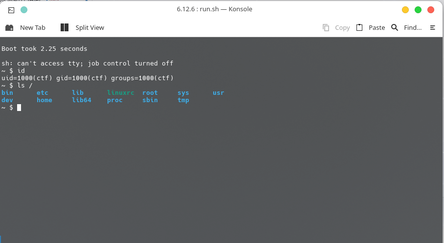
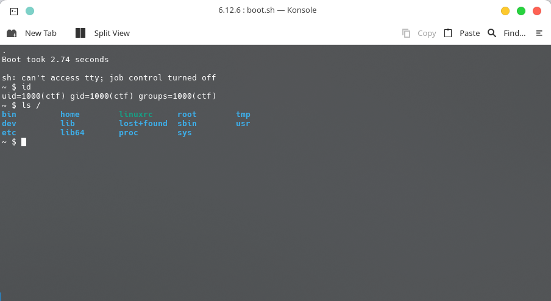

# カーネル実行環境の構築

QEMU はオープンソースの仮想マシンソフトウェアです。さまざまなアーキテクチャのエミュレーション(Emulation)に対応し、kvm と組み合わせて現在のアーキテクチャの仮想化(Virtualization)も行えます。現在最も人気のあるオープンソースの仮想マシンソフトウェアです。

この章では、QEMU を使ってデバッグ・解析環境を構築する方法を主に紹介します。qemu でカーネルを起動してデバッグするには、カーネル、QEMU、ファイルシステムが必要です。

## カーネルイメージファイルの入手

ソースからカーネルをビルドしてカーネルイメージファイルを得る方法は、前の章で説明済みなので、ここでは繰り返しません。

## QEMU の入手

QEMU の入手方法も 2 通りあります。ディストリビューションのリポジトリからインストールする方法と、ソースからビルドする方法です。必要に応じて選んでください。

## BusyBox で基本的なファイルシステムを構築する

[BusyBox](https://www.busybox.net/) は、よく使われる Linux のコマンドやツールを 300 以上まとめたソフトウェアで、ls、cat、echo などの一般的なコマンドを含んでいます。各ディストリビューションで一般的な [GNU core utilities](https://www.gnu.org/software/coreutils/) と比べて、BusyBox はより軽量で設定もしやすいため、busybox でカーネルに基本的なユーザー環境を提供します。

### busybox のダウンロードとビルド

> ホストで比較的新しいカーネルバージョンを使っている場合、BusyBox のビルドが完了しないことがあります。このバグは 2024 年 1 月にはすでに[報告が提出されて](https://lists.busybox.net/pipermail/busybox-cvs/2024-January/041752.html)いますが、現在まで修正されていません。
> 
> BusyBox のビルドに失敗する場合は、古いカーネルに切り替えて続けるか、ビルド済みバージョンを直接ダウンロードすることを検討してください。

#### BusyBox ソースのダウンロード

まず [busybox.net](https://busybox.net/downloads/) から好きなバージョンをダウンロードします。筆者はここで `1.36.0` を使います。

```shell
$ wget https://busybox.net/downloads/busybox-1.36.0.tar.bz2
```

ダウンロードが終わったら展開します。

```shell
$ tar -jxvf busybox-1.36.0.tar.bz2 
```

#### BusyBox のビルド

次にビルドオプションを設定します。ソースのルートディレクトリに移動し、次のコマンドを実行して GUI の設定画面に入ります。

```shell
$ make menuconfig
```

`Settings` ---> `Build static binary file (no shared lib)` にチェックを入れ、libc に依存しない静的ビルド版を作ります。今回の簡易的なカーネル環境には BusyBox しかなく、libc などの実行時サポートが追加されていないためです。

> オプション:Linux System Utilities で Support mounting NFS file systems on Linux < 2.6.23 (NEW) のチェックを外します。Networking Utilities で inetd のチェックを外します。

続いてビルドします。

```shell
$ make -j$(nproc)
$ make install
```

ビルドが完了すると `_install` ディレクトリが生成されます。これを使ってファイルシステムを構築します。

### ファイルシステムの設定

まず `_install` ディレクトリに基本的なファイルシステムの構造を作成します。

```shell
$ cd _install
$ mkdir -pv {bin,sbin,etc,proc,sys,dev,home/ctf,root,tmp,lib64,lib/x86_64-linux-gnu,usr/{bin,sbin}}
$ touch etc/inittab
$ mkdir etc/init.d
$ touch etc/init.d/rcS
$ chmod +x ./etc/init.d/rcS
```

作成した `./etc/inittab` に次の内容を書き込みます。

```shell
::sysinit:/etc/init.d/rcS
::askfirst:/bin/login
::ctrlaltdel:/sbin/reboot
::shutdown:/sbin/swapoff -a
::shutdown:/bin/umount -a -r
::restart:/sbin/init
```

上記のファイルでは、システムの初期化スクリプトを `etc/init.d/rcS` に指定しています。そこでこのファイルに次の内容を書き込みます。主な内容は、各種ファイルシステムのマウント、各ディレクトリの権限の設定、非特権ユーザーの作成です。

```bash
#!/bin/sh
chown -R root:root /
chmod 700 /root
chown -R ctf:ctf /home/ctf

mount -t proc none /proc
mount -t sysfs none /sys
mount -t tmpfs tmpfs /tmp
mkdir /dev/pts
mount -t devpts devpts /dev/pts

echo 1 > /proc/sys/kernel/dmesg_restrict
echo 1 > /proc/sys/kernel/kptr_restrict

echo -e "\nBoot took $(cut -d' ' -f1 /proc/uptime) seconds\n"

cd /home/ctf
su ctf -c sh

poweroff -d 0  -f
```

次に、このスクリプトに実行権限を付与します。このスクリプトは通常、独自の環境初期化スクリプトとして使います。

```shell
$ chmod +x ./etc/init.d/rcS
```

続いてユーザーグループ関連の権限を設定します。ここでは `root` と `ctf` の 2 つのユーザーグループ、`root` と `ctf` の 2 人のユーザーを作成し、ファイルシステムのマウント項目を 1 つ設定しています。

```shell
$ echo "root:x:0:0:root:/root:/bin/sh" > etc/passwd
$ echo "ctf:x:1000:1000:ctf:/home/ctf:/bin/sh" >> etc/passwd
$ echo "root:x:0:" > etc/group
$ echo "ctf:x:1000:" >> etc/group
$ echo "none /dev/pts devpts gid=5,mode=620 0 0" > etc/fstab
```

### ファイルシステムのパッケージ化

この節では、ファイルシステムをパッケージ化する方法を説明します。ここでは `qcow2`、`ext4`、`cpio` の 3 つの形式を紹介します。

#### QCOW2 形式

QEMU Copy-on-Write version 2 `QCOW2` は QEMU でよく使われるディスクイメージ形式です。次のコマンドで、指定したサイズの QCOW2 イメージファイルを作成できます。

```shell
$ qemu-img create -f qcow2 rootfs.qcow2 8M
```

その後、次のコマンドでネットワークブロックデバイスとしてマウントできます。

> その前に、次のカーネルモジュールを手動で有効にする必要があるかもしれません。
> 
> ```shell
> $ sudo modprobe nbd
> ```

```shell
$ sudo qemu-nbd -c /dev/nbd0 ./rootfs.qcow2
```

次に、好きなファイルシステム、たとえば最もよく使われる ext4 でフォーマットします。


```shell
$ sudo mkfs.ext4 /dev/nbd0
```

その後は通常どおりマウントします。

```shell
$ sudo mount /dev/nbd0 /mnt
```

そして、先ほど構築したファイルシステムの内容をコピーします。

```shell
$ sudo cp -auv _install/* /mnt
$ sudo chown -R root:root /mnt/
$ sudo chmod 700 /mnt/root
$ sudo chown -R 1000:1000 /mnt/home/ctf/
```

最後に、通常どおりアンマウントして nbd を切り離します。

```shell
$ sudo umount /mnt
$ sync
$ sudo qemu-nbd -d /dev/nbd0
```

#### ext4 イメージ形式

ファイルシステムを ext4 イメージ形式にパッケージ化することもできます。まず空の ext4 イメージファイルを作成します。ここで `bs` はブロックサイズ、`count` はブロック数を表します。

```shell
$ dd if=/dev/zero of=rootfs.img bs=1M count=32
```

その後、ext4 形式でフォーマットします。

```shell
$ mkfs.ext4 rootfs.img 
```

イメージをマウントして、ファイルをコピーすれば完了です。

```shell
$ mkdir tmp
$ sudo mount rootfs.img ./tmp/
$ sudo cp -rfp _install/* ./tmp/
$ sudo chown -R root:root ./tmp/
$ sudo chmod 700 ./tmp/root
$ sudo chown -R 1000:1000 ./tmp/home/ctf/
$ sudo umount ./tmp
```

#### cpio 形式

`_install` ディレクトリで次のコマンドを使うと、ファイルシステムを cpio 形式にパッケージ化できます。

```shell
$ find . | cpio -o --format=newc > ../rootfs.cpio
```

次のように書くこともできます。

```shell
$ find . | cpio -o -H newc > ../rootfs.cpio
```

> ここでの出力先は筆者が適当に選んだもので、好きな場所に置いても構いません。

もちろん、次のコマンドでファイルシステムを展開し直すこともできます。

```shell
$ cpio -idv < ./rootfs.cpio
```

## カーネルの起動

ここでは、先ほどビルドした Linux カーネルとファイルシステムイメージを例に、カーネルの起動方法を紹介します。次のスクリプトで Linux カーネルを直接起動できます。

```bash
#!/bin/sh
qemu-system-x86_64 \
    -m 128M \
    -kernel ./bzImage \
    -hda ./rootfs.qcow2 \
    -monitor /dev/null \
    -append "root=/dev/sda rw rdinit=/sbin/init console=ttyS0 oops=panic panic=1 loglevel=3 quiet kaslr" \
    -cpu kvm64,+smep \
    -smp cores=2,threads=1 \
    -nographic \
    -snapshot \
    -s
```

各引数の説明は次のとおりです。詳しくは QEMU の公式ドキュメントを参照してください。

- `-m`:仮想マシンのメモリサイズ。
- `-kernel`:カーネルイメージのパス。
- `-hda`:ファイルシステムのパス。qcow2 イメージを本物のハードディスクデバイスとしてマウントします。利点は、実環境により近いことです。
- `-monitor`:モニタをホストのデバイス `/dev/null` にリダイレクトします。null にリダイレクトするのは主に、CTF でモニタ経由で直接 flag を取られるのを防ぐためです。
- `-append`:カーネルの起動パラメータ
    - `root=/dev/sda rw`:ルートファイルシステムのあるデバイスを設定します。`-hda` で SATA ハードディスクとしてマウントしており、Linux では最初の SATA ハードディスクのパスは `/dev/sda` なので、ルートファイルシステムのパスをこのデバイスパスに指し、`rw` フラグで読み書き権限を与えています。
    - `kaslr`:カーネルのアドレスのランダム化を有効にします。`nokaslr` に変えて無効にすれば、デバッグしやすくなります。
    - `rdinit`:最初に起動するプロセスを指定します。ここでは `/sbin/init` を初期プロセスに指定しており、先ほどの設定では、これはデフォルトで `/etc/init.d/rcS` を起動スクリプトとして使います。
    - `loglevel=3` & `quiet`:ログを出力しません。
    - `console=ttyS0`:端末を `/dev/ttyS0` に指定します。これにより、起動するとすぐ端末画面に入れます。
- `-cpu`:CPU のオプションを設定します。ここでは smep による保護を有効にしています。
- `-smp`:対称型マルチプロセッサの構成を設定します。ここでは 2 コア、各コア 1 スレッドに設定しています。
- `-nographic`:GUI を提供しません。このときカーネルはシリアルポートにのみ出力し、出力内容は QEMU によって端末にリダイレクトされます。
- `-snapshot`:スナップショット方式で起動します。これにより、仮想マシン内でファイルシステムに加えた変更は「ディスクに書き込まれ」ません。
- `-s`:`-gdb tcp::1234` の省略形です(そのまま書いても構いません)。後で gdb からローカルポートに接続してデバッグできます。

起動後の様子は次のとおりです。



ext4 ファイルイメージを使う場合は、起動パラメータを次のように一部変更します。

```bash
#!/bin/sh
qemu-system-x86_64 \
    -m 128M \
    -kernel ./bzImage \
    -hda  ./rootfs.img \
    -monitor /dev/null \
    -append "root=/dev/sda rw rdinit=/sbin/init console=ttyS0 oops=panic panic=1 loglevel=3 quiet kaslr" \
    -cpu kvm64,+smep \
    -smp cores=2,threads=1 \
    -nographic \
    -snapshot \
    -s
```

変更した引数は次のとおりです。

- `-hda`:ファイルシステムのパスを qcow2 イメージから ext4 イメージに変更しました。

起動後の様子は次のとおりです。



cpio ファイルシステムを使う場合は、起動パラメータを次のように一部変更します。

```bash
#!/bin/sh
qemu-system-x86_64 \
    -m 128M \
    -kernel ./bzImage \
    -initrd  ./rootfs.cpio \
    -monitor /dev/null \
    -append "root=/dev/ram rdinit=/sbin/init console=ttyS0 oops=panic panic=1 loglevel=3 quiet kaslr" \
    -cpu kvm64,+smep \
    -smp cores=2,threads=1 \
    -nographic \
    -snapshot \
    -s
```

変更した引数は次のとおりです。

- `-initrd`:初期ファイルシステムのパス。cpio ファイルシステムはメモリにロードされます(initramfs)。
- `-append`:`root=/dev/ram` に変更しました。initramfs を使っているため、ファイルシステムはメモリ上にあり、ルートファイルシステムのパスをメモリデバイスにする必要があるためです。

また、monitor を /dev/null に設定していない場合は、`CTRL + A` を 1 回押してから `C` を 1 回押すと QEMU monitor に入れます。monitor には役立つコマンドが多数あることがわかります。

```bash
~ $ QEMU 9.1.2 monitor - type 'help' for more information
(qemu) help
announce_self [interfaces] [id] -- Trigger GARP/RARP announcements
balloon target -- request VM to change its memory allocation (in MB)
block_job_cancel [-f] device -- stop an active background block operation (use -f
                         if you want to abort the operation immediately
                         instead of keep running until data is in sync)
...
```

## ドライバのロード

先ほどビルドしたドライバをロードしてみます。生成された ko ファイルをファイルシステムにコピーし、起動スクリプトに `insmod` コマンドを追加するだけです。具体的には次のとおりです。

```bash
chown -R root:root /
chmod 700 /root
chown -R ctf:ctf /home/ctf

mount -t proc none /proc
mount -t sysfs none /sys
mount -t tmpfs tmpfs /tmp
mkdir /dev/pts
mount -t devpts devpts /dev/pts

echo 1 > /proc/sys/kernel/dmesg_restrict
echo 1 > /proc/sys/kernel/kptr_restrict

insmod /root/a3kmod.ko

echo -e "\nBoot took $(cut -d' ' -f1 /proc/uptime) seconds\n"

cd /root
su root -c sh

poweroff -d 0  -f
```

qemu でカーネルを起動したら、dmesg で出力を確認できます。対応する ko が確かにロードされていることがわかります。

```shell
# dmesg | grep a3kmod
[    5.689366] a3kmod: loading out-of-tree module taints kernel.
[    5.693217] [a3kmod:] Hello kernel world!
```

## デバッグと解析

ここでは、カーネルのデバッグ方法を簡単に紹介します。

### デバッグのヒント

デバッグしやすいように、root ユーザーでシェルを起動できます。つまり、init スクリプトの該当部分を次のように変更します。

```diff
- su ctf -c sh
+ su root -c sh
```

また、起動時にカーネルのランダム化を無効にするよう指定することもできます。

```bash
#!/bin/sh
qemu-system-x86_64 \
    -m 128M \
    -kernel ./bzImage \
    -hda  ./rootfs.img \
    -monitor /dev/null \
    -append "root=/dev/sda rw rdinit=/sbin/init console=ttyS0 oops=panic panic=1 loglevel=3 quiet nokaslr" \
    -cpu kvm64,+smep \
    -smp cores=2,threads=1 \
    -nographic \
    -s
```

### 基本操作

`/proc/kallsyms` から、特定のカーネルシンボルの情報を取得できます。

```shell
# cat /proc/kallsyms | grep prepare_kernel_cred
ffffffffa66d0b90 T __pfx_prepare_kernel_cred
ffffffffa66d0ba0 T prepare_kernel_cred
ffffffffa8061668 r __ksymtab_prepare_kernel_cred
```

`lsmod` コマンドで、ロードされているドライバの基本情報を確認できます。

```shell
# lsmod
a3kmod 16384 0 - Live 0xffffffffc008f000 (O)
```

`/sys/module` ディレクトリを読み取ると、カーネルモジュールのより詳しい情報を取得できます。

```shell
# cat /sys/module/a3kmod/sections/.text 
0xffffffffc008f000
# cat /sys/module/a3kmod/sections/.data 
0xffffffffc0091038
```

### デバッグの開始

qemu は実はカーネルをデバッグするためのインタフェースを提供しており、起動パラメータに `-gdb dev` を追加するとデバッグサービスを起動できます。最も一般的なのは、あるポートで tcp 接続を待ち受ける使い方です。QEMU は省略形の `-s` も提供しており、これは `-gdb tcp::1234` を表します。つまり 1234 番ポートで gdbserver を起動します。

デバッグモードでカーネルを起動したら、別の端末から次のコマンドで対応する gdbserver に接続してデバッグを開始できます。

```shell
gdb -q -ex "target remote localhost:1234"
```

カーネルの起動後、gdb で `add-symbol-file` サブコマンドを使ってシンボル情報を追加できます。`-s セクション名 セクションアドレス` の形式の追加引数で、各セクションのメモリ上のロードアドレスを指定します。例:

```shell
pwndbg> add-symbol-file ./test_kmod/src/a3kmod.ko -s .text 0xffffffffc008f000 -s .data 0xffffffffc0091038 -s .bss 0xffffffffc0091540
add symbol table from file "./test_kmod/src/a3kmod.ko" at
        .text_addr = 0xffffffffc008f000
        .data_addr = 0xffffffffc0091038
        .bss_addr = 0xffffffffc0091540
Reading symbols from ./test_kmod/src/a3kmod.ko...
warning: remote target does not support file transfer, attempting to access files from local filesystem.
(No debugging symbols found in ./test_kmod/src/a3kmod.ko)
```

もちろん、ソースコードのディレクトリ情報を追加することもできます。ここからは、ユーザー空間のデバッグと変わりません。

## KGDB によるデバッグ

カーネルには専用のデバッグツール KGDB(Kernel GNU Debugger)が用意されています。ビルド時に `CONFIG_KGDB=y` の設定オプションを有効にして KGDB コンポーネントをカーネルに組み込み、シリアルポートなどを使ってデバッグできます。

QEMU のエミュレーション環境では、シリアルポート(たとえば `ttyS1`)を KGDB の出力先に指定できます。たとえば次の起動スクリプトを考えます。

```bash
#!/bin/sh
qemu-system-x86_64 \
    -m 64M \
    -kernel ./bzImage \
    -initrd  ./rootfs.img \
    -append "root=/dev/ram rw console=ttyS0 kgdboc=ttyS1,115200 oops=panic panic=1 nokaslr" \
    -smp cores=2,threads=1 \
    -display none \
    -serial stdio \
    -serial tcp::4445,server,nowait \
    -cpu kvm64
```

- カーネルの起動パラメータに `console=ttyS0 kgdboc=ttyS1,` を追加しました。これは、シリアルポート `ttyS0` をコンソール出力に、シリアルポート `ttyS1` を KGDB のデバッグポートに指定するものです。
- QEMU の起動パラメータに `-serial` を 2 つ追加しました。これは 2 つのシリアルポートを作成するという意味で、1 つ目のシリアルポートは標準入出力に、2 つ目はローカルの 4445 番ポートに指定されています。

qemu 仮想マシンの内部で `echo g > /proc/sysrq-trigger` コマンドを実行すると、KGDB を起動できます。

```shell
~ # cat /sys/module/kgdboc/par~ # cat /sys/module/kgdboc/parameters/kgdboc
ttyS1,115200
~ # echo g > /proc/sysrq-triggerameters/kgdboc
ttyS1,115200
~ # echo g > /proc/sysrq-trigger
[    9.078653] sysrq: DEBUG
[    9.081034] KGDB: Entering KGDB
```

> また、append で kgdbwait パラメータを使うと、カーネルの起動完了後に自動的に起動させることもできます。

別の端末から gdb で接続します。

```shell
gdb vmlinux
Reading symbols from vmlinux...
(gdb) target remote:4445
Remote debugging using :4445
warning: multi-threaded target stopped without sending a thread-id, using first non-exited thread
[Switching to Thread 4294967294]
kgdb_breakpoint () at kernel/debug/debug_core.c:1092
1092            wmb(); /* Sync point after breakpoint */
(gdb)
```

## 参考

- https://arttnba3.cn/2021/02/21/OS-0X01-LINUX-KERNEL-PART-II/
- https://arttnba3.cn/2022/07/15/VIRTUALIZATION-0X00-QEMU-PART-I/
- https://www.ibm.com/developerworks/cn/linux/l-busybox/index.html
- https://qemu.readthedocs.io/en/latest/system/qemu-manpage.html
- http://blog.nsfocus.net/gdb-kgdb-debug-application/
