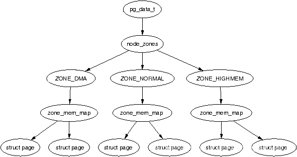
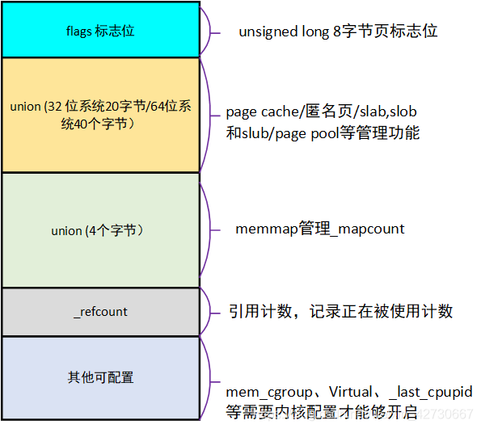
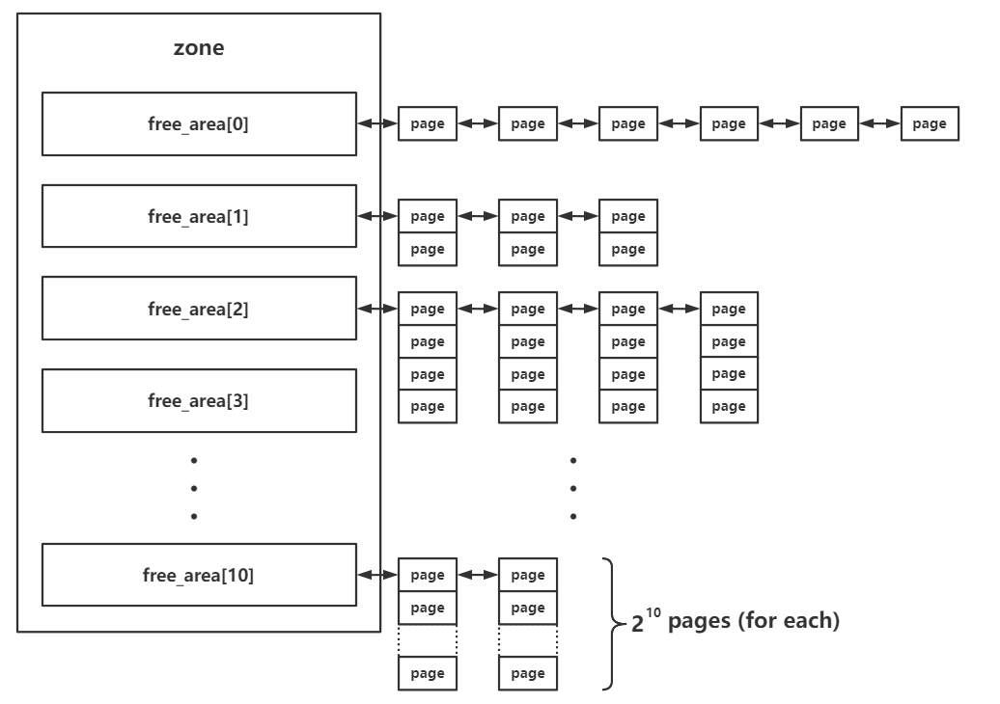
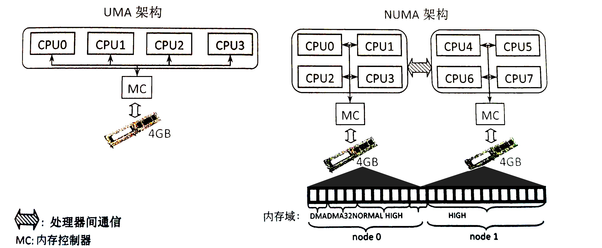
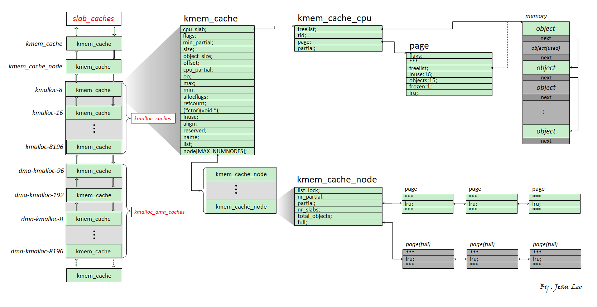

# カーネルヒープの概要

ユーザー空間のプロセスのヒープ(heap)と同様に、カーネルにも独自の動的メモリ管理の仕組みがあります。ここでは便宜上、カーネル内で動的に確保されるメモリも同じく「ヒープ」と呼びます。

Linux kernel はメモリを `ページ→ゾーン→ノード` の 3 階層に分けて管理します。主なメモリ管理機構は `buddy system` と `slab allocator` の 2 つです。前者はメモリページを粒度として、利用可能なすべての物理メモリを管理します。後者は前者にメモリページを要求し、それを複数の小さなオブジェクト(object)に分割して、きめ細かいメモリ管理を行います。

## ページ→ゾーン→ノードの 3 階層構造

これは非常に古典的な _Overview_ で、上から順に次のようになっています。

- **ノード**(node、構造体 pgdata\_list に対応)
- **ゾーン**(zone、構造体 zone に対応。図には 3 種類の zone が示されています)
- **ページ**(page、構造体 page に対応)



### ページ(page)

Linux kernel では `page` 構造体で 1 つの物理ページフレームを表します。**物理ページフレームごとに、対応する page 構造体が 1 つあります**。



### ゾーン(zone)

Linux では、1 つのノード内の用途の異なるメモリ領域を、それぞれ異なる `ゾーン(zone)` に分けます。対応する構造体は `struct zone` です。



### ノード(node)

zone の 1 つ上の層が**ノード**です。Linux は_メモリコントローラ(memory controller)_をノード分割の基準にしています。UMA アーキテクチャではノードは 1 つだけで、NUMA アーキテクチャでは通常複数のノードがあります。同じメモリコントローラ配下の CPU にとって、対応するノードを_ローカルメモリ_と呼びます。異なるプロセッサどうしはバスでさらに接続されています。次の図のように、1 つの MC が 1 つのノードに対応します。



## buddy system

buddy system は Linux kernel の比較的低レイヤのメモリ管理システムで、**メモリページを粒度としてすべての物理メモリを管理します**。**ゾーン**というレベルに存在し、現在のゾーンに属するすべての物理ページフレームを管理します。

各 zone 構造体には free\_area 構造体の配列があり、buddy system が **order ごとに管理するページ**を格納します。

```c
struct zone {
    //...
    struct free_area	free_area[MAX_ORDER];
    //...
```

ここで `MAX_ORDER` は定数で、値は 11 です。

buddy system では、空きページの連続したサイズに応じて階層的に管理します。ここでの order の実際の意味は**連続した空きページのサイズ**ですが、単位はページ数ではなく`階`(order)です。つまり、各添字に格納されるページのサイズは次のとおりです。

$$
2^{order}
$$

free\_area に置かれたページは、自身の対応するフィールドによって双方向リスト構造につながれます。これにより、次のような _Overview_ が得られます。


  - 確保:
    - まず、要求されたメモリサイズを 2 のべき乗枚のメモリページのサイズにそろえ、対応する添字から連続したメモリページを取り出します。
    - 対応する添字のリストが空の場合は、次の order からメモリページを取り出して 2 つに分け、現在の添字に対応するリストに装填し、そのうえで上位の呼び出し元に返します。次の order も空の場合は、さらに高い order に対して同じ要求の過程を続けます。
  - 解放:
    - 対応する連続したメモリページを、対応するリストに解放します。
    - 統合できるメモリページがないか検索し、あれば統合して、より高い order のリストに入れます。

## slab allocator

slab allocator は、よりきめ細かいメモリ管理機構です。buddy system に 1 枚または複数枚の連続したメモリページを要求し、それを同じサイズの**オブジェクト**(object)に分割して上位の呼び出し元に返すことで、よりきめ細かいメモリ管理を実現します。

slab allocator には 3 つのバージョンがあります。

- slab(最初のバージョン。仕組みが比較的複雑で、効率もよくありません)
- slob(組み込みなどの場面向けの、極端に簡略化したバージョン)
- slub(最適化されたバージョン。**現在の汎用バージョン**)

### 基本構造

`slub` 版の allocator は、現在のほとんどの Linux kernel で採用されているバージョンです。そのため、この記事でも主に slub allocator について述べます。基本構造は次の図のとおりです。



slub allocator が buddy system に要求して得た 1 枚または複数枚のメモリページを、1 つの `slub` と呼びます。これは複数の同じサイズのオブジェクト(object)に分割され、各 object が確保の単位となります。slub の最初のメモリページに対応する page 構造体の freelist メンバが、そのメモリページ上の最初の空きオブジェクトを指します。1 つの slub 上のすべての空きオブジェクトは、NULL で終わる単方向リストを構成します。

  > object は、ユーザー空間の glibc の chunk に相当するものと考えられます。ただし、object は chunk のように header を持つ必要はありません。page 構造体と物理メモリの間には線形の対応関係があるため、object のアドレスから対応する page 構造体を直接見つけられるからです。

`kmem_cache` は基本的な allocator コンポーネントで、ある特定のサイズ(特定の用途)のオブジェクトを確保するために使われます。すべての kmem\_cache は双方向リストを構成し、対応する 2 つの構造体配列 `kmalloc_caches` と `kmalloc_dma_caches` があります。

1 つの `kmem_cache` は主に 2 つのモジュールで構成されます。

  - `kmem_cache_cpu`:これは **percpu 変数**(つまり各コアが独立したコピーを持つ。原理は、gs レジスタを percpu セグメントのベースとしてアドレッシングするものです)で、現在のコアが使用している slub を表します。そのため、現在の CPU が kmem\_cache\_cpu から object を取り出すときは**ロックが不要**で、性能が大幅に向上します
  - `kmem_cache_node`:現在の `kmem_cache` の slub の集配拠点と考えられます。ここには 2 つの slub リストがあります。
    - partial:この slub 上には一定数の空き object がありますが、すべてが空いているわけではありません。
    - full:この slub 上のすべての object が確保済みです。

### 確保/解放の過程

これで、slub allocator の確保/解放の動作を説明できます。

  - 確保:
    - まず `kmem_cache_cpu` からオブジェクトを取り、あればそのまま返します。
    - `kmem_cache_cpu` 上の slub に空きオブジェクトがなくなった場合、その slub は `kmem_cache_cpu` から外されます。そして **partial** リストから slub を 1 つ取って `kmem_cache_cpu` に取り付け、そこから空きオブジェクトを取り出して返します。
    - `kmem_cache_node` の partial リストも空になった場合は、**buddy system に新しいメモリページの確保を要求し**、複数の object に分割してから `kmem_cache_cpu` に渡し、空きオブジェクトを取り出して上位の呼び出し元に返します。
  - 解放:
    - 解放される object が `kmem_cache_cpu` の slub に属する場合は、先頭挿入法で現在の CPU の slub の freelist にそのまま挿入します。
    - 解放される object が `kmem_cache_node` の partial リスト上の slub に属する場合は、先頭挿入法で対応する slub の freelist にそのまま挿入します。
    - 解放される object が full slub のものである場合は、それが対応する slub の freelist の先頭ノードとなり、**その slub は partial リストに置かれます**。

以上が slub allocator の基本原理です。

## REFERENCE

[https://arttnba3.cn/2021/11/28/OS-0X02-LINUX-KERNEL-MEMORY-5.11-PART-I/](https://arttnba3.cn/2021/11/28/OS-0X02-LINUX-KERNEL-MEMORY-5.11-PART-I/)

[https://arttnba3.cn/2022/06/30/OS-0X03-LINUX-KERNEL-MEMORY-5.11-PART-II/](https://arttnba3.cn/2022/06/30/OS-0X03-LINUX-KERNEL-MEMORY-5.11-PART-II/)

[https://arttnba3.cn/2023/02/24/OS-0X04-LINUX-KERNEL-MEMORY-6.2-PART-III/](https://arttnba3.cn/2023/02/24/OS-0X04-LINUX-KERNEL-MEMORY-6.2-PART-III/)

[https://blog.csdn.net/lukuen/article/details/6935068](https://blog.csdn.net/lukuen/article/details/6935068)

[https://www.cnblogs.com/LoyenWang/p/11922887.html](https://www.cnblogs.com/LoyenWang/p/11922887.html)