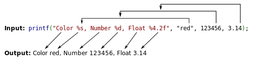

# 原理の紹介

まず、書式文字列脆弱性(format string vulnerability)の原理を簡単に紹介します。

## 書式文字列関数の紹介

書式文字列関数は可変個の引数を受け取り、**第1引数を書式文字列として、それに従って後続の引数を解釈します**。平たく言えば、書式文字列関数とは、コンピュータのメモリ上に表現されたデータを、人間が読める文字列の形式に変換するものです。ほぼすべての C/C++ プログラムが、**情報の出力、プログラムのデバッグ、文字列の処理**のために書式文字列関数を利用しています。一般に、書式文字列を攻撃に利用する際は、主に次の3つの部分に分けて考えます。

- 書式文字列関数
- 書式文字列
- 後続の引数(**省略可**)

ここで簡単な例を挙げます。printf 関数などには、おそらく大半の人が触れたことがあるでしょう。以降、一つずつ紹介していきます。



### 書式文字列関数

よく使われる書式文字列関数には次のものがあります。

-   入力
    -   scanf
-   出力

|           関数            |        概要         |
| :---------------------: | :-----------------: |
|         printf          |      stdout に出力      |
|         fprintf         |     指定した FILE ストリームに出力      |
|         vprintf         | 引数リストに従って書式化し stdout に出力 |
|        vfprintf         | 引数リストに従って書式化し指定した FILE ストリームに出力 |
|         sprintf         |       文字列に出力        |
|        snprintf         |     指定バイト数を文字列に出力     |
|        vsprintf         |   引数リストに従って書式化し文字列に出力   |
|        vsnprintf        | 引数リストに従って書式化し指定バイト数を文字列に出力 |
|      setproctitle       |       argv を設定        |
|         syslog          |        ログを出力         |
| err, verr, warn, vwarn など |         ……         |

### 書式文字列

ここで書式文字列の形式を確認します。基本形式は次のとおりです。

```
%[parameter][flags][field width][.precision][length]type
```
それぞれの pattern の意味については、Wikipedia の[書式文字列](https://zh.wikipedia.org/wiki/%E6%A0%BC%E5%BC%8F%E5%8C%96%E5%AD%97%E7%AC%A6%E4%B8%B2)を参照してください。次の各 pattern のうち、対応する選択肢は特に重要です。

-   parameter
    -   n$、書式文字列中の指定した引数を取得する
-   flag
-   field width
    -   出力の最小幅
-   precision
    -   出力の最大長
-   length、出力の長さ
    -   hh、1バイトを出力する
    -   h、2バイトを出力する
-   type
    -   d/i、符号付き整数
    -   u、符号なし整数
    -   x/X、16進数の unsigned int。x は小文字、X は大文字を使います。精度を指定した場合、出力する数字が足りないときは左側を 0 で埋めます。デフォルトの精度は 1 です。精度が 0 で値も 0 の場合、出力は空になります。
    -   o、8進数の unsigned int。精度を指定した場合、出力する数字が足りないときは左側を 0 で埋めます。デフォルトの精度は 1 です。精度が 0 で値も 0 の場合、出力は空になります。
    -   s、l フラグがない場合、null 終端文字列を、精度で決まる上限まで出力します。精度の指定がなければすべてのバイトを出力します。l フラグがある場合、対応する関数引数は wchar\_t 型の配列を指し、出力時に各ワイド文字をマルチバイト文字に変換します。これは wcrtomb 関数を呼ぶのと同じです。
    -   c、l フラグがない場合、int 引数を unsigned char 型に変換して出力します。l フラグがある場合、wint\_t 引数を2要素の wchart_t 配列に変換します。1番目の要素に出力する文字が入り、2番目の要素は null ワイド文字です。
    -   p、void \* 型で、対応する変数の値を出力します。printf("%p",a) は変数 a の値をアドレス形式で出力し、printf("%p", &a) は変数 a があるアドレスを出力します。
    -   n、文字は出力しませんが、これまでに正常に出力した文字数を、対応する整数ポインタ引数が指す変数に書き込みます。
    -   %、'``%``' そのもの。いかなる flags、width も受け付けません。

### 引数

出力したい変数そのものです。

## 書式文字列脆弱性の原理

冒頭で書式文字列の基本を紹介しましたが、ここでもう少し詳しく説明します。先ほど、書式文字列関数は書式文字列に従って解釈を行うと述べました。**そのため、解釈される引数の個数も、当然この書式文字列によって決まります**。たとえば '%s' は、文字列の引数を1つ出力することを示します。

先ほどの例を使って、さらに説明します。


このような例では、printf 関数に入る前(つまり printf をまだ呼び出していない時点)のスタックのレイアウトは、高アドレスから低アドレスへ順に次のとおりです。

```text
some value
3.14
123456
addr of "red"
addr of format string: Color %s...
```

**注:ここでは、3.14 の上にある値は未知の値であるものとします。**

printf に入ると、関数はまず第1引数を取得し、その文字を1文字ずつ読み取ります。このとき2つの場合があります。

-   現在の文字が % でなければ、そのまま対応する標準出力に出力します。
-   現在の文字が % であれば、次の文字を続けて読み取ります。
    -   文字がなければ、エラーになります。
    -   次の文字が % であれば、% を出力します。
    -   それ以外は、その文字に応じた引数を取得し、解釈して出力します。

ここで、プログラムを書く際に、次のように書いてしまったとします。

```C
printf("Color %s, Number %d, Float %4.2f");
```

この場合、引数を渡していないことが分かりますが、プログラムはどう動くでしょうか。プログラムはそのまま実行され、スタック上で書式文字列のアドレスが置かれている位置より上にある3つの変数を、それぞれ次のように解釈します。

1. そのアドレスが指す文字列として解釈する
2. その内容を整数値として解釈する
3. その内容を浮動小数点値として解釈する

2と3は問題になりにくいのですが、1については、アクセスできないアドレス(たとえば 0)が渡されていると、プログラムはそれが原因でクラッシュします。

これが、書式文字列脆弱性の基本的な原理です。

## 参考資料

- https://zh.wikipedia.org/wiki/%E6%A0%BC%E5%BC%8F%E5%8C%96%E5%AD%97%E7%AC%A6%E4%B8%B2
