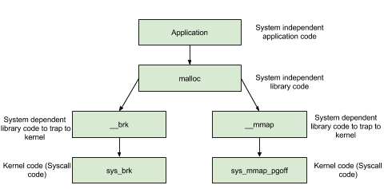
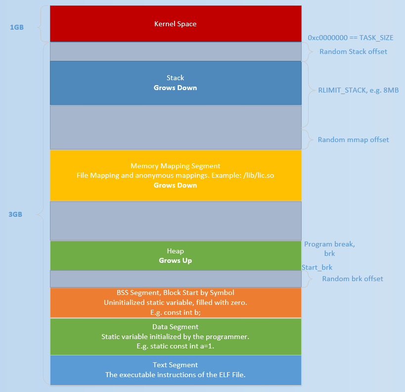

# ヒープ概要

## ヒープとは

プログラムの実行中、ヒープは動的に割り当てられるメモリを提供し、サイズが事前に分からないメモリをプログラムが要求できるようにします。ヒープとは、実はプログラムの仮想アドレス空間にある連続した線形の領域で、低アドレスから高アドレスの方向に伸びます。ヒープを管理するプログラムの部分を、一般にヒープマネージャ(heap manager)と呼びます。

ヒープマネージャはユーザープログラムとカーネルの中間に位置し、主に次の処理を行います。

1. ユーザーからのメモリ要求に応えます。オペレーティングシステムにメモリを要求し、それをユーザープログラムに返します。同時に、メモリ管理の効率を保つため、カーネルは一般に大きな連続メモリをあらかじめ割り当て、ヒープマネージャが何らかのアルゴリズムでそのメモリを管理します。ヒープ領域が不足したときにだけ、ヒープマネージャは再びオペレーティングシステムとやり取りします。
2. ユーザーが解放したメモリを管理します。一般に、ユーザーが解放したメモリはそのままオペレーティングシステムに返却されるのではなく、ヒープマネージャが管理します。この解放されたメモリは、ユーザーの新たなメモリ要求に応えるために使えます。

Linux の初期のヒープの割り当てと回収は Doug Lea が実装しましたが、複数スレッドを並列に処理する際、プロセスのヒープメモリ空間を共有していました。そのため安全性のため、スレッドがヒープを使うときはロックをかけます。しかし同時に、ロックによって他のスレッドがヒープを使えなくなり、メモリの割り当てと回収の効率が下がります。また、マルチスレッドで使うときに正しく制御できないと、メモリの割り当てと回収の正しさにも影響しかねません。Wolfram Gloger が Doug Lea の実装を改良してマルチスレッドに対応させました。このヒープアロケータが ptmalloc です。glibc-2.3.x. 以降、glibc には ptmalloc2 が組み込まれています。

現在の Linux の標準ディストリビューションで使われているヒープアロケータは、glibc のヒープアロケータである ptmalloc2 です。ptmalloc2 は主に malloc/free 関数でメモリブロックを割り当て・解放します。

注意すべき点として、メモリの割り当てと使用の過程で、Linux には次の基本的なメモリ管理の考え方があります。**実際にアドレスへアクセスしたときに初めて、システムは仮想ページと物理ページの対応関係を作ります**。そのため、オペレーティングシステムがプログラムに大きなメモリを割り当て済みであっても、そのメモリは実は仮想メモリにすぎません。ユーザーが対応するメモリを使ったときに初めて、システムは実際に物理ページをユーザーに割り当てます。

## ヒープの基本操作

ここでは主に次を紹介します。

- 基本的なヒープ操作(ヒープの割り当て、回収、ヒープの割り当ての裏にあるシステムコール)
- ヒープの現在のマルチスレッド対応

### malloc

glibc の [malloc.c](https://github.com/iromise/glibc/blob/master/malloc/malloc.c#L448) では、malloc の説明は次のとおりです。

```c++
/*
  malloc(size_t n)
  Returns a pointer to a newly allocated chunk of at least n bytes, or null
  if no space is available. Additionally, on failure, errno is
  set to ENOMEM on ANSI C systems.
  If n is zero, malloc returns a minumum-sized chunk. (The minimum
  size is 16 bytes on most 32bit systems, and 24 or 32 bytes on 64bit
  systems.)  On most systems, size_t is an unsigned type, so calls
  with negative arguments are interpreted as requests for huge amounts
  of space, which will often fail. The maximum supported value of n
  differs across systems, but is in all cases less than the maximum
  representable value of a size_t.
*/
```

malloc 関数は、指定したバイト数のメモリブロックへのポインタを返すことが分かります。さらにこの関数は、いくつかの異常な場合にも対処しています。

- n=0 のとき、現在のシステムが許す最小のヒープメモリブロックを返す。
- n が負数のとき、ほとんどのシステムで **size_t は符号なし数である(この点は非常に重要です)** ため、プログラムは非常に大きなメモリ領域を要求することになりますが、システムにそれだけ割り当てられるメモリはないので、通常は失敗します。

### free

glibc の [malloc.c](https://github.com/iromise/glibc/blob/master/malloc/malloc.c#L465) では、free の説明は次のとおりです。

```c++
/*
      free(void* p)
      Releases the chunk of memory pointed to by p, that had been previously
      allocated using malloc or a related routine such as realloc.
      It has no effect if p is null. It can have arbitrary (i.e., bad!)
      effects if p has already been freed.
      Unless disabled (using mallopt), freeing very large spaces will
      when possible, automatically trigger operations that give
      back unused memory to the system, thus reducing program footprint.
    */
```

free 関数は、p が指すメモリブロックを解放することが分かります。このメモリブロックは malloc 関数で得られたものかもしれませんし、関連する関数 realloc で得られたものかもしれません。

さらに、この関数も同様に異常な場合に対処しています。

- **p がヌルポインタのとき、関数は何もしません。**
- p がすでに解放された後で再び解放すると、めちゃくちゃな結果になります。これが実は `double free` です。
- 無効化(mallopt)されている場合を除き、非常に大きなメモリ領域を解放するときは、プログラムが使うメモリ領域を減らすために、そのメモリ領域をシステムに返却します。

### メモリ割り当ての裏にあるシステムコール

前述の関数のうち、malloc 関数も free 関数も、動的にメモリを確保・解放する際によく使いますが、実際にシステムとやり取りする関数ではありません。これらの関数の裏にあるシステムコールは、主に [(s)brk](http://man7.org/linux/man-pages/man2/sbrk.2.html) 関数と [mmap, munmap](http://man7.org/linux/man-pages/man2/mmap.2.html) 関数です。

次の図のとおり、ここでは主にヒープに対してメモリブロックを要求する操作を考えます。



#### (s)brk

ヒープの操作のため、オペレーティングシステムは brk 関数を、glibc ライブラリは sbrk 関数を提供しており、[brk](https://en.wikipedia.org/wiki/Sbrk) の大きさを増やすことでオペレーティングシステムにメモリを要求できます。

初期状態では、ヒープの開始アドレス [start_brk](http://elixir.free-electrons.com/linux/v3.8/source/include/linux/mm_types.h#L365) とヒープの現在の末尾 [brk](http://elixir.free-electrons.com/linux/v3.8/source/include/linux/mm_types.h#L365) は同じアドレスを指しています。ASLR が有効かどうかで、両者の具体的な位置は変わります。

- ASLR が無効のとき、start_brk と brk は data/bss セグメントの末尾を指します。
- ASLR が有効のとき、start_brk と brk はやはり同じ位置を指しますが、その位置は data/bss セグメントの末尾からランダムなオフセットだけ離れた場所です。

具体的な様子は次の図のとおりです(この図はネットに出回っているものとほぼ同じですが、大きな図を描く必要があったため、ここでは別に描き直しました)。



**例**

```c
/* sbrk and brk example */
#include <stdio.h>
#include <unistd.h>
#include <sys/types.h>

int main()
{
        void *curr_brk, *tmp_brk = NULL;

        printf("Welcome to sbrk example:%d\n", getpid());

        /* sbrk(0) gives current program break location */
        tmp_brk = curr_brk = sbrk(0);
        printf("Program Break Location1:%p\n", curr_brk);
        getchar();

        /* brk(addr) increments/decrements program break location */
        brk(curr_brk+4096);

        curr_brk = sbrk(0);
        printf("Program break Location2:%p\n", curr_brk);
        getchar();

        brk(tmp_brk);

        curr_brk = sbrk(0);
        printf("Program Break Location3:%p\n", curr_brk);
        getchar();

        return 0;
}
```

各操作の実行後に getchar() 関数を実行している点に注意してください。これは、プログラムの実際のマッピングを確認しやすくするためです。

**brk を初めて呼び出す前**

下の出力から、ヒープが現れていないことが分かります。したがって、

- start_brk = brk = end_data = 0x804b000

```shell
sploitfun@sploitfun-VirtualBox:~/ptmalloc.ppt/syscalls$ ./sbrk
Welcome to sbrk example:6141
Program Break Location1:0x804b000
...
sploitfun@sploitfun-VirtualBox:~/ptmalloc.ppt/syscalls$ cat /proc/6141/maps
...
0804a000-0804b000 rw-p 00001000 08:01 539624     /home/sploitfun/ptmalloc.ppt/syscalls/sbrk
b7e21000-b7e22000 rw-p 00000000 00:00 0
...
sploitfun@sploitfun-VirtualBox:~/ptmalloc.ppt/syscalls$
```

**brk を初めて増やした後**

下の出力から、ヒープセグメントが現れたことが分かります。

- start_brk = end_data = 0x804b000
- brk = 0x804c000

```shell
sploitfun@sploitfun-VirtualBox:~/ptmalloc.ppt/syscalls$ ./sbrk
Welcome to sbrk example:6141
Program Break Location1:0x804b000
Program Break Location2:0x804c000
...
sploitfun@sploitfun-VirtualBox:~/ptmalloc.ppt/syscalls$ cat /proc/6141/maps
...
0804a000-0804b000 rw-p 00001000 08:01 539624     /home/sploitfun/ptmalloc.ppt/syscalls/sbrk
0804b000-0804c000 rw-p 00000000 00:00 0          [heap]
b7e21000-b7e22000 rw-p 00000000 00:00 0
...
sploitfun@sploitfun-VirtualBox:~/ptmalloc.ppt/syscalls$
```

このうち、ヒープに関する行について

- 0x0804b000 は、該当するヒープの開始アドレスです。
- rw-p は、ヒープに読み書きの権限があり、かつプライベートなデータであることを示します。
- 00000000 はファイルオフセットを示します。この部分の内容はファイルからマッピングされたものではないため、0 です。
- 00:00 はメジャー/マイナー(Major/mirror)のデバイス番号です。この部分の内容もファイルからマッピングされたものではないため、どちらも 0 です。
- 0 は Inode 番号を示します。この部分の内容はファイルからマッピングされたものではないため、0 です。

#### mmap

malloc は [mmap](http://lxr.free-electrons.com/source/mm/mmap.c?v=3.8#L1285) を使って、独立した匿名マッピングセグメントを作ります。匿名マッピングの主な目的は、0 で埋められたメモリを要求できることと、そのメモリが呼び出したプロセスだけに使われることです。

**例**

```c++
/* Private anonymous mapping example using mmap syscall */
#include <stdio.h>
#include <sys/mman.h>
#include <sys/types.h>
#include <sys/stat.h>
#include <fcntl.h>
#include <unistd.h>
#include <stdlib.h>

void static inline errExit(const char* msg)
{
        printf("%s failed. Exiting the process\n", msg);
        exit(-1);
}

int main()
{
        int ret = -1;
        printf("Welcome to private anonymous mapping example::PID:%d\n", getpid());
        printf("Before mmap\n");
        getchar();
        char* addr = NULL;
        addr = mmap(NULL, (size_t)132*1024, PROT_READ|PROT_WRITE, MAP_PRIVATE | MAP_ANONYMOUS, -1, 0);
        if (addr == MAP_FAILED)
                errExit("mmap");
        printf("After mmap\n");
        getchar();

        /* Unmap mapped region. */
        ret = munmap(addr, (size_t)132*1024);
        if(ret == -1)
                errExit("munmap");
        printf("After munmap\n");
        getchar();
        return 0;
}
```

**mmap を実行する前**

下の出力から、現在は .so ファイルの mmap セグメントしかないことが分かります。

```shell
sploitfun@sploitfun-VirtualBox:~/ptmalloc.ppt/syscalls$ cat /proc/6067/maps
08048000-08049000 r-xp 00000000 08:01 539691     /home/sploitfun/ptmalloc.ppt/syscalls/mmap
08049000-0804a000 r--p 00000000 08:01 539691     /home/sploitfun/ptmalloc.ppt/syscalls/mmap
0804a000-0804b000 rw-p 00001000 08:01 539691     /home/sploitfun/ptmalloc.ppt/syscalls/mmap
b7e21000-b7e22000 rw-p 00000000 00:00 0
...
sploitfun@sploitfun-VirtualBox:~/ptmalloc.ppt/syscalls$
```

**mmap の後**

下の出力から、確保したメモリが既存のメモリセグメントと結合し、b7e00000 から b7e21000 までの mmap セグメントを構成していることが分かります。

```shell
sploitfun@sploitfun-VirtualBox:~/ptmalloc.ppt/syscalls$ cat /proc/6067/maps
08048000-08049000 r-xp 00000000 08:01 539691     /home/sploitfun/ptmalloc.ppt/syscalls/mmap
08049000-0804a000 r--p 00000000 08:01 539691     /home/sploitfun/ptmalloc.ppt/syscalls/mmap
0804a000-0804b000 rw-p 00001000 08:01 539691     /home/sploitfun/ptmalloc.ppt/syscalls/mmap
b7e00000-b7e22000 rw-p 00000000 00:00 0
...
sploitfun@sploitfun-VirtualBox:~/ptmalloc.ppt/syscalls$
```

**munmap**

下の出力から、以前に確保したメモリセグメントがなくなり、メモリセグメントが元の姿に戻っていることが分かります。

```shell
sploitfun@sploitfun-VirtualBox:~/ptmalloc.ppt/syscalls$ cat /proc/6067/maps
08048000-08049000 r-xp 00000000 08:01 539691     /home/sploitfun/ptmalloc.ppt/syscalls/mmap
08049000-0804a000 r--p 00000000 08:01 539691     /home/sploitfun/ptmalloc.ppt/syscalls/mmap
0804a000-0804b000 rw-p 00001000 08:01 539691     /home/sploitfun/ptmalloc.ppt/syscalls/mmap
b7e21000-b7e22000 rw-p 00000000 00:00 0
...
sploitfun@sploitfun-VirtualBox:~/ptmalloc.ppt/syscalls$
```

### マルチスレッド対応

従来の dlmalloc の実装では、2つのスレッドが同時にメモリを要求しようとすると、臨界領域に入ってメモリを要求できるのは一方のスレッドだけで、もう一方のスレッドは臨界領域内にスレッドがいなくなるまで待たなければなりません。すべてのスレッドが1つのヒープを共有しているためです。glibc の ptmalloc の実装でよい点は、マルチスレッドからの高速なアクセスに対応したことです。新しい実装では、すべてのスレッドが複数のヒープを共有します。

ここで例を挙げます。

```c++
/* Per thread arena example. */
#include <stdio.h>
#include <stdlib.h>
#include <pthread.h>
#include <unistd.h>
#include <sys/types.h>

void* threadFunc(void* arg) {
        printf("Before malloc in thread 1\n");
        getchar();
        char* addr = (char*) malloc(1000);
        printf("After malloc and before free in thread 1\n");
        getchar();
        free(addr);
        printf("After free in thread 1\n");
        getchar();
}

int main() {
        pthread_t t1;
        void* s;
        int ret;
        char* addr;

        printf("Welcome to per thread arena example::%d\n",getpid());
        printf("Before malloc in main thread\n");
        getchar();
        addr = (char*) malloc(1000);
        printf("After malloc and before free in main thread\n");
        getchar();
        free(addr);
        printf("After free in main thread\n");
        getchar();
        ret = pthread_create(&t1, NULL, threadFunc, NULL);
        if(ret)
        {
                printf("Thread creation error\n");
                return -1;
        }
        ret = pthread_join(t1, &s);
        if(ret)
        {
                printf("Thread join error\n");
                return -1;
        }
        return 0;
}
```

**最初の要求の前**には、ヒープセグメントはまったくありません。

```shell
sploitfun@sploitfun-VirtualBox:~/ptmalloc.ppt/mthread$ ./mthread
Welcome to per thread arena example::6501
Before malloc in main thread
...
sploitfun@sploitfun-VirtualBox:~/ptmalloc.ppt/mthread$ cat /proc/6501/maps
08048000-08049000 r-xp 00000000 08:01 539625     /home/sploitfun/ptmalloc.ppt/mthread/mthread
08049000-0804a000 r--p 00000000 08:01 539625     /home/sploitfun/ptmalloc.ppt/mthread/mthread
0804a000-0804b000 rw-p 00001000 08:01 539625     /home/sploitfun/ptmalloc.ppt/mthread/mthread
b7e05000-b7e07000 rw-p 00000000 00:00 0
...
sploitfun@sploitfun-VirtualBox:~/ptmalloc.ppt/mthread$
```

**最初の要求の後**、下の出力から、ヒープセグメントが作られ、しかもデータセグメントのすぐ隣にあることが分かります。これは malloc の裏で brk 関数が使われていることを示しています。また、注意すべき点として、要求したのは 1000 バイトだけなのに、0x0806c000-0x0804b000=0x21000 バイトのヒープが得られています。**これは、プログラムがオペレーティングシステムに要求したメモリはごく小さくても、利便性のため、オペレーティングシステムは大きなメモリをプログラムに割り当てることを示しています。こうすることで、カーネルモードとユーザーモードの切り替えを何度も行わずに済み、プログラムの効率が上がります。**この連続したメモリ領域を arena と呼びます。また、メイン(main)スレッドが要求したメモリを main_arena と呼びます。以降に要求されるメモリは、領域が不足するまでこの arena から取得されます。arena の領域が不足したときは、brk を増やすことでヒープの領域を拡張できます。同様に、arena は brk を減らして自分の領域を縮小することもできます。

```shell
sploitfun@sploitfun-VirtualBox:~/ptmalloc.ppt/mthread$ ./mthread
Welcome to per thread arena example::6501
Before malloc in main thread
After malloc and before free in main thread
...
sploitfun@sploitfun-VirtualBox:~/lsploits/hof/ptmalloc.ppt/mthread$ cat /proc/6501/maps
08048000-08049000 r-xp 00000000 08:01 539625     /home/sploitfun/ptmalloc.ppt/mthread/mthread
08049000-0804a000 r--p 00000000 08:01 539625     /home/sploitfun/ptmalloc.ppt/mthread/mthread
0804a000-0804b000 rw-p 00001000 08:01 539625     /home/sploitfun/ptmalloc.ppt/mthread/mthread
0804b000-0806c000 rw-p 00000000 00:00 0          [heap]
b7e05000-b7e07000 rw-p 00000000 00:00 0
...
sploitfun@sploitfun-VirtualBox:~/ptmalloc.ppt/mthread$
```

**メインスレッドがメモリを解放した後**、下の出力から、対応する arena は回収されず、glibc の管理下に置かれていることが分かります。その後プログラムが再びメモリを要求したとき、glibc が管理しているメモリが十分あれば、glibc はヒープ割り当てのアルゴリズムに従って、プログラムに対応するメモリを割り当てます。

```shell
sploitfun@sploitfun-VirtualBox:~/ptmalloc.ppt/mthread$ ./mthread
Welcome to per thread arena example::6501
Before malloc in main thread
After malloc and before free in main thread
After free in main thread
...
sploitfun@sploitfun-VirtualBox:~/lsploits/hof/ptmalloc.ppt/mthread$ cat /proc/6501/maps
08048000-08049000 r-xp 00000000 08:01 539625     /home/sploitfun/ptmalloc.ppt/mthread/mthread
08049000-0804a000 r--p 00000000 08:01 539625     /home/sploitfun/ptmalloc.ppt/mthread/mthread
0804a000-0804b000 rw-p 00001000 08:01 539625     /home/sploitfun/ptmalloc.ppt/mthread/mthread
0804b000-0806c000 rw-p 00000000 00:00 0          [heap]
b7e05000-b7e07000 rw-p 00000000 00:00 0
...
sploitfun@sploitfun-VirtualBox:~/ptmalloc.ppt/mthread$
```

**最初のスレッドが malloc する前**、スレッド1に関連するヒープはまだ現れていませんが、スレッド1に関連するスタックは現れています。

```shell
sploitfun@sploitfun-VirtualBox:~/ptmalloc.ppt/mthread$ ./mthread
Welcome to per thread arena example::6501
Before malloc in main thread
After malloc and before free in main thread
After free in main thread
Before malloc in thread 1
...
sploitfun@sploitfun-VirtualBox:~/ptmalloc.ppt/mthread$ cat /proc/6501/maps
08048000-08049000 r-xp 00000000 08:01 539625     /home/sploitfun/ptmalloc.ppt/mthread/mthread
08049000-0804a000 r--p 00000000 08:01 539625     /home/sploitfun/ptmalloc.ppt/mthread/mthread
0804a000-0804b000 rw-p 00001000 08:01 539625     /home/sploitfun/ptmalloc.ppt/mthread/mthread
0804b000-0806c000 rw-p 00000000 00:00 0          [heap]
b7604000-b7605000 ---p 00000000 00:00 0
b7605000-b7e07000 rw-p 00000000 00:00 0          [stack:6594]
...
sploitfun@sploitfun-VirtualBox:~/ptmalloc.ppt/mthread$
```

**最初のスレッドが malloc した後**、下の出力から、スレッド1のヒープセグメントが作られたことが分かります。しかもその位置はメモリマッピングセグメントの領域で、サイズも同じく 132KB(b7500000-b7521000)です。したがって、このスレッドがヒープを要求するとき、裏で対応する関数は mmap 関数であることが分かります。また、実際にプログラムに割り当てられたメモリは 1M(b7500000-b7600000)であることも分かります。しかも、そのうち 132KB の部分だけが読み書きの権限を持ち、この連続した領域を thread arena と呼びます。

注意:

> ユーザーが要求するメモリが 128KB より大きく、かつ十分な空きのある arena がどれもないとき、システムは mmap 関数を実行して対応するメモリ領域を割り当てます。これは、その要求がメインスレッドからのものかサブスレッドからのものかとは関係ありません。

```shell
sploitfun@sploitfun-VirtualBox:~/ptmalloc.ppt/mthread$ ./mthread
Welcome to per thread arena example::6501
Before malloc in main thread
After malloc and before free in main thread
After free in main thread
Before malloc in thread 1
After malloc and before free in thread 1
...
sploitfun@sploitfun-VirtualBox:~/ptmalloc.ppt/mthread$ cat /proc/6501/maps
08048000-08049000 r-xp 00000000 08:01 539625     /home/sploitfun/ptmalloc.ppt/mthread/mthread
08049000-0804a000 r--p 00000000 08:01 539625     /home/sploitfun/ptmalloc.ppt/mthread/mthread
0804a000-0804b000 rw-p 00001000 08:01 539625     /home/sploitfun/ptmalloc.ppt/mthread/mthread
0804b000-0806c000 rw-p 00000000 00:00 0          [heap]
b7500000-b7521000 rw-p 00000000 00:00 0
b7521000-b7600000 ---p 00000000 00:00 0
b7604000-b7605000 ---p 00000000 00:00 0
b7605000-b7e07000 rw-p 00000000 00:00 0          [stack:6594]
...
sploitfun@sploitfun-VirtualBox:~/ptmalloc.ppt/mthread$
```

**最初のスレッドがメモリを解放した後**、下の出力から、このようにメモリを解放しても、メモリはシステムに返却されないことが分かります。

```shell
sploitfun@sploitfun-VirtualBox:~/ptmalloc.ppt/mthread$ ./mthread
Welcome to per thread arena example::6501
Before malloc in main thread
After malloc and before free in main thread
After free in main thread
Before malloc in thread 1
After malloc and before free in thread 1
After free in thread 1
...
sploitfun@sploitfun-VirtualBox:~/ptmalloc.ppt/mthread$ cat /proc/6501/maps
08048000-08049000 r-xp 00000000 08:01 539625     /home/sploitfun/ptmalloc.ppt/mthread/mthread
08049000-0804a000 r--p 00000000 08:01 539625     /home/sploitfun/ptmalloc.ppt/mthread/mthread
0804a000-0804b000 rw-p 00001000 08:01 539625     /home/sploitfun/ptmalloc.ppt/mthread/mthread
0804b000-0806c000 rw-p 00000000 00:00 0          [heap]
b7500000-b7521000 rw-p 00000000 00:00 0
b7521000-b7600000 ---p 00000000 00:00 0
b7604000-b7605000 ---p 00000000 00:00 0
b7605000-b7e07000 rw-p 00000000 00:00 0          [stack:6594]
...
sploitfun@sploitfun-VirtualBox:~/ptmalloc.ppt/mthread$
```

## 参考文献

- [sploitfun](https://sploitfun.wordpress.com/archives/)
