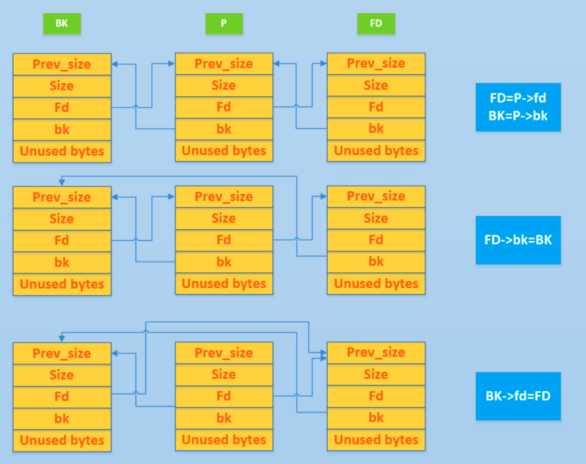

# 基本操作

## unlink

unlink は、双方向リスト(空き chunk のみを格納する)から要素を 1 つ取り出すためのもので、次の場所で使われることがあります。

- malloc
    - ちょうどよいサイズの large bin から chunk を取得するとき。
        - **ここで注意すべきは、fastbin と small bin では unlink が使われないことで、これが脆弱性がこれらでよく見つかる理由です。**
        - unsorted bin を順に走査して処理するときにも unlink は使われません。
    - 要求された chunk が属する bin より大きい bin から chunk を取り出すとき。
- free
    - 後方統合。物理的に隣接する低位アドレスの空き chunk を統合する。
    - 前方統合。物理的に隣接する高位アドレスの空き chunk を統合する(top chunk を除く)。
- malloc_consolidate
    - 後方統合。物理的に隣接する低位アドレスの空き chunk を統合する。
    - 前方統合。物理的に隣接する高位アドレスの空き chunk を統合する(top chunk を除く)。
- realloc
    - 前方拡張。物理的に隣接する高位アドレスの空き chunk を統合する(top chunk を除く)。

unlink は非常に頻繁に使われるため、次のようにマクロとして実装されています。

```c
/* Take a chunk off a bin list */
// unlink p
#define unlink(AV, P, BK, FD) {                                            \
    // P はすでに双方向リストの中にあるため、サイズを記録している箇所が 2 つある。そこでサイズが一致するかを検査する。
    if (__builtin_expect (chunksize(P) != prev_size (next_chunk(P)), 0))      \
      malloc_printerr ("corrupted size vs. prev_size");			      \
    FD = P->fd;                                                                      \
    BK = P->bk;                                                                      \
    // 攻撃者が空き chunk の fd と bk を単純に改ざんして任意書き込みを実現するのを防ぐ。
    if (__builtin_expect (FD->bk != P || BK->fd != P, 0))                      \
      malloc_printerr (check_action, "corrupted double-linked list", P, AV);  \
    else {                                                                      \
        FD->bk = BK;                                                              \
        BK->fd = FD;                                                              \
        // 以下では主に、P に対応する nextsize 双方向リストの変更を考える
        if (!in_smallbin_range (chunksize_nomask (P))                              \
            // P->fd_nextsize が NULL なら、P は nextsize リストに挿入されていない。
            // その場合、nextsize フィールドを変更する必要もない。
            // ここでは bk_nextsize フィールドを判定していないため、問題が起きる可能性がある。
            && __builtin_expect (P->fd_nextsize != NULL, 0)) {                      \
            // 小さい chunk の検査と同様の考え方
            if (__builtin_expect (P->fd_nextsize->bk_nextsize != P, 0)              \
                || __builtin_expect (P->bk_nextsize->fd_nextsize != P, 0))    \
              malloc_printerr (check_action,                                      \
                               "corrupted double-linked list (not small)",    \
                               P, AV);                                              \
            // ここは、P がすでに nextsize リストの中にあることを意味する。
            // FD が nextsize リストの中にない場合
            if (FD->fd_nextsize == NULL) {                                      \
                // nextsize でつながれた双方向リストが P 自身だけなら、P をそのまま取り除く
                // FD を nextsize でつながれたリストとする
                if (P->fd_nextsize == P)                                      \
                  FD->fd_nextsize = FD->bk_nextsize = FD;                      \
                else {                                                              \
                // そうでなければ、FD を nextsize が形成する双方向リストに挿入する必要がある
                    FD->fd_nextsize = P->fd_nextsize;                              \
                    FD->bk_nextsize = P->bk_nextsize;                              \
                    P->fd_nextsize->bk_nextsize = FD;                              \
                    P->bk_nextsize->fd_nextsize = FD;                              \
                  }                                                              \
              } else {                                                              \
                // リストの中にあるなら、そのまま取り除けばよい
                P->fd_nextsize->bk_nextsize = P->bk_nextsize;                      \
                P->bk_nextsize->fd_nextsize = P->fd_nextsize;                      \
              }                                                                      \
          }                                                                      \
      }                                                                              \
}
```

ここでは small bin の unlink を例に紹介します。large bin の unlink もこれと似ており、nextsize の処理が加わるだけです。



**P の最終的な fd と bk ポインタは変化していない**ことがわかりますが、双方向リスト全体を走査しても、対応するリストにはもうたどり着けません。この「変化していない」点は役に立ちます。この方法でアドレスをリークできることがあるからです。

- libc のアドレス
    - P が双方向リストの先頭にあるとき、bk でリークできる
    - P が双方向リストの末尾にあるとき、fd でリークできる
    - 双方向リストに空き chunk が 1 つだけのとき、P は双方向リストの中にあり、fd と bk のどちらでもリークできる
- ヒープのアドレスのリーク(双方向リストに複数の空き chunk がある場合)
    - P が双方向リストの先頭にあるとき、fd でリークできる
    - P が双方向リストの中にあるとき、fd と bk のどちらでもリークできる
    - P が双方向リストの末尾にあるとき、bk でリークできる

**注意**

- ここでの先頭とは、bin の fd が指す chunk、つまり双方向リストの中で最も新しく追加された chunk を指します。
- ここでの末尾とは、bin の bk が指す chunk、つまり双方向リストの中で最も早く追加された chunk を指します。

また、fd、bk に対しても fd_nextsize、bk_nextsize に対しても、プログラムは fd と bk が対応する要件を満たしているかを検査します。

```c
// fd bk
if (__builtin_expect (FD->bk != P || BK->fd != P, 0))                      \
  malloc_printerr (check_action, "corrupted double-linked list", P, AV);  \

  // next_size related
              if (__builtin_expect (P->fd_nextsize->bk_nextsize != P, 0)              \
                || __builtin_expect (P->bk_nextsize->fd_nextsize != P, 0))    \
              malloc_printerr (check_action,                                      \
                               "corrupted double-linked list (not small)",    \
                               P, AV);
```

一見、ごく普通に見えます。fd と bk を例にすると、P の forward chunk の bk は当然 P であり、同様に P の backward chunk の fd も当然 P です。対応する検査がなければ、P の fd と bk を書き換えることで、任意アドレス書き込みの効果を簡単に得られてしまいます。より詳しい例については、攻撃編の unlink を参照してください。

**注意: ヒープの最初の chunk が記録する prev_inuse ビットは、デフォルトで 1 です。**

## malloc_printerr

glibc の malloc でエラーが検出されると、`malloc_printerr` 関数が呼び出されます。

```cpp
static void malloc_printerr(const char *str) {
  __libc_message(do_abort, "%s\n", str);
  __builtin_unreachable();
}
```

主に `__libc_message` を呼び出して `abort` 関数を実行します。次のとおりです。

```c
  if ((action & do_abort)) {
    if ((action & do_backtrace))
      BEFORE_ABORT(do_abort, written, fd);

    /* Kill the application.  */
    abort();
  }
```

`abort` 関数では、glibc が 2.23 のバージョンの場合、stream を fflush します。

```c
  /* Flush all streams.  We cannot close them now because the user
     might have registered a handler for SIGABRT.  */
  if (stage == 1)
    {
      ++stage;
      fflush (NULL);
    }
```