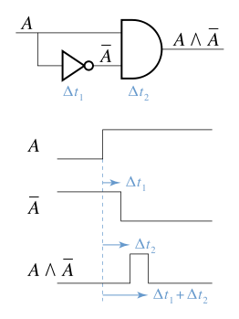
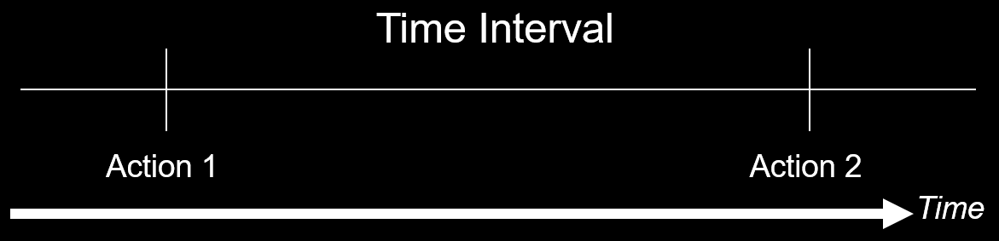
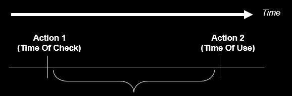
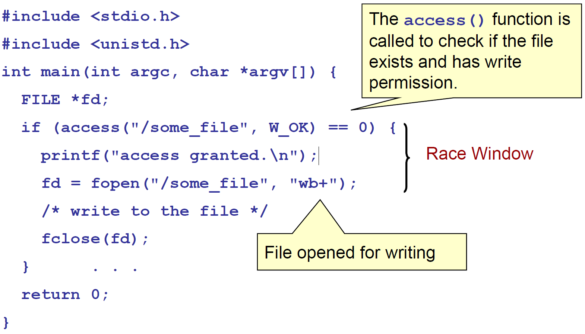
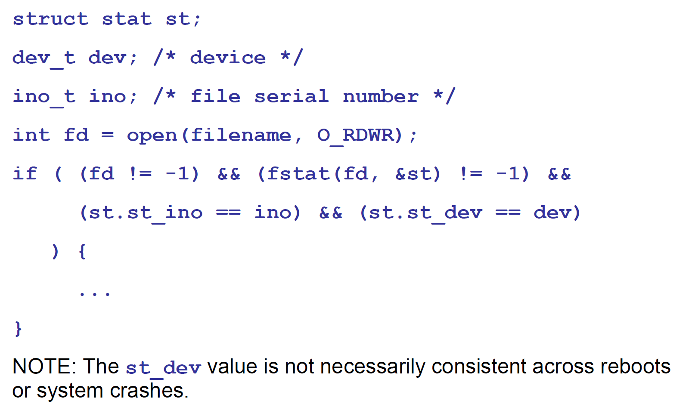
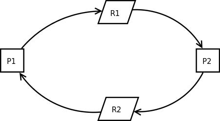

# Race Condition

## 概要

条件競争(race condition)とは、システムの実行結果が、制御できないイベントの順序に依存している状態のことです。これらの制御できないイベントが開発者の意図した順序で実行されないと、バグが発生することがあります。この用語はもともと、2つの電気信号が出力結果に影響を与えようとして互いに競争することに由来します。



条件競争は主に次の分野で発生します。

- 電子システム、特に論理回路
- コンピュータ、特にマルチスレッドプログラムや分散プログラム。

現在のシステムでは並行プログラミングが多用され、リソースを共有することも多いため、条件競争の脆弱性が生じやすくなっています。

ここでは主にコンピュータプログラムにおける条件競争を扱います。ソフトウェアの実行結果がプロセスやスレッドの順序に依存する場合に、条件競争が発生することがあります。簡単に考えると、条件競争には次の**条件**が必要だと分かります。

- 並行性。つまり、並行して実行される実行フローが少なくとも2つ存在すること。ここでの実行フローには、スレッド、プロセス、タスクなどのレベルのものが含まれます。
- 共有オブジェクト。つまり、複数の並行フローが同じオブジェクトにアクセスすること。**一般的な共有オブジェクトには、共有メモリ、ファイルシステム、シグナルがあります。通常、これらの共有オブジェクトは、複数のプログラムの実行フローが互いに情報をやり取りするために使われます。**また、共有オブジェクトにアクセスするコードを**クリティカルセクション**(臨界区、critical section)と呼びます。通常のコーディングでは、この部分にはロックをかけるべきです。
- オブジェクトの変更。つまり、少なくとも1つの制御フローが競争対象の状態を変更すること。プログラムがオブジェクトを読み取るだけであれば、条件競争は発生しません。

並行実行では実行フローの不確定性が大きいため、条件競争は比較的**気づきにくく**、**再現やデバッグも困難**です。このことが、条件競争の修正を難しくしています。

条件競争の影響もさまざまで、軽ければプログラムが異常動作するだけですが、重ければプログラムがクラッシュします。攻撃者が条件競争の脆弱性を悪用した場合、対象システムの特権を取得される可能性が高くなります。

簡単な例を挙げます。

```c
#include <pthread.h>
#include <stdio.h>

int counter;
void *IncreaseCounter(void *args) {
  counter += 1;
  sleep(0.1);
  printf("Thread %d has counter value %d\n", (unsigned int)pthread_self(),
         counter);
}

int main() {
  pthread_t p[10];
  for (int i = 0; i < 10; ++i) {
    pthread_create(&p[i], NULL, IncreaseCounter, NULL);
  }
  for (int i = 0; i < 10; ++i) {
    pthread_join(p[i], NULL);
  }
  return 0;
}

```

通常であれば、次のような出力を期待するでしょう。

```shell
➜  005race_condition ./example1
Thread 1859024640 has counter value 1
Thread 1841583872 has counter value 2
Thread 1832863488 has counter value 3
Thread 1824143104 has counter value 4
Thread 1744828160 has counter value 5
Thread 1736107776 has counter value 6
Thread 1727387392 has counter value 7
Thread 1850304256 has counter value 8
Thread 1709946624 has counter value 9
Thread 1718667008 has counter value 10
```

しかし、条件競争のために、最終的な出力結果は期待どおりにならないことが多くなります。

```c
➜  005race_condition ./example1
Thread 1417475840 has counter value 2
Thread 1408755456 has counter value 2
Thread 1391314688 has counter value 8
Thread 1356433152 has counter value 8
Thread 1365153536 has counter value 8
Thread 1373873920 has counter value 8
Thread 1382594304 has counter value 8
Thread 1400035072 has counter value 8
Thread 1275066112 has counter value 9
Thread 1266345728 has counter value 10
```

では、なぜ条件競争が起こりうるのかを考えてみましょう。次の具体例で説明します。

- プログラムはまず action1 を実行し、続いて action2 を実行する。ここでの action はアプリケーションレベルのものでも、OS レベルのものでもよい。通常であれば、プログラムが action2 を実行するとき、action1 によって作られた条件が引き続き成り立っていることを期待する。
- しかしプログラムの並行性のために、攻撃者は action2 が実行される前のごく短い時間窓の中で、action1 が作った条件を破壊できる可能性が高い。このとき攻撃者の操作が action2 と競争状態になるため、プログラムの実行結果に影響が出ることがある。



したがって、問題の根源は、プログラマがある条件が該当する時間帯には成り立っているはずだと仮定しているものの、その条件がごく小さな時間窓の中で変更されうる点にあると考えます。**この時間の間隔は非常に小さいかもしれませんが、攻撃者は(計算集約型の操作や DoS 攻撃などの)操作を行って、被害側マシンの処理速度を相対的に遅くすることができる場合があります。**

## 形式

よくある条件競争には次の形式があります。

### CWE-367: TOCTOU Race Condition

#### 説明

TOCTOU (Time-of-check Time-of-use) とは、プログラムがリソース(変数、メモリ、ファイル)を使用する前にそれを検査するものの、プログラムが実際にそのリソースを使用する前に、リソースが変更されてしまうことを指します。



以下に、さらに具体的な例を挙げます。

#### CWE-365: Race Condition in Switch

プログラムが switch 文を実行している最中に switch 変数の値が変更されると、予期しない動作を引き起こす可能性があります。特に case 文の後に break 文を書いていないコードでは、switch 変数が変化すると、プログラム本来のロジックが変わってしまう可能性が高くなります。

#### CWE-363: Race Condition Enabling Link Following

Linux にはファイルの名前付けの方法が2種類あることはご存じでしょう。

- ファイルのパス名
- ファイルディスクリプタ(file descriptor)

ただし、この2つの名前を対応するオブジェクトに解決する方法は異なります。

- ファイルのパス名は、解決の際に、渡されたパス(ファイル名、ハードリンク、シンボリックリンク)を通じて**間接的に解決**されます。渡されるパラメータは、対応するファイルの実際のアドレス(inode)ではありません。
- ファイルディスクリプタは、ファイルを直接指すポインタにアクセスすることで解決されます。

この間接性のために、先ほど述べた時間窓が生じます。

次のコードを例にします。プログラムはあるファイルにアクセスする前に、そのファイルが存在するかを検査し、その後ファイルを開いて操作を行います。しかし、検査の後、実際にファイルを使用する前に、攻撃者がそのファイルをシンボリックリンクに置き換えると、プログラムは誤ったファイルにアクセスすることになります。



この種の条件競争の問題の根源は、ファイルシステム上の名前とオブジェクトのバインディングにあります。次の関数はいずれもファイル名を引数として使います。access(), open(), creat(), mkdir(), unlink(), rmdir(), chown(), symlink(), link(), rename(), chroot(),…

では、この問題はどう避ければよいでしょうか。fstat 関数でファイルの情報を読み取って stat 構造体に格納し、その情報を既知の情報と比較することで、正しいファイルを読み込んだかどうかを判断できます。stat 構造体のうち、`st_ino` と `st_dev` の変数でファイルを一意に表せます。

- `st_ino`: ファイルのシリアル番号、つまり `i-node` を保持する
- `st_dev`: ファイルが存在するデバイスを保持する



### CWE-364: Signal Handler Race Condition

#### 概要

条件競争はシグナルハンドラ(信号処理プログラム)で頻繁に発生します。シグナルハンドラは非同期の動作をサポートしているためです。特にシグナルハンドラが**再入不可**(non-reentrant)であったり、状態に敏感であったりする場合、攻撃者はシグナルハンドラ内の条件競争を利用して、サービス拒否攻撃やコード実行を達成できる可能性があります。たとえば、シグナルハンドラの中で free を実行している最中に別のシグナルが来ると、シグナルハンドラが再び free を実行してしまい、double free の状況になります。少し工夫すれば、任意アドレスへの書き込みを達成できるかもしれません。

一般に、シグナルハンドラに関する条件競争の代表的な状況は次のとおりです。

- シグナルハンドラと通常のコード部分が、グローバル変数やデータセグメントを共有している。
- 異なるシグナルハンドラの間で状態を共有している。
- シグナルハンドラ自身が、malloc や free などの再入不可の関数を使っている。
- 1つのシグナルハンドラ関数が複数のシグナルを処理しており、これが use after free や double free の脆弱性につながりうる。
- setjmp や longjmp などの仕組みを使うことで、シグナルハンドラが元のプログラムの実行フローに戻れなくなる。

#### スレッドセーフと再入可能

ここで、スレッドセーフと再入可能(reentrant)の関係を説明しておきます。

-   スレッドセーフ
    -   その関数を複数のスレッドから呼び出しても、何の問題も起きないこと。
    -   条件
        -   自身が共有リソースを一切持たない。
        -   共有リソースがある場合は、ロックが必要。
-   再利用可能
    -   1つの関数の複数のインスタンスが、同じアドレス空間内で同時に実行できること。
    -   再入可能な関数は中断することができ、他のコードがその関数に入っても、データの完全性は失われません。したがって再入可能な関数は必ずスレッドセーフです。
    -   再入可能性が重視するのは、単一のスレッドが実行しているときに、同じサブルーチンに再び入っても安全であることです。
    -   満たさない条件
        -   関数内で静的なデータ構造を使っており、それが定数でない。
        -   関数内で malloc 関数や free 関数を使っている。
        -   関数が標準 I/O 関数を使っている。
        -   呼び出している関数が再入可能でない。
    -   再入可能な関数が使うすべての変数は、[コールスタック](https://zh.wikipedia.org/wiki/%E8%B0%83%E7%94%A8%E6%A0%88)上の現在の[関数スタック](https://zh.wikipedia.org/w/index.php?title=%E5%87%BD%E6%95%B0%E6%A0%88&action=edit&redlink=1)(フレーム)の中に保存されます。

## 対策

条件競争を排除したい場合、最初の目標は競争窓(race windows)を見つけることです。

競争窓とは、競争対象にアクセスするコード部分のことで、攻撃者に競争対象を変更する機会を与えます。

一般に、競合する競争窓を互いに排他的にできれば、競合状態を排除できます。

### 同期プリミティブ

一般に、条件競争を排除するには同期プリミティブ(synchronization primitive)を使います。よく使われるものは次のとおりです。

-   ロック変数
    -   通常のミューテックス(mutex)は、待機中に CPU を手放してアイドル状態に入り、しばらくすると自動的に再試行します。
    -   スピンロック(spinlock)は、待機中に CPU を手放さず、試行し続けます。
-   条件変数
    -   **条件変数はロックをかけるためではなく、待機するために使います。条件変数は、ある特別な状況が発生するまでスレッドを自動的にブロックするために使います。通常、条件変数はミューテックスと一緒に使います。**
-   クリティカルセクションオブジェクト、CRITICAL_SECTION

-   セマフォ(semaphore)。あるクリティカルセクションにアクセスできるスレッド数を制御するもので、通常は1より大きい。
-   パイプ。読み取りプロセスと書き込みプロセスをつないで両者の通信を実現するための共有ファイルを指す。その寿命は、パイプを作成したプロセスの寿命を超えない。
-   名前付きパイプ。寿命をオペレーティングシステムの稼働期間と同じ長さにできる。

```
# パイプを作成する
mkfifo my_pipe
# gzip は指定されたパイプからデータを読み取り、圧縮して out.gz に書き込む
gzip -9 -c < my_pipe > out.gz &
# パイプにデータを送る
cat file > my_pipe
```

### デッドロック

#### 概要

同期プリミティブの使い方が不適切だと、プロセスがデッドロック(死锁、deadlock)に陥ることがあります。2つ以上の実行フローが互いにブロックし合って、どれも先に進めなくなると、デッドロックが発生します。デッドロックは主に、競合する実行フローの中に循環待ちの実行フローがあることで起こります。つまり、循環待ちの中の各実行フローが1つずつリソースを獲得し、同時に次のリソースを獲得しようとしている状態です。下図では、P1 と P2 の2つのプロセスが、実行を続けるためにリソースを必要としています。P1 はリソース R2 を持っており、実行にはさらにリソース R1 が必要です。P2 はリソース R1 を持っており、実行にはさらにリソース R2 が必要です。双方が互いを待っていて、どちらも実行できません。



一般に、デッドロックには次の4つの必要条件があります。

- 相互排他。リソースが排他的であること。
- 保持と待機。すでに持っているリソースを保持したまま、次のリソースを待つこと。
- 横取り不可(非プリエンプション)。プロセスが獲得したリソースは、使い終わる前に、リソースを要求する側が占有している側から強制的に奪うことはできず、占有しているプロセス自身が解放するのを待つしかないこと。
- 循環待ち。リソースを循環して待つこと。

デッドロックを排除したい場合は、上の4つの必要条件を崩せばよいということになります。

このほか、デッドロックは次のような原因から生じることがあります。

- プロセッサの速度
- プロセスやスレッドのスケジューリングアルゴリズムの変更
- 実行中の、異なるメモリの制限。
- プログラムの実行を中断しうるあらゆる非同期イベント。

#### 影響

デッドロックは、通常、サービス拒否攻撃を引き起こします。

## 検出

ここまで来ると、条件競争の脆弱性を検出できないものか、という疑問が浮かびます。実際にこの方面の研究もあり、主に静的解析と動的解析の2つの側面から検出が行われています。

### 静的検出

現時点で知られている静的検出ツールは次のとおりです。

-   [Flawfinder](http://www.dwheeler.com/flawfinder/)
    -   対象: C/C++ のソースコード
    -   手順
        -   脆弱性データベースを構築する
        -   単純なテキストパターンマッチングを行う。データフロー解析や制御フロー解析は一切行わない
-   [ThreadSanitizer](https://github.com/google/sanitizers)
    -   対象: C++ と Go
    -   実装: LLVM

### 動的検出

- [Intel Inspector](https://en.wikipedia.org/wiki/Intel_Inspector)
- [Valgrind](https://en.wikipedia.org/wiki/Valgrind)

# 参考

- http://www.teraits.com/pitagoras/marcio/segapp/05.ppt
- http://repository.root-me.org/Programmation/C%20-%20C++/EN%20-%20Secure%20Coding%20in%20C%20and%20C++%20Race%20Conditions.pdf
- https://www.blackhat.com/presentations/bh-europe-04/bh-eu-04-tsyrklevich/bh-eu-04-tsyrklevich.pdf
- https://xinhuang.github.io/posts/2014-09-23-detect-race-condition-using-clang-thread-sanitizer.html
- https://llvm.org/devmtg/2011-11/Hutchins_ThreadSafety.pdf
- http://www.cnblogs.com/biyeymyhjob/archive/2012/07/20/2601655.html
- http://www.cnblogs.com/huxiao-tee/p/4660352.html
- https://github.com/dirtycow/dirtycow.github.io
