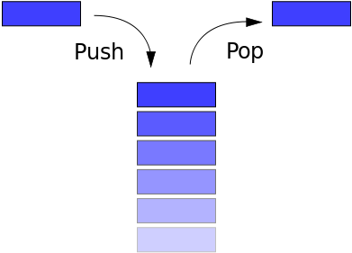
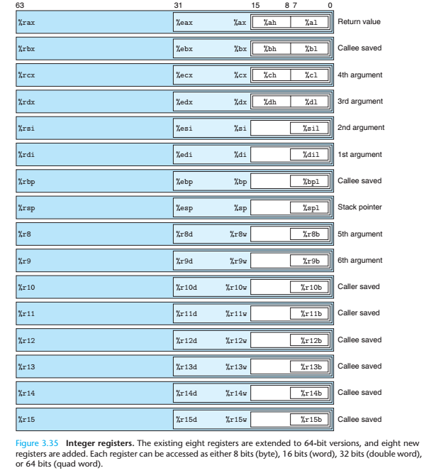

# スタックの紹介

## スタックの基本

スタック(stack)は典型的な後入れ先出し(Last in First Out)のデータ構造で、主な操作は積む(push)と取り出す(pop)の2つです。下図(Wikipedia より)のとおりです。どちらの操作もスタックの先頭(top)に対して行われ、もちろんスタックの底(bottom)もあります。

高水準言語は実行時にアセンブリプログラムに変換され、アセンブリプログラムの実行中にこのデータ構造が十分に活用されます。プログラムは実行時にそれぞれ仮想アドレス空間を持ち、その一部がそのプログラムのスタックに当たります。スタックは関数呼び出しの情報とローカル変数を保存するために使われます。また、よく行われる操作もやはり push と pop です。注意すべきは、**プログラムのスタックはプロセスのアドレス空間の高位アドレスから低位アドレスへ向かって伸びる**という点です。

## 関数呼び出しスタック

基本的な関数呼び出しスタックを学ぶために、以下の記事を必ずしっかり読んでください。

- [C言語の関数呼び出しスタック(一)](http://www.cnblogs.com/clover-toeic/p/3755401.html)
- [C言語の関数呼び出しスタック(二)](http://www.cnblogs.com/clover-toeic/p/3756668.html)

ここでレジスタの図をもう1枚示します。

32 ビットと 64 ビットのプログラムには、次のような簡単な違いがあることに注意してください。

- **x86**
    - **関数の引数**は**関数の戻りアドレス**の上にあります
- **x64**
    - System V AMD64 ABI(Linux、FreeBSD、macOS などが採用)では、最初の6個の整数またはポインタの引数が順に**RDI, RSI, RDX, RCX, R8, R9 レジスタ**に保存され、引数がそれ以上ある場合にのみスタックに保存されます。
    - メモリアドレスは 0x00007FFFFFFFFFFF を超えることができず、**6バイト長**です。超えると例外が発生します。

## 参考文献

- csapp
- Calling conventions for different C++ compilers and operating systems, Agner Fog
