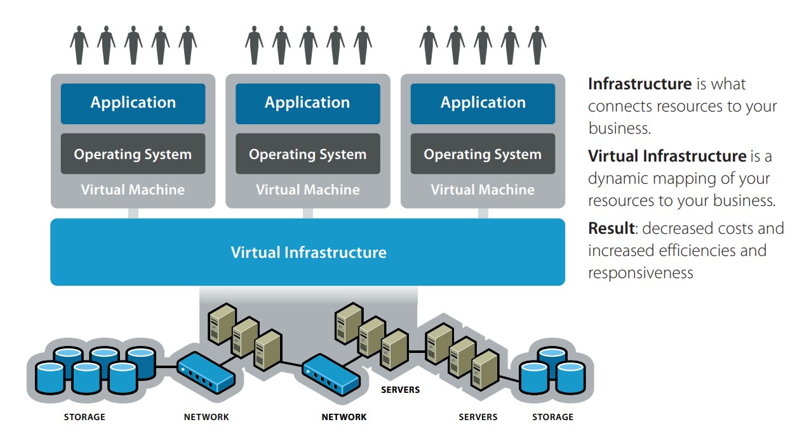
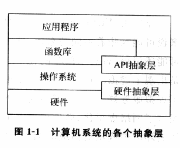
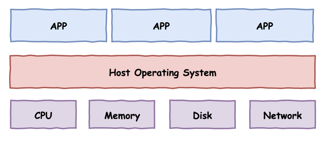
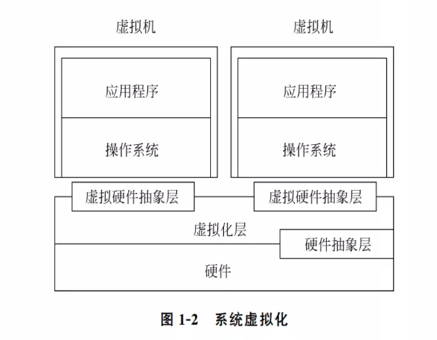
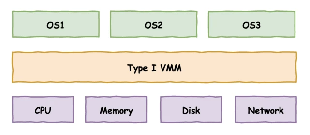
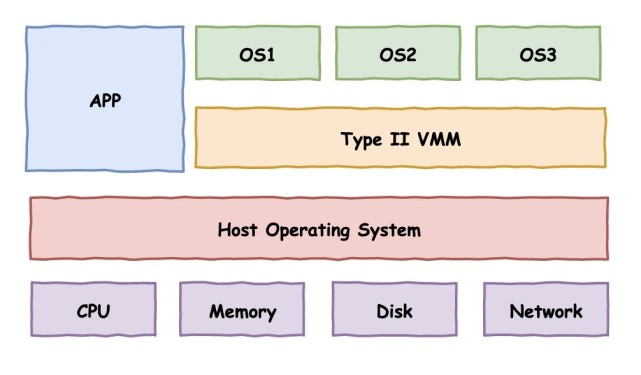
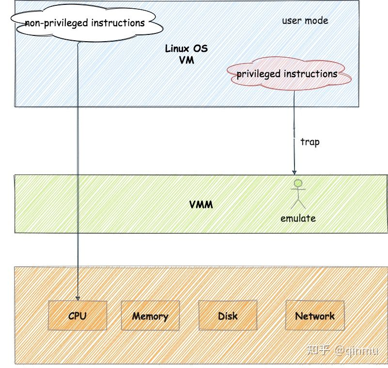

# 仮想化技術の紹介

仮想化とは何でしょうか。狭い意味では、日常で仮想化と言うときは主に _仮想マシン_(Virtual Machine)を指し、**仮想化技術によって 1 台のコンピュータを複数の論理コンピュータに仮想化する**ものです。これは実は、仮想化技術のうち抽象化の粒度が単一のコンピュータである分野、つまり `システム仮想化` にあたります。

コンピュータサイエンスにおける**仮想化**(Virtualization)とは、実際には「**コンピュータのさまざまな実体リソースを論理的に抽象化し、異なる仮想リソースとして提示する**」リソース管理技術のことです。仮想化技術を使うと、実体の構造同士が分割できないという性質を打ち破れます。1 つの実体リソースを複数の仮想リソースとしてユーザーに見せることも、複数の実体リソースを 1 つの物理リソースとして見せることもできます。

仮想化技術によって、リソースの動的な割り当て、柔軟なスケジューリング、ドメインをまたいだ共有などを実現でき、リソースの利用率を高められます。

> ここでいう実体リソースには、**CPU、メモリ、ディスク容量、ネットワークアダプタ**などが含まれます。

ここで、仮想化技術の定番の教科書にある記述を引用します。

> 抽象的に言えば、仮想化とは物理的な制約に縛られない、リソースの論理的な表現です。具体的に言えば、仮想化技術の実現形態は、システムに仮想層を追加することです。仮想化層は下位のリソースを別の形のリソースに抽象化し、上位に提供します。空間的な分割、時間的な分割(タイムシェアリング)、およびエミュレーションによって、仮想化は 1 つのリソースを複数に抽象化できます。逆に、複数のリソースを 1 つに抽象化することもできます。
>
> ——『システム仮想化:原理と実装』

つまり、仮想化技術の実現は、現代のコンピュータシステムが下から上へと積み重ねる多層の抽象構造に由来します。「**各層は上の層に対して抽象を提示し、各層は下の層の抽象インターフェースだけを知っていればよく、その内部の動作機構を知る必要はない**」。したがって、**同じように振る舞う抽象インターフェースを何らかの方法で上位層に提供できれば、上位層から見ると、それはその層が提供する本物のリソースに見え、その層の仮想化が実現できる**、と容易に考えられます。

こうして、物理層と仮想層の両側から見ると、仮想化には 2 つの重要な修飾語ができます。

- 「**Host**」:物理リソース側。
- 「**Guest**」:仮想リソース側。

リソースの種類に応じて、この 2 つの修飾語の後ろにさまざまな名詞を付けられます。たとえば、物理マシンを `Host Machine`(ホストマシン)、その上で動作する仮想マシンを `Guest Machine`(ゲストマシン)と呼びます。同様に、ホストマシン上でオペレーティングシステムが動作している場合、それを `Host OS`、仮想マシン内で動作するオペレーティングシステムを `Guest OS` と呼びます。

異なる抽象層にある仮想化は、次のように分類できます。

- **ハードウェア抽象層での仮想化**:仮想ハードウェア抽象層によって仮想マシンを実現し、Guest OS に物理ハードウェアと同じ、または似たハードウェア抽象層を提示します。「**システムレベル仮想化**」とも呼ばれます(例:VMWare、Xen)。
- オペレーティングシステム層での仮想化:通常は、オペレーティングシステムのカーネルが、互いに隔離された複数のユーザー空間インスタンス(通常はコンテナと呼ばれる)を提供することを指します。これらのユーザー空間インスタンスは、ユーザーから見ると本物のコンピュータのようで、独立したネットワークやファイルシステムなどを持ちます(例:VServer)。
- ライブラリ関数層での仮想化:オペレーティングシステムのアプリケーションレベルのライブラリ関数のサービスインターフェースを仮想化することで、アプリケーションを修正せずに異なるオペレーティングシステム上でシームレスに動作させます(例:Wine、WSL)。
- プログラミング言語層での仮想化:この種の仮想マシンは、ハードウェア上には存在しない、プロセスレベルの仮想アーキテクチャを実行します。プログラムコードは、仮想マシンのランタイムサポートシステムによって機械語に**翻訳**されてから実行されます。プロセスレベルの仮想化に属します(例:JVM)。

> たとえば Linux kernel の VFS は、仮想化という概念にとてもよく合致するサブシステムです。上位からの呼び出しの観点では、見えているのは統一された API であり、各ファイルシステムの具体的な実装は VFS 層の下に隠されています。この抽象層における open、read、write などの抽象 API の使い方だけを知っていればよく、下層の ext4 や ntfs の内部実装を気にする必要はありません。
>
> 仮想化も同様で、Guest 側から見えるのは統一された仮想リソースのインターフェースだけです。言い換えれば、Host が仮想化されたリソースのインターフェースを提示しており、その振る舞いは実体のデバイスと一致しています。

日常で言う仮想化技術は主に**ハードウェア抽象層での仮想化**、つまり「**システムレベル仮想化**」で、仮想化技術によって 1 台のコンピュータを複数の論理コンピュータに仮想化するものです。

実体リソースの種類に応じて、さらに次のように細分できます。

- **計算仮想化**:CPU とメモリのリソースの仮想化。
- **ネットワーク仮想化**:ネットワークリンクのリソースの仮想化。
- **IO 仮想化**:IO リソースの仮想化。
- **ストレージ仮想化**:ディスクストレージのリソースの仮想化。

## システム仮想化の概要

### 基本モデル

まず仮想マシンを定義します。

- **仮想マシン**(Virtual Machine)は、コンピュータの仮想化インスタンスです。独自の仮想ハードウェア(CPU、メモリ、デバイスなど)を持ち、アプリケーションやオペレーティングシステムの実行を含め、コンピュータとほぼ完全に同じ機能を実行できます。

コンピュータは、下図のような 3 層モデルに簡単に抽象化できます。下から順に**物理ハードウェア層、オペレーティングシステム層、アプリケーション層**です。したがって、仮想マシンのインスタンスは、図のような階層を持つ**論理的なコンピュータ**とみなせます。

しかし、仮想マシンの実行には物理環境の支えが必要で、仮想マシンのインスタンスが何もないところから現れたり消えたりすることもできません。そこで新しい概念として **VMM**、つまり `Virtual Machine Monitor`(`Hypervisor` とも呼ばれる)を導入します。これは VM とハードウェアの間にあるソフトウェア層で、**VM の作成や破棄などを担当し、VM に実行環境を提供します**。これが `仮想ハードウェア抽象層` です。

1974 年、Gerald J. Popek と Robert P. Goldberg は共著論文[『Formal Requirements for Virtualizable Third Generation Architectures』](https://dl.acm.org/doi/pdf/10.1145/361011.361073)を発表し、仮想化可能なシステム構造を満たす VMM の 3 つの十分条件を提示しました。これは `Popek and Goldberg virtualization requirements` と呼ばれます。

- **等価性**(essentially identical):VMM の下で動作するプログラムは、**等価な物理マシン上で直接動作する同じプログラムの振る舞いと完全に一致しなければならない**
- **リソース制御**(resource control):VMM は仮想リソースに対して、割り当て、監視、回収を含む**完全な制御能力**を持つ
- **効率性**(efficiency):マシン命令のうち頻繁に使われる部分は、VMM の介入なしに**ハードウェア上で直接実行される**べきである

この論文では 2 種類の Hypervisor 方式が提示されており、これが現在の主流の 2 方式になっています。

- `Type I`:**Hypervisor がハードウェア上で直接動作する。つまり Hypervisor を Host OS としてハードウェアリソースを直接管理する**。たとえば `VMware ESXI` はこの構成の Hypervisor です。

  

- `Type II`:**Hypervisor が従来のオペレーティングシステム上で、ほかのアプリケーションと並行して動作する**。たとえば `Qemu` や `VMware Player` はこの構成の Hypervisor です。

  

ここで `センシティブ命令`(sensitive instructions)という概念を導入します。これは**特権リソースを操作する命令**で、たとえば IO 操作やページテーブルレジスタの変更などです。VMM がシステムリソースを完全に制御できるようにするには、**センシティブ命令は VMM の監視・審査のもとで、または VMM を経由して実行されなければなりません**。したがって、あるアーキテクチャのすべての特権命令がセンシティブ命令であれば、**特権レベル圧縮**(Ring Compression)の方法で仮想環境を実現できます。

- VMM は最高特権レベルで動作し、Guest VM は低い特権レベルで動作します。Guest VM がセンシティブ命令を実行すると、最高特権レベルにある VMM にトラップされ、VMM がセンシティブ命令の振る舞いをエミュレートできます。

これによって、システム仮想化の古典的なモデルである `Trap & Emulate` が得られます。

- オペレーティングシステムの実行モードを「ユーザーモード(user mode)」と「特権モード(privileged mode)」に分けます。ユーザーモードでは非特権命令しか直接実行できず、特権命令を実行すると例外が発生して、特権モード側の対応する処理コードにトラップされます。
- Guest VM をユーザーモードで動作させることで、通常の命令は CPU 上でそのまま実行できます。Guest VM が**センシティブ命令**を実行すると**例外が発生し、VMM が介入して本来の振る舞いをエミュレートします**。

ハードウェアの実体リソースにもさまざまな種類があるため、種類ごとの仮想化技術を次のように分けます。

- CPU 仮想化
- メモリ仮想化
- I/O 仮想化

## REFERENCE

『システム仮想化:原理と実装』——Intel オープンソースソフトウェア技術センター

[【VIRT.0x02】系统虚拟化导论](https://arttnba3.cn/2022/08/29/VURTUALIZATION-0X02-BASIC_KNOWLEDGE/)

[Intel® 64 and IA-32 Architectures Software Developer's Manual Volume 3C: System Programming Guide, Part 3](https://cdrdv2.intel.com/v1/dl/getContent/671506)

[重学 Docker - part1: 虚拟化技术简述](https://zhuanlan.zhihu.com/p/363922044)

[Formal Requirements for Virtualizable Third Generation Architectures](https://dl.acm.org/doi/pdf/10.1145/361011.361073)
