# CPU 仮想化

CPU 仮想化は、システム仮想化技術の中で最も中核となる部分です。CPU はコンピュータの最も中核的なコンポーネントであり、システム全体の動作を直接制御しているからです。また、メモリアクセス(メモリ仮想化)と I/O 操作(I/O 仮想化)も CPU に直接依存しているため、CPU 仮想化はシステム仮想化技術の核心です。

Gerald J. Popek と Robert P. Goldberg の共著論文[『Formal Requirements for Virtualizable Third Generation Architectures』](https://dl.acm.org/doi/pdf/10.1145/361011.361073)では、仮想化可能なシステム構造を満たす VMM の 3 つの十分条件として、等価性、リソース制御、効率性が提示されました。この条件を満たすために、CPU 仮想化で使われる古典的なモデルは「Trap & Emulate」で、**特権レベル圧縮**(Ring Compression)の方法で仮想環境を実現します。

- Hypervisor は最高特権レベルで動作し、Guest VM は低い特権レベルで動作します。Guest VM は非センシティブ命令をハードウェア上で直接実行し、センシティブ命令を実行すると、最高特権レベルにある Hypervisor にトラップされ、Hypervisor がセンシティブ命令の振る舞いをエミュレートします。
- virtual CPU のスケジューリングが発生すると、vCPU の状態を保存して Hypervisor の状態を復元します。Hypervisor は処理を終えると次の virtual CPU のスケジューリングを行い、次の vCPU の状態を復元して実行を再開します。

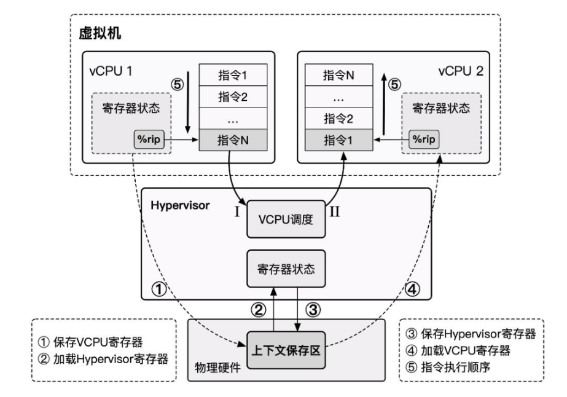

## x86 仮想化で直面した問題

仮想化技術の発展初期において、パーソナルコンピュータの分野で広く使われていた x86 アーキテクチャは、仮想化の古典的なアーキテクチャである「Trap & Emulate」を十分にサポートしておらず、システム仮想化のサポートに欠陥がありました。**システム仮想化は直接的かつ効率的には実現できませんでした**。

Intel の階層型保護リングは権限を ring0~ring3 に分け、オペレーティングシステムのカーネルは ring0、ユーザープロセスは ring3 の権限で動作します。

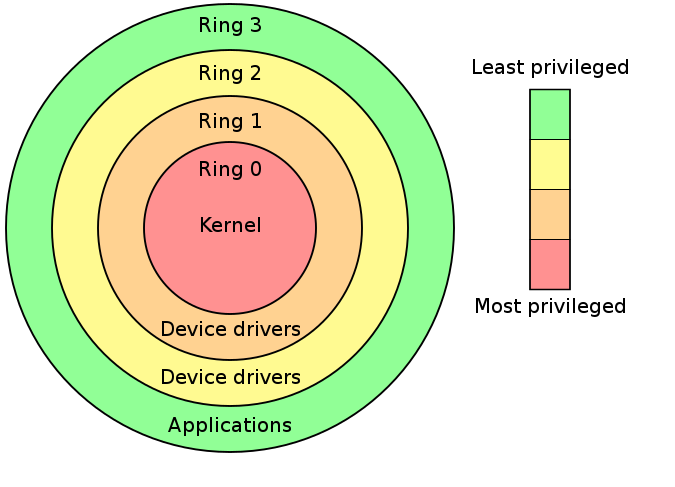

システム仮想化の古典的なアーキテクチャ「Trap & Emulate」では、Guest OS はすべて ring3 で動作し、センシティブ命令が絡むと VM が General Protection 例外を発生させ、VMM がそれを捕捉して処理します。**しかし、すべてのセンシティブ命令が特権命令であるわけではなく、すべてのセンシティブ命令が VMM の介入のための例外を発生させるわけでもありません**。x86 アーキテクチャには、**非特権のセンシティブ命令が全部で 17 個**あります。

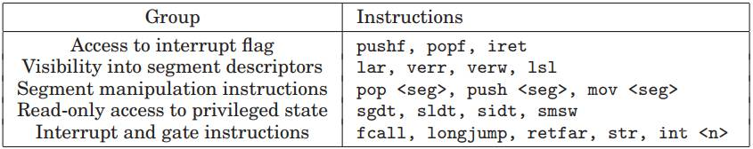

これらの命令は **`Popek and Goldberg virtualization requirements` に直接違反しており、x86 は仮想化可能なアーキテクチャではありません**。

> たとえば x86 で popf を使って eflags の割り込みフラグ(IF)を変更しようとする場合、ユーザーモードでこの操作を行っても、**ハードウェアに単に無視され、例外は発生しません**。そのため VMM は介入できません。

「ハードウェアが足りなければ、ソフトウェアで補う」。そこで、ハードウェアが仮想化を十分にサポートするようになる前は、Hypervisor はソフトウェアの面で工夫するしかなく、2 種類の純粋なソフトウェア仮想化技術が登場しました。「エミュレーション実行」(VMWare)と「ソースコードの直接書き換え」(Xen)です。

ソフトウェア仮想化技術が長年かけて成熟した後、ようやく x86 アーキテクチャも仮想化をサポートするようになりました。「ハードウェア支援仮想化」(Intel VT)が登場し始めたのです。

## 純粋なソフトウェアによる CPU 仮想化の実現

前述のとおり、x86 アーキテクチャには**非特権のセンシティブ命令があり、VMM が x86 VM のセンシティブな振る舞いを捕捉できません**。これは `Popek and Goldberg virtualization requirements` に違反しているため、ハードウェアの仮想化サポートが登場する前は、仮想化ベンダーはまずソフトウェアの面から手を打つしかありませんでした。

### エミュレーション & インタプリタ実行

**「エミュレーション」**(Emulate)技術は、実は仮想化より前から存在しました。純粋なソフトウェアによるエミュレーションとは、本質的には、**エミュレート対象と同じ振る舞いを示すアプリケーションを書くことで、異なる構成のプラットフォーム向けのアプリケーションを動作させる**ことです。

エミュレーション技術はプログラムレベルだけでなく、システムレベルのエミュレーションにも使えます。CPU の動作の本質は、**PC レジスタが指すメモリ領域から命令を取り出してデコードし、実行し続けること**です。したがって、仮想マシンを実現する最も単純で強引な方法は、**各命令に対応する振る舞いをエミュレートし、VM の振る舞いを VMM から完全に制御できるようにすること**だ、と容易に考えられます。

エミュレーション技術の原理も最も単純で、**インタプリタ実行**によってエミュレーションを実現できます。つまり、エミュレータのプログラムがメモリから命令を読み出し続け、各命令の効果をエミュレートします。ある意味で、**各命令の実行時に「トラップ」が行われている**ため、エミュレーション技術で仮想化の穴を埋められ、物理マシンと異なるアーキテクチャの仮想マシンをエミュレートすることもできます。

**Qemu**(`Quick Emulator`)は本質的にエミュレータであり、**各種周辺機器を含むコンピュータシステム一式を完全にエミュレートします**。

ただし、インタプリタ実行に基づくエミュレーション技術には、非常に致命的な欠点があります。**性能が極めて悪い**ことです。すべての命令を VMM が解析してから VMM がエミュレート実行する必要があり、最も単純な命令でも複数の手順と複数回のメモリアクセスに分解される可能性があるため、効率が極めて低くなります。

x86 アーキテクチャで仮想マシンを実現するのにエミュレーション技術を使う理由を、改めて考えてみましょう。非特権のセンシティブ命令の存在が `Popek and Goldberg virtualization requirements` を破っていますが、**非特権のセンシティブ命令は少数にすぎず、大部分の命令は物理ハードウェア上で直接実行できます**。そこで、エミュレーション技術を改良した仮想化技術として、`スキャン & パッチ` と `バイナリ変換` が登場しました。

### スキャン & パッチ

仮想化のシナリオにおける仮想マシンの多くは、物理マシンと同じ ISA を持つため、純粋なエミュレーションで仮想マシンを実現する必要はありません。**非センシティブ命令はハードウェア上で直接実行させ、何らかの方法で非特権のセンシティブ命令を VMM にトラップさせる**ことで、Trap & Emulate モデルを再び実現できます。

**スキャン & パッチ**(Scan & Patch)はそのような技術で、**非センシティブ命令はハードウェア上で直接実行させ**、同時に**システムコード中のセンシティブ命令を、VMM にトラップできるジャンプ命令などに置き換えます**。これにより、VM がセンシティブ命令を実行したときに VMM にトラップされ、VMM がセンシティブ命令の効果をエミュレート実行できます。

基本的な実行の流れは次のとおりです。

- VMM は、VM が各コード片を実行する前にスキャンし、各命令を解析して、特権命令とセンシティブ命令を探す
- VMM は該当する命令のパッチコードを動的に生成し、元のセンシティブ命令を外部へのジャンプに置き換えて VMM にトラップさせ、VMM 内で動的に生成したパッチコードを実行する
- パッチコードの実行が終わったら、VM に戻って次のコードの実行を続ける

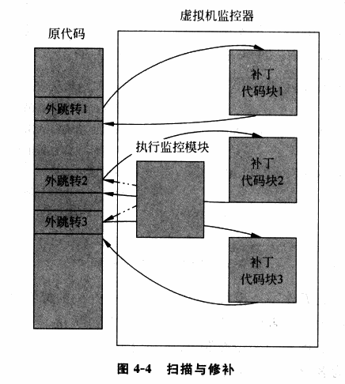

「スキャン & パッチ」技術ではコードの大部分を物理 CPU 上で直接実行できるため、性能の損失は小さくなります。しかし、「スキャン & パッチ」にも一定の欠点があります。

- 特権命令とセンシティブ命令は引き続きエミュレーション実行で処理されるため、一定の性能損失が生じる可能性がある

- コードパッチによって余分なジャンプが入り、コードの局所性が損なわれる

  > 局所性の原理:CPU が命令やデータにアクセスするメモリ単位は、小さな領域に集中する傾向がある

- VMM は、パッチコードに対応する元のコードのコピーを保持する必要があり、余分なオーバーヘッドが生じる

### バイナリ変換

仮想化の性能をさらに高めるために、**「バイナリコード変換」**(Binary Translation)技術が登場しました。「スキャン & パッチ」と同様に、バイナリコード変換も実行時にコードを動的に書き換えますが、BT 技術は**基本ブロック**(入口と出口が 1 つずつしかないコードブロック)を変換の単位とする点が異なります。

- Emulator は、読み込んだバイナリコードを**変換**し、対応する ISA の**特権命令とセンシティブ命令を含まない部分集合**で構成されたコードとして出力します。これによりユーザーモードで安全に実行できます
- Emulator は、これから実行する基本ブロックのために領域を動的に確保します。これを**変換キャッシュ**(translation cache)と呼び、変換後のコードがここに置かれます。各 TC は何らかの対応関係(たとえばハッシュテーブル)で元のコードと関連付けられます

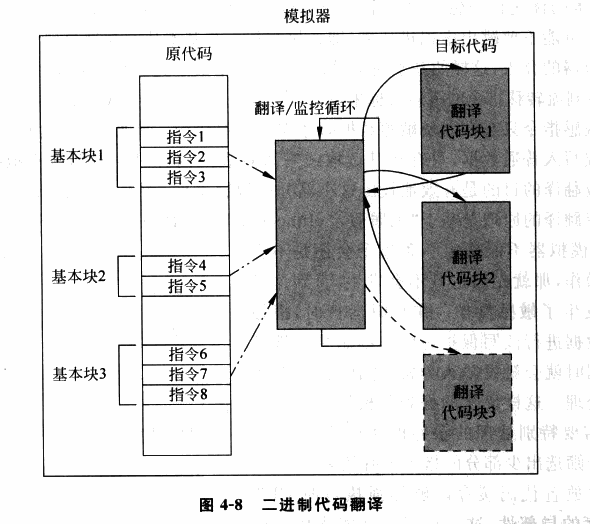

> バイナリコード変換技術とスキャン & パッチ技術の原理は大筋でよく似ていますが、バイナリコード変換技術がすべてのコードを変換するのに対し、スキャン & パッチ技術はセンシティブ命令と特権命令だけにパッチを当てます。また、スキャン & パッチ技術は**コード全体の構造を変えず**、センシティブ命令と特権命令を VMM へのトラップを起こせる命令に置き換えるだけです。一方、バイナリコード変換技術は**基本ブロックのコード全体の構造を直接変えます**(たとえば、変換前は 40B だった基本ブロックが変換後に 100B になり、内部コードの相対位置も変化します)。

変換方法は大きく次の 2 つに分けられます。

- **単純変換**:**等価なコードによるエミュレーション**と直接理解できます。この方法は実装が比較的簡単ですが、命令数が大幅に膨らみます。
- **同値変換**:変換の**元のコードと結果のコードが同じ**ものです。理論上、ほとんどの命令は同値変換でハードウェア上で直接実行できますが、より複雑な動的解析技術が必要です。

同じ ISA アーキテクチャ上では、大部分の命令は直接同値変換できますが、次のものは例外です。

- PC 相対アドレッシング命令。この種の命令のアドレッシングは PC に依存しますが、バイナリ変換後はコードの基本ブロックの構造が変わるため、アドレッシングの正確さを保つために補正コードを追加で挿入する必要があり、一定の性能損失が生じます。
- 直接制御転送。関数呼び出しやジャンプ命令などが含まれ、飛び先アドレスを生成したコードのアドレスに置き換える必要があります。
- 間接制御転送。間接呼び出し、リターン、間接ジャンプなどが含まれ、飛び先アドレスが実行時に動的に決まるため、変換時に飛び先を確定できません。
- 特権命令。単純な特権命令は、同様の同値コードに直接変換できます(たとえば cli 命令は、vcpu の flags レジスタの IF ビットを 0 にする処理に直接変換できます)。しかし、少し複雑な命令では、深いエミュレーションが必要になり、ジャンプ命令を使って VMM にトラップさせることになるため、通常は一定の性能オーバーヘッドが生じます。

> たとえば、QEMU における基本ブロックのコード変換の例を示します。
>
> 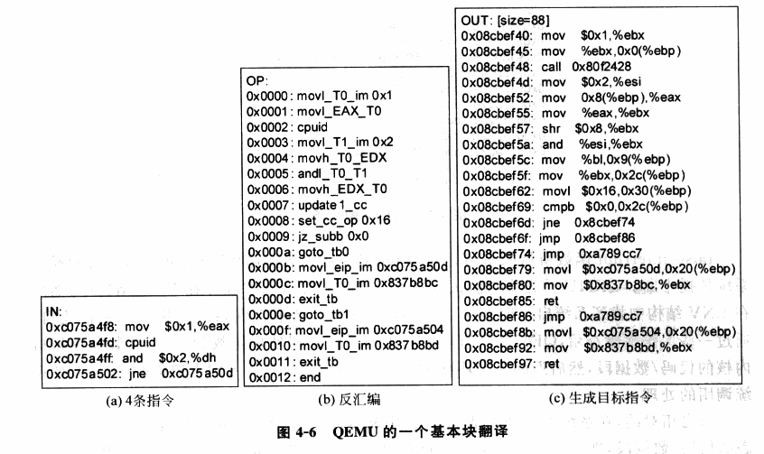

バイナリコード変換技術はより複雑な過程を使うため、より多くの問題も生じ、次のような場合は追加の処理が必要です。

- 自己書き換えコード(Self Modifying Code)。この種のプログラムは、実行時に自分が実行するコードを書き換えるため、Emulator が新たに生成されたコードを再変換する必要があります。
- 自己参照コード(Self Referential Code)。この種のプログラムは、実行中に自分のコードセグメントの内容を読み取るため、変換後のコードではなく元のコードセグメントの内容を読ませるよう、追加の処理が必要です。
- 正確な例外(Precise Exceptions)。変換後のコードの実行中に割り込みや例外が発生した場合、実行状態を、元のコードが例外発生点まで実行されたときの状態に戻してから、Guest OS に処理を渡す必要があります。BT 技術では現状この状況をうまく扱うことが難しく、これは変換後のコードと元のコードが 1 命令ずつの対応関係を失っているためです。実現可能な解決策の 1 つは、例外が発生したときにロールバックし、その後インタプリタ実行に切り替えることです。
- リアルタイムコード。この種のコードはリアルタイム性への要求が高く、エミュレーション環境で実行すると時間の正確さが失われます。現時点では解決できません。


## ハードウェア支援仮想化

この節では、Intel VT-x を例に、ハードウェア支援仮想化(hardware-assisted virtualization)技術を紹介します。

### 概要

Intel VT 技術は、Intel が x86 仮想化のために提供するハードウェアサポートです。そのうち CPU 仮想化を支援するのが `Intel VT-x` 技術で、従来の IA32 プロセッサアーキテクチャを拡張し、IA32 アーキテクチャの CPU 仮想化にハードウェアサポートを提供します。

VT-x 技術は、Intel CPU に 2 つの動作モードを追加で導入します。これらを総称して **VMX 動作モード**(Virtual Machine eXtensions)と呼び、`vmxon` 命令で有効にします。この 2 つの動作モードは、**それぞれが独立した階層型保護リングを持ちます**。

- `VMX Root Operation`:Hypervisor が動作するモードです。このモードではコンピュータのすべてのリソースにアクセスでき、VM のスケジューリングを行います。
- `VMX Non-Root Operation`:VM が動作するモードです。このモードではセンシティブでないリソースにしかアクセスできず、センシティブなリソースへのアクセス(たとえば I/O 操作)があると、CPU は Non-Root モードを抜けて Hypervisor にトラップされます。Hypervisor が処理した後、再び Non-Root モードに入り、VM の実行を再開します。

そこで、Root モードと Non-Root モードの間の切り替え動作を次のように定義します。

- `VM-Entry`:Hypervisor が自身の状態情報を保存し、VMX Non-Root モードに切り替え、VM の状態情報をロードして、VM の実行フローを再開します。
- `VM-Exit`:VM の実行を一時停止して自身の状態情報を保存し、VMX Root モードに切り替え、Hypervisor の状態情報をロードして、対応するハンドラ関数を実行します。

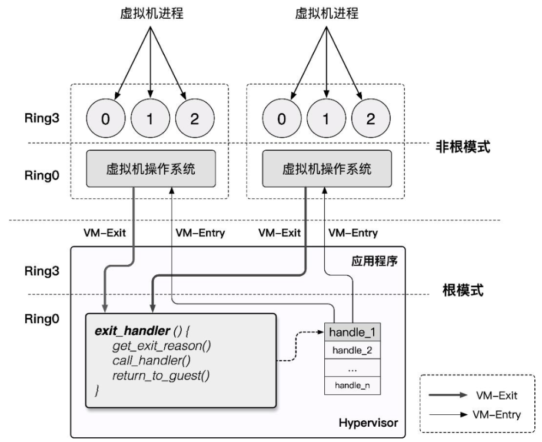

Non-Root モードと Root モードはそれぞれ独自の階層型保護リングを持つため、Host OS と Guest OS はどちらも**修正なしで、それぞれ対応するモードのままハードウェア上で直接動作できます**。切り替えが発生するのは、Guest OS がセンシティブなリソースにアクセスするときと、Host OS が VM をスケジューリングするときだけです。これにより、VM の高い性能を確保しつつ `Trap & Emulate` モデルを実現し、x86 アーキテクチャの仮想化の穴も解決しました。

### VMCS

`VMCS`(**Virtual-Machine Control Structure**)は、CPU 仮想化に必要な関連状態を保存するためのメモリです。**virtual CPU ごとに 1 つの VMCS があり**、同時刻に 1 つの物理 CPU は 1 つの VMCS としか結び付けられず、その逆も同様です。ただし、時刻が異なれば VMCS を別の物理 CPU に結び付けることができ、これを VMCS の**マイグレーション**(Migration)と呼びます。

VMCS の結び付けと解除に関係するのは、次の 2 つの命令です。

|     Instruction     |                Description                |
| :-----------------: | :---------------------------------------: |
| VMPTRLD <VMCS アドレス> | 指定した VMCS を、この命令を実行した CPU に結び付ける |
|       VMCLEAR       |   この命令を実行した CPU と、その VMCS の結び付けを解除する   |

VT-x では、VMCS は**最大 4KB 以下のメモリブロックで、4KB にアラインされている必要がある**ものと定義されており、その内容の形式は次のとおりです。

```c
struct VMCS {
    /* バージョン番号、4バイト */
	uint32_t vmcs_revision_identifier:31, shadow_vmcs_indicator:1;
    
    /* 中止識別子、4バイト
     * 当 VM-Exit 失败时便会产生 VMX 中止，并在此处存放原因
     */
    uint32_t 	vmx_abort_indicator;
    
    /* データ領域 */
    struct VMCSData vmcs_data;
};
```

VMCS のデータ領域には VMCS の主な情報が格納されており、次の 6 つのサブ領域に分かれます。

- **Guest-state area**:VM のレジスタ状態を保存します。VM-entry 時にロードされ、VM-exit 時に保存されます

- **Host-state area**:Hypervisor のレジスタ状態を保存します。VM-exit 時にロードされます

- **VM-execution control fileds**:`Non-Root` モードでのプロセッサの振る舞いを制御します

- **VM-entry  control fileds**:`VM-Entry` の過程での一部の振る舞いを制御します

- **VM-exit  control fileds**:`VM-Exit` の過程での一部の振る舞いを制御します

- **VM-exit information fields**:`VM-Exit` の基本的な原因とその他の詳細情報を保存します。一部のプロセッサでは、この領域は読み取り専用です

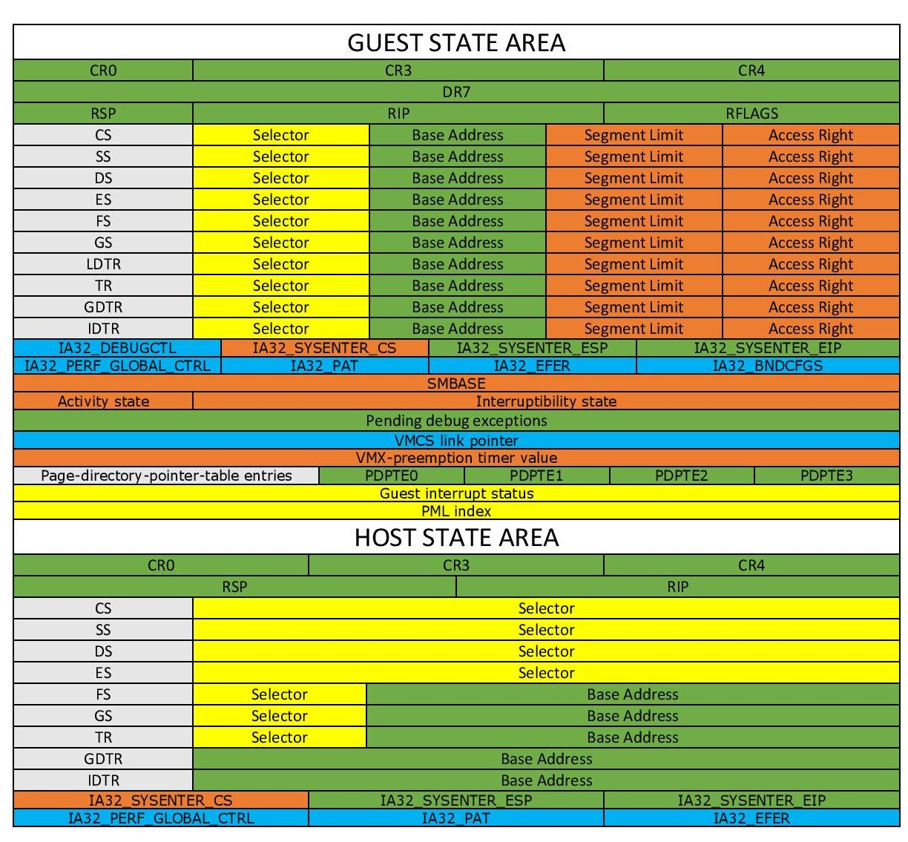

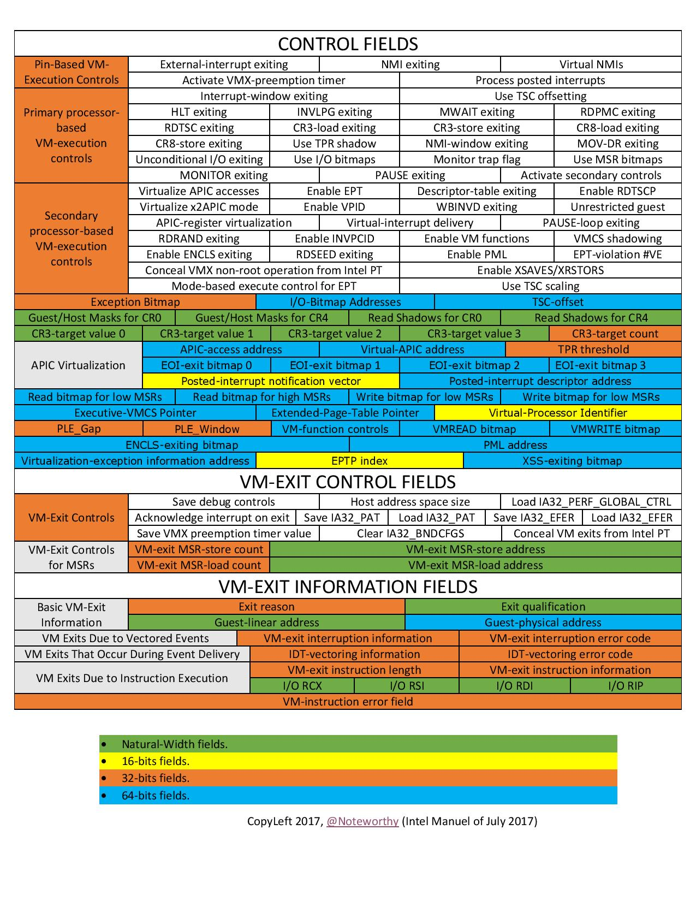

VMCS の読み書きは、次の 2 つの命令で行えます。

|      Instruction      |           Description            |
| :-------------------: | :------------------------------: |
|     VMREAD <インデックス>     |     VMCS の「インデックス」で指定した領域を読む     |
| VMWRITE <インデックス> <データ> | VMCS の「インデックス」で指定した領域にデータを書き込む |

> ここでのインデックスはオフセット値ではありません。Intel はデータ領域内の各フィールドに固有のインデックス値を定義しており、たとえば Guest State Area の ES セグメントセレクタのインデックス値は `0x00000800` です。
>
> もちろん、すべての領域のインデックスを暗記するのは現実的ではなく、最善の方法はこまめに表を引くことです :) 参考文献:[Intel SDM](https://www.intel.com/content/www/us/en/developer/articles/technical/intel-sdm.html) の [Intel® 64 and IA-32 Architectures Software Developer's Manual Volume 3C: System Programming Guide, Part 3](https://cdrdv2.intel.com/v1/dl/getContent/671506)。

### VMX 動作モード

従来の IA32 アーキテクチャの拡張として、VMX 動作モードはデフォルトでは無効で、VMM がハードウェア支援仮想化機能を使う必要があるときにだけ、Intel が提供する 2 つの新しい命令で VMX 動作モードのオン・オフを切り替えます。

- `VMXON`:VMX 動作モードを有効にします。
- `VMXOFF`:VMX 動作モードを無効にします。

Intel SDM に記述されている VMX のライフサイクルは次のとおりです。

- ソフトウェアは `VMXON` 命令で VMX 動作モードに入る。
- VMM は `VM entries` で Guest VM に入ることができる(一度に実行できる VM は 1 つだけ)。VMM は `VMLAUNCH`(最初に VM に入るとき)と `VMRESUME`(VMM から VM に復帰するとき)の命令で `VM entry` を有効にし、`VM exits` で制御を取り戻す。
- `VM exits` は VMM が指定したエントリポイントに制御を移す。VMM は VM の終了理由に応じて処理した後、`VM entry` で VM に戻る。
- VMM が自身の実行を止めて VMX 動作モードを抜けたいときは、`VMXOFF` 命令で行う。

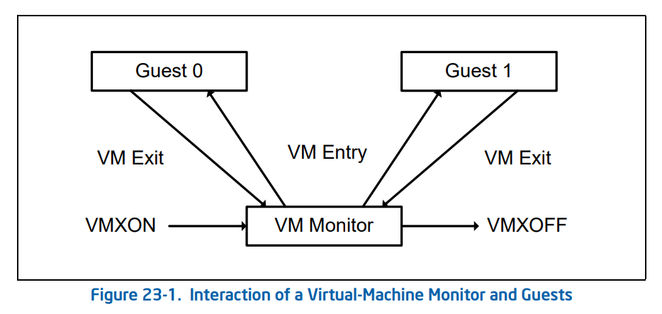

ここで、`VM entry` と `VM exit` の 2 つの動作の実装の詳細に踏み込みます。その流れの中で、それぞれ次の動作が行われます。

- **VM entry**:Hypervisor から VM への切り替え
  - VMCS の妥当性を検査する(各フィールドの値が妥当か)。
  - VMCS の `Guest-state area` の各フィールドを、対応するレジスタにロードする。
  - 指定された MSR をロードする。
  - VMCS の状態を `launched` に設定する。
  - 必要に応じて、VMCS の `VM-entry Interrucption-Information` に書き込むことで、VM への**イベントインジェクション**(例外や非同期割り込みなど)を行う。
- **VM exit**:VM から Hypervisor への切り替え
  - VM が終了した理由と詳細情報を、VMCS の `VM-exit information fields` に書き込む。
  - VM のレジスタを VMCS の `Guest-state area` に保存する。
  - VMCS の `Host-state area` から Host のレジスタを復元する。
  - 指定された MSR をロードする。

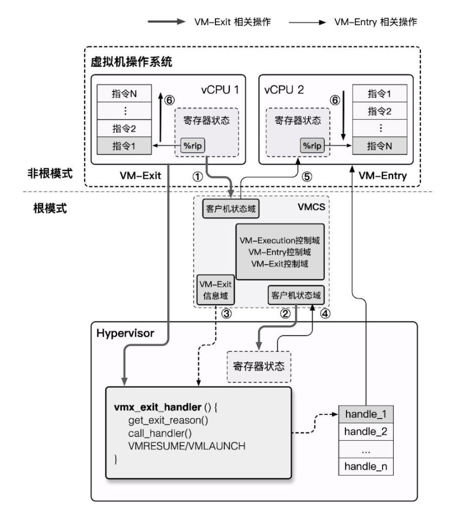

> ここで、筆者から 1 つ概念を補足します。**Model Specific Register**(略称 MSR)は、x86 における一群のレジスタで、**CPU の動作の制御、機能のオン・オフ、デバッグ、プログラム実行のトレース、CPU 性能の監視**などに使われます。
>
> > たとえば `syscall` 命令は、MSR レジスタを通じてカーネルのシステムコールのエントリポイントを取得します。
>
> 各 MSR レジスタには `MSR Index` と呼ばれる id があり、この id を使って `RDMSR` 命令と `WRMSR` 命令で、指定した MSR レジスタを読み書きできます。
>
> MSR レジスタの詳細は、Intel SDM の Volume 4 で確認できます。

## KVM & QEMU-KVM

**Kernel-based Virtual Machine** は、Linux 2.6.20 以降 kernel に組み込まれている**オープンソースのシステム仮想化カーネルモジュール**です。本質的には、ハードウェア支援仮想化に依存して kernel 内に置かれた Hypervisor、言い換えると、**KVM は Linux kernel を Hypervisor に変え**、VM を操作するためのユーザー空間向けインターフェース `/dev/kvm` を提供します。KVM は ioctl で操作できます。

ただし、KVM 自体が提供するのは CPU とメモリの仮想化だけで、完全な仮想化環境にはなりません。そこで、既存の完全仮想化の方式を再利用し、**CPU とメモリのエミュレーションを KVM に任せる**ことを考えられます。こうすれば、KVM を介してハードウェア支援仮想化を直接利用し、仮想マシンの性能を高められます。

QEMU は KVM を使った仮想マシンの作成と実行をサポートしており、QEMU + KVM による仮想化の方式は次のとおりです。

- QEMU は ioctl でカーネル空間に入り、制御を KVM に移し、KVM が VM を実行する。
- VM-Exit が発生すると KVM が引き継ぎ、原因を判断して、そのまま実行を続けるか QEMU に処理を任せるかを決める。
- 後者の場合は、ユーザー空間の QEMU 内の処理コードに戻って該当の処理を行い、その後終了するか最初の手順に戻る。

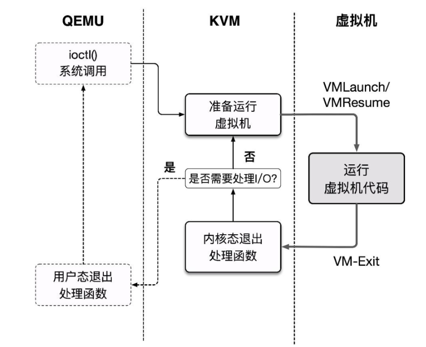

この基本的な実行フレームワークは、実際には QEMU のソースコード `accel/kvm/kvm-all.c` の `kvm_cpu_exec()` です。

```c
int kvm_cpu_exec(CPUState *cpu)
{
    //...
    cpu_exec_start(cpu);

    do {
        //...
        /**
         * 开始运行 VM，本质上就是 ioctl(kvm_fd, KVM_RUN)
         * 当产生 VM-Exit 时，首先在 KVM 中完成处理，
         * 若产生 IO，则退出内核态，即恢复到这里，接下来进入到用户态的处理
         */
        run_ret = kvm_vcpu_ioctl(cpu, KVM_RUN, 0);
        
        //...
        if (run_ret < 0) {
            /**
             * 返回值小于 0 说明 VM 运行出了些问题，
             * 这里会简单处理后 break 打破大循环 
             */
        	//...
        }
        
        trace_kvm_run_exit(cpu->cpu_index, run->exit_reason);
        /* ここは大きな switch で、終了理由に応じて異なる処理を行う。完全なコードは載せない */
        switch (run->exit_reason) {
        case KVM_EXIT_IO:
            DPRINTF("handle_io\n");
            /* Called outside BQL */
            kvm_handle_io(run->io.port, attrs,
                          (uint8_t *)run + run->io.data_offset,
                          run->io.direction,
                          run->io.size,
                          run->io.count);
            ret = 0;
            break;
        case KVM_EXIT_MMIO:
            DPRINTF("handle_mmio\n");
            /* Called outside BQL */
            address_space_rw(&address_space_memory,
                             run->mmio.phys_addr, attrs,
                             run->mmio.data,
                             run->mmio.len,
                             run->mmio.is_write);
            ret = 0;
            break;
        //...
        default:
            DPRINTF("kvm_arch_handle_exit\n");
            ret = kvm_arch_handle_exit(cpu, run);
            break;
        }
    } while (ret == 0);
    
    /* 実行終了、後始末の処理 */
    // ...
```

## REFERENCE

『システム仮想化:原理と実装』——Intel オープンソースソフトウェア技術センター

[【VIRT.0x02】系统虚拟化导论](https://arttnba3.cn/2022/08/29/VURTUALIZATION-0X02-BASIC_KNOWLEDGE/)

[Intel® 64 and IA-32 Architectures Software Developer's Manual Volume 3C: System Programming Guide, Part 3](https://cdrdv2.intel.com/v1/dl/getContent/671506)

[Formal Requirements for Virtualizable Third Generation Architectures](https://dl.acm.org/doi/pdf/10.1145/361011.361073)
