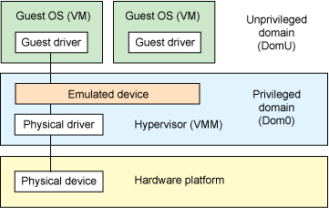
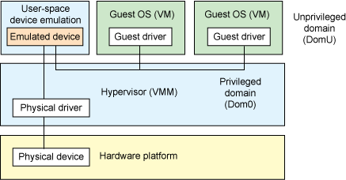
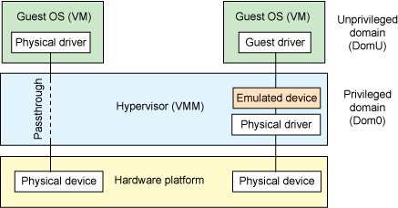
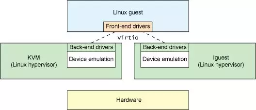
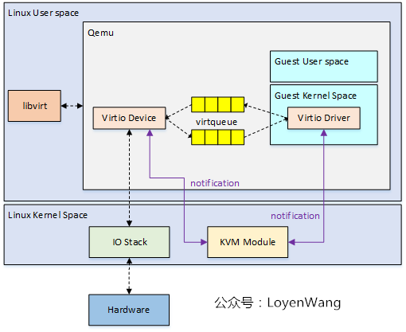
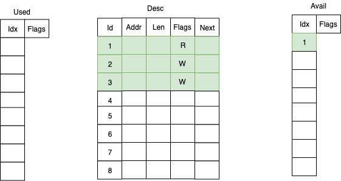
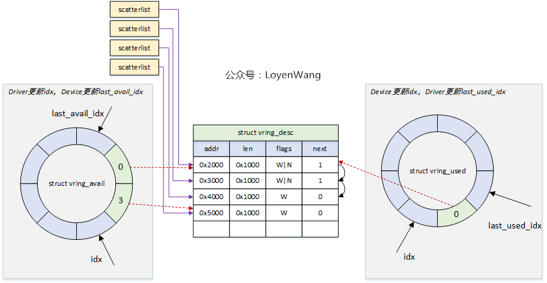
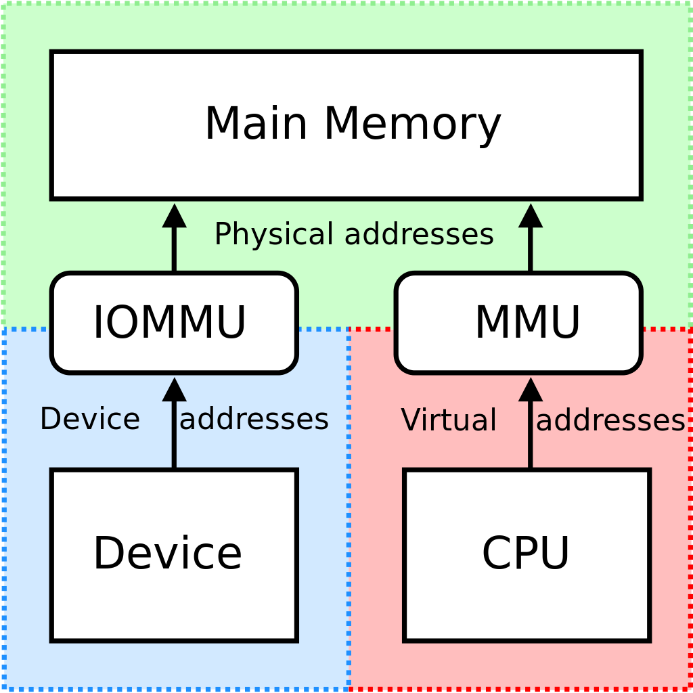
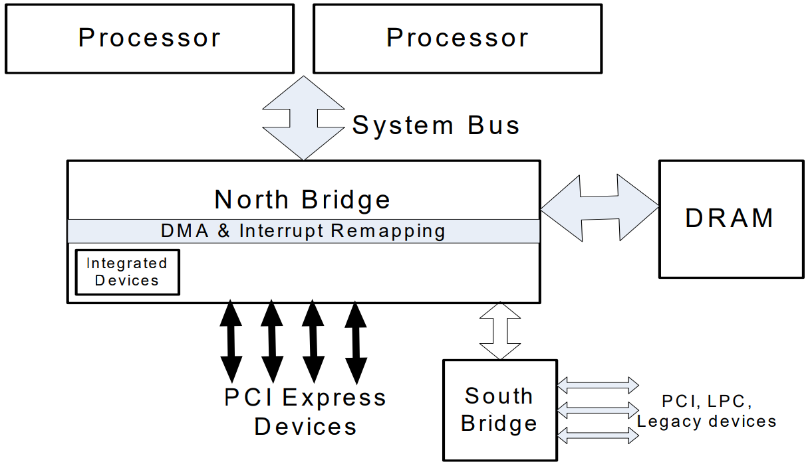
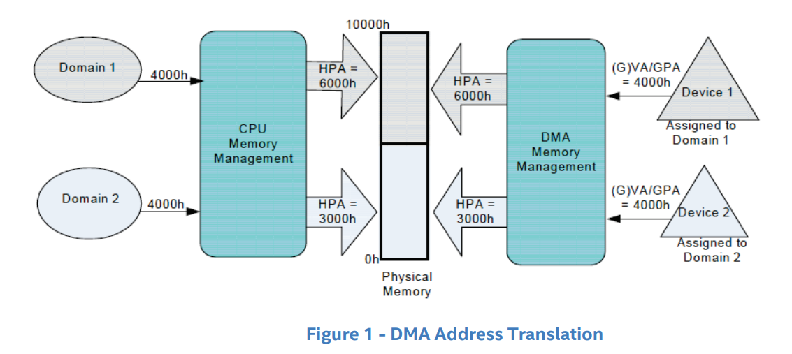

# IO 仮想化

現実の周辺機器リソースは限られていることが多く、また VM に実在する周辺機器リソースを直接触らせる必要がない場合もあれば、実体のないデバイスを VM に提供したい場合もあります。そのため Hypervisor は、IO 仮想化によって VM に**仮想的なデバイスリソース**を提供する必要があります。

プロセッサの観点では、周辺機器とのやり取りは主に MMIO と Port IO で行われるため、周辺機器に対する仮想化を **I/O 仮想化**と呼びます。

I/O 仮想化では、次の 3 つのタスクを実現する必要があります。

- アクセスの捕捉:Hypervisor は、VM による周辺機器へのアクセス操作を捕捉する必要がある。
- デバイスインターフェースの提供:Hypervisor は、VM に仮想/パススルーデバイスのインターフェースを提供する必要がある。
- デバイス機能の実現:Hypervisor は、仮想デバイスの機能を実現する必要がある。

## 基本モデル

### プラットフォームデバイスエミュレーション(Platform device emulation)

**プラットフォームデバイスエミュレーション**では、Hypervisor が仮想デバイスの機能のエミュレーションを担当します。仮想化ソフトウェアごとに、エミュレートするデバイスの実装方法は異なります。

**Hypervisor ベースのデバイスエミュレーション**(Hypervisor-based device emulation)は、VMware workstation シリーズの製品でよく使われる方式です。hypervisor 内に一般的なデバイスのエミュレーションがあり、仮想ディスク、仮想ネットワークアダプタなどの必要な要素を含めて、guest OS が共有します。このモデルを下図に示します。



2 つ目のアーキテクチャは**ユーザー空間デバイスエミュレーション**(User space device emulation)と呼ばれ、仮想デバイスのエミュレーションをユーザー空間で行います。QEMU はユーザー空間で独立してデバイスをエミュレートし、仮想デバイスは、ほかの VM から hypervisor が提供するインターフェースを通じて呼び出されます。デバイスのエミュレーションは hypervisor から独立しているため、任意のデバイスをエミュレートでき、そのエミュレートされたデバイスはほかの hypervisor 間でも共有できます。



### デバイスパススルー(Device passthrough)

上記の 2 つのモデルには、多かれ少なかれ一定の性能オーバーヘッドがあります。そのデバイスを複数の VM で共有する必要があるなら、このオーバーヘッドは見合うかもしれませんが、共有する必要がないなら、より効率的な方法であるデバイスパススルー(Device passthrough)を使えます。

デバイスパススルーは、デバイスを占有するデバイスエミュレーションと理解できます。デバイスを指定した VM に直接**隔離**して割り当て、その VM が専有して使えるようにします。**これによりネイティブのデバイスに近い性能が得られます**。たとえば、大量の IO を必要とするデバイス(ネットワークデバイスなど)では、デバイスパススルーによってほぼ完璧な性能が得られます。



## ソフトウェア準仮想化 - virtio

`virtio` という概念は、仮想化分野のかなり古い論文[virtio: towards a de-facto standard for virtual I/O devices](https://ozlabs.org/~rusty/virtio-spec/virtio-paper.pdf)に由来します。主にデバイス仮想化の問題を解決するために、**汎用的な仮想化デバイスモデルを提供する**ものです。Guest OS は統一された virtio ドライバを 1 組実装するだけで、仮想化デバイスに統一的な方法でアクセスでき、さまざまな仮想化ドライバが乱立する問題を避けられます。



### VirtQueue:転送層の抽象

`virtqueue` は、virtio でデータ転送を行うための重要な構造で、それ自体が**データキュー**を表します。一方がキューに buffer を追加し、もう一方がキューから buffer を取り出します。この方法で、Guest と Host の間の基本的なデータ転送モデルを実現しています。

モデルの複雑さを抑えるため、通常 virtqueue を使った転送は単方向です。そのため最も単純なモデルは、2 つの virtqueue を使って Guest と Host の間の双方向通信を実現するものです。tx queue(送信キュー)と rx queue(受信キュー)です。



virtqueue に対する操作は、論文では関数テーブル `virtqueue_ops` として抽象化されています。

```c
struct virtqueue_ops {
    int (*add_buf)(struct virtqueue *vq,
                    struct scatterlist sg[],
                    unsigned int out_num,
                    unsigned int in_num,
                    void *data);
    void (*kick)(struct virtqueue *vq);
    void *(*get_buf)(struct virtqueue *vq,
    unsigned int *len);
    void (*disable_cb)(struct virtqueue *vq);
    bool (*enable_cb)(struct virtqueue *vq);
};
```

-  `add_buf`:virtqueue に buffer を 1 つ追加する
-  `kick`:新しい buffer が到着したことを相手側に通知する
-  `get_buf`:virtqueue から buffer を 1 つ取得する
-  `disable_cb`:buffer 到着の通知を無効にするよう相手側に通知する
-  `enable_cb`:buffer 到着の通知を有効にするよう相手側に通知する

### VRing:virtqueue の基本構造

virtqueue の中核となるデータ構造は `vring` で、これは**リングバッファキュー**です。次の 3 つの部分で構成されます。

- ディスクリプタテーブル(Desc)
- 利用可能ディスクリプタ配列(Avail)
- 使用済みディスクリプタ配列(Used)



ディスクリプタ(Descriptor)は次のような構造で、1 つの buffer の基本的な属性を表します。注意点として、Avail/Used の 1 つのエントリは、通常は複数の descriptor が連結された buffer です。これが next フィールドの役割です。

```c
struct vring_desc
{
    __u64 addr;		// Guest Physical Addresses
    __u32 len;		// 長さ
    __u16 flags;	// 属性
    __u16 next;		// 次のディスクリプタの idx
};
```

**Avail** 配列は、現在利用可能なディスクリプタを格納します。

```c
struct vring_avail
{
    __u16 flags;
    __u16 idx;
    __u16 ring[NUM];
};
```

**Used** 配列は、すでに使用されたディスクリプタを格納します。

```c
struct vring_used_elem
{
    __u32 id;
    __u32 len;
};

struct vring_used
{
    __u16 flags;
    __u16 idx;
    struct vring_used_elem ring[];
};
```

Avail 配列と Used 配列も**リングキュー**ですが、この 2 つの配列は通信する双方がそれぞれ使います。

- データの**送信側**は、データを準備した後、`Avail キュー` から利用可能なエントリを取得し、ディスクリプタテーブルを更新し、`Used キュー` に新しいエントリを挿入して、データが到着したことを受信側に通知します。
- データの**受信側**は、`Used キュー` からエントリを取り出し、ディスクリプタテーブルを読んでデータを取得し、処理が終わったらエントリを `Avail キュー` に挿入します。

下図は、Guest から Host へデータを送信するときの vring の例です。



### virtio の設定操作の抽象

virtqueue と組み合わせて、仮想 PCI デバイスの基本操作を次のように抽象化できます。

- feature bits の取得
- 設定空間の読み書き
- status bits の読み書き
- デバイスのリセット
- virtqueue の作成/破棄

これを関数テーブル `virtio_config_ops` として抽象化します。

```c
struct virtio_config_ops
{
        bool (*feature)(struct virtio_device *vdev, unsigned bit);
        void (*get)(struct virtio_device *vdev, unsigned offset,
                    void *buf, unsigned len);
        void (*set)(struct virtio_device *vdev, unsigned offset,
                    const void *buf, unsigned len);
        u8 (*get_status)(struct virtio_device *vdev);
        void (*set_status)(struct virtio_device *vdev, u8 status);
        void (*reset)(struct virtio_device *vdev);
        struct virtqueue *(*find_vq)(struct virtio_device *vdev,
                                     unsigned index,
                                     void (*callback)(struct virtqueue *));
        void (*del_vq)(struct virtqueue *vq);
};
```

- `feature`:デバイスに対応する feature bit を取得する。
- `get & set`:デバイスの設定空間を読み書きする。
- `get_status & set_status`:デバイスの status bits を読み書きする。
- `reset`:デバイスをリセットする。
- `find_vq`:virtqueue を取得/作成する。
- `del_vq`:virtqueue を破棄する。

## IOMMU

 IOMMU とは **Input/Output Memory Management Unit** のことで、その機能は CPU の MMU に似ており、**デバイス側にアドレス変換機能を提供するユニット**です。



IOMMU は通常ノースブリッジに統合されており、デバイス側に向けて次の 2 つの機能を提供します。

- **DMA リマッピング**(**DMA remapping**):DMA 機能を持つデバイスは仮想アドレスを使用でき、IOMMU によって物理アドレスに変換されてダイレクトメモリアクセスを行います。
- **割り込みリマッピング**(**Interrupt remapping**):IOMMU はデバイスが発生させた割り込みを横取りし、割り込みリマッピングテーブルに従って新しい割り込み要求を生成して LAPIC に送ります。



### DMA リマッピング

DMA リマッピングとは、デバイス側のアドレスアクセスに対する再変換です。下図の左側は CPU によるメモリの仮想化で、MMU がプロセスのページテーブルを使って、プロセスがアクセスする仮想アドレスを物理アドレスに変換します。これにより、2 つのプロセスが同じ仮想アドレスにアクセスしても、実際には異なる物理アドレスにアクセスします。DMA リマッピングも同様の原理で、下図の右側のように、周辺機器が DMA を行おうとすると、IOMMU が「デバイスページテーブル」に従ってアドレスを変換します。これにより、2 つのデバイスはそれぞれ同じアドレスにアクセスしているつもりでも、実際には異なる物理アドレスにアクセスします。



### IOMMU と仮想化

IOMMU の導入は周辺機器との通信のオーバーヘッドを増やしますが、システム仮想化技術の難点の 1 つを解決します。純粋なエミュレーションではないデバイスは、GPA と HPA の対応関係を知らないため、Guest OS が提供したアドレスで DMA を行うと、**Host のメモリに直接アクセスしてしまいます**。

IOMMU を導入すると、IOMMU は Host 側が提供する GPA から HPA へのアドレス変換テーブルに従って **DMA remapping** を行えます。これにより、周辺機器は Guest の物理メモリに正しくアクセスでき、Host の対応する物理メモリ領域に誤ってアクセスすることがなくなります。

## REFERENCE

[IBM Archived | Linux virtualization and PCI passthrough](https://developer.ibm.com/tutorials/l-pci-passthrough/)

[【原创】Linux虚拟化KVM-Qemu分析（十）之virtio驱动](https://www.cnblogs.com/LoyenWang/p/14444344.html)

[【原创】Linux虚拟化KVM-Qemu分析（十一）之virtqueue ](https://www.cnblogs.com/LoyenWang/p/14589296.html)

[virtio: towards a de-facto standard for virtual I/O devices](https://ozlabs.org/~rusty/virtio-spec/virtio-paper.pdf)

[知乎 - IOMMU DMA 重映射](https://zhuanlan.zhihu.com/p/349225786)

『システム仮想化——原理と実装』——Intel オープンソースソフトウェア技術センター

[A Tour Beyond BIOS: Using IOMMU for DMA Protection in UEFI Firmware](https://www.intel.com/content/dam/develop/external/us/en/documents/intel-whitepaper-using-iommu-for-dma-protection-in-uefi.pdf)


