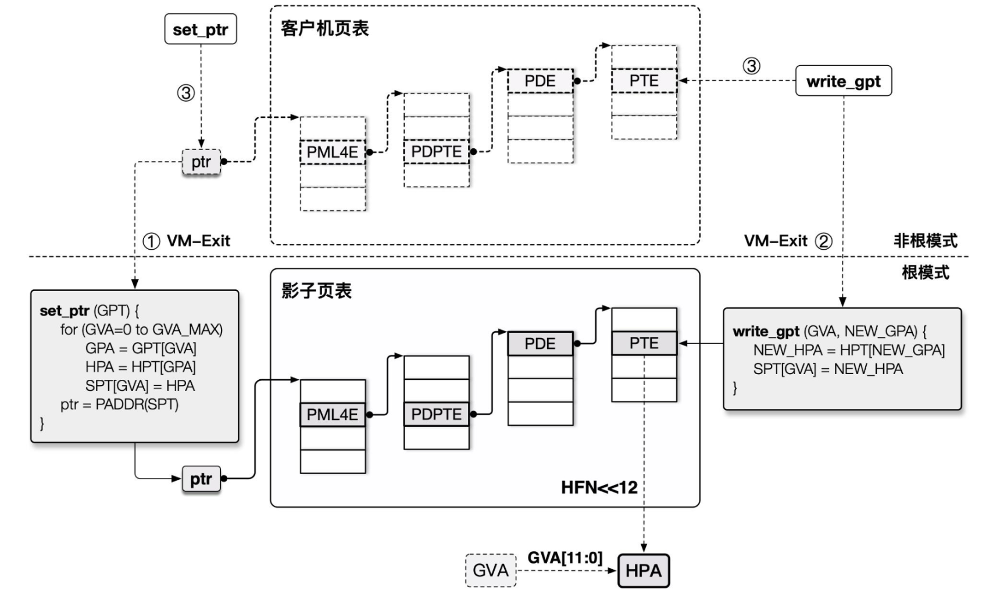
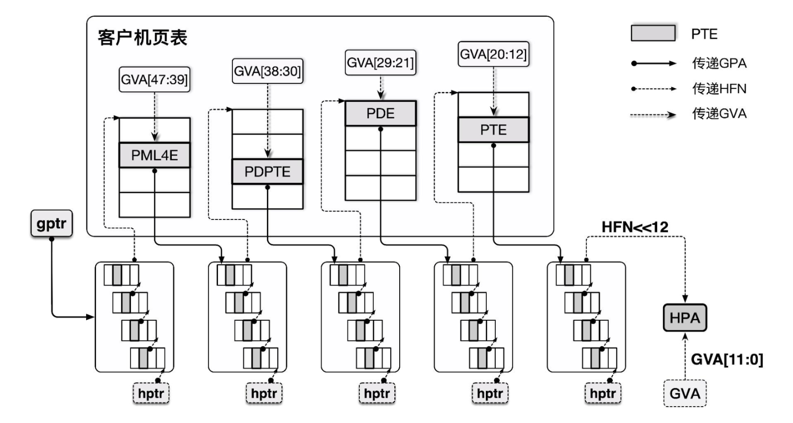

# メモリ仮想化

メモリ仮想化は、本質的に次の 2 つの目的を達成する必要があります。

- Guest から見て 0 から始まる連続した物理メモリ空間を提供すること。
- 各 VM の間で、メモリリソースを有効に隔離、スケジューリング、共有すること。

## 純粋なソフトウェアによるメモリ仮想化の実現

### 仮想マシンのメモリアクセスの原理と直面する問題

メモリ空間を隔離するために、Hypervisor は Guest VM のために新しいアドレス空間の層 `Guest Physical Address Space` を用意する必要があります。Guest 側からはこの層のアドレス空間しか見えず、Hypervisor は GPA から HVA への変換関係を記録する必要があります。

下図は Qemu のメモリアーキテクチャです。

```
Guest' processes
                     +--------------------+
Virtual addr space   |                    |
                     +--------------------+                                    （GVA）
                     |                    |
                     \__   Page Table     \__
                        \                    \
                         |                    |  Guest kernel
                    +----+--------------------+----------------+
Guest's phy  memory |    |                    |                |            （GPA）
                    +----+--------------------+----------------+
                    |                                          |
                    \__                                        \__
                       \                                          \
                        |             QEMU process                 |
                   +----+------------------------------------------+
Virtual addr space |    |                                          |         （HVA）
                   +----+------------------------------------------+
                   |                                               |
                    \__                Page Table                   \__
                       \                                               \
                        |                                               |
                   +----+-----------------------------------------------+----+
Physical memory    |    |                                               |    |    （HPA）
                   +----+-----------------------------------------------+----+
```

Guest 内のある仮想アドレス上のデータにアクセスするには、次の手順が必要です。

- まず Guest のページテーブルによって `Guest Virtual Address`(GVA)を `Guest Physical Address`(GPA)に変換する。
- GPA は Qemu の実装では、実際には Host 上で mmap された大きなメモリ領域に対応付けられているため、GPA をさらに `Host Virtual Address`(HVA)に変換する必要がある。
- 最後に Host のページテーブルによって HVA を `Host Physical Address`(HPA)に変換する。
- Guest の多段ページテーブルのアドレッシングでも、`GPA->HPA` の変換が何度も行われる。

この一連の流れは**非常に重く**、仮想マシンのメモリアクセスの性能が極めて低くなります。

> QEMU でメモリにアクセスする中核の関数は `address_space_rw()` で、`GPA->HVA` を実現しています。興味のある方は内部の実装を見てみてください。

### シャドウページテーブル(shadow page table)

初期の Intel ハードウェアは仮想化を十分にサポートしていなかったため、Hypervisor はまずソフトウェアの面で最適化するしかありませんでした。そこで**シャドウページテーブル**(Shadow Page Table)が登場しました。

Intel を例にとると、CR3 レジスタ(最上位のページテーブルへのポインタを格納)の読み書きはセンシティブ命令であるため、Hypervisor は VM のこの操作を容易に捕捉でき、**ページテーブルを GVA→HPA の対応関係を格納したシャドウページテーブルに置き換えます**。これにより、**GVA から HPA への変換を直接完了できます**。



シャドウページテーブルを実現するために、本質的には **MMU 仮想化**を実現する必要があります。

- Guest VM から見えて操作できるのは、実際には仮想的な MMU です。実際に MMU にロードされるページテーブルは、Hypevisor が変換して生成した**シャドウページテーブル**です。
- シャドウページテーブルのアクセス権限は**読み取り専用**で、Guest がページテーブルを読み書きしようとすると、Hypervisor がその操作を捕捉して代わりに処理できます。

ただし、この方法の欠点は、**Guest VM の各ページテーブルについて、それぞれ独立したシャドウページテーブルを維持する必要があり、VMM と VM の間で何度も切り替える必要がある**ことで、少なからぬオーバーヘッドがあります。

## ハードウェア支援仮想化

### 拡張ページテーブル(Extend Page Table, EPT)

ソフトウェアの面では、これ以上よい最適化の方法は難しいようで、そこでハードウェアによるメモリ仮想化のサポートが登場しました。**EPT** は **Extend Page Table** の略で、Intel がメモリ仮想化を実現するために新たに追加した機能であり、メモリアクセスのオーバーヘッドを減らすことが目的です。

EPT は Guest VM が自身のページテーブルを操作する過程には干渉しません。本質的には、**Guest の物理アドレス空間から Host の物理アドレス空間へ変換するページテーブルを追加で提供する**もので、つまり追加のページテーブルを使って `GPA→HPA` の変換を行います。

EPT 方式はシャドウページテーブルより変換が 1 層多くなりますが、Guest 本来のページテーブル管理に干渉する必要がなく、**GVA→GPA→HPA の過程はすべてハードウェアが自動的に行います**。また Hypervisor は `EPT Violation` 例外(EPT のエントリが空)を捕捉するだけで済み、効率がかなり向上します。



### VPID:TLB リソースの最適化

**Translation Lookaside Buffer** は、仮想アドレスから物理アドレスへの変換を高速化するための**ページテーブルエントリのキャッシュ**です。アドレス変換を行うとき、CPU はまず TLB を検索し、TLB は仮想アドレスに対応するキャッシュがあるかを調べ、cache miss した場合にだけページテーブルを検索します。

TLB は対応するページテーブルとともに動作するため、ページテーブルを切り替えると TLB の元の内容は無効になります。このとき `INVLPG` で TLB を無効化する必要があります。同様に、VM-Entry と VM-Exit のときも CPU は TLB を強制的に無効化しますが、これでも一定の性能損失があります。

**Virtual Processor Identifier**(VPID)は、TLB リソース管理に対するハードウェアレベルの最適化です。ハードウェア上で各 TLB エントリに VPID の識別子を付けます(VMM は vCPU ごとに一意の VPID を割り当てて VMCS に格納し、論理 CPU の VPID は 0 です)。CPU は TLB cache を検索するときにまず VPID を比較します。これにより、VM entry/exit のたびにすべての cache を破棄する必要がなくなり、以前に保持した cache を引き続き再利用できます。

## REFERENCE

『システム仮想化:原理と実装』——Intel オープンソースソフトウェア技術センター 著

[【VIRT.0x02】系统虚拟化导论](https://arttnba3.cn/2022/08/29/VURTUALIZATION-0X02-BASIC_KNOWLEDGE/)

『Linux システム仮想化を深く探る』——王柏生、謝広軍 著
