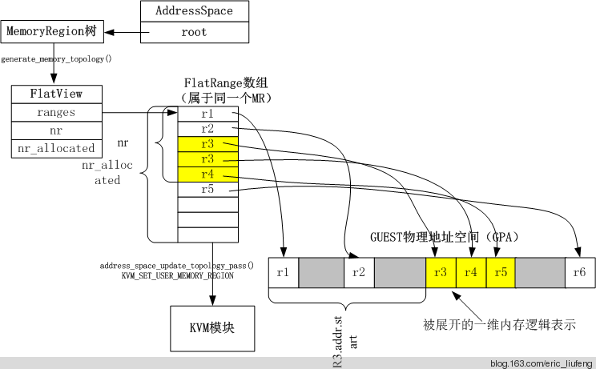
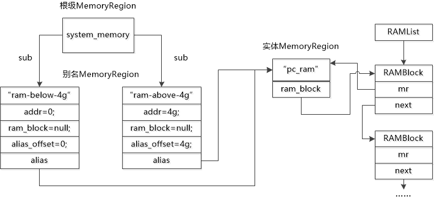

# QEMU のメモリ管理

この節では、QEMU が特定の VM のメモリをどのように管理するかを説明します。

## Guest VM の視点(GPA)

### MemoryRegion:Guest の視点での 1 つの「メモリ」

Qemu では、具体的な Guest 物理メモリ領域を `MemoryRegion` 構造体型で表します。この構造体は `include/exec/memory.h` で定義されています。

```c
/** MemoryRegion:
 *
 * 表示一块内存区域的一个结构体.
 */
struct MemoryRegion {
    Object parent_obj;

    /* private: */

    /* The following fields should fit in a cache line */
    bool romd_mode;
    bool ram;
    bool subpage;
    bool readonly; /* For RAM regions */
    bool nonvolatile;
    bool rom_device;
    bool flush_coalesced_mmio;
    bool global_locking;
    uint8_t dirty_log_mask;
    bool is_iommu;
    RAMBlock *ram_block;
    Object *owner;

    const MemoryRegionOps *ops;
    void *opaque;
    MemoryRegion *container;	// 親の MemoryRegion を指す
    Int128 size;	// メモリ領域のサイズ
    hwaddr addr;	// 親 MR 内でのオフセット
    void (*destructor)(MemoryRegion *mr);
    uint64_t align;
    bool terminates;
    bool ram_device;
    bool enabled;
    bool warning_printed; /* For reservations */
    uint8_t vga_logging_count;
    MemoryRegion *alias;	// alias MR の場合のみ、実際の MR を指す
    hwaddr alias_offset;
    int32_t priority;
    QTAILQ_HEAD(, MemoryRegion) subregions;
    QTAILQ_ENTRY(MemoryRegion) subregions_link;
    QTAILQ_HEAD(, CoalescedMemoryRange) coalesced;
    const char *name;
    unsigned ioeventfd_nb;
    MemoryRegionIoeventfd *ioeventfds;
};
```

[QEMU 公式ドキュメント](https://www.qemu.org/docs/master/devel/memory.html#types-of-regions)の記述によると、多数のメモリ領域オブジェクトはすべて C の構造体型 MemoryRegion として宣言されていますが、機能的な特性や利用場面の違いによって、これらのメモリ領域は実際の使用上 8 種類の MemoryRegion に分けられます。この 8 種類のメモリ領域で、Guest の一般的なメモリアクセスの需要はおおむね満たされます。8 種類は次のとおりです。

- RAM MemoryRegion:`memory_region_init_ram()` で初期化されます。具体的な Host メモリを表し、このメモリ領域が Guest に割り当てられて使われます
- ROM MemoryRegion:`memory_region_init_rom()` で初期化されます。原理は RAM MR と似ていますが、読み取り専用(ホストのメモリ領域に直接アクセスするのと同じ)で、書き込み操作は禁止されます。
- MMIO MemoryRegion:`memory_region_init_io()` で初期化されます。ゲスト仮想マシンのメモリの一区画で、読み書きのたびに最終的に QEMU コードに登録されたコールバック関数が呼び出され、MMIO の読み書きの流れをエミュレートするために使われます。
- ROM device MemoryRegion:`memory_region_init_rom_device()` で初期化されます。読み取り操作は RAM MR の直接メモリアクセスと同様に動作し、書き込み操作は MMIO MR のコールバック関数の呼び出しと同様に動作します。
- IOMMU MemoryRegion:`memory_region_init_iommu()` で初期化されます。名前のとおり、この MR の種類は IOMMU のモデル化にのみ使われ、単純なデバイスには使われません。この種の MR 内のアドレスにアクセスするとアドレス変換が行われ、別のターゲットメモリ領域に転送されます。
- container MemoryRegion:`memory_region_init()` で初期化されます。実際のメモリ領域を指すのではなく、オフセットがそれぞれ異なる別の MR を包含するだけです。container MR は、複数の MR を 1 つの単位にまとめて表現・管理するために使われます。たとえば PCI BAR は、1 つの RAM MR と 1 つの MMIO MR で構成されることがあります。
- alias MemoryRegion:`memory_region_init_alias()` で初期化されます。別の MemoryRegion の実体の別名として存在し、実際のメモリを指しません。
- reservation MemoryRegion:`memory_region_init_io()` にコールバック引数として `NULL` を渡して初期化されます。主にデバッグ用で、その占有する I/O 空間は QEMU 自身が処理すべきではありません。典型的な用途は、KVM が有効なときにホストカーネルが処理するアドレス空間の部分を追跡することです。

container MR とほかの MR は木構造を成し、container がルートノード、実体が子ノードになります。形式は次のとおりです。

```
                            struct MemoryRegion
                            +------------------------+                                         
                            |name                    |                                         
                            |  (const char *)        |                                         
                            +------------------------+                                         
                            |addr                    |                                         
                            |  (hwaddr)              |                                         
                            |size                    |                                         
                            |  (Int128)              |                                         
                            +------------------------+                                         
                            |subregions              |                                         
                            |    QTAILQ_HEAD()       |                                         
                            +------------------------+                                         
                                       |
                                       |
               ----+-------------------+---------------------+----
                   |                                         |
                   |                                         |
                   |                                         |

     struct MemoryRegion                            struct MemoryRegion
     +------------------------+                     +------------------------+
     |name                    |                     |name                    |
     |  (const char *)        |                     |  (const char *)        |
     +------------------------+                     +------------------------+
     |addr                    |                     |addr                    |
     |  (hwaddr)              |                     |  (hwaddr)              |
     |size                    |                     |size                    |
     |  (Int128)              |                     |  (Int128)              |
     +------------------------+                     +------------------------+
     |subregions              |                     |subregions              |
     |    QTAILQ_HEAD()       |                     |    QTAILQ_HEAD()       |
     +------------------------+                     +------------------------+
```

同様に、OOP の考え方に基づき、MemoryRegion のメンバ関数は関数テーブル `MemoryRegionOps` にまとめられています。

```c
/*
 * Memory region callbacks
 */
struct MemoryRegionOps {
    /* メモリ領域から読む。@addr は @mr に対する相対値。@size の単位はバイト。 */
    uint64_t (*read)(void *opaque,
                     hwaddr addr,
                     unsigned size);
    /* メモリ領域へ書く。@addr は @mr に対する相対値。@size の単位はバイト。 */
    void (*write)(void *opaque,
                  hwaddr addr,
                  uint64_t data,
                  unsigned size);

    MemTxResult (*read_with_attrs)(void *opaque,
                                   hwaddr addr,
                                   uint64_t *data,
                                   unsigned size,
                                   MemTxAttrs attrs);
    MemTxResult (*write_with_attrs)(void *opaque,
                                    hwaddr addr,
                                    uint64_t data,
                                    unsigned size,
                                    MemTxAttrs attrs);

    enum device_endian endianness;
    /* Guest から見える制約: */
    struct {
        /* 若非 0，则指定了超出机器检查范围的访问大小界限
         */
        unsigned min_access_size;
        unsigned max_access_size;
        /* If true, unaligned accesses are supported.  Otherwise unaligned
         * accesses throw machine checks.
         */
         bool unaligned;
        /*
         * 若存在且 #false, 则该事务不会被设备所接受
         * (并导致机器的相关行为，例如机器检查异常).
         */
        bool (*accepts)(void *opaque, hwaddr addr,
                        unsigned size, bool is_write,
                        MemTxAttrs attrs);
    } valid;
    /* 内部実装の制約: */
    struct {
        /* 若非 0，则决定了最小的实现的 size .
         * 更小的 size 将被向上回绕，且将返回部分结果.
         */
        unsigned min_access_size;
        /* 若非 0，则决定了最大的实现的 size . 
         * 更大的 size 将被作为一系列的更小的 size 的访问而完成.
         */
        unsigned max_access_size;
        /* 若为 true, 支持非对齐的访问.  
         * 否则所有的访问都将被转换为（可能多种）对齐的访问.
         */
        bool unaligned;
    } impl;
};
```

Guest が仮想マシン上のメモリを読み書きするとき、Qemu 内部では実際に `address_space_rw()` が呼び出されます。通常の RAM メモリの場合は MR に対応するメモリを直接操作し、MMIO の場合は最終的に対応する `MR->ops->read()` または `MR->ops->write()` が呼び出されます。

同様に、インターフェースを統一するため、Qemu では **PMIO の実装も MemoryRegion によって行われます**。ポートの集まりを、QEMU の視点での Guest メモリの一区画と理解できます。

> ほぼすべての CTF の QEMU Pwn 問題は、デバイスを独自に定義し、対応する MMIO/PMIO 操作を定義しています。

### FlatView:MR ツリーに対応する Guest 視点の物理アドレス空間

QEMU は木構造の MemoryRegion で Guest の物理アドレス空間を管理しており、動的な調整(デバイスのホットプラグなど)をサポートします。しかし、このような入れ子や重なりのある複雑な構造は、KVM などのカーネルモジュールと直接やり取りするのに向きません。そのため QEMU は `FlatView` を使って、**1 本の MemoryRegion ツリーが表す線形の Guest アドレス空間**を表します。これは木構造をリストに「平坦化」し、各エントリが連続したメモリ領域の開始アドレス(GPA)、サイズ、属性(RAM/MMIO など)を記録することで、入れ子関係をなくし、カーネルの処理を簡単にします。たとえば KVM は EPT(Extended Page Table)を設定するために明確な物理メモリレイアウトを必要とするので、`FlatView` は直接マッピングできる平坦なメモリ記述を提供し、カーネルが複雑な木構造を解析することを避けられます。`FlatView` は `FlatRange` 構造体のポインタ配列を使って、異なる `MemoryRegion` に対応するアドレス情報を格納します。各 `FlatRange` は、単一の `MemoryRegion` の **Guest 視点での 1 つの線形な物理アドレス空間**と、読み取り専用かどうかなどの特性情報を表し、`FlatRange` 同士が表すアドレス範囲は重なりません。

```c
/* Range of memory in the global map.  Addresses are absolute. */
struct FlatRange {
    MemoryRegion *mr;
    hwaddr offset_in_region;
    AddrRange addr;
    uint8_t dirty_log_mask;
    bool romd_mode;
    bool readonly;
    bool nonvolatile;
};

//...

/* Flattened global view of current active memory hierarchy.  Kept in sorted
 * order.
 */
struct FlatView {
    struct rcu_head rcu;
    unsigned ref;
    FlatRange *ranges;
    unsigned nr;
    unsigned nr_allocated;
    struct AddressSpaceDispatch *dispatch;
    MemoryRegion *root;
};
```

### AddressSpace:種類の異なる Guest アドレス空間

`AddressSpace` 構造体は、**Guest の視点での種類の異なるアドレス空間**を表します。x86 では実際には `address_space_memory` と `address_space_io` の 2 種類しかありません。

1 つの `AddressSpace` 構造体は 1 本の MemoryRegion ツリーのルートノードと関連付けられ、`FlatView` 構造体を使ってそのツリーの平坦化されたメモリ空間を構築します。

```c
/**
 * struct AddressSpace: describes a mapping of addresses to #MemoryRegion objects
 */
struct AddressSpace {
    /* private: */
    struct rcu_head rcu;
    char *name;
    MemoryRegion *root;

    /* Accessed via RCU.  */
    struct FlatView *current_map;

    int ioeventfd_nb;
    struct MemoryRegionIoeventfd *ioeventfds;
    QTAILQ_HEAD(, MemoryListener) listeners;
    QTAILQ_ENTRY(AddressSpace) address_spaces_link;
};
```

最終的に、次のような全体図が得られます。



## host VMM の視点(HVA)

### RAMBlock:MR に対応する Host 仮想メモリ

`RAMBlock` 構造体は、**単一の実体 MemoryRegion が占有する Host 仮想メモリの情報**を表し、複数の `RAMBlock` 構造体は単方向リストを成します。

比較的重要なメンバは次のとおりです。

- `mr`:この RAMBlock に対応する MemoryRegion(つまり HVA → GPA)
- `host`:GVA に対応する HVA。通常は QEMU が `mmap()` で取得する(KVM を使っていない場合)

```c
struct RAMBlock {
    struct rcu_head rcu;
    struct MemoryRegion *mr;
    uint8_t *host;
    uint8_t *colo_cache; /* For colo, VM's ram cache */
    ram_addr_t offset;
    ram_addr_t used_length;
    ram_addr_t max_length;
    void (*resized)(const char*, uint64_t length, void *host);
    uint32_t flags;
    /* Protected by iothread lock.  */
    char idstr[256];
    /* RCU-enabled, writes protected by the ramlist lock */
    QLIST_ENTRY(RAMBlock) next;
    QLIST_HEAD(, RAMBlockNotifier) ramblock_notifiers;
    int fd;
    size_t page_size;
    /* dirty bitmap used during migration */
    unsigned long *bmap;
    /* bitmap of already received pages in postcopy */
    unsigned long *receivedmap;

    /*
     * bitmap to track already cleared dirty bitmap.  When the bit is
     * set, it means the corresponding memory chunk needs a log-clear.
     * Set this up to non-NULL to enable the capability to postpone
     * and split clearing of dirty bitmap on the remote node (e.g.,
     * KVM).  The bitmap will be set only when doing global sync.
     *
     * It is only used during src side of ram migration, and it is
     * protected by the global ram_state.bitmap_mutex.
     *
     * NOTE: this bitmap is different comparing to the other bitmaps
     * in that one bit can represent multiple guest pages (which is
     * decided by the `clear_bmap_shift' variable below).  On
     * destination side, this should always be NULL, and the variable
     * `clear_bmap_shift' is meaningless.
     */
    unsigned long *clear_bmap;
    uint8_t clear_bmap_shift;

    /*
     * RAM block length that corresponds to the used_length on the migration
     * source (after RAM block sizes were synchronized). Especially, after
     * starting to run the guest, used_length and postcopy_length can differ.
     * Used to register/unregister uffd handlers and as the size of the received
     * bitmap. Receiving any page beyond this length will bail out, as it
     * could not have been valid on the source.
     */
    ram_addr_t postcopy_length;
};
```

対応関係は下図のとおりです。



## REFERENCE

[QEMU官方文档](https://www.qemu.org/docs/master/devel/memory.html#types-of-regions)

[understanding qemu - MemoryRegion](https://richardweiyang-2.gitbook.io/understanding_qemu/00-as/02-memoryregion)

[QEMU内存分析（一）：内存虚拟化关键结构体](https://www.cnblogs.com/edver/p/14470706.html)

[QEMU的内存模拟](https://66ring.github.io/2021/04/13/universe/qemu/qemu_softmmu/)

[QEMU的内存模型](https://richardweiyang-2.gitbook.io/kernel-exploring/00-kvm/01-memory_virtualization/01_1-qemu_memory_model)

[【VIRT.0x00】Qemu - I：Qemu 简易食用指南](https://arttnba3.cn/2022/07/15/VIRTUALIZATION-0X00-QEMU-PART-I/)
