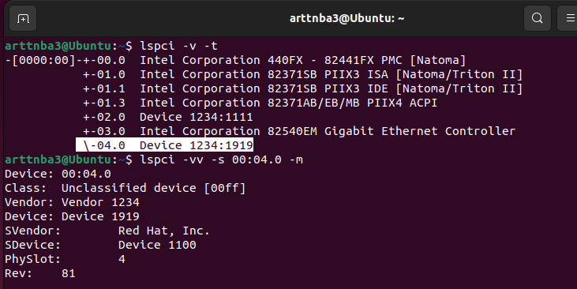

# QEMU のエミュレートデバイスを書く

この節では、QEMU に新しいエミュレートデバイスを書く方法を紹介します。

> 注 1:始める前に、[PCI デバイスの基礎知識](https://arttnba3.cn/2022/08/30/HARDWARE-0X00-PCI_DEVICE/)を補っておくとよいでしょう。
>
> 注 2:qemu 公式は `hw/misc/edu.c` に教育用のデバイスのサンプルを、red hat は `hw/misc/pci-testdev.c` にテスト用デバイスを提供しています。この 2 つのデバイスを参考にして自分のデバイスを作れます。

## QEMU Object Model

Qemu には、オブジェクト指向を実現するための **Qemu Object Model** と呼ばれる仕組みがあり、主に次の 4 つのコンポーネントで構成されています。

- `Type`:「クラス」の基本的な属性を定義するもの。たとえばクラス名、サイズ、コンストラクタなど。
- `Class`:「クラス」の静的な内容を定義するもの。たとえばクラスに格納される静的データ、メソッドの関数ポインタなど。
- `Object`:動的に確保される「クラス」の具体的なインスタンス(instance)で、クラスの動的なデータを格納する。
- `Property`:動的なオブジェクトデータのアクセサ(accessor)で、モニタインターフェースから確認できる。

Golang と同様に、QOM ではメンバの埋め込みによってクラスの継承を実現し、親クラスはクラス構造体の最初のメンバ `parent` として存在します。そのため多重継承もサポートされません。

> [この ppt](https://www.linux-kvm.org/images/f/f6/2012-forum-QOM_CPU.pdf) を参照

### I、TypeInfo - クラスの基本的な属性

`TypeInfo` 構造体は `クラス` の基本的な属性を定義するためのもので、`include/qom/object.h` で定義されています。

```c
/**
 * TypeInfo:
 * @name: 类型名.
 * @parent: 父类型名.
 * @instance_size: 对象大小 (#Object 的衍生物). 
 *   若 @instance_size 为 0, 则对象的大小为其父类的大小
 * @instance_init: 该函数被调用以初始化对象（译注：构造函数）. 
 *   （译注：调用前）父类已被初始化，因此子类只需要初始化他自己的成员。
 * @instance_post_init: 该函数被调用以结束一个对象的初始化，
 *   在所有的 @instance_init 函数被调用之后.
 * @instance_finalize: 该函数在对象被析构时调用. 其在
 *   父类的 @instance_finalize 被调用之前被调用.
 *   在该函数中一个对象应当仅释放该对象特有的成员。
 * @abstract: 若该域为真，则该类为一个虚类，不能被直接实例化。
 * @class_size: 这个对象的类对象的大小 (#Object 的衍生物)
 *   若 @class_size 为 0, 则类的大小为其父类的大小。
 *   这允许一个类型在没有添加额外的虚函数时避免实现一个显式的类型。
 * @class_init: 该函数在所有父类初始化结束后被调用，
 *   以允许一个类设置他的默认虚方法指针.
 *   这也允许该函数重写父类的虚方法。
 * @class_base_init: 在所有的父类被初始化后、但
 *   在类自身初始化前，为所有的基类调用该函数。
 *   该函数用以撤销从父类 memcpy 到子类的影响.
 * @class_data: 传递给 @class_init 与 @class_base_init 的数据,
 *   这会在建立动态类型时有用。
 * @interfaces: 与这个类型相关的接口. 
 *   其应当指向一个以 0 填充元素结尾的静态数组
 */
struct TypeInfo
{
    const char *name;
    const char *parent;

    size_t instance_size;
    void (*instance_init)(Object *obj);
    void (*instance_post_init)(Object *obj);
    void (*instance_finalize)(Object *obj);

    bool abstract;
    size_t class_size;

    void (*class_init)(ObjectClass *klass, void *data);
    void (*class_base_init)(ObjectClass *klass, void *data);
    void *class_data;

    InterfaceInfo *interfaces;
};
```

Qemu で**クラス**を定義するときは、実際には `TypeInfo` 型の変数を定義する必要があります。以下は、Qemu で独自のクラスを定義する例です。

```c
static const TypeInfo a3_type_info = {
    .name = "a3_type",
    .parent = TYPE_OBJECT,
    .interfaces = (InterfaceInfo[]) {
        { },
    },
}

static void a3_register_types(void) {
    type_register_static(&a3_type_info);
}

type_init(a3_register_types);
```

`type_init()` は実は gcc の `constructor` 属性のラッパーで、その役割は関数を `init_array` に追加することです。Qemu プログラムの起動時、main 関数に入る前に `init_array` 内の関数が先に呼び出されるため、ここで自分で定義した関数が呼び出されます。その関数が `type_register_static()` を呼び出し、自分で定義した型 `a3_type_info` をグローバルな型テーブルに登録します。

### II、Class - クラスの静的な内容

`TypeInfo` 構造体でクラスを定義した後は、そのクラスの静的な内容(関数テーブル、静的メンバなど)を定義する Class 構造体も定義する必要があります。これは対応する Class 構造体型を継承する必要があり、たとえば新しいマシンクラスを定義するなら、その Class は `MachineClass` を継承しなければなりません。

すべての Class 構造体型の最終的な親は `ObjectClass` 構造体です。

```c
/**
 * ObjectClass:
 *
 * 所有类的基类.  #ObjectClass 仅包含一个整型类型 handler
 */
struct ObjectClass
{
    /*< private >*/
    Type type;
    GSList *interfaces;

    const char *object_cast_cache[OBJECT_CLASS_CAST_CACHE];
    const char *class_cast_cache[OBJECT_CLASS_CAST_CACHE];

    ObjectUnparent *unparent;

    GHashTable *properties;
};
```

以下は最も単純な例です。

```c
struct A3Class
{
    /*< private >*/
    ObjectClass parent;
}
```

Class の定義が終わったら、先ほど定義した `a3_type_info` に、Class size と Class のコンストラクタを追加する必要があります。

```c
static void a3_class_init(ObjectClass *oc, void *data)
{
    // この oc 引数が新しく作成された Class で、グローバルにこのインスタンスは 1 つだけ
    // 自分の Class 型にキャストしてから、必要な操作を行う
    // do something
}

static const TypeInfo a3_type_info = {
    .name = "a3_type",
    .parent = TYPE_OBJECT,
    .class_size = sizeof(A3Class),
    .class_init = a3_class_init,
    .interfaces = (InterfaceInfo[]) {
        { },
    },
}
```

### III、Object - クラスのインスタンスオブジェクト

インスタンスオブジェクトを表すために、対応する Object 型も定義する必要があります。これはそのクラスの実際の具体的なデータを保持し、対応する Object 構造体型を継承する必要があります。たとえば新しいマシン型を定義するなら、そのインスタンス型は `MachineState` を継承しなければなりません。

すべての Object 構造体型の最終的な親は `Object` 構造体です。

```c
/**
 * Object:
 *
 * 所有对象的基类。该对象的第一个成员为一个指向 #ObjectClass 的指针。
 * 因为 C 中将一个结构体的第一个成员组织在该结构体的 0 字节起始处，
 * 只要任何的子类将其父类作为第一个成员，我们都能直接转化为一个 #Object.
 *
 * 因此, #Object 包含一个对对象类的引用作为其第一个成员。 
 * 这允许在运行时识别对象的真实类型
 */
struct Object
{
    /*< private >*/
    ObjectClass *class;
    ObjectFree *free;
    GHashTable *properties;
    uint32_t ref;
    Object *parent;
};
```

以下は例です。

```c
struct A3Object
{
    /*< private >*/
    Object parent;
}
```

Object の定義が終わったら、先ほど定義した `a3_type_info` に、Object size と Object のコンストラクタを追加する必要があります。

```c
static void a3_object_init(Object *obj)
{
    // この obj 引数が動的に作成された型のインスタンス
    // do something
}

static const TypeInfo a3_type_info = {
    .name = "a3_type",
    .parent = TYPE_OBJECT,
    .instance_init = a3_object_init,
    .instance_size = sizeof(A3Object),
    .class_size = sizeof(A3Class),
    .class_init = a3_class_init,
    .interfaces = (InterfaceInfo[]) {
        { },
    },
}
```

### IV、クラスの作成と解放

C++ で `new` と `delete` を使ってクラスのインスタンスを作成・解放するのと同様に、QOM では `object_new()` と `object_delete()` を使って QOM クラスのインスタンスを作成・破棄します。本質的には `クラス領域の確保/解放 + コンストラクタ/デストラクタの明示的な呼び出し` です。

QOM がクラスのインスタンスを作成するときの型の判定は、クラスの名前、つまり `TypeInfo->name` で行います。インスタンスを作成するとき、Qemu はすべての TypeInfo を走査して名前が一致するものを探し、対応するコンストラクタを呼び出して、その基底クラスの `Object->class` を対応する class に向けます。

以下は例です。

```c
// create a QOM object
A3Object *a3obj = object_new("a3_type");
// delete a QOM object
object_delete(a3obj);
```

## Qemu での PCI デバイスの作成

ここまで Qemu 関連の知識を補ったので、いよいよ Qemu で PCI デバイスを書き始められます。ここでは筆者が最も単純な Qemu デバイスを書き、そのソースコードを `hw/misc/a3dev.c` に置きます。

Qemu における PCI デバイスのインスタンスの基底クラスは `PCIDevice` なので、デバイスのインスタンスを表すために `PCIDevice` を継承したクラスを作成する必要があります。ここでは、MMIO と PMIO 用の `MemoryRegion` を 2 つと、データを格納する buffer を 1 つ宣言しているだけです。

```c
#define A3DEV_BUF_SIZE 0x100

typedef struct A3PCIDevState {
    /*< private >*/
    PCIDevice parent_obj;

    /*< public >*/
    MemoryRegion mmio;
    MemoryRegion pmio;
    uint8_t buf[A3DEV_BUF_SIZE];
} A3PCIDevState;
```

また、PCI デバイスの静的な型 `PCIDeviceClass` を継承した空の Class テンプレートを定義します。ただしこの手順は必須ではなく、実際には `PCIDeviceClass` をそのままデバイスクラスの Class として使えます。

```c
typedef struct A3PCIDevClass {
    /*< private >*/
    PCIDeviceClass parent;
} A3PCIDevClass;
```

さらに、親クラスを子クラスに変換するマクロを 2 つ定義します。QOM の基本的な関数が受け渡すのは多くが親クラスのポインタなので、型チェック + キャストを行うマクロが必要になります。これは Qemu で慣用的なやり方です。

```c
#define TYPE_A3DEV_PCI "a3dev-pci"
#define A3DEV_PCI(obj) \
    OBJECT_CHECK(A3PCIDevState, (obj), TYPE_A3DEV_PCI)
#define A3DEV_PCI_GET_CLASS(obj) \
    OBJECT_GET_CLASS(A3PCIDevClass, obj, TYPE_A3DEV_PCI)
#define A3DEV_PCI_CLASS(klass) \
    OBJECT_CLASS_CHECK(A3PCIDevClass, klass, TYPE_A3DEV_PCI)
```

続いて、MMIO と PMIO の操作関数を定義します。ここでは単純に、デバイス内部の buffer を読み書きするだけにして、2 つの MemoryRegion に対応する関数テーブルを宣言します。ここで渡される `hwaddr` 型の引数は、絶対アドレスではなく相対アドレスである点に注意してください。

```c
static uint64_t
a3dev_read(void *opaque, hwaddr addr, unsigned size)
{
    A3PCIDevState *ds = A3DEV_PCI(opaque);
    uint64_t val = ~0LL;

    if (size > 8)
        return val;

    if (addr + size > A3DEV_BUF_SIZE)
        return val;
    
    memcpy(&val, &ds->buf[addr], size);
    return val;
}

static void
a3dev_write(void *opaque, hwaddr addr, uint64_t val, unsigned size)
{
    A3PCIDevState *ds = A3DEV_PCI(opaque);

    if (size > 8)
        return ;

    if (addr + size > A3DEV_BUF_SIZE)
        return ;
    
    memcpy(&ds->buf[addr], &val, size);
}

static uint64_t
a3dev_mmio_read(void *opaque, hwaddr addr, unsigned size)
{
    return a3dev_read(opaque, addr, size);
}

static uint64_t
a3dev_pmio_read(void *opaque, hwaddr addr, unsigned size)
{
    return a3dev_read(opaque, addr, size);
}

static void
a3dev_mmio_write(void *opaque, hwaddr addr, uint64_t val, unsigned size)
{
    a3dev_write(opaque, addr, val, size);
}

static void
a3dev_pmio_write(void *opaque, hwaddr addr, uint64_t val, unsigned size)
{
    a3dev_write(opaque, addr, val, size);
}

static const MemoryRegionOps a3dev_mmio_ops = {
    .read = a3dev_mmio_read,
    .write = a3dev_mmio_write,
    .endianness = DEVICE_LITTLE_ENDIAN,
};

static const MemoryRegionOps a3dev_pmio_ops = {
    .read = a3dev_pmio_read,
    .write = a3dev_pmio_write,
    .endianness = DEVICE_LITTLE_ENDIAN,
};
```

次はデバイスインスタンスの初期化関数です。`PCIDeviceClass` には `realize` という関数ポインタが定義されており、PCI デバイスがロードされるときにこの関数ポインタが指す関数が呼び出されて初期化されます。そこで自前の初期化関数を定義しますが、やるべきことは基本的に 2 つの `MemoryRegion` の初期化だけです。`memory_region_init_io()` がこの 2 つの `MemoryRegion` を初期化し、関数テーブルを指定したものに設定します。`pci_register_bar()` は BAR の登録に使います。

```c
static void a3dev_realize(PCIDevice *pci_dev, Error **errp)
{
    A3PCIDevState *ds = A3DEV_PCI(pci_dev);

    memory_region_init_io(&ds->mmio, OBJECT(ds), &a3dev_mmio_ops,
                        pci_dev, "a3dev-mmio", A3DEV_BUF_SIZE);
    pci_register_bar(pci_dev, 0, PCI_BASE_ADDRESS_SPACE_MEMORY, &ds->mmio);
    memory_region_init_io(&ds->pmio, OBJECT(ds), &a3dev_pmio_ops,
                        pci_dev, "a3dev-pmio", A3DEV_BUF_SIZE);
    pci_register_bar(pci_dev, 1, PCI_BASE_ADDRESS_SPACE_IO, &ds->pmio);
}
```

最後は Class と Object(つまり instance)の初期化関数です。Class の初期化関数では、親クラス `PCIDeviceClass` の一連の基本属性(つまり PCI デバイスの基本属性)を設定する必要がある点に注意してください。

```c
static void a3dev_instance_init(Object *obj)
{
    // do something
}

static void a3dev_class_init(ObjectClass *oc, void *data)
{
    DeviceClass *dc = DEVICE_CLASS(oc);
    PCIDeviceClass *pci = PCI_DEVICE_CLASS(oc);

    pci->realize = a3dev_realize;
    pci->vendor_id = PCI_VENDOR_ID_QEMU;
    pci->device_id = 0x1919;
    pci->revision = 0x81;
    pci->class_id = PCI_CLASS_OTHERS;

    dc->desc = "arttnba3 test PCI device";
    set_bit(DEVICE_CATEGORY_MISC, dc->categories);
}
```

最後に、PCI デバイス型の TypeInfo を登録します。ここで、**インターフェースに PCI のインターフェースを追加する**ことを忘れないでください。

```c
static const TypeInfo a3dev_type_info = {
    .name = TYPE_A3DEV_PCI,
    .parent = TYPE_PCI_DEVICE,
    .instance_init = a3dev_instance_init,
    .instance_size = sizeof(A3PCIDevState),
    .class_size = sizeof(A3PCIDevClass),
    .class_init = a3dev_class_init,
    .interfaces = (InterfaceInfo[]) {
        { INTERFACE_CONVENTIONAL_PCI_DEVICE },
        { },
    },
};

static void a3dev_register_types(void) {
    type_register_static(&a3dev_type_info);
}

type_init(a3dev_register_types);
```

最後に、新しく追加したこのデバイスを meson ビルドシステムに追加します。`hw/misc/meson.build` に次の文を追加します。

```meson
softmmu_ss.add(when: 'CONFIG_PCI_A3DEV', if_true: files('a3dev.c'))
```

さらに `hw/misc/Kconfig` に次の内容を追加します。これは、`CONFIG_PCI_DEVICES=y` のときにこのデバイスをビルドすることを意味します。

```kconfig
config PCI_A3DEV
    bool
    default y if PCI_DEVICES
    depends on PCI
```

その後、Qemu をビルドして `-device a3dev-pci` を付け、適当な Linux システムを起動します。このとき `lspci` コマンドを使うと、新しく追加した pci デバイスが見えます。



次のプログラムで、デバイスの入出力をテストできます。root 権限が必要な点に注意してください。

> PMIO は、iopl でポートの権限を変更した後、in/out 系の命令でポートを読み書きできます。

```c
#include <stdio.h>
#include <unistd.h>
#include <fcntl.h>
#include <stdlib.h>
#include <sys/io.h>

int main(int argc, char **argv, char **envp)
{
        unsigned short port_addr;

        if (argc < 2) {
                puts("[x] no port provided!");
                exit(EXIT_FAILURE);
        }

        if (iopl(3) < 0) {
                puts("[x] no privilege!");
                exit(EXIT_FAILURE);
        }

        port_addr = atoi(argv[1]);

        printf("[+] a3dev port addr start at: %d\n", port_addr);

        puts("[*] now writing into a3dev-pci...");

        for (int i = 0; i < 0x100 / 4; i++) {
                outl(i, port_addr + i * 4);
        }

        puts("[+] writing done!");

        printf("[*] now reading from a3dev-pci...");
        for (int i = 0; i < 0x100 / 4; i++) {
                if (i % 8 == 0) {
                        printf("\n[--%d--]", port_addr + i * 4);
                }
                printf(" %d ", inl(port_addr + i * 4));
        }

        puts("\n[+] reading done!");
}
```

> MMIO は、`sys` ディレクトリ配下のデバイスの `resource0` ファイルを mmap でマップすれば、直接読み書きできます。

```c
#include <stdio.h>
#include <stdlib.h>
#include <fcntl.h>
#include <unistd.h>
#include <stdint.h>
#include <sys/mman.h>

void mmio_write(uint32_t *addr, uint32_t val)
{
        *addr = val;
}

uint32_t mmio_read(uint32_t *addr)
{
        return *addr;
}

int main(int argc, char **argv, char **envp)
{
        uint32_t *mmio_addr;
        int dev_fd;

        dev_fd = open("/sys/devices/pci0000:00/0000:00:04.0/resource0",
                        O_RDWR | O_SYNC);
        if (dev_fd < 0) {
                puts("[x] failed to open mmio file! wrong path or no root!");
                exit(EXIT_FAILURE);
        }

        mmio_addr = (uint32_t*)
                mmap(0, 0x1000, PROT_READ | PROT_WRITE, MAP_SHARED, dev_fd, 0);
        if (mmio_addr == MAP_FAILED) {
                puts("failed to mmap!");
                exit(EXIT_FAILURE);
        }

        puts("[*] start writing to a3dev-pci...");
        for (int i = 0; i < 0x100 / 4; i++) {
                mmio_write(mmio_addr + i, i);
        }
        puts("[+] write done!");

        printf("[*] start reading from a3dev-pci...");
        for (int i = 0; i < 0x100 / 4; i++) {
                if (i % 8 == 0) {
                        printf("\n[--%p--]", mmio_addr);
                }
                printf(" %u ", mmio_read(mmio_addr + i));
        }
        puts("\n[+] read done!");
}
```

## REFERENCE

[【VIRT.0x00】Qemu - I：Qemu 简易食用指南](https://arttnba3.cn/2022/07/15/VIRTUALIZATION-0X00-QEMU-PART-I/)

[QOM Vadis?Taking Objects To The CPU And Beyond](https://www.linux-kvm.org/images/f/f6/2012-forum-QOM_CPU.pdf)

[在 QEMU 中模拟设备 - 知乎](https://zhuanlan.zhihu.com/p/57526565)
